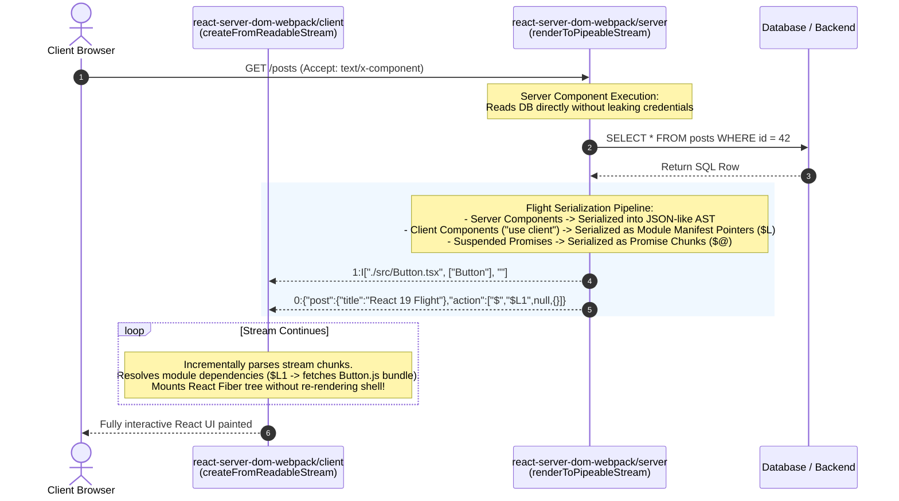

# 05 — The React Flight Protocol & React Server DOM

## Metadata
- **React Version**: 19.0.0+
- **Prerequisites**: [07-server-components-and-ssr.md](../15-concurrent-and-modern-react/07-server-components-and-ssr.md), React Fiber Internals, HTTP Streaming
- **Difficulty**: Expert
- **Estimated Read Time**: 30 minutes
- **Tags**: `flight-protocol`, `rsc-wire-format`, `react-server-dom`, `server-components`, `streaming`, `internals`

---

## Architecture Diagram

The diagram below details the end-to-end architecture of the **React Flight Protocol**: how the server executes Server Components, serializes the virtual tree into the Flight stream format (`react-server-dom`), streams text chunks over HTTP, and how the client parses chunks and resolves Client References (`$L`) into an interactive DOM tree.



---

## Concept Overview

Traditional Server-Side Rendering (SSR) produces raw **HTML strings**. While HTML is great for initial page loads and SEO, it has severe limitations for dynamic Single Page Applications:
1. **Hydration Cost**: The browser must download the full JavaScript bundle for every component rendered in the HTML, re-executing them on the client to attach event listeners.
2. **State Loss on Navigation**: Navigating to a new route via traditional SSR replaces the entire HTML document, destroying client-side state (such as an audio player, scroll position, or uncommitted form drafts).

The **React Flight Protocol** (implemented in packages named `react-server-dom-*`) is the foundational wire protocol powering React Server Components (RSC):
- **Not HTML**: Flight does not transmit HTML; it transmits a **compact, streaming representation of the Virtual DOM tree**.
- **Zero Client JS for Server Components**: Code inside Server Components (heavy markdown parsers, database clients, secrets) is **never bundled or sent to the browser**.
- **Seamless Streaming**: Chunks arrive as newline-delimited stream lines, allowing the client to render completed components while slow async children are still resolving.
- **Client State Preservation**: When navigating between routes, Flight streams the updated subtrees, allowing the client reconciler to diff and merge changes without blowing away existing client state!

---

## Practical Implementation

### Example 1: Understanding the Flight Wire Format Anatomy

When a server executes a Server Component tree, it emits lines of text formatted according to the Flight specification:

```text
1:I["/build/static/js/LikeButton.js",["LikeButton"],""]
0:{"name":"PostDetail","children":[["$","h1",null,{"children":"Deep Dive into Flight"}],["$","$L1",null,{"initialLikes":42}]]}
```

### Breakdown of the Flight Wire Syntax:

| Token / Prefix | Meaning | Description |
| :--- | :--- | :--- |
| `0:`, `1:`, `2:` | **Chunk ID** | Identifies the chunk identifier across the stream. |
| `I` | **Client Reference** | Manifest reference pointing to a client component bundle URL and export name. |
| `$` | **React Element** | Represents a `React.createElement` tuple: `["$", type, key, props]`. |
| `$L1` | **Lazy Client Ref** | Pointers to Client Reference chunk `1`. Tells the client: *"Load module 1 and render it here"*. |
| `$@2` | **Promise Chunk** | Represents an unresolved asynchronous Promise that will resolve later in the stream. |
| `$Sreact.suspense` | **Suspense Symbol** | Identifies a React Suspense boundary element. |

---

### Example 2: Minimal Server Component Rendering Flight Stream with Node.js

Creating a standalone Node.js server that streams Flight payloads using `react-server-dom-webpack/server`.

```tsx
// server/flightHandler.ts
import http from 'http';
// @ts-ignore - low-level react internal package
import { renderToPipeableStream } from 'react-server-dom-webpack/server';
import React from 'react';

// A Server Component that reads directly from memory/DB
async function ServerProductCatalog() {
  // Direct async operation on server
  const products = [
    { id: '101', name: 'High-Performance Keyboard', price: 140 },
    { id: '102', name: 'Ultra-wide Monitor', price: 450 },
  ];

  return (
    <div className="product-list">
      <h1>Enterprise Hardware Store</h1>
      <ul>
        {products.map((p) => (
          <li key={p.id}>
            <strong>{p.name}</strong> — ${p.price}
          </li>
        ))}
      </ul>
    </div>
  );
}

const server = http.createServer((req, res) => {
  if (req.url === '/rsc') {
    res.setHeader('Content-Type', 'text/x-component');

    // Bundler client manifest mapping Client Component imports
    const clientManifest = {};

    // Stream React Server Component tree directly as Flight Protocol chunks!
    const { pipe } = renderToPipeableStream(
      React.createElement(ServerProductCatalog),
      clientManifest
    );

    pipe(res);
  } else {
    res.statusCode = 404;
    res.end();
  }
});

server.listen(3001, () => {
  console.log('Flight RSC server listening on http://localhost:3001/rsc');
});
```

*Expected Verification Output:*
```text
GET http://localhost:3001/rsc
Response Headers: Content-Type: text/x-component, Transfer-Encoding: chunked
Payload Stream:
0:["$","div",null,{"className":"product-list","children":[["$","h1",null,{"children":"Enterprise Hardware Store"}],["$","ul",null,{"children":[...]}] ]}]
```

---

### Example 3: Client-Side Flight Stream Consumption with `createFromReadableStream`

On the browser, React consumes the Flight stream and converts it directly into a live, interactive Fiber tree.

```tsx
// src/client/flightConsumer.ts
import { createFromReadableStream } from 'react-server-dom-webpack/client';
import React, { use } from 'react';

// Fetches Flight stream and passes readable stream to parser
export function fetchRSCPayload(url: string): Promise<React.ReactNode> {
  const responsePromise = fetch(url).then((res) => {
    if (!res.body) throw new Error('Response body missing');
    // Deserializes Flight chunks directly from the network stream!
    return createFromReadableStream(res.body);
  });

  return responsePromise;
}

// React 19 Component consuming the stream promise via use()
export function RemoteServerView({ rscPromise }: { rscPromise: Promise<React.ReactNode> }) {
  // use() unwraps the Flight tree and triggers Suspense while streaming
  const content = use(rscPromise);

  return <div className="rsc-container border p-4 rounded">{content}</div>;
}
```

*Expected Verification Output:*
```text
Browser receives streaming text/x-component chunks.
createFromReadableStream yields React elements progressively.
use(rscPromise) unwraps components into DOM without reloading or unmounting shell.
```

---

### Example 4: Streaming Out-of-Order Promises over Flight

Flight supports streaming asynchronous promises. Notice how the server sends a placeholder chunk `$@` and streams the resolved data lines later when the promise settles!

```text
// 1. Initial shell sent immediately (Header and Suspense boundary)
0:["$","div",null,{"children":[["$","h2",null,{"children":"Dashboard"}],["$","$Sreact.suspense",null,{"fallback":"Loading stats...","children":"$@1"}]]}]

// 2. Slow database query finishes 800ms later -> Server streams chunk 1!
1:{"activeUsers":1420,"revenue":"$84,000"}
```

```tsx
// Server Component representation
import React, { Suspense } from 'react';

async function SlowStats() {
  // Simulates slow analytics query
  await new Promise((r) => setTimeout(r, 800));
  return <div>Active Users: 1,420 | Revenue: $84,000</div>;
}

export function Dashboard() {
  return (
    <div>
      <h2>Dashboard</h2>
      <Suspense fallback={<p>Loading stats...</p>}>
        <SlowStats />
      </Suspense>
    </div>
  );
}
```

*Expected Verification Output:*
```text
Browser renders Dashboard title + "Loading stats..." immediately.
When chunk 1 arrives over HTTP, Suspense fallback is replaced with SlowStats content automatically.
```

---

### Example 5: Client References (`$L`) vs Server References (`$F`)

Distinguishing how Flight coordinates transitions between the client and server.

```tsx
// src/components/FlightInteractionDemo.tsx
// 1. Server Component (Never bundled to client)
import { LikeButton } from './LikeButton'; // Client Component ('use client')
import { updatePostTitle } from '../actions/postActions'; // Server Action ('use server')

export async function PostView({ postId }: { postId: string }) {
  const post = { id: postId, title: 'Understanding React Flight' };

  return (
    <article className="p-6 border rounded">
      {/* HTML primitive */}
      <h1 className="text-2xl font-bold">{post.title}</h1>

      {/* Client Reference: Serialized as $L pointer */}
      <LikeButton postId={post.id} />

      {/* Server Action Reference: Serialized as $F pointer */}
      <form action={updatePostTitle}>
        <input type="hidden" name="postId" value={post.id} />
        <input name="title" placeholder="New Title" className="border p-1" />
        <button type="submit">Update</button>
      </form>
    </article>
  );
}
```

*Expected Verification Output:*
```text
Flight wire payload:
  - LikeButton becomes $L1 with client bundle path.
  - updatePostTitle action becomes $F2 with action ID reference.
  - Zero server-side database code or action logic is leaked to the client bundle.
```

---

## Mental Model & Analogies

### The Blueprint Wire Transmission

- **Traditional SSR (HTML)** is like shipping a **fully assembled plastic model**:
  - It arrives assembled, but all the joints are glued stiff (no interactivity).
  - You must spray liquid glue over the entire model (`hydration`) to make the joints moveable.
- **The Flight Protocol** is like sending **digital 3D printer blueprints**:
  - The server transmits clean coordinate blueprints line-by-line (`["$", "div", ...]`).
  - When the blueprint specifies an interactive motor, it provides a part reference number (`$L1`).
  - The client's 3D printer reads the stream, prints the structure immediately, snaps in the motor from local storage, and the model is fully interactive from the moment it is printed.

---

## Under the Hood / Internal Mechanics

### 1. How Flight Handles Circular References and Deduplication

In standard `JSON.stringify()`, circular object graphs throw `TypeError: Converting circular structure to JSON`, and repeated objects are serialized multiple times, bloating payload sizes.
Flight solves this using an internal **Reference Map**:
- Every object, element, or promise serialized by Flight is assigned an ID.
- If an object is referenced multiple times in the component tree, Flight serializes it once and emits reference pointers (`$0`, `$1`) for subsequent appearances, achieving maximum compression over the wire.

### 2. Client Reference Bundling Manifest

When the server encounters a component marked with `'use client'`, it does not serialize its JSX. Instead, the bundler (Webpack, Vite, Rspack) generates a **Client Manifest**:
```json
{
  "src/components/LikeButton.tsx": {
    "id": "./src/components/LikeButton.tsx",
    "name": "LikeButton",
    "chunks": ["static/js/LikeButton.chunk.js"]
  }
}
```
Flight emits:
```text
1:I["static/js/LikeButton.chunk.js", ["LikeButton"], ""]
```
When the client receives this line, it instructs the browser's module loader (e.g. `import()`) to fetch `LikeButton.chunk.js` asynchronously in parallel with the rest of the stream.

---

## Common Pitfalls & Anti-Patterns

| Anti-Pattern | Why It Breaks | Recommended Solution |
| :--- | :--- | :--- |
| **Passing Non-Serializable Props to Client Components**| Flight cannot serialize JavaScript functions, symbols, or class instances across the wire. | Pass plain JSON-serializable primitives, objects, or Server Actions (`'use server'`). |
| **Assuming Flight is Human-Readable JSON** | Trying to parse Flight streams with `JSON.parse()` crashes due to line-delimited chunk IDs and prefixes. | Always use `react-server-dom` client parsers (`createFromReadableStream`). |
| **Leaking Server Secrets into Props** | Any prop passed from a Server Component to a Client Component is serialized in plain text into the Flight stream! | Never pass secret API keys, database hashes, or internal tokens as props to Client Components. |
| **Buffering Flight Streams in Reverse Proxies** | Nginx or Cloudflare buffering converts progressive streaming into delayed batch bursts. | Set response header `X-Accel-Buffering: no` and `Content-Type: text/x-component`. |
| **Executing Side-Effects in Server Component Render**| Server Components can re-render during Flight streaming; mutations cause unexpected behavior. | Keep Server Components pure; execute mutations inside Server Actions or route handlers. |
| **Importing Client-Only APIs in Server Components** | Calling `window`, `localStorage`, or `document` in Server Components causes immediate Node.js crashes. | Move browser-specific logic into Client Components marked with `'use client'`. |

---

## Performance & Optimization

### Parallelizing Module Preloads with Flight

Modern RSC frameworks (Next.js, Waku) scan the Flight stream on the server and emit `<link rel="modulepreload">` tags in the HTML `<head>` for all referenced Client Components (`$L`). This ensures that client JavaScript bundles download concurrently with the Flight stream, eliminating script-loading waterfalls.

---

## Edge Cases & Debugging

### Inspecting Flight Payloads in Browser DevTools
- Open Chrome DevTools -> **Network** tab.
- Filter by `Fetch/XHR`.
- Click on an RSC navigation request (e.g. `?_rsc=123`).
- Select the **Response** tab: you can view the raw Flight stream lines (`0:`, `1:I`, `2:`) and inspect exactly what data and client references are crossing the network boundary.

---

## Ecosystem & Alternative Approaches

- **Next.js App Router**: The primary commercial implementation of the Flight Protocol.
- **Waku**: A minimalist, lightweight React Server Components framework created by Daishi Kato.
- **React Router v7 / Remix**: Uses standard JSON loaders and server actions; evaluating Flight adoption.

---

## Exercises & Challenges

<details>
<summary><strong>Exercise 1: Identify Non-Serializable Prop Violations</strong></summary>

**Challenge**: Which of the following props can be safely passed from a Server Component to a Client Component over the Flight Protocol?

```tsx
// Server Component
<ClientWidget
  count={42}                                // 1. Valid (number)
  title="Analytics"                         // 2. Valid (string)
  onClick={() => console.log('clicked')}    // 3. INVALID (closures cannot cross wire)
  createdAt={new Date()}                    // 4. Valid (built-in Date serialization)
  eventEmitter={new EventEmitter()}         // 5. INVALID (custom class instance)
/>
```
</details>

<details>
<summary><strong>Exercise 2: Mock Flight Stream Parser</strong></summary>

**Challenge**: Write a simple parser that splits a chunked Flight payload on newline boundaries and separates chunk IDs from JSON payloads.

```ts
export function parseFlightLines(streamChunk: string) {
  return streamChunk
    .split('\n')
    .filter(Boolean)
    .map((line) => {
      const colonIdx = line.indexOf(':');
      const id = line.slice(0, colonIdx);
      const payload = line.slice(colonIdx + 1);
      return { id, payload };
    });
}
```
</details>

---

## Frequently Asked Interview Questions

<details>
<summary><strong>1. What is the React Flight Protocol and what is its purpose?</strong></summary>

The React Flight Protocol (implemented in `react-server-dom`) is the internal streaming wire protocol for React Server Components (RSC). It serializes a Virtual DOM tree of elements, props, client component references (`$L`), and asynchronous promises into a compact, newline-delimited stream. It allows the server to send rendered UI to the client without sending the JavaScript source code of Server Components.
</details>

<details>
<summary><strong>2. How does the Flight Protocol differ from standard HTML SSR?</strong></summary>

Standard SSR generates static HTML strings. Hydrating HTML requires downloading the JavaScript for every rendered component, and navigating between pages replaces the HTML document, losing client-side state. 
Flight transmits a structured representation of the Virtual DOM. When navigating, the client reconciler diffs the incoming Flight stream against the existing Fiber tree, updating only changed DOM nodes while preserving client state (e.g., input focus, scroll position, audio playback).
</details>

<details>
<summary><strong>3. What is a "Client Reference" (`$L`) in the Flight wire format?</strong></summary>

When a Server Component imports a Client Component (marked with `'use client'`), the server does not execute or bundle its code. Instead, it serializes a Client Reference token (e.g. `1:I["bundle.js", ["MyButton"]]` and `["$","$L1",null,{}]`). This instructs the client-side Flight runtime to load the specified JavaScript bundle and mount the client component at that exact position in the tree.
</details>

<details>
<summary><strong>4. Why can't standard JavaScript functions be passed as props from Server to Client Components?</strong></summary>

JavaScript functions close over local lexical scope in Node.js server memory. A closure cannot be serialized into JSON or transmitted over an HTTP network socket. The only functions that can cross the wire are **Server Actions** (`'use server'`), which are serialized as cryptographic endpoint identifiers (`$F`) that trigger RPC calls back to the server when invoked.
</details>

<details>
<summary><strong>5. How does Flight handle streaming asynchronous data and Suspense?</strong></summary>

When a Server Component suspends on a Promise, Flight serializes the Suspense boundary element with a promise reference token (`$@`). The initial shell HTML/Flight stream is sent to the client immediately. When the server promise resolves, Flight streams a new chunk containing the resolved data indexed by that promise ID, instructing the client to unwrap the Suspense boundary and display the content.
</details>

<details>
<summary><strong>6. What security risk is unique to props passed across the Flight boundary?</strong></summary>

Any prop passed from a Server Component to a Client Component is serialized in plain text into the public Flight stream. If an engineer accidentally passes an entire user object containing password hashes or secret tokens (`<UserProfile user={userWithSecrets} />`), those secrets are visible in plain text in the browser's Network tab.
</details>

<details>
<summary><strong>7. How does Flight prevent circular references during serialization?</strong></summary>

Flight maintains an internal map of object identities during serialization. When an object or element is encountered more than once, Flight outputs a reference pointer (`$0`, `$1`) instead of re-serializing the object, safely handling circular or repeated references while keeping the network payload minimal.
</details>

<details>
<summary><strong>8. What packages implement the Flight protocol in the React ecosystem?</strong></summary>

The protocol is implemented in the official `react-server-dom-*` family of packages, specialized by bundler: `react-server-dom-webpack`, `react-server-dom-turbopack`, `react-server-dom-esm`, and `react-server-dom-vite`.
</details>

---

## References & Further Reading

- [React GitHub: react-server-dom Specification & Source](https://github.com/facebook/react/tree/main/packages/react-server-dom-webpack)
- [RFC: React Server Components](https://github.com/reactjs/rfcs/blob/main/text/0188-server-components.md)
- [Plasmic: How React Server Components Work - An In-Depth Guide](https://www.plasmic.app/blog/how-react-server-components-work)
- [Dan Abramov: React Server Components from Scratch](https://github.com/reactwg/server-components/discussions)
- [Waku: Minimalist RSC Framework](https://waku.gg/)
