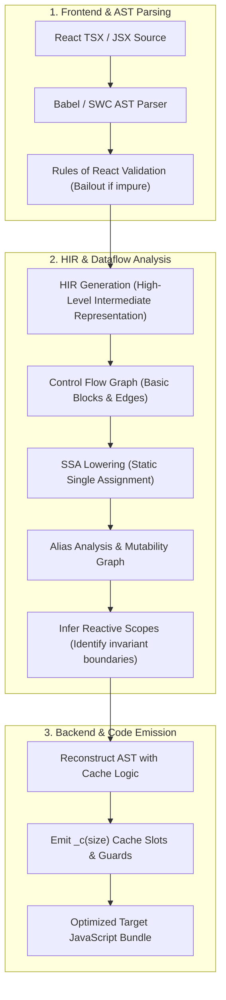

# 05 — React Compiler Transforms & HIR Internals

## Metadata
- **React Version**: 19.0.0+ (Compiler v1.0.0-rc+)
- **Prerequisites**: [00-fiber-architecture.md](./00-fiber-architecture.md), [01-reconciliation.md](./01-reconciliation.md), Compiler Theory & Intermediate Representations
- **Difficulty**: Expert
- **Estimated Read Time**: 31 minutes
- **Tags**: `compiler-internals`, `hir`, `ssa`, `reactive-scopes`, `alias-analysis`, `babel-transforms`, `internals`

---

## Architecture Diagram

The flowchart below illustrates the internal compilation pipeline of the **React Compiler** (formerly *React Forget*), tracing how raw JavaScript/TypeScript source code is ingested, validated, transformed into High-level Intermediate Representation (HIR), analyzed via Static Single Assignment (SSA) and Alias Graphs, partitioned into Reactive Scopes, and finally emitted as optimized JavaScript utilizing runtime cache slots (`_c()`).



---

## Concept Overview

Traditional JavaScript compilers (such as Babel or TypeScript) perform **syntactic transforms**: they convert newer syntax (e.g., optional chaining `?.`, JSX, or class properties) into older syntax that target browsers understand. They treat JavaScript code as a nested tree of syntactic nodes (AST) without understanding dataflow, object mutations, or runtime semantics.

The **React Compiler** is a true **semantic optimizing compiler**. It understands both JavaScript language semantics (mutability, scopes, control flow) and the **Rules of React** (hooks, pure render functions, immutable props).

### The Four Stages of the React Compiler:

1. **Lowering to HIR (High-level Intermediate Representation)**: The compiler converts the deeply nested AST into a flat list of basic blocks with explicit control flow edges, stripping out language complexities like nested ternary expressions or switch statements.
2. **Static Single Assignment (SSA)**: Every variable assignment is broken down such that variables are declared and assigned exactly once (`x_0 = ...; x_1 = ...`). This allows algorithms to trace exactly where every value originated.
3. **Alias Analysis & Type Inference**: The compiler constructs an Alias Graph to determine if an object allocated in step A is mutated in step B, or if it escapes the component's scope (e.g. passed to JSX or returned from a hook).
4. **Reactive Scope Construction & Codegen**: Statements whose inputs are reactive (props, state) are grouped into **Reactive Scopes**. The compiler emits guarding `if` conditions that compare dependencies and reuse cached values stored in an indexed Fiber vector (`_c()`).

---

## Practical Implementation

### Example 1: Tracing Source Code to Emitted Target JavaScript

Let's examine how a natural component with an inline object and mapped array is transformed.

**Input Source Code:**
```tsx
// src/components/ProductCard.tsx
import React from 'react';

export function ProductCard({ title, price, tags }: { title: string; price: number; tags: string[] }) {
  const formattedPrice = `$${price.toFixed(2)}`;
  const style = { color: price > 100 ? 'red' : 'green' };

  return (
    <div style={style}>
      <h3>{title}</h3>
      <span>{formattedPrice}</span>
      <ul>
        {tags.map((t) => (
          <li key={t}>{t}</li>
        ))}
      </ul>
    </div>
  );
}
```

**Emitted JavaScript Code (Decompiled from Compiler Output):**
```js
function ProductCard(t0) {
  const $ = _c(11); // Fiber cache vector with 11 slots
  const { title, price, tags } = t0;

  // Reactive Scope 1: formattedPrice (Depends on: price)
  let t1;
  if ($[0] !== price) {
    t1 = `$${price.toFixed(2)}`;
    $[0] = price;
    $[1] = t1;
  } else {
    t1 = $[1];
  }
  const formattedPrice = t1;

  // Reactive Scope 2: style object (Depends on: price)
  let t2;
  if ($[2] !== price) {
    t2 = { color: price > 100 ? 'red' : 'green' };
    $[2] = price;
    $[3] = t2;
  } else {
    t2 = $[3];
  }
  const style = t2;

  // Reactive Scope 3: Mapped list items (Depends on: tags)
  let t3;
  if ($[4] !== tags) {
    t3 = tags.map((t) => <li key={t}>{t}</li>);
    $[4] = tags;
    $[5] = t3;
  } else {
    t3 = $[5];
  }

  // Reactive Scope 4: Final JSX element tree (Depends on: style, title, formattedPrice, t3)
  let t4;
  if ($[6] !== style || $[7] !== title || $[8] !== formattedPrice || $[9] !== t3) {
    t4 = (
      <div style={style}>
        <h3>{title}</h3>
        <span>{formattedPrice}</span>
        <ul>{t3}</ul>
      </div>
    );
    $[6] = style;
    $[7] = title;
    $[8] = formattedPrice;
    $[9] = t3;
    $[10] = t4;
  } else {
    t4 = $[10];
  }

  return t4;
}
```

*Expected Verification Output:*
```text
If parent re-renders with identical props:
  - All 4 if guards evaluate to false.
  - $[10] is returned immediately by reference.
  - VDOM diffing for <div>, <h3>, <span>, <ul>, and <li> is 100% skipped.
```

---

### Example 2: Static Single Assignment (SSA) Transformation

To understand how the compiler analyzes mutable variables, consider re-assigned variables:

```ts
// Developer writes mutable JavaScript:
let x = 10;
if (condition) {
  x = x + 5;
}
console.log(x);
```

**Compiler Lowers to SSA Representation:**
```text
bb0 (Entry Block):
  x_0 = 10
  if condition goto bb1 else goto bb2

bb1 (Then Block):
  x_1 = x_0 + 5
  goto bb2

bb2 (Merge Block):
  x_2 = Phi(x_0, x_1)  // Phi node merges values based on execution path
  call console.log(x_2)
```

*Explanation*: In SSA form, every version of a variable has a unique subscript. The compiler knows that `x_2` depends on the branch condition and `x_0`, allowing it to cleanly calculate whether `x_2` is invariant without running into mutation bugs.

---

### Example 3: Alias Analysis and Mutability Graph

The compiler traces whether objects can be safely cached or if they are mutated later in the function.

```tsx
// Source code
function BadMutationExample({ item }: { item: { count: number } }) {
  const copy = item; // Alias created: 'copy' points to 'item'
  copy.count++;      // MUTATION of prop!
  return <div>{copy.count}</div>;
}
```

**Compiler Alias Graph Analysis:**
1. `item` is identified as an **Immutable Function Argument** (Rule of React: props are frozen).
2. `copy` is linked in the Alias Graph to the same memory reference as `item`.
3. Statement `copy.count++` attempts to mutate a frozen reference.
4. **Action**: The compiler triggers a **Bailout** (or throws a compilation error if `eslint-plugin-react-compiler` is enabled), refusing to generate cache slots for unsafe code.

---

### Example 4: The Runtime Cache Hook: `_c(size)`

Where does the `$` cache array actually live? In React 19, `_c` is an optimized hook exported by the React runtime (`react/compiler-runtime`).

```tsx
// Conceptual implementation of the runtime cache primitive
import { __SECRET_INTERNALS_DO_NOT_USE_OR_YOU_WILL_BE_FIRED } from 'react';

// Conceptually, _c(size) operates like an indexed memoization slot on Fiber:
export function _c(size: number): any[] {
  // Accesses current Fiber's memoizedState linked list
  const fiber = getCurrentFiber();
  let memoCache = fiber.memoCache;

  if (!memoCache) {
    // Allocate flat fixed-size array on initial mount
    memoCache = new Array(size);
    fiber.memoCache = memoCache;
  }

  return memoCache;
}
```

*Performance Insight*: Unlike `useMemo` (which allocates a linked list node `{ memoizedState: [val, deps], next: ... }` for every single memoized value), `_c(size)` allocates a **single, flat, continuous array** per component Fiber. This drastically reduces JavaScript heap memory fragmentation and garbage collection overhead.

---

### Example 5: Invariant Hoisting (Compile-Time Constant Evaluation)

When expressions do not depend on props, state, or hooks, the React Compiler hovers them entirely out of the component function, turning them into module-scoped constants!

**Source Code:**
```tsx
export function MetricView() {
  // Pure static config
  const columns = ['Timestamp', 'Metric', 'Value', 'Status'];
  const baseRate = 1.05 * 100;

  return <div>{columns.join(' | ')} - Base: {baseRate}</div>;
}
```

**Compiled Output:**
```js
// HOISTED OUTSIDE FUNCTION ENTIRELY!
const CONST_COLUMNS = ['Timestamp', 'Metric', 'Value', 'Status'];
const CONST_BASE_RATE = 105;
const CONST_JSX = <div>Timestamp | Metric | Value | Status - Base: 105</div>;

export function MetricView() {
  // Zero computations, zero allocations, zero cache lookups during render!
  return CONST_JSX;
}
```

*Expected Verification Output:*
```text
MetricView execution time drops to <0.01ms.
Returns exact module-level constant JSX reference on every render.
```

---

## Mental Model & Analogies

### The Assembly Line Inspection

- **Standard Bundler (Babel/Vite)** is a **translator**:
  - Translates English sentences into Spanish sentences word-for-word (`() => {}` becomes `function() {}`). It does not care if the sentence describes something impossible.
- **The React Compiler** is an **industrial manufacturing engineer**:
  - It studies the entire assembly line blueprint (HIR).
  - It notices that Part #3 (`style` object) and Part #7 (`formattedPrice`) only need to be stamped when the raw steel (`price`) changes.
  - It installs automated robotic arms with sensors (`if ($[0] !== price)`) at each station.
  - If identical steel arrives, the robotic arm pulls the finished part from the storage shelf instead of re-stamping it from scratch.

---

## Under the Hood / Internal Mechanics

### 1. The Reactive Scope Graph

The central optimization artifact inside the compiler is the **Reactive Scope**:
- A Reactive Scope has **Inputs** (values read inside the scope created outside of it) and **Outputs** (values created inside the scope and read after it).
- **Rule of Scope Merging**: If Scope A produces an object that is mutated inside Scope B, Scope A and Scope B are **merged into a single, unified Reactive Scope**.
- **Scope Alignment**: Scopes must strictly nest; they cannot interleave. The compiler reorders independent statements to achieve optimal, non-interleaved scope nesting.

### 2. Bailout Classification

When the compiler cannot optimize a function, it categorizes the bailout into one of three classifications:
1. **Critical Syntax**: Code containing `eval`, `with`, or non-standard `arguments`.
2. **Rule of React Violation**: Mutating props, calling hooks conditionally, or writing to module globals during render.
3. **Complex Control Flow**: Unresolvable loops or deeply complex exception handling structures that cannot be reduced to clean SSA forms.

---

## Common Pitfalls & Anti-Patterns

| Anti-Pattern | Why It Breaks | Recommended Solution |
| :--- | :--- | :--- |
| **Mutating Prop Values (`props.items.push(x)`)** | Breaks compiler alias tracking; triggers an immediate compilation bailout. | Treat props as read-only; clone arrays before appending (`[...props.items, x]`). |
| **Writing to Global Variables During Render**| Compiler assumes component functions are idempotent pure mathematical transformations. | Move side-effects into `useEffect` or event handlers. |
| **Passing Dynamically Mutated Objects to Hooks**| Causes Reactive Scopes to merge indefinitely, expanding cache boundaries and defeating memoization. | Keep objects immutable and scoped to their specific consumers. |
| **Using `Date.now()` or `Math.random()` in Render** | Nondeterministic values produce different outputs on every render, invalidating cache slots. | Store dynamic timestamps in state or retrieve them in effects. |
| **Relying on Function Identity for Reset Logic** | Because the compiler memoizes inline callbacks across renders, patterns that rely on new callback identities to trigger effects fail. | Explicitly trigger reset logic via state or keys rather than function references. |
| **Disabling ESLint Rules for Dependencies** | Suppressing `react-hooks/exhaustive-deps` hides underlying state bugs from the compiler. | Fix the true dependencies rather than disabling the linter. |

---

## Performance & Optimization

### Maximizing Compiler Effectiveness

To help the compiler achieve maximum optimization:
1. **Keep components small and focused**: Smaller functions produce simpler Control Flow Graphs with tighter Reactive Scopes.
2. **Colocate state**: Avoid passing giant monolithic objects through multiple intermediate components.
3. **Use TypeScript strict mode**: Type annotations assist the compiler's type-inference pass in identifying immutable primitives vs mutable objects.

---

## Edge Cases & Debugging

### Inspecting Compiler Output in the Playground
The React team maintains the official **React Compiler Playground** (`https://playground.react.dev/`):
- Paste your component code into the left pane.
- Inspect the generated **HIR (High-Level Intermediate Representation)** in the center pane.
- View the finalized JavaScript with cache slots (`_c()`) and reactive scopes in the right pane.

---

## Ecosystem & Alternative Approaches

- **Babel Plugin React Compiler (`babel-plugin-react-compiler`)**: The official Babel transform.
- **SWC / Rust React Compiler (In Development)**: Porting the compiler pipeline to Rust for ultra-fast Next.js and Turbopack builds.
- **Manual Memoization (`useMemo`, `React.memo`)**: Fallback for environments unable to run the compiler build step.

---

## Exercises & Challenges

<details>
<summary><strong>Exercise 1: Predict the Reactive Scopes</strong></summary>

**Challenge**: In the snippet below, identify how many distinct Reactive Scopes the compiler will construct and what their inputs are.

```tsx
function Dashboard({ user, theme }: { user: { name: string; age: number }; theme: string }) {
  const greeting = `Hello, ${user.name}`;
  const isAdult = user.age >= 18;
  const themeClass = `theme-${theme}`;

  return <div className={themeClass}>{greeting} - {isAdult ? 'Adult' : 'Minor'}</div>;
}
```

**Answer**:
- **Scope 1**: `greeting` (Inputs: `user.name`)
- **Scope 2**: `isAdult` (Inputs: `user.age`)
- **Scope 3**: `themeClass` (Inputs: `theme`)
- **Scope 4**: Final JSX Element (Inputs: `themeClass`, `greeting`, `isAdult`)
</details>

<details>
<summary><strong>Exercise 2: Refactoring a Bailout Pattern</strong></summary>

**Challenge**: Fix this component so the compiler does not bail out:

```tsx
// Before (Triggers Bailout due to external mutation):
let renderCount = 0;
export function Counter() {
  renderCount++; // Violation!
  return <div>Renders: {renderCount}</div>;
}

// After (Pure React conforming to Rules of React):
export function CounterFixed() {
  const [renders, setRenders] = useState(0);
  useEffect(() => {
    setRenders((r) => r + 1);
  }, []);
  return <div>Mounted cleanly</div>;
}
```
</details>

---

## Frequently Asked Interview Questions

<details>
<summary><strong>1. What is High-level Intermediate Representation (HIR) in the React Compiler?</strong></summary>

HIR is an intermediate data structure between the raw Abstract Syntax Tree (AST) and target JavaScript. It represents component code as a Control Flow Graph (CFG) of basic blocks in Static Single Assignment (SSA) form. HIR simplifies complex language constructs (such as nested loops, ternaries, and variable reassignment), enabling compiler algorithms to analyze mutability, dataflow, and reactive dependencies accurately.
</details>

<details>
<summary><strong>2. How does Static Single Assignment (SSA) form aid the React Compiler?</strong></summary>

In SSA form, every variable is declared and assigned exactly once. If a variable is reassigned in original code, the compiler creates versioned identifiers (`x_0`, `x_1`) and uses $\Phi$ (Phi) nodes at control flow merge points. This guarantees that every value's origin and dependencies can be traced backward without ambiguity caused by intermediate mutations.
</details>

<details>
<summary><strong>3. How does `_c(size)` differ architecturally from `useMemo`?</strong></summary>

`useMemo` creates an individual linked-list node on the Fiber's hook list for every call, requiring separate dependency array comparisons and object allocations. 
`_c(size)` allocates a single, flat array of fixed size per component Fiber. Indices inside the array are accessed directly by numerical offset (`$[0]`, `$[1]`), minimizing memory overhead and eliminating hook allocation churn.
</details>

<details>
<summary><strong>4. What is a "Reactive Scope" and how is it bounded?</strong></summary>

A Reactive Scope is a group of instructions that compute one or more values depending on reactive inputs (props, state). The scope is bounded by an `if` guard that compares current inputs against previously cached inputs. If all inputs match by reference (`Object.is`), the entire scope block is skipped, and cached output values are returned directly.
</details>

<details>
<summary><strong>5. What is the Alias Graph and why is it essential for compiler correctness?</strong></summary>

The Alias Graph tracks whether two or more variable names point to the same underlying object in memory. If variable `b` is assigned from `a`, and `b.prop = 123` is mutated later, the Alias Graph informs the compiler that `a` was also mutated. This prevents the compiler from erroneously caching `a` as invariant when its underlying data was modified.
</details>

<details>
<summary><strong>6. What causes the React Compiler to "Bailout" during build?</strong></summary>

The compiler bails out when it encounters code that violates JavaScript purity or the Rules of React: mutating props or state in place, modifying global variables during render, calling hooks conditionally, or using language constructs like `eval()`. When a bailout occurs, the compiler skips optimizing that specific function and leaves it as standard uncompiled JavaScript.
</details>

<details>
<summary><strong>7. How does the compiler handle callbacks passed as props to children?</strong></summary>

The compiler groups the callback's declaration into a Reactive Scope based on the variables it closes over. If the closed-over variables remain unchanged across renders, the callback maintains identical reference identity, preventing downstream child components from re-rendering due to function recreation.
</details>

<details>
<summary><strong>8. Does the React Compiler eliminate the Virtual DOM?</strong></summary>

No. The React Compiler does not eliminate the Virtual DOM (unlike Solid.js or Svelte). It optimizes the Virtual DOM by automatically caching VDOM element subtrees. If a component's props do not change, the compiler returns the exact previously created VDOM element object by reference, allowing React's reconciler to bail out of diffing child subtrees in $O(1)$ time.
</details>

---

## References & Further Reading

- [Official React Compiler Documentation](https://react.dev/learn/react-compiler)
- [React Compiler Working Group Discussions](https://github.com/reactwg/react-compiler)
- [Static Single Assignment (SSA) Book](http://ssabook.gforge.inria.fr/latest/book.pdf)
- [React Compiler Interactive Playground](https://playground.react.dev/)
- [React Conf 2024: Forget About Memo - React Compiler Deep Dive](https://www.youtube.com/watch?v=qOQWTOqMB98)
