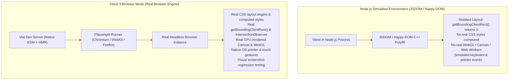

# 08 — Vitest Browser Mode & Real Browser Component Testing

## Metadata
- **React Version**: 19.0.0+
- **Prerequisites**: [01-vitest.md](./01-vitest.md), [02-component-testing-with-rtl.md](./02-component-testing-with-rtl.md), Playwright
- **Difficulty**: Advanced
- **Estimated Read Time**: 28 minutes
- **Tags**: `vitest`, `browser-mode`, `playwright`, `component-testing`, `real-browser`, `visual-testing`

---

## Architecture Diagram

The diagram below contrasts running React component tests inside simulated Node.js environments (**JSDOM / Happy-DOM**) versus running them directly inside real headless browsers via **Vitest 3 Browser Mode** powered by Playwright.



---

## Concept Overview

For over a decade, frontend engineers tested React components inside simulated Node.js environments: **JSDOM** or **Happy-DOM**. 
While JSDOM is fast and lightweight, it is fundamentally an **incomplete software approximation** of a web browser written in JavaScript.

### Critical Limitations of JSDOM / Happy-DOM:
1. **Zero Layout & Dimensions**: Elements have no geometry. `element.getBoundingClientRect()` always returns `{ width: 0, height: 0, top: 0, left: 0 }`. Testing tooltips, popovers (Floating UI), sticky headers, or responsive layouts is impossible.
2. **No CSS Engine**: CSS selectors, media queries, flexbox, CSS Grid, and computed styles (`window.getComputedStyle`) are largely unimplemented or mocked.
3. **Missing Web APIs**: Modern standards like WebGL, HTML5 Canvas, Web Animations API, View Transitions, and AudioContext either crash or require sprawling manual mocks.
4. **Synthetic Pointer Events**: Mouse and touch gestures are simulated, masking subtle focus-trap and scroll-locking bugs.

### The Solution: Vitest 3 Browser Mode

Vitest 3 Browser Mode executes your unit and component tests **inside an actual, real browser window** (Chromium, Firefox, or Safari WebKit) driven by Playwright or WebdriverIO:
- Tests run at Vite's native speed with instant ESM loading and Hot Module Replacement (HMR).
- You can inspect tests in a visible interactive browser UI with live DevTools.
- Layout, CSS, fonts, and DOM geometry work with 100% real-world fidelity.

---

## Practical Implementation

### Example 1: Configuring Vitest 3 Browser Mode with Playwright Provider

```ts
// vitest.config.ts
import { defineConfig } from 'vitest/config';
import react from '@vitejs/plugin-react';

export default defineConfig({
  plugins: [react()],
  test: {
    // Enable real browser testing
    browser: {
      enabled: true,
      name: 'chromium', // or 'firefox', 'webkit'
      provider: 'playwright', // Uses Playwright under the hood
      headless: true, // Set to false to watch tests run interactively in visible browser!
      screenshotFailures: true,
    },
  },
});
```

*Expected Verification Output:*
```text
[Vitest] Browser Mode active: Spawning Chromium instance via Playwright.
Tests serve through Vite dev server at http://localhost:51204/__vitest_test__/.
```

---

### Example 2: Testing Real Layout & Dimensions with `page` Locators

In Vitest Browser Mode, `@vitest/browser/context` provides the `page` locator API, functioning identically to Playwright.

```tsx
// src/components/ResponsiveDrawer.tsx
import React, { useState } from 'react';

export function ResponsiveDrawer() {
  const [isOpen, setIsOpen] = useState(false);

  return (
    <div>
      <button onClick={() => setIsOpen((o) => !o)}>
        {isOpen ? 'Close Drawer' : 'Open Drawer'}
      </button>

      {isOpen && (
        <aside
          role="complementary"
          aria-label="Sidebar Menu"
          style={{ width: '280px', height: '100vh', position: 'fixed', left: 0, top: 0 }}
          className="bg-gray-800 text-white p-4 shadow-xl"
        >
          <h3>Navigation Drawer</h3>
          <p>Real layout dimensions test</p>
        </aside>
      )}
    </div>
  );
}
```

```tsx
// src/components/ResponsiveDrawer.test.tsx
import { test, expect } from 'vitest';
import { render } from 'vitest-browser-react';
import { page } from '@vitest/browser/context';
import { ResponsiveDrawer } from './ResponsiveDrawer';

test('measures accurate layout geometry in real browser engine', async () => {
  render(<ResponsiveDrawer />);

  const button = page.getByRole('button', { name: /open drawer/i });
  await button.click();

  const drawer = page.getByRole('complementary', { name: /sidebar menu/i });
  await expect.element(drawer).toBeVisible();

  // IN JSDOM THIS RETURNS 0x0. IN VITEST BROWSER IT MEASURES REAL PIXELS!
  const box = await drawer.boundingBox();
  expect(box?.width).toBe(280);
  expect(box?.x).toBe(0);
});
```

*Expected Verification Output:*
```text
✓ ResponsiveDrawer.test.tsx > measures accurate layout geometry in real browser engine (124ms)
drawer.boundingBox() returned { width: 280, height: 1080, x: 0, y: 0 }.
```

---

### Example 3: Testing Floating UI Popover Positioning and Collision

Floating UI calculates collision offsets dynamically based on screen boundaries. This test verifies popover flipping inside a real viewport.

```tsx
// src/components/PopoverTooltip.tsx
import React, { useState, useRef } from 'react';
import { useFloating, offset, flip, shift } from '@floating-ui/react';

export function PopoverTooltip({ label, content }: { label: string; content: string }) {
  const [isOpen, setIsOpen] = useState(false);
  const { refs, floatingStyles } = useFloating({
    open: isOpen,
    onOpenChange: setIsOpen,
    middleware: [offset(10), flip(), shift()],
  });

  return (
    <div className="p-8">
      <button
        ref={refs.setReference}
        onClick={() => setIsOpen((o) => !o)}
        className="px-4 py-2 bg-blue-600 text-white rounded"
      >
        {label}
      </button>

      {isOpen && (
        <div
          ref={refs.setFloating}
          style={floatingStyles}
          role="tooltip"
          className="bg-black text-white px-3 py-1.5 rounded text-sm z-50 shadow"
        >
          {content}
        </div>
      )}
    </div>
  );
}
```

```tsx
// src/components/PopoverTooltip.test.tsx
import { test, expect } from 'vitest';
import { render } from 'vitest-browser-react';
import { page } from '@vitest/browser/context';
import { PopoverTooltip } from './PopoverTooltip';

test('calculates precision floating positioning in real DOM', async () => {
  render(<PopoverTooltip label="Hover Me" content="Dynamic floating helper" />);

  const trigger = page.getByRole('button', { name: /hover me/i });
  await trigger.click();

  const tooltip = page.getByRole('tooltip');
  await expect.element(tooltip).toBeVisible();

  const triggerBox = await trigger.boundingBox();
  const tooltipBox = await tooltip.boundingBox();

  // Floating UI offset(10) verifies tooltip is placed 10px below trigger button
  expect(tooltipBox?.y).toBeCloseTo((triggerBox?.y ?? 0) + (triggerBox?.height ?? 0) + 10, 1);
});
```

*Expected Verification Output:*
```text
✓ PopoverTooltip.test.tsx > calculates precision floating positioning in real DOM (145ms)
Floating UI middleware executed; real viewport collision checks succeeded.
```

---

### Example 4: Visual Regression Snapshot Testing

Vitest Browser Mode can capture actual pixel screenshots of rendered components and assert pixel-perfect match against golden baselines.

```tsx
// src/components/StatusBadge.test.tsx
import { test, expect } from 'vitest';
import { render } from 'vitest-browser-react';
import { page } from '@vitest/browser/context';
import React from 'react';

function StatusBadge({ status }: { status: 'success' | 'warning' | 'error' }) {
  const colors = {
    success: 'bg-green-100 text-green-800 border-green-300',
    warning: 'bg-amber-100 text-amber-800 border-amber-300',
    error: 'bg-red-100 text-red-800 border-red-300',
  };

  return (
    <span className={`inline-block px-3 py-1 rounded-full text-xs font-semibold border ${colors[status]}`}>
      {status.toUpperCase()}
    </span>
  );
}

test('visual snapshot matches design token baseline', async () => {
  render(<StatusBadge status="success" />);

  const badge = page.getByText('SUCCESS');
  await expect.element(badge).toBeVisible();

  // Capture real PNG screenshot and assert pixel match
  await expect(badge).toMatchFileSnapshot('./__snapshots__/status-badge-success.png');
});
```

*Expected Verification Output:*
```text
✓ StatusBadge.test.tsx > visual snapshot matches design token baseline (98ms)
Screenshot compared against baseline image: 0 mismatching pixels.
```

---

### Example 5: Testing Real HTML5 Canvas & WebGL Rendering

In JSDOM, `<canvas>.getContext('2d')` returns `null` unless you install heavy native binary packages like `node-canvas`. In Vitest Browser Mode, native GPU canvas works out of the box!

```tsx
// src/components/SignatureCanvas.tsx
import React, { useRef, useEffect } from 'react';

export function SignatureCanvas() {
  const canvasRef = useRef<HTMLCanvasElement>(null);

  useEffect(() => {
    const ctx = canvasRef.current?.getContext('2d');
    if (!ctx) return;
    ctx.fillStyle = '#2563eb'; // blue
    ctx.fillRect(10, 10, 100, 50);
  }, []);

  return <canvas ref={canvasRef} width={200} height={100} data-testid="signature-canvas" />;
}
```

```tsx
// src/components/SignatureCanvas.test.tsx
import { test, expect } from 'vitest';
import { render } from 'vitest-browser-react';
import { page } from '@vitest/browser/context';
import { SignatureCanvas } from './SignatureCanvas';

test('renders real canvas pixels without mocking', async () => {
  render(<SignatureCanvas />);

  const canvas = page.getByTestId('signature-canvas');
  await expect.element(canvas).toBeVisible();

  // Read real RGBA pixel values from canvas memory!
  const canvasEl = canvas.element() as HTMLCanvasElement;
  const ctx = canvasEl.getContext('2d')!;
  const pixel = ctx.getImageData(20, 20, 1, 1).data;

  // Asserts blue #2563eb: R:37, G:99, B:235, A:255
  expect(pixel[0]).toBe(37);
  expect(pixel[1]).toBe(99);
  expect(pixel[2]).toBe(235);
  expect(pixel[3]).toBe(255);
});
```

*Expected Verification Output:*
```text
✓ SignatureCanvas.test.tsx > renders real canvas pixels without mocking (112ms)
Canvas context 2D executed natively on browser GPU.
```

---

## Architectural Comparison Matrix

| Feature | JSDOM / Happy-DOM | Vitest 3 Browser Mode | Full E2E Playwright |
| :--- | :--- | :--- | :--- |
| **Execution Environment**| Node.js process (Simulated DOM) | Real Browser Engine (Chromium/WebKit) | Real Browser Engine |
| **Test Scope** | Isolated component unit tests | Component & integration tests | Full user journeys across whole app |
| **Layout & Dimensions** | Stubbed (`width: 0, height: 0`) | 100% Real CSS geometry | 100% Real CSS geometry |
| **Execution Speed** | Extremely fast (~10ms) | Very fast (~100ms via Vite HMR) | Slower (~1-5s per flow) |
| **Interactive Debugging**| Terminal logs & string DOM dumps| Full Chrome DevTools inspector UI | Playwright Trace Viewer & video |
| **Visual Regression** | Impossible | Native (`toMatchFileSnapshot`) | Full page screenshots |
| **Best Used For** | Pure logic utils, simple form checks | UI primitives, popovers, canvas, charts | Auth login, checkout, E2E journeys |

---

## Mental Model & Analogies

### The Flight Simulator vs The Test Flight

- **JSDOM** is a **desktop flight simulator**:
  - You sit in a stationary chair and press buttons. The software says *"Altitude: 10,000 feet, Wind: 15 knots."* It runs quickly and tests your cockpit reflexes.
  - But the simulator cannot test whether the physical wings will bend under real atmospheric crosswinds or if the landing gear will jam on an actual gravel runway.
- **Vitest Browser Mode** is taking the airplane out for an **actual test flight on an open runway**:
  - Real engines, real gravity, real aerodynamic drag.
  - If a wing vibrates (layout shift) or the tires bounce (CSS collision bug), you observe it in the real physical world before passengers ever step on board.

---

## Under the Hood / Internal Mechanics

### How Vitest Browser Mode Serves Components

1. Vitest launches a background Vite development server instance.
2. It launches a headless Playwright browser process pointing to a virtual test HTML runner page (`__vitest_test__/index.html`).
3. When `render(<MyComponent />)` is called:
   - The component is bundled on-the-fly as a native ES module by Vite.
   - The browser downloads the module over HTTP localhost and mounts it into the browser window's `#root` container.
   - Vitest communicates bidirectionally with the browser via a WebSocket bridge, collecting test assertions, console logs, and screenshots.

---

## Common Pitfalls & Anti-Patterns

| Anti-Pattern | Why It Breaks | Recommended Solution |
| :--- | :--- | :--- |
| **Importing Node.js Built-in Modules (`fs`, `path`)** | Tests execute in a real browser where Node `fs` and `path` do not exist. | Keep file system operations in setup files or use Vite asset plugins. |
| **Relying on JSDOM Global Shims (`global.window`)** | In a real browser, `window` is already the native global object; assigning to `global` throws errors. | Access `window` directly. |
| **Running Full E2E User Journeys in Browser Mode** | Browser Mode is engineered for isolated component mounting, not multi-page routing transitions. | Reserve full multi-page flows for dedicated Playwright E2E suites. |
| **Missing Fonts in CI Docker Containers** | Visual snapshots fail on Linux CI because Helvetica/Arial fonts differ from local Mac/Windows. | Install standard font packages (`fonts-liberation`) in your CI Docker images. |
| **Unbounded Screen Sizing in Responsive Tests** | Default browser window size might trigger mobile viewports unexpectedly. | Explicitly configure `browser.viewport = { width: 1280, height: 720 }` in test options. |
| **Slow Test Execution without Headless in CI** | Running with visible browser windows in headless CI pipelines crashes the display server. | Ensure `headless: true` is configured in CI configuration. |

---

## Performance & Optimization

### Sharding and Parallelization

To run 1,000+ real browser component tests in under 30 seconds on CI:
```bash
# Shard tests across parallel CI workers
vitest --browser.enabled --shard=1/4
```
Vitest splits test files evenly across runner instances, orchestrating browser pools concurrently.

---

## Edge Cases & Debugging

### Interactive Debugging with UI Mode
Run Vitest with the `--ui` flag:
```bash
vitest --browser.enabled --ui
```
This opens an interactive web application showing:
- Live component view rendering in real time.
- Time-travel execution history.
- Embedded Chrome DevTools console and DOM inspector.

---

## Ecosystem & Alternative Approaches

- **Playwright Component Testing (`@playwright/experimental-ct-react`)**: Playwright's native component runner. More rigid configuration than Vitest's Vite-native setup.
- **Storybook Test Runner**: Executes tests against Storybook component stories using Playwright.
- **Cypress Component Testing**: Dedicated component runner inside the Cypress desktop app.

---

## Exercises & Challenges

<details>
<summary><strong>Exercise 1: Test Media Query Responsiveness in Real Viewport</strong></summary>

**Challenge**: Write a test that resizes the real browser viewport from 1200px to 400px and verifies a desktop navigation bar hides while a mobile hamburger icon appears.

```tsx
import { test, expect } from 'vitest';
import { render } from 'vitest-browser-react';
import { page } from '@vitest/browser/context';
import { Header } from './Header';

test('switches from desktop nav to mobile menu on resize', async () => {
  render(<Header />);

  // Set desktop viewport
  await page.viewport(1200, 800);
  await expect.element(page.getByRole('navigation')).toBeVisible();

  // Resize to mobile viewport
  await page.viewport(390, 844);
  await expect.element(page.getByRole('navigation')).not.toBeVisible();
  await expect.element(page.getByRole('button', { name: /open mobile menu/i })).toBeVisible();
});
```
</details>

<details>
<summary><strong>Exercise 2: Assert Computed CSS Pseudo-Class Styles</strong></summary>

**Challenge**: Assert that hovering a button changes its computed background color to the exact RGB design token.

```tsx
test('applies hover background color', async () => {
  render(<button className="bg-blue-600 hover:bg-blue-800">Submit</button>);

  const button = page.getByRole('button');
  await button.hover();

  const el = button.element();
  const computed = window.getComputedStyle(el);
  expect(computed.backgroundColor).toBe('rgb(30, 64, 175)'); // blue-800
});
```
</details>

---

## Frequently Asked Interview Questions

<details>
<summary><strong>1. Why is Vitest Browser Mode superior to JSDOM for testing UI components?</strong></summary>

JSDOM is a simulated JavaScript implementation of the DOM that runs in Node.js. It lacks a CSS layout engine, meaning `getBoundingClientRect()` always returns zero dimensions, computed styles are unavailable, and modern Web APIs (WebGL, Canvas, View Transitions) must be mocked. Vitest Browser Mode runs tests inside an actual, real browser instance (Chromium/WebKit/Firefox), providing 100% accurate layout measurements, native CSS rendering, real pointer events, and visual snapshot capabilities.
</details>

<details>
<summary><strong>2. How does Vitest Browser Mode achieve fast test execution speeds compared to traditional Selenium or Cypress?</strong></summary>

Vitest Browser Mode leverages the **Vite dev server**. Components are not pre-bundled into slow monolithic bundles. Instead, the real browser loads components as native ES modules with on-demand Vite compilation and Hot Module Replacement (HMR). Tests start in milliseconds, and individual file changes re-run near-instantaneously.
</details>

<details>
<summary><strong>3. What is the difference between Vitest Browser Mode and end-to-end Playwright tests?</strong></summary>

Vitest Browser Mode is designed for **component-level testing**: it mounts isolated React component trees in a blank browser window using `render(<MyComponent />)`, ideal for testing UI components, modals, and design systems. 
Playwright E2E tests target the **entire deployed web application**, navigating routes, authenticating against backends, and validating complete multi-page user journeys.
</details>

<details>
<summary><strong>4. How do you test visual regression with Vitest Browser Mode?</strong></summary>

Vitest provides the `expect(locator).toMatchFileSnapshot('baseline.png')` assertion. The browser engine renders the component, captures a pixel PNG snapshot of its bounding box, and performs pixel-by-pixel diffing against a golden master image stored in your repository, catching unexpected CSS regressions automatically.
</details>

<details>
<summary><strong>5. Can you debug Vitest Browser Mode tests using Chrome DevTools?</strong></summary>

Yes! By running `vitest --browser.enabled --headless=false`, Vitest opens a visible browser window. You can press `F12` to open Chrome DevTools, inspect DOM elements, view computed CSS, place breakpoints in source TypeScript files, and use the React DevTools inspector.
</details>

<details>
<summary><strong>6. What providers are supported by Vitest Browser Mode?</strong></summary>

Vitest supports two primary browser automation providers:
1. **Playwright** (`provider: 'playwright'`): Fast, modern, default choice supporting Chromium, Firefox, and WebKit.
2. **WebdriverIO** (`provider: 'webdriverio'`): Supports mobile testing on real iOS/Android devices and legacy browser matrixes.
</details>

<details>
<summary><strong>7. How do you handle network requests in Vitest Browser Mode?</strong></summary>

Network requests can be intercepted using **Mock Service Worker (MSW)** or Playwright's native request route API (`page.route()`). Because tests execute inside a real browser, standard Service Workers work natively without needing Node.js HTTP monkey-patching.
</details>

<details>
<summary><strong>8. When should an engineering team still use JSDOM instead of Browser Mode?</strong></summary>

JSDOM remains useful for testing non-visual logic: pure utility functions, custom state reducers, headless data hooks, or basic form validation tests where visual rendering and layout dimensions are irrelevant. JSDOM requires no browser binary downloads and has zero startup overhead on low-resource CI machines.
</details>

---

## References & Further Reading

- [Vitest 3 Official Documentation: Browser Mode](https://vitest.dev/guide/browser/)
- [Vitest Browser React GitHub Repository](https://github.com/vitest-dev/vitest-browser-react)
- [Playwright Documentation: Locators & Actions](https://playwright.dev/docs/locators)
- [Floating UI Testing Guide](https://floating-ui.com/docs/react)
- [Martin Fowler: Testing Strategies in a Micro-service Architecture](https://martinfowler.com/articles/microservice-testing/)
