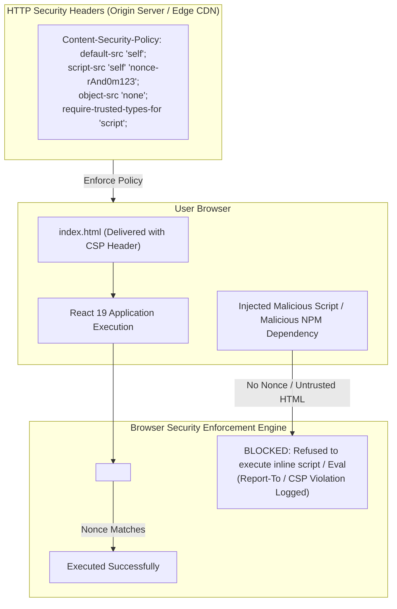

# 09 — Content Security Policy (CSP) & XSS Hardening in React

## Metadata
- **React Version**: 19.0.0+
- **Prerequisites**: [05-security.md](./05-security.md), Web Application Security Basics (OWASP Top 10)
- **Difficulty**: Advanced
- **Estimated Read Time**: 28 minutes
- **Tags**: `security`, `csp`, `xss`, `content-security-policy`, `trusted-types`, `dompurify`, `production`

---

## Architecture Diagram

The diagram below illustrates how a Strict Content Security Policy (CSP) with cryptographic nonces, Trusted Types, and sanitized markup boundaries protects a React 19 Single Page Application against Cross-Site Scripting (XSS) and data exfiltration.



---

## Concept Overview

While React protects against basic Cross-Site Scripting (XSS) by default (automatically escaping strings embedded in JSX: `{userInput}` renders as harmless text rather than HTML), modern enterprise applications face sophisticated attack vectors:
1. **`dangerouslySetInnerHTML`**: Unsanitized HTML rendering from rich text editors or third-party CMS inputs.
2. **Insecure URL Schemes**: `javascript:...` links embedded in `<a href={userLink}>`.
3. **Compromised NPM Dependencies (Supply Chain Attacks)**: Malicious third-party packages running script payloads in browser memory.
4. **Browser Extension Injections**: Rogue extensions injecting inline `<script>` tags to harvest authentication tokens.

A **Content Security Policy (CSP)** is an HTTP response header that restricts the resources (scripts, styles, images, iframes, network connections) the browser is permitted to load and execute.

### Why Legacy CSPs Fail in React SPAs:
Many legacy tutorials recommend `script-src 'unsafe-inline'`. This completely defeats the CSP—any injected XSS attack can execute immediately.
Modern production React applications must adopt a **Strict CSP based on cryptographic nonces or hashes** combined with **Trusted Types**.

---

## Practical Implementation

### Example 1: Strict CSP HTTP Header with Dynamic Nonce Generation

A cryptographic nonce is a single-use random string generated per HTTP request on your SSR server or Edge gateway (Cloudflare, Fastly, AWS Lambda@Edge).

```ts
// server/cspMiddleware.ts (Express / Node.js)
import crypto from 'crypto';
import type { Request, Response, NextFunction } from 'express';

export function cspMiddleware(req: Request, res: Response, next: NextFunction) {
  // 1. Generate a cryptographically secure random 128-bit base64 nonce per request
  const nonce = crypto.randomBytes(16).toString('base64');
  res.locals.nonce = nonce;

  // 2. Strict Content Security Policy definition
  const cspHeader = [
    "default-src 'self'",
    // Only scripts from same origin or carrying this specific request's nonce
    `script-src 'self' 'nonce-${nonce}' 'strict-dynamic'`,
    // Style src allowing hashed or nonced styles
    `style-src 'self' 'nonce-${nonce}'`,
    "img-src 'self' data: https://images.unsplash.com",
    "font-src 'self' https://fonts.gstatic.com",
    "connect-src 'self' https://api.company.com https://telemetry.company.com",
    "object-src 'none'", // Block Flash and Java applets
    "base-uri 'none'",   // Prevent <base> tag hijacking
    "frame-ancestors 'none'", // Prevent Clickjacking (blocks iframe embedding)
    "form-action 'self'",
    // Modern DOM XSS defense
    "require-trusted-types-for 'script'",
    "report-uri /api/security/csp-reports",
  ].join('; ');

  res.setHeader('Content-Security-Policy', cspHeader);
  next();
}
```

*Expected Verification Output:*
```text
HTTP Response Header:
Content-Security-Policy: default-src 'self'; script-src 'self' 'nonce-W2h5Zk...==' 'strict-dynamic'; ...
Any inline script without matching nonce attribute is immediately blocked by the browser.
```

---

### Example 2: Injecting the Nonce into the HTML Template and React Scripts

```html
<!-- server/views/index.html -->
<!DOCTYPE html>
<html lang="en">
  <head>
    <meta charset="UTF-8" />
    <title>Enterprise Secure React App</title>
    <!-- Nonce applied to critical entry script -->
    <script type="module" nonce="<%= nonce %>" src="/src/main.tsx"></script>
    <!-- Nonce applied to initial CSS styles -->
    <style nonce="<%= nonce %>">
      body { margin: 0; font-family: sans-serif; }
    </style>
  </head>
  <body>
    <div id="root"></div>
  </body>
</html>
```

*Expected Verification Output:*
```text
Browser verifies script nonce matches header nonce; executes main.tsx safely.
Injected <script>alert(1)</script> lacks nonce attribute -> Blocked with console security error!
```

---

### Example 3: Sanitizing Rich Text with DOMPurify Before `dangerouslySetInnerHTML`

When you must render user-provided HTML (e.g. from a CMS or rich text editor), always sanitize with DOMPurify to strip malicious script payloads, event handlers, and data URLs.

```tsx
// src/components/SanitizedHtml.tsx
import React, { useMemo } from 'react';
import DOMPurify from 'dompurify';

interface SanitizedHtmlProps {
  dirtyHtml: string;
  className?: string;
}

export function SanitizedHtml({ dirtyHtml, className }: SanitizedHtmlProps) {
  // Memoize purification to avoid re-parsing on unrelated renders
  const cleanHtml = useMemo(() => {
    return DOMPurify.sanitize(dirtyHtml, {
      ALLOWED_TAGS: ['b', 'i', 'em', 'strong', 'a', 'p', 'ul', 'ol', 'li', 'h1', 'h2', 'h3', 'code', 'pre'],
      ALLOWED_ATTR: ['href', 'title', 'target', 'rel'],
      // Enforce safe link behaviors
      ADD_ATTR: ['target', 'rel'],
      FORBID_TAGS: ['script', 'iframe', 'object', 'embed', 'style'],
      FORBID_ATTR: ['onerror', 'onload', 'onclick', 'onmouseover'],
    });
  }, [dirtyHtml]);

  return (
    <div
      className={className}
      // Safe to render purified markup
      dangerouslySetInnerHTML={{ __html: cleanHtml }}
    />
  );
}
```

*Expected Verification Output:*
```text
Input: `<p>Hello</p><script>stealCookie()</script>`
Sanitized: `<p>Hello</p>` (Malicious onerror attribute and <script> tag completely stripped!)
```

---

### Example 4: Enforcing W3C Trusted Types in React 19

Trusted Types prevents DOM XSS by requiring all strings assigned to dangerous sinks (such as `innerHTML`, `outerHTML`, or `script.src`) to be wrapped in a verified `TrustedHTML` object.

```ts
// src/security/trustedTypes.ts
import DOMPurify from 'dompurify';

// Create a Trusted Types policy
if (window.trustedTypes && window.trustedTypes.createPolicy) {
  window.trustedTypes.createPolicy('default', {
    createHTML: (string) => {
      // All strings assigned to innerHTML must pass through DOMPurify!
      return DOMPurify.sanitize(string, { RETURN_TRUSTED_TYPE: true }) as unknown as string;
    },
    createScript: () => {
      // Disallow runtime string-to-script conversions
      throw new Error('Dynamic script creation is prohibited by security policy.');
    },
    createScriptURL: (url) => {
      // Restrict script sources to internal domain
      if (url.startsWith('https://trusted-cdn.company.com/')) {
        return url;
      }
      throw new Error(`Untrusted script URL: ${url}`);
    },
  });
}
```

*Expected Verification Output:*
```text
Any component or library attempting raw `element.innerHTML = userInput` is instantly intercepted:
TypeError: Failed to set the 'innerHTML' property on 'Element': This document requires 'TrustedHTML' assignment.
```

---

### Example 5: Defending Against Insecure URL Schemes (`javascript:...`)

When rendering dynamic links provided by users (e.g. user profiles or website links), an attacker can supply `javascript:alert(document.cookie)`.

```tsx
// src/components/SafeExternalLink.tsx
import React from 'react';

interface SafeExternalLinkProps {
  href: string;
  children: React.ReactNode;
}

// Validates that URL scheme is strictly http or https
function isSafeUrl(url: string): boolean {
  try {
    const parsed = new URL(url, window.location.origin);
    return parsed.protocol === 'https:' || parsed.protocol === 'http:';
  } catch {
    return false;
  }
}

export function SafeExternalLink({ href, children }: SafeExternalLinkProps) {
  const safeHref = isSafeUrl(href) ? href : '#';

  return (
    <a
      href={safeHref}
      target="_blank"
      // rel="noopener noreferrer" prevents tabnabbing and window.opener theft
      rel="noopener noreferrer"
      className="text-blue-600 hover:underline"
    >
      {children}
    </a>
  );
}
```

*Expected Verification Output:*
```text
Input: href="javascript:alert(1)" -> Evaluates isSafeUrl() as false.
Renders <a href="#" rel="noopener noreferrer"> -> Execution blocked!
Input: href="https://google.com" -> Renders valid external link.
```

---

## Mental Model & Analogies

### The Airport Security Checkpoint

- **No CSP** is an open field where anyone can walk directly onto the airplane tarmac carrying whatever bags they want.
- **Legacy CSP (`unsafe-inline`)** is a security guard who checks passports, but allows passengers to carry bottles labeled *"Definitely Not Explosive"*.
- **Strict CSP with Nonce** is a **VIP Security Clearance Wristband**:
  - Every morning, airport security prints a cryptographic barcode for that flight only.
  - No matter how legitimate someone looks, if they don't have the exact matching wristband printed for this specific hour, they cannot board the aircraft.
  - Even if an attacker smuggles a script into the luggage area (`injected XSS`), the engine refuses to run it because it lacks the valid security wristband.

---

## Under the Hood / Internal Mechanics

### 1. The `strict-dynamic` Directive

In modern CSP Level 3, the `'strict-dynamic'` keyword drastically simplifies managing third-party scripts:
- When a script marked with a valid nonce (e.g. `<script nonce="xyz" src="analytics.js">`) loads, `'strict-dynamic'` allows *that* trusted script to dynamically create and append child `<script>` elements at runtime.
- You do not need to maintain an exhaustive whitelist of 50 third-party analytics hostnames (e.g. Google Analytics, Hotjar, Datadog) in your CSP header. As long as the root loader script carried the nonce, downstream modules are transitively trusted.

### 2. CSP Violation Reporting

Always configure automated violation reporting in production to catch attacks and misconfigurations:
```http
Report-To: {"group":"csp-violations","max_age":10886400,"endpoints":[{"url":"https://api.company.com/csp-report"}]}
Reporting-Endpoints: csp-violations="https://api.company.com/csp-report"
```
When a browser blocks an untrusted script, it emits a background JSON POST report detailing the blocked URI, violated directive, and stack trace without interrupting the user.

---

## Common Pitfalls & Anti-Patterns

| Anti-Pattern | Why It Breaks | Recommended Solution |
| :--- | :--- | :--- |
| **Using `script-src 'unsafe-inline'`** | Completely disables CSP script protection; any XSS injection executes. | Use strict nonce-based CSP (`'nonce-...' 'strict-dynamic'`). |
| **Static Hardcoded Nonces (`nonce="secret123"`)** | Attackers can read the static nonce from source and append it to malicious injected scripts. | Generate a fresh, cryptographically random nonce on every HTTP response. |
| **Using `dangerouslySetInnerHTML` without DOMPurify**| Directly injects unsanitized strings into DOM, causing instant XSS. | Always sanitize via `DOMPurify.sanitize()` with explicit tag whitelists. |
| **Allowing `data:` or `blob:` in `script-src`** | Attackers can bypass host whitelists by executing `<script src="data:text/javascript,...">`. | Explicitly disallow `data:` and `blob:` in `script-src`. |
| **Neglecting `target="_blank"` Protection** | Older browsers allow opened tabs to access `window.opener.location`, enabling phishing (reverse tabnabbing). | Always pair `target="_blank"` with `rel="noopener noreferrer"`. |
| **Storing JWT Auth Tokens in `localStorage`** | Bypasses CSP and React escaping; any successful XSS can steal tokens instantly. | Store tokens in React memory or `HttpOnly; SameSite=Strict; Secure` cookies. |

---

## Performance & Optimization

### Edge Worker Nonce Injection

For Single Page Applications hosted on static object stores (AWS S3, Cloudflare Pages), you can generate nonces at zero latency using an Edge Worker (Cloudflare Worker or CloudFront Function):
1. The Edge Worker intercepts the incoming GET request for `index.html`.
2. Generates a random nonce in memory (`crypto.randomUUID()`).
3. Replaces the placeholder `__NONCE__` string in `index.html` on the fly.
4. Adds the `Content-Security-Policy` header to the response stream.

---

## Edge Cases & Debugging

### Debugging with `Content-Security-Policy-Report-Only`
Before enforcing a strict CSP on production users:
- Set the header as `Content-Security-Policy-Report-Only: ...`.
- The browser will **not** block any scripts or styles, but will log console warnings and dispatch JSON reports for any rule that *would* have failed.
- Monitor your telemetry dashboard for 7 days to eliminate false positives before switching to enforcement mode.

---

## Ecosystem & Alternative Approaches

- **DOMPurify**: The gold standard HTML sanitization library for JavaScript/React (~7KB).
- **Trusted Types API**: Native W3C browser standard for DOM XSS prevention.
- **Helmet (Node.js)**: Middleware package that sets CSP and security headers automatically in Express.

---

## Exercises & Challenges

<details>
<summary><strong>Exercise 1: Audit a Vulnerable CSP Header</strong></summary>

**Challenge**: Identify three security flaws in this CSP header:
`Content-Security-Policy: default-src *; script-src 'self' 'unsafe-inline' 'unsafe-eval' https:;`

**Answer**:
1. `default-src *`: Wildcard allows unrestricted loading of objects, fonts, media, and iframes from any origin.
2. `'unsafe-inline'`: Defeats XSS defense; allows any inline script injection to execute.
3. `'unsafe-eval'`: Allows `eval()`, `new Function()`, and string-based execution, enabling prototype pollution payloads.
4. `https:`: Allows scripts from *any* HTTPS domain on the internet, enabling attackers to host malicious payloads on cloud storage.
</details>

<details>
<summary><strong>Exercise 2: Write a Custom Nonce Script Component</strong></summary>

**Challenge**: Create a React component that accesses the request nonce from React Context and applies it to dynamically rendered scripts.

```tsx
import React, { createContext, useContext } from 'react';

const NonceContext = createContext<string>('');

export const NonceProvider = NonceContext.Provider;

export function NonceScript({ src }: { src: string }) {
  const nonce = useContext(NonceContext);
  return <script nonce={nonce} src={src} async />;
}
```
</details>

---

## Frequently Asked Interview Questions

<details>
<summary><strong>1. Does React's built-in JSX escaping make Content Security Policy unnecessary?</strong></summary>

No! While React automatically escapes values in JSX expressions (`{userInput}` becomes safe text), React cannot protect against XSS if developers use `dangerouslySetInnerHTML`, bind unvalidated `javascript:` URLs to `<a href>`, or if a compromised third-party NPM package executes malicious JavaScript in the client bundle. CSP provides a critical defense-in-depth security layer enforced by the browser engine itself.
</details>

<details>
<summary><strong>2. Why is `'unsafe-inline'` dangerous in a Content Security Policy?</strong></summary>

`'unsafe-inline'` permits the execution of inline `<script>` tags, inline event attributes (`onclick=...`), and inline style blocks. If an attacker discovers any injection flaw, they can inject an inline script block, and the browser will execute it without hesitation, rendering the CSP completely ineffective against XSS.
</details>

<details>
<summary><strong>3. How does a Strict Nonce-based CSP work in React?</strong></summary>

The server generates a fresh, cryptographically random nonce (number used once) for each HTTP request and includes it in both the `Content-Security-Policy` header (`script-src 'nonce-XYZ'`) and on valid `<script nonce="XYZ">` tags in the HTML. When the page executes, the browser only executes scripts that bear the exact matching nonce attribute, blocking any untrusted or injected script.
</details>

<details>
<summary><strong>4. What is the purpose of W3C Trusted Types in modern frontend security?</strong></summary>

Trusted Types locks down dangerous DOM "sinks" (such as `element.innerHTML`, `outerHTML`, `document.write`, and `script.src`). Instead of allowing arbitrary strings to be assigned, the browser enforces that only objects created by verified security policies (such as strings sanitized through DOMPurify) can be passed, eliminating entire classes of Client-Side DOM XSS.
</details>

<details>
<summary><strong>5. What is the difference between `Content-Security-Policy` and `Content-Security-Policy-Report-Only`?</strong></summary>

`Content-Security-Policy` actively enforces the rules, blocking violating scripts or styles and logging warnings. 
`Content-Security-Policy-Report-Only` monitors compliance without blocking any execution; it emits violation reports to your specified endpoint, allowing teams to test strict policies in production safely before full enforcement.
</details>

<details>
<summary><strong>6. How does `'strict-dynamic'` improve CSP management for modern web applications?</strong></summary>

Without `'strict-dynamic'`, developers must manually whitelist every third-party domain loaded by their scripts in the CSP header. With `'strict-dynamic'`, any script that executes with a valid nonce is permitted to dynamically load and append additional child scripts, allowing complex third-party SDKs (analytics, tag managers) to function without maintaining brittle domain whitelists.
</details>

<details>
<summary><strong>7. Why should external links with `target="_blank"` always include `rel="noopener noreferrer"`?</strong></summary>

When a link opens a new tab via `target="_blank"`, older browsers give the newly opened tab a reference to the opening window via `window.opener`. A malicious destination website can execute `window.opener.location = 'https://fake-login.com'`, redirecting the original tab to a phishing clone. Adding `rel="noopener noreferrer"` sets `window.opener` to `null`, completely isolating the new tab.
</details>

<details>
<summary><strong>8. Can a Content Security Policy be set in a `<meta>` tag inside `index.html`?</strong></summary>

Yes, via `<meta http-equiv="Content-Security-Policy" content="...">`. However, meta tags have significant security limitations: they do not support `frame-ancestors` (clickjacking defense), `report-uri`, or `require-trusted-types-for`. For maximum enterprise security, CSP must be emitted as an HTTP response header from the server or CDN edge.
</details>

---

## References & Further Reading

- [MDN Web Docs: Content Security Policy (CSP)](https://developer.mozilla.org/en-US/docs/Web/HTTP/CSP)
- [web.dev: Mitigate XSS with a Strict Content Security Policy (CSP)](https://web.dev/articles/strict-csp)
- [W3C Trusted Types Specification](https://w3c.github.io/trusted-types/dist/spec/)
- [DOMPurify GitHub Repository](https://github.com/cure53/DOMPurify)
- [OWASP Cross-Site Scripting (XSS) Prevention Cheat Sheet](https://cheatsheetseries.owasp.org/cheatsheets/Cross_Site_Scripting_Prevention_Cheat_Sheet.html)
