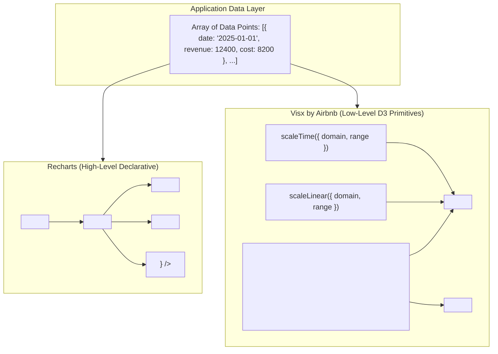

# 05 — Data Visualization in React: Recharts vs. Visx

## Metadata
- **React Version**: 19.0.0+
- **Prerequisites**: [01-components-and-props.md](../01-fundamentals/02-components-and-props.md), SVG Primitives, D3 Scale Basics
- **Difficulty**: Advanced
- **Estimated Read Time**: 29 minutes
- **Tags**: `data-vis`, `charts`, `recharts`, `visx`, `svg`, `d3`, `analytics`

---

## Architecture Diagram

The diagram below compares high-level declarative charting with **Recharts** (ready-made composite components) versus low-level headless data visualization with **Visx** (unopinionated mathematical D3 layout primitives rendered via React SVG elements).



---

## Concept Overview

Visualizing data in React requires choosing between three rendering technologies:
1. **SVG (Scalable Vector Graphics)**: Declarative, resolution-independent DOM nodes. Easily styled with CSS, inspectable in DevTools, and supports native React event listeners (`onClick`, `onMouseEnter`). Ideal for up to ~2,000 data points.
2. **HTML5 Canvas**: Procedural pixel bitmap rendering. Extremely fast for 10,000+ data points, but lacks native DOM event bubbling and accessible screen-reader tags.
3. **WebGL (Three.js)**: GPU-accelerated 3D and 2D rendering for hundreds of thousands of live entities.

### Recharts vs Visx: Architectural Comparison

| Dimension | Recharts (v2.13+) | Visx (by Airbnb v3+) |
| :--- | :--- | :--- |
| **Philosophy** | "Batteries included" ready-made charts | "Headless primitives" for custom bespoke visualizations |
| **Under the Hood**| SVG + D3 math bundled internally | Direct modular D3 packages wrapped in React components |
| **Developer Experience**| Fast setup (<10 lines of JSX) | Requires manual scale mapping and SVG layout math |
| **Customization Ceiling**| Limited by component props and internal slots | 100% total control over SVG elements and aesthetics |
| **Bundle Footprint** | Moderate (~45KB gzipped) | Modular tree-shaking (only import `@visx/scale`, `@visx/shape`) |
| **Best Used For** | Standard SaaS dashboards, analytics portals | Custom bespoke infographics, financial charts, complex interactions |

---

## Practical Implementation

### Example 1: Declarative Revenue Line Chart with Recharts

A complete, production-ready area-line chart featuring custom tooltips, gradients, and responsive sizing.

```tsx
// src/components/RevenueChart.tsx
import React from 'react';
import {
  ResponsiveContainer,
  AreaChart,
  Area,
  XAxis,
  YAxis,
  Tooltip,
  CartesianGrid,
} from 'recharts';

interface MetricPoint {
  month: string;
  revenue: number;
  expenses: number;
}

const DATA: MetricPoint[] = [
  { month: 'Jan', revenue: 42000, expenses: 28000 },
  { month: 'Feb', revenue: 49000, expenses: 31000 },
  { month: 'Mar', revenue: 62000, expenses: 35000 },
  { month: 'Apr', revenue: 58000, expenses: 33000 },
  { month: 'May', revenue: 71000, expenses: 40000 },
  { month: 'Jun', revenue: 84000, expenses: 44000 },
];

function CustomTooltip({ active, payload, label }: any) {
  if (active && payload && payload.length) {
    return (
      <div className="bg-white p-3 border rounded shadow-md text-xs">
        <p className="font-bold text-gray-700">{label}</p>
        <p className="text-blue-600">Revenue: ${payload[0].value.toLocaleString()}</p>
        <p className="text-red-500">Expenses: ${payload[1].value.toLocaleString()}</p>
      </div>
    );
  }
  return null;
}

export function RevenueChart() {
  return (
    <div className="w-full h-80 p-4 bg-white border rounded-xl shadow-sm">
      <h3 className="text-lg font-bold mb-4">Revenue vs Expenses (2025)</h3>
      <ResponsiveContainer width="100%" height="85%">
        <AreaChart data={DATA} margin={{ top: 10, right: 30, left: 0, bottom: 0 }}>
          <defs>
            <linearGradient id="colorRev" x1="0" y1="0" x2="0" y2="1">
              <stop offset="5%" stopColor="#2563eb" stopOpacity={0.4} />
              <stop offset="95%" stopColor="#2563eb" stopOpacity={0.0} />
            </linearGradient>
          </defs>
          <CartesianGrid strokeDasharray="3 3" vertical={false} stroke="#f1f5f9" />
          <XAxis dataKey="month" tickLine={false} stroke="#94a3b8" />
          <YAxis
            tickLine={false}
            stroke="#94a3b8"
            tickFormatter={(val) => `$${val / 1000}k`}
          />
          <Tooltip content={<CustomTooltip />} />
          <Area
            type="monotone"
            dataKey="revenue"
            stroke="#2563eb"
            strokeWidth={2}
            fillOpacity={1}
            fill="url(#colorRev)"
          />
          <Area
            type="monotone"
            dataKey="expenses"
            stroke="#ef4444"
            strokeWidth={2}
            fillOpacity={0}
            fill="transparent"
          />
        </AreaChart>
      </ResponsiveContainer>
    </div>
  );
}
```

*Expected Verification Output:*
```text
Renders responsive SVG chart with blue gradient area fill.
Hovering data points renders formatted custom tooltip with dollar figures.
```

---

### Example 2: Headless Low-Level Bar Chart with Visx

Building a custom bar chart using `@visx/shape`, `@visx/scale`, and `@visx/group`.

```tsx
// src/components/VisxBarChart.tsx
import React, { useMemo } from 'react';
import { Group } from '@visx/group';
import { Bar } from '@visx/shape';
import { scaleLinear, scaleBand } from '@visx/scale';

interface ProductSales {
  product: string;
  units: number;
}

const SALES_DATA: ProductSales[] = [
  { product: 'Widget A', units: 120 },
  { product: 'Widget B', units: 85 },
  { product: 'Widget C', units: 190 },
  { product: 'Widget D', units: 145 },
];

export function VisxBarChart({ width = 450, height = 250 }: { width?: number; height?: number }) {
  const margin = { top: 20, right: 20, bottom: 40, left: 40 };
  const xMax = width - margin.left - margin.right;
  const yMax = height - margin.top - margin.bottom;

  // D3 Scales memoized to avoid re-allocation
  const xScale = useMemo(
    () =>
      scaleBand<string>({
        range: [0, xMax],
        round: true,
        domain: SALES_DATA.map((d) => d.product),
        padding: 0.3,
      }),
    [xMax]
  );

  const yScale = useMemo(
    () =>
      scaleLinear<number>({
        range: [yMax, 0],
        round: true,
        domain: [0, Math.max(...SALES_DATA.map((d) => d.units)) * 1.15],
      }),
    [yMax]
  );

  return (
    <svg width={width} height={height} className="border rounded bg-white p-2">
      <Group left={margin.left} top={margin.top}>
        {SALES_DATA.map((d) => {
          const barWidth = xScale.bandwidth();
          const barHeight = yMax - (yScale(d.units) ?? 0);
          const barX = xScale(d.product);
          const barY = yMax - barHeight;

          return (
            <Bar
              key={d.product}
              x={barX}
              y={barY}
              width={barWidth}
              height={barHeight}
              fill="#4f46e5"
              rx={4}
              onClick={() => alert(`Selected ${d.product}: ${d.units} units`)}
              className="cursor-pointer hover:opacity-80 transition-opacity"
            />
          );
        })}
      </Group>
    </svg>
  );
}
```

*Expected Verification Output:*
```text
Renders clean SVG bars with rounded corners (rx=4).
Native React onClick handlers bind directly to individual SVG <rect> nodes.
```

---

### Example 3: Live Real-Time Streaming Chart with Dynamic Sliding Window

Rendering real-time WebSocket sensor telemetry updating at 10Hz without memory bloat.

```tsx
// src/components/LiveTelemetryChart.tsx
import React, { useState, useEffect } from 'react';
import { LineChart, Line, XAxis, YAxis, ResponsiveContainer } from 'recharts';

interface TelemetryPoint {
  time: string;
  cpu: number;
}

export function LiveTelemetryChart() {
  const [data, setData] = useState<TelemetryPoint[]>([]);

  useEffect(() => {
    const interval = setInterval(() => {
      const now = new Date().toLocaleTimeString();
      const cpuUsage = Math.floor(Math.random() * 40) + 30; // 30-70%

      setData((prev) => {
        // Keep fixed sliding window of last 20 data points
        const next = [...prev, { time: now, cpu: cpuUsage }];
        return next.length > 20 ? next.slice(next.length - 20) : next;
      });
    }, 500);

    return () => clearInterval(interval);
  }, []);

  return (
    <div className="w-full h-64 p-4 border rounded bg-gray-900 text-white">
      <h4 className="text-sm font-mono text-emerald-400 mb-2">● LIVE CPU TELEMETRY (10Hz)</h4>
      <ResponsiveContainer width="100%" height="80%">
        <LineChart data={data}>
          <XAxis dataKey="time" stroke="#475569" tick={{ fontSize: 10 }} />
          <YAxis domain={[0, 100]} stroke="#475569" tick={{ fontSize: 10 }} />
          {/* isAnimationActive={false} is MANDATORY for real-time streaming to prevent lagging transitions */}
          <Line
            type="monotone"
            dataKey="cpu"
            stroke="#10b981"
            strokeWidth={2}
            dot={false}
            isAnimationActive={false}
          />
        </LineChart>
      </ResponsiveContainer>
    </div>
  );
}
```

*Expected Verification Output:*
```text
Chart streams new data points smoothly every 500ms.
Fixed sliding window prevents DOM memory leaks; isAnimationActive={false} prevents animation stutter.
```

---

### Example 4: Accessible Data Visualization with Screen-Reader Data Table Fallback

Data visualizations must comply with WCAG 2.2 accessibility standards by exposing accessible tables and ARIA summaries for visually impaired users.

```tsx
// src/components/AccessibleChartWrapper.tsx
import React, { useState } from 'react';
import { RevenueChart } from './RevenueChart';

export function AccessibleChartWrapper() {
  const [showTable, setShowTable] = useState(false);

  return (
    <section aria-labelledby="chart-heading" className="space-y-4">
      <div className="flex justify-between items-center">
        <h2 id="chart-heading" className="text-xl font-bold">Financial Overview</h2>
        <button
          onClick={() => setShowTable((t) => !t)}
          className="text-xs bg-gray-100 hover:bg-gray-200 px-3 py-1.5 rounded font-medium border"
          aria-expanded={showTable}
          aria-controls="data-table-view"
        >
          {showTable ? 'View Chart' : 'View Accessible Data Table'}
        </button>
      </div>

      {/* Screen-reader descriptive summary */}
      <p className="sr-only">
        Line chart illustrating revenue growth from $42,000 in January to $84,000 in June 2025.
      </p>

      {showTable ? (
        <div id="data-table-view" className="overflow-x-auto">
          <table className="w-full text-sm border-collapse border border-gray-300">
            <caption className="sr-only">Monthly Revenue vs Expenses 2025</caption>
            <thead className="bg-gray-100">
              <tr>
                <th className="border p-2 text-left">Month</th>
                <th className="border p-2 text-right">Revenue</th>
                <th className="border p-2 text-right">Expenses</th>
              </tr>
            </thead>
            <tbody>
              <tr>
                <td className="border p-2">Jan</td>
                <td className="border p-2 text-right">$42,000</td>
                <td className="border p-2 text-right">$28,000</td>
              </tr>
              {/* remaining rows */}
            </tbody>
          </table>
        </div>
      ) : (
        <div aria-hidden="true">
          <RevenueChart />
        </div>
      )}
    </section>
  );
}
```

*Expected Verification Output:*
```text
Screen readers announce descriptive chart summary.
Keyboard users can toggle to tabular data view with 100% WAI-ARIA semantic table elements.
```

---

### Example 5: High-Density Canvas Fallback for 20,000 Data Points

When data exceeds 5,000 points, SVG DOM nodes exhaust memory. This example uses standard HTML5 Canvas with React refs.

```tsx
// src/components/HighDensityScatterPlot.tsx
import React, { useRef, useEffect } from 'react';

export function HighDensityScatterPlot({ pointCount = 10000 }: { pointCount?: number }) {
  const canvasRef = useRef<HTMLCanvasElement>(null);

  useEffect(() => {
    const canvas = canvasRef.current;
    if (!canvas) return;
    const ctx = canvas.getContext('2d');
    if (!ctx) return;

    ctx.clearRect(0, 0, canvas.width, canvas.height);
    ctx.fillStyle = 'rgba(59, 130, 246, 0.4)';

    // Generate and plot 10,000 points in <5ms
    for (let i = 0; i < pointCount; i++) {
      const x = Math.random() * canvas.width;
      const y = Math.random() * canvas.height;
      ctx.fillRect(x, y, 2, 2);
    }
  }, [pointCount]);

  return (
    <div className="p-4 border rounded bg-white">
      <h4 className="font-bold mb-2">High-Density Scatter Plot ({pointCount.toLocaleString()} Points)</h4>
      <canvas ref={canvasRef} width={500} height={300} className="border bg-slate-50 rounded" />
    </div>
  );
}
```

*Expected Verification Output:*
```text
10,000 scatter points rendered in <4ms on HTML5 Canvas without creating a single DOM node.
```

---

## Mental Model & Analogies

### The Ready-Made Suit vs The Bespoke Tailor

- **Recharts** is like buying a **high-end ready-to-wear suit**:
  - You pick your size off the rack (`<LineChart>`), put on the tie (`<XAxis>`), and look great in 5 minutes.
  - But if you want lapels made of imported Kevlar with an asymmetrical third sleeve, the ready-made suit cannot accommodate you.
- **Visx** is like visiting a **master tailor's workshop**:
  - They give you bolts of fine fabric (`@visx/shape`), mathematical measuring tape (`@visx/scale`), and precision needles (`<Group>`).
  - You must do the sewing math yourself, but you can build literally any garment imaginable.

---

## Under the Hood / Internal Mechanics

### Why Recharts Requires `ResponsiveContainer` Aspect Ratios

An `<svg>` element has its own coordinate system (`viewBox="0 0 w h"`). If you do not specify explicit pixel widths or wrap it in `<ResponsiveContainer>`, the SVG collapses to `0px x 0px` inside modern CSS flex or grid containers.
`ResponsiveContainer` works by injecting an invisible `ResizeObserver` listener on its parent `<div>` and setting explicit computed pixel widths on child SVG elements.

---

## Common Pitfalls & Anti-Patterns

| Anti-Pattern | Why It Breaks | Recommended Solution |
| :--- | :--- | :--- |
| **Rendering 10,000 SVG Elements** | Exhausts browser memory and creates thousands of DOM nodes, freezing scrolling. | Use HTML5 Canvas or WebGL for datasets exceeding 2,000 points. |
| **Keeping `isAnimationActive={true}` on Real-Time Feeds**| Animations re-trigger on every 100ms update, creating a permanent visual lag. | Set `isAnimationActive={false}` on real-time streaming series. |
| **Recalculating D3 Scales on Every Render Pass** | Re-allocating scale functions causes unnecessary GC churn. | Memoize D3 scales with `useMemo(() => scaleLinear(...), [domain, range])`. |
| **Omitting Accessible Data Tables** | Screen readers cannot parse raw SVG `<path>` vectors, failing WCAG compliance. | Provide an accessible data table or descriptive `aria-label` summary. |
| **Mounting `ResponsiveContainer` Inside Zero-Height Flex**| Recharts logs console warnings and renders a blank 0x0 container. | Give the parent container an explicit height (`h-80` or `min-h-[300px]`). |
| **Mutating Original Data Array in Sorting** | `data.sort()` mutates input arrays in place, violating React purity. | Pass cloned arrays: `[...data].sort()`. |

---

## Performance & Optimization

### Debouncing Responsive Resize Calculations

When users resize browser windows, `ResizeObserver` triggers 60 times per second, recalculating complex chart layouts. Debounce resize events by 150ms to avoid layout thrashing.

---

## Edge Cases & Debugging

### Fixing Tooltip Clipping in Overflow Containers
- **Symptom**: Custom tooltips are clipped or cut off by parent container borders.
- **Root Cause**: The chart container has `overflow: hidden` or `overflow: auto`.
- **Remedy**: Use `usePortal` or Recharts `wrapperStyle={{ zIndex: 1000 }}` to render tooltips outside clipping boundaries.

---

## Ecosystem & Alternative Approaches

- **Nivo (`@nivo/core`)**: Gorgeous, themed React charting library with native SVG, Canvas, and SSR support.
- **Victory (`victory`)**: Battle-tested charting library by Formidable Labs with native React Native support.
- **Plotly.js / Chart.js**: Heavy canvas/SVG libraries with non-React imperative roots.

---

## Exercises & Challenges

<details>
<summary><strong>Exercise 1: Implement a Multi-Metric Donut / Pie Chart with Recharts</strong></summary>

**Challenge**: Build a donut chart displaying storage usage distribution (Images, Video, Documents, System) with an inner radius cutout.

```tsx
import React from 'react';
import { PieChart, Pie, Cell, ResponsiveContainer, Tooltip } from 'recharts';

const DATA = [
  { name: 'Images', value: 400, color: '#3b82f6' },
  { name: 'Videos', value: 300, color: '#10b981' },
  { name: 'Documents', value: 200, color: '#f59e0b' },
  { name: 'System', value: 100, color: '#6b7280' },
];

export function StorageDonut() {
  return (
    <div className="w-64 h-64">
      <ResponsiveContainer width="100%" height="100%">
        <PieChart>
          <Pie data={DATA} innerRadius={60} outerRadius={80} paddingAngle={4} dataKey="value">
            {DATA.map((entry) => (
              <Cell key={entry.name} fill={entry.color} />
            ))}
          </Pie>
          <Tooltip />
        </PieChart>
      </ResponsiveContainer>
    </div>
  );
}
```
</details>

<details>
<summary><strong>Exercise 2: Linear Threshold Annotation Line</strong></summary>

**Challenge**: Add a red dashed reference line indicating a SLA latency threshold at 200ms using `<ReferenceLine>`.

```tsx
import { ReferenceLine } from 'recharts';
// Inside <LineChart>:
<ReferenceLine y={200} stroke="red" strokeDasharray="3 3" label="SLA 200ms Limit" />
```
</details>

---

## Frequently Asked Interview Questions

<details>
<summary><strong>1. What are the key architectural tradeoffs between SVG and Canvas for data visualization?</strong></summary>

**SVG** renders vector DOM nodes. It supports CSS styling, crisp scaling across resolutions, and native React event listeners on individual chart elements (`onClick`). However, rendering more than 2,000–5,000 SVG elements degrades DOM performance. 
**HTML5 Canvas** renders procedural pixels on a single surface. It can effortlessly render 50,000+ data points at 60fps, but lacks individual DOM elements, requiring manual hit-testing for hover tooltips and manual accessibility fallbacks.
</details>

<details>
<summary><strong>2. How does Recharts differ fundamentally from Visx?</strong></summary>

Recharts is an opinionated, declarative component library with built-in composable charts (`<LineChart>`, `<BarChart>`). It handles scales, margins, and tooltips automatically with minimal code. 
Visx (by Airbnb) is an unopinionated collection of low-level visualization primitives and D3 scale wrappers. It forces developers to manage coordinates, scales, and layout math explicitly, granting complete design freedom and smaller tree-shaken bundles.
</details>

<details>
<summary><strong>3. Why should chart animations (`isAnimationActive`) be disabled in real-time streaming dashboards?</strong></summary>

Chart animation libraries interpolate paths and coordinates from previous positions to new positions using spring or tween curves (~300ms). In real-time dashboards updating several times per second, overlapping animation frames starve the browser main thread and cause visual stutter. Disabling animations allows immediate, instantaneous path updates.
</details>

<details>
<summary><strong>4. How do you make data visualizations accessible under WCAG 2.2?</strong></summary>

1. Provide an accessible alternative data view (such as an HTML `<table>` or CSV export).
2. Include descriptive `<title>` and `<desc>` tags inside SVGs and assign `role="img" aria-labelledby="..."`.
3. Use high-contrast color palettes that do not rely solely on color to convey meaning (pair colors with patterns or labels).
4. Support keyboard focus on interactive data points.
</details>

<details>
<summary><strong>5. What is the role of D3 in modern React charting libraries?</strong></summary>

Modern React charting libraries do **not** use D3's DOM manipulation methods (`d3.select()`, `.enter()`, `.exit()`), because direct DOM mutation conflicts with React's Fiber reconciler. Instead, libraries use D3 purely as a **mathematical computation library**: `d3-scale` (translating data values into pixel coordinates), `d3-shape` (calculating SVG path strings), and `d3-array` (statistical aggregations). React handles all DOM rendering.
</details>

<details>
<summary><strong>6. Why does `ResponsiveContainer` sometimes fail or render at 0x0 size?</strong></summary>

`ResponsiveContainer` measures the computed dimensions of its parent DOM container using `ResizeObserver`. If the parent container is a CSS flex or grid item with no explicit height (e.g. `height: auto` or flex child without `flex-1`), the parent collapses to 0px, causing the SVG to render with zero height.
</details>

<details>
<summary><strong>7. How do you prevent layout thrashing when displaying live chart tooltips?</strong></summary>

Render tooltips using absolute positioning or CSS transforms (`transform: translate3d(...)`) rather than altering `top` and `left` properties, and avoid updating parent layout state. Using a dedicated portal or lightweight tooltip container prevents re-rendering the entire chart SVG.
</details>

<details>
<summary><strong>8. When should an enterprise team choose Visx over Recharts?</strong></summary>

Choose Visx when you have strict bespoke design requirements that cannot be achieved with standard chart templates (e.g. custom financial heatmaps, radial network graphs, custom geospatial glyphs), or when you want strict tree-shaking to minimize bundle footprint. Choose Recharts for standard business and SaaS analytics where development speed and consistency are primary.
</details>

---

## References & Further Reading

- [Recharts Official Documentation](https://recharts.org/)
- [Visx by Airbnb Official Documentation](https://airbnb.io/visx/)
- [D3.js Mathematical Scales Reference](https://d3js.org/d3-scale)
- [W3C SVG Accessibility Guidelines](https://www.w3.org/WAI/GL/wiki/SVG_Accessibility)
- [Nivo Data Visualization Library](https://nivo.rocks/)
