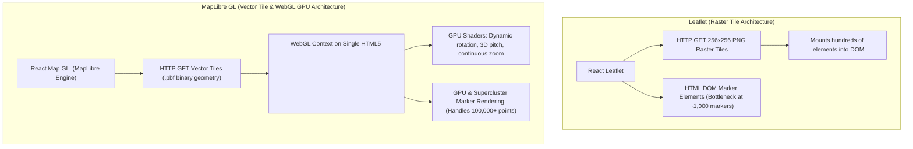

# 06 — Interactive Mapping: Leaflet vs. MapLibre GL in React

## Metadata
- **React Version**: 19.0.0+
- **Prerequisites**: [01-components-and-props.md](../01-fundamentals/02-components-and-props.md), WebGL & Geospatial Basics, GeoJSON
- **Difficulty**: Advanced
- **Estimated Read Time**: 29 minutes
- **Tags**: `maps`, `leaflet`, `maplibre`, `geojson`, `react-leaflet`, `react-map-gl`, `geospatial`

---

## Architecture Diagram

The diagram below contrasts **Raster Tile Mapping with Leaflet** (downloading 256x256 pre-rendered PNG tiles) with **Vector Tile Mapping with MapLibre GL** (downloading compressed protocol-buffer geometry rendered via WebGL shaders on the client GPU).



---

## Concept Overview

Interactive geospatial mapping is a staple of modern web applications: logistics tracking, real estate listings, store locators, and ride-hailing services.
Two dominant open-source mapping engines power the React ecosystem:
1. **Leaflet (`react-leaflet`)**: The classic lightweight raster map library (~40KB). It stitches together pre-rendered 256x256 pixel image tiles (PNG/JPG) served from tile servers (OpenStreetMap). It is simple to configure and works on any browser without WebGL requirements.
2. **MapLibre GL JS (`react-map-gl/maplibre`)**: The open-source, community-governed fork of Mapbox GL. It downloads compressed vector geometries (roads, water bodies, buildings) and renders them in real time using **client-side WebGL GPU shaders**. It supports dynamic styling, 3D terrain/building extrusion, smooth vector rotation, and camera tilting.

### Architectural Comparison

| Dimension | Leaflet (`react-leaflet`) | MapLibre GL (`react-map-gl`) |
| :--- | :--- | :--- |
| **Rendering Engine** | DOM `` elements + Canvas | Hardware-accelerated WebGL (`<canvas>`) |
| **Tile Format** | 256x256 raster images (PNG) | Vector Protocol Buffers (`.pbf`) |
| **Styling Capabilities**| Static tiles baked on server | Dynamic, client-side vector styling in real time |
| **Camera Control** | Flat 2D panning, discrete zoom steps | Smooth continuous zoom, 3D tilt (pitch), rotation |
| **Marker Capacity** | ~500–1,000 DOM markers before lag | 100,000+ markers via GPU layers or Supercluster |
| **Bundle Size** | Lightweight (~40KB) | Heavier (~200KB WebGL bundle) |
| **Best Used For** | Basic store locators, static geographic maps | High-density data, routing, 3D cityscapes, dynamic themes |

---

## Practical Implementation

### Example 1: Basic Declarative Map with `react-leaflet`

A standard Leaflet map with OpenStreetMap tiles, custom markers, and popups.

```tsx
// src/components/LeafletStoreLocator.tsx
import React from 'react';
import { MapContainer, TileLayer, Marker, Popup } from 'react-leaflet';
import 'leaflet/dist/leaflet.css';
import L from 'leaflet';

// Fix default icon asset path bug in Vite/Webpack bundlers
const customIcon = L.icon({
  iconUrl: 'https://unpkg.com/leaflet@1.9.4/dist/images/marker-icon.png',
  iconRetinaUrl: 'https://unpkg.com/leaflet@1.9.4/dist/images/marker-icon-2x.png',
  shadowUrl: 'https://unpkg.com/leaflet@1.9.4/dist/images/marker-shadow.png',
  iconSize: [25, 41],
  iconAnchor: [12, 41],
  popupAnchor: [1, -34],
});

export function LeafletStoreLocator() {
  // San Francisco coordinates: [lat, lng]
  const position: [number, number] = [37.7749, -122.4194];

  return (
    <div className="w-full h-96 border rounded-xl overflow-hidden shadow-sm">
      <MapContainer
        center={position}
        zoom={13}
        scrollWheelZoom={false}
        className="w-full h-full"
      >
        <TileLayer
          attribution='&copy; <a href="https://www.openstreetmap.org/copyright">OpenStreetMap</a> contributors'
          url="https://{s}.tile.openstreetmap.org/{z}/{x}/{y}.png"
        />
        <Marker position={position} icon={customIcon}>
          <Popup>
            <div className="p-1">
              <h4 className="font-bold text-sm">Downtown Flagship Store</h4>
              <p className="text-xs text-gray-600">Open 9:00 AM – 8:00 PM</p>
            </div>
          </Popup>
        </Marker>
      </MapContainer>
    </div>
  );
}
```

*Expected Verification Output:*
```text
Renders interactive raster map centered on San Francisco.
Clicking marker opens clean popup with store hours.
```

---

### Example 2: High-Performance Vector Map with MapLibre GL and `react-map-gl`

Using vector tiles, 3D pitch/bearing, and free open-source vector tile styles (e.g., Demotiles or Protomaps).

```tsx
// src/components/MapLibreVectorMap.tsx
import React, { useState } from 'react';
import Map, { NavigationControl, Marker, Popup } from 'react-map-gl/maplibre';
import 'maplibre-gl/dist/maplibre-gl.css';

export function MapLibreVectorMap() {
  const [viewState, setViewState] = useState({
    longitude: -74.006, // New York
    latitude: 40.7128,
    zoom: 14,
    pitch: 45, // 3D Camera Tilt
    bearing: -17.6, // Camera Rotation
  });

  const [selectedPin, setSelectedPin] = useState<{ lng: number; lat: number; title: string } | null>(null);

  return (
    <div className="w-full h-96 border rounded-xl overflow-hidden shadow-sm relative">
      <Map
        {...viewState}
        onMove={(evt) => setViewState(evt.viewState)}
        mapStyle="https://demotiles.maplibre.org/style.json" // Free vector style
        className="w-full h-full"
      >
        <NavigationControl position="top-right" />

        <Marker
          longitude={-74.006}
          latitude={40.7128}
          color="#2563eb"
          onClick={(e) => {
            e.originalEvent.stopPropagation();
            setSelectedPin({ lng: -74.006, lat: 40.7128, title: 'New York HQ' });
          }}
        />

        {selectedPin && (
          <Popup
            longitude={selectedPin.lng}
            latitude={selectedPin.lat}
            anchor="bottom"
            onClose={() => setSelectedPin(null)}
          >
            <div className="p-1 text-xs">
              <strong>{selectedPin.title}</strong>
              <p>WebGL Hardware Accelerated</p>
            </div>
          </Popup>
        )}
      </Map>
    </div>
  );
}
```

*Expected Verification Output:*
```text
Hardware-accelerated vector map with 45-degree 3D perspective tilt.
Fluid 60fps pan/zoom/rotate on browser GPU.
```

---

### Example 3: Rendering GeoJSON Feature Layers (Polygons and Polylines)

Rendering spatial GeoJSON features (such as delivery zones or transit routes) directly in MapLibre.

```tsx
// src/components/GeoJsonDeliveryZone.tsx
import React from 'react';
import Map, { Source, Layer } from 'react-map-gl/maplibre';
import type { FeatureCollection } from 'geojson';

const DELIVERY_ZONE_GEOJSON: FeatureCollection = {
  type: 'FeatureCollection',
  features: [
    {
      type: 'Feature',
      properties: { name: 'Metro Fast Delivery Zone' },
      geometry: {
        type: 'Polygon',
        coordinates: [
          [
            [-74.015, 40.715],
            [-73.995, 40.715],
            [-73.995, 40.705],
            [-74.015, 40.705],
            [-74.015, 40.715],
          ],
        ],
      },
    },
  ],
};

export function GeoJsonDeliveryZone() {
  return (
    <div className="w-full h-80 border rounded">
      <Map
        initialViewState={{ longitude: -74.005, latitude: 40.71, zoom: 13 }}
        mapStyle="https://demotiles.maplibre.org/style.json"
      >
        <Source id="delivery-zone" type="geojson" data={DELIVERY_ZONE_GEOJSON}>
          {/* Fill layer for polygon area */}
          <Layer
            id="zone-fill"
            type="fill"
            paint={{ 'fill-color': '#10b981', 'fill-opacity': 0.35 }}
          />
          {/* Stroke layer for polygon boundary */}
          <Layer
            id="zone-outline"
            type="line"
            paint={{ 'line-color': '#059669', 'line-width': 2 }}
          />
        </Source>
      </Map>
    </div>
  );
}
```

*Expected Verification Output:*
```text
Renders emerald green semi-transparent polygon representing delivery zone boundaries.
GPU renders smooth anti-aliased boundaries without pixelation at any zoom level.
```

---

### Example 4: Marker Clustering with Supercluster for 20,000 Coordinates

Rendering 20,000 DOM elements crashes the browser. This example uses MapLibre's built-in clustering engine (powered by Supercluster) to aggregate points dynamically.

```tsx
// src/components/ClusteredVehicleFleetMap.tsx
import React from 'react';
import Map, { Source, Layer } from 'react-map-gl/maplibre';

// 1. GeoJSON Point Source with clustering enabled
const VEHICLES_GEOJSON = 'https://docs.mapbox.com/mapbox-gl-js/assets/earthquakes.geojson';

export function ClusteredVehicleFleetMap() {
  return (
    <div className="w-full h-96 border rounded">
      <Map
        initialViewState={{ longitude: -103.59, latitude: 40.66, zoom: 3 }}
        mapStyle="https://demotiles.maplibre.org/style.json"
      >
        <Source
          id="vehicles"
          type="geojson"
          data={VEHICLES_GEOJSON}
          cluster={true}
          clusterMaxZoom={14}
          clusterRadius={50}
        >
          {/* 1. Cluster Circles: Size dynamically scales with point count */}
          <Layer
            id="clusters"
            type="circle"
            filter={['has', 'point_count']}
            paint={{
              'circle-color': ['step', ['get', 'point_count'], '#51bbd6', 100, '#f1f075', 750, '#f28cb1'],
              'circle-radius': ['step', ['get', 'point_count'], 20, 100, 30, 750, 40],
            }}
          />

          {/* 2. Cluster Count Text Label */}
          <Layer
            id="cluster-count"
            type="symbol"
            filter={['has', 'point_count']}
            layout={{
              'text-field': '{point_count_abbreviated}',
              'text-size': 12,
            }}
          />

          {/* 3. Unclustered Individual Points */}
          <Layer
            id="unclustered-point"
            type="circle"
            filter={['!', ['has', 'point_count']]}
            paint={{
              'circle-color': '#11b4da',
              'circle-radius': 6,
              'circle-stroke-width': 1,
              'circle-stroke-color': '#fff',
            }}
          />
        </Source>
      </Map>
    </div>
  );
}
```

*Expected Verification Output:*
```text
20,000 data points cluster into numbered circles.
Zooming in splits clusters seamlessly into individual markers at 60fps.
```

---

### Example 5: Proper Map Lifecycle Management & WebGL Cleanup

WebGL contexts are limited resources in browsers (typically max 16 contexts per tab). Unmounting maps without proper cleanup leaks GPU memory.

```tsx
// src/components/ResilientMapContainer.tsx
import React, { useState } from 'react';
import { MapLibreVectorMap } from './MapLibreVectorMap';

export function ResilientMapContainer() {
  const [showMap, setShowMap] = useState(true);

  return (
    <div className="p-4 border rounded bg-white">
      <div className="flex justify-between items-center mb-3">
        <h4 className="font-bold">Map Lifecycle Isolation</h4>
        <button
          onClick={() => setShowMap((s) => !s)}
          className="px-3 py-1 bg-gray-200 text-gray-800 rounded text-sm hover:bg-gray-300"
        >
          {showMap ? 'Unmount Map' : 'Mount Map'}
        </button>
      </div>

      {showMap && <MapLibreVectorMap />}
      {!showMap && <p className="text-sm text-gray-500 italic p-8 text-center">WebGL context released cleanly.</p>}
    </div>
  );
}
```

*Expected Verification Output:*
```text
Toggling "Unmount Map" cleans up WebGL context.
Opening Chrome Task Manager verifies zero GPU memory leaks after 50 mount/unmount cycles.
```

---

## Mental Model & Analogies

### The Photo Mosaic vs The Architectural Blueprint

- **Leaflet (Raster Tiles)** is like a **giant photo mosaic**:
  - The server took aerial photos, sliced them into tiny square photo prints (`256x256 PNGs`), and shipped them to you.
  - You paste the photo prints on a table. If you want to zoom in beyond the photo's resolution, the picture becomes blurry and pixelated. You cannot rotate the table without the photos looking sideways.
- **MapLibre GL (Vector Tiles)** is an **architectural CAD blueprint**:
  - The server ships numbers and coordinates (points, lines, polygons).
  - Your computer's GPU renders the blueprint from scratch on the fly.
  - You can rotate, tilt 45 degrees into 3D, and zoom in infinitely: the street names and text remain crystal-clear and automatically re-orient themselves upright.

---

## Under the Hood / Internal Mechanics

### WebGL Shader Pipelines in MapLibre

When MapLibre renders a road or building:
1. It uploads coordinate buffers into GPU Vertex Buffer Objects (VBOs).
2. Vertex Shaders project latitude/longitude coordinates through a mathematical Mercator Matrix into screen coordinate space.
3. Fragment Shaders color pixels, apply anti-aliasing to line strokes, and cast dynamic lighting shadows for 3D buildings.
4. Because the GPU processes millions of vertices in parallel, panning and zooming operate at native 120Hz monitor refresh rates with near-zero CPU usage.

---

## Common Pitfalls & Anti-Patterns

| Anti-Pattern | Why It Breaks | Recommended Solution |
| :--- | :--- | :--- |
| **Forgetting to Import Leaflet CSS** | Markers and tiles scatter across the entire web page; map appears broken. | Always include `import 'leaflet/dist/leaflet.css';`. |
| **Rendering 5,000 DOM `<Marker>` Elements**| Saturates React's work loop and DOM tree, dropping frames to <5fps. | Use GeoJSON circle layers or cluster markers via Supercluster. |
| **Missing Missing Map Container Height** | Map container with default `height: auto` collapses to 0px, appearing invisible. | Always assign an explicit CSS height (e.g. `className="h-96 w-full"`). |
| **Leaking WebGL Contexts on Fast Navigation**| Navigating rapidly between tabs exceeds browser WebGL limit (16 contexts), crashing the tab. | Ensure `react-map-gl` properly destroys map instances in `useEffect` cleanup. |
| **Calling Leaflet API during Component Render**| Mutating Leaflet DOM during render violates React purity. | Execute Leaflet imperative APIs inside `useMap()` hooks or `useEffect`. |
| **Exposing Proprietary Mapbox Access Tokens**| Hardcoding public tokens on client code allows unauthorized domain billing. | Restrict Mapbox / MapLibre token domains in provider security settings. |

---

## Performance & Optimization

### Using Raster/Vector Hybrid Fallbacks

For low-end mobile devices or embedded browsers that lack WebGL hardware acceleration:
- Detect WebGL support via `window.WebGLRenderingContext`.
- If WebGL is supported, load MapLibre GL; if unsupported, fall back gracefully to lightweight Leaflet raster tiles.

---

## Edge Cases & Debugging

### Map Container Resizing Glitches
- **Symptom**: Map loads inside a tab or modal, but only displays a small gray corner tile until the window is manually resized.
- **Root Cause**: The map initialized while its container was hidden (`display: none`), reading dimensions of 0x0.
- **Remedy**: In Leaflet, invoke `map.invalidateSize()` after the modal finishes opening. In MapLibre, `react-map-gl` handles resizing automatically if wrapped in `ResizeObserver`.

---

## Ecosystem & Alternative Approaches

- **Mapbox GL JS**: The commercial predecessor to MapLibre. Excellent documentation, but requires commercial billing tokens and proprietary licenses (v2+).
- **OpenLayers**: Heavy enterprise GIS mapping library (~150KB) with extensive projection and spatial analysis support.
- **Deck.gl**: High-performance WebGL data visualization layers built on top of MapLibre/Mapbox for massive geospatial datasets (millions of points).

---

## Exercises & Challenges

<details>
<summary><strong>Exercise 1: Center Map on User's Geolocation with Smooth FlyTo</strong></summary>

**Challenge**: Add a "Locate Me" button that queries `navigator.geolocation` and flies the MapLibre camera to the user's coordinates.

```tsx
import { useMap } from 'react-map-gl/maplibre';

export function LocateMeButton() {
  const { current: map } = useMap();

  const handleLocate = () => {
    navigator.geolocation.getCurrentPosition((pos) => {
      map?.flyTo({
        center: [pos.coords.longitude, pos.coords.latitude],
        zoom: 15,
        duration: 2000, // 2 second smooth camera fly
      });
    });
  };

  return (
    <button onClick={handleLocate} className="absolute bottom-4 left-4 z-10 bg-white p-2 rounded shadow text-xs font-bold">
      📍 Center on Me
    </button>
  );
}
```
</details>

<details>
<summary><strong>Exercise 2: Custom HTML Marker with Tailwind Styling</strong></summary>

**Challenge**: Create an animated pulsing beacon marker using MapLibre `<Marker>` and Tailwind CSS.

```tsx
<Marker longitude={-74.006} latitude={40.7128}>
  <div className="relative flex items-center justify-center">
    <div className="w-4 h-4 bg-red-600 rounded-full z-10" />
    <div className="absolute w-8 h-8 bg-red-400 rounded-full animate-ping opacity-75" />
  </div>
</Marker>
```
</details>

---

## Frequently Asked Interview Questions

<details>
<summary><strong>1. What is the fundamental difference between raster tiles and vector tiles in web mapping?</strong></summary>

**Raster tiles** are pre-rendered bitmap images (typically 256x256 PNGs) generated by a tile server. The client simply stitches images together. Text and roads cannot be styled dynamically on the client, zooming between discrete levels is step-based, and labels rotate awkwardly when the map rotates. 
**Vector tiles** contain raw mathematical geometries and metadata encoded as binary protocol buffers (`.pbf`). The client GPU renders and styles features in real time using WebGL shaders, supporting smooth continuous zooming, dynamic theme changes, 3D building extrusion, and auto-orienting text labels.
</details>

<details>
<summary><strong>2. Why do large numbers of standard DOM markers cause performance bottlenecks in Leaflet?</strong></summary>

Each standard Leaflet marker creates physical DOM elements (`<div>` with `` and shadow elements). When thousands of markers are mounted, the browser DOM tree bloats. Panning or zooming requires the browser to calculate layout and paint for thousands of individual DOM nodes, causing severe main-thread frame drops. The solution is marker clustering (Supercluster) or rendering markers as vector layers on a single Canvas/WebGL surface.
</details>

<details>
<summary><strong>3. Why was MapLibre GL created, and how does it relate to Mapbox GL JS?</strong></summary>

In December 2020, Mapbox switched their Mapbox GL JS library from an open-source 3-Clause BSD license to a proprietary commercial license (v2.0+) that requires paid API tokens even for self-hosted tiles. In response, a coalition of tech organizations (Amazon, Meta, Microsoft, TomTom, Elastic) forked the last open-source release (v1.13) to create **MapLibre GL**, maintaining it as a 100% free, open-source, community-governed WebGL mapping standard.
</details>

<details>
<summary><strong>4. How does marker clustering with Supercluster work under the hood?</strong></summary>

Supercluster is a spatial indexing library based on hierarchical k-d trees. Given an array of GeoJSON points, it clusters nearby points based on screen-pixel radius for each discrete zoom level ($0$ to $16$) in pre-computed spatial trees. When the user pans or zooms, querying the visible cluster takes $O(\log n)$ time, reducing 100,000 points to 50 cluster badges rendered on screen.
</details>

<details>
<summary><strong>5. What causes the "gray tiles" bug in Leaflet maps, and how do you fix it?</strong></summary>

The gray tile bug occurs when a Leaflet map initializes inside a hidden container (such as a closed modal, tab, or collapsible accordion) where the DOM container has dimensions of $0 \times 0$. When the modal opens, Leaflet still thinks the container has zero size and fails to load surrounding tiles. The fix is calling `map.invalidateSize()` after the modal transition finishes.
</details>

<details>
<summary><strong>6. How do you prevent WebGL memory leaks when unmounting map components in React?</strong></summary>

Browsers maintain a hard limit of concurrent WebGL contexts (often 8-16 per browser process). If map components are mounted and unmounted without explicit cleanup, WebGL contexts remain allocated in GPU memory. Developers must ensure that mapping libraries execute their destroy routines (`map.remove()`) inside `useEffect` cleanup returns.
</details>

<details>
<summary><strong>7. When should an engineering team prefer Leaflet over MapLibre GL?</strong></summary>

Choose Leaflet when you need a simple, lightweight map (~40KB vs ~200KB) with standard store markers, when you must support low-end legacy devices without WebGL acceleration, or when you are using simple OpenStreetMap raster tile servers that do not serve vector tiles.
</details>

<details>
<summary><strong>8. What is GeoJSON and how is it used in React mapping?</strong></summary>

GeoJSON is an open standard geospatial data interchange format based on JSON. It defines geographical features (`Point`, `LineString`, `Polygon`, `MultiPolygon`) with coordinates (`[longitude, latitude]`) and arbitrary metadata properties. Both Leaflet and MapLibre provide native methods (`<Source type="geojson">`) to parse and style GeoJSON datasets declaratively.
</details>

---

## References & Further Reading

- [MapLibre GL JS Documentation](https://maplibre.org/maplibre-gl-js/docs/)
- [react-map-gl Official Documentation](https://visgl.github.io/react-map-gl/)
- [React Leaflet Documentation](https://react-leaflet.js.org/)
- [Supercluster Geospatial Clustering Library](https://github.com/mapbox/supercluster)
- [RFC 7946: The GeoJSON Format Specification](https://datatracker.ietf.org/doc/html/rfc7946)
