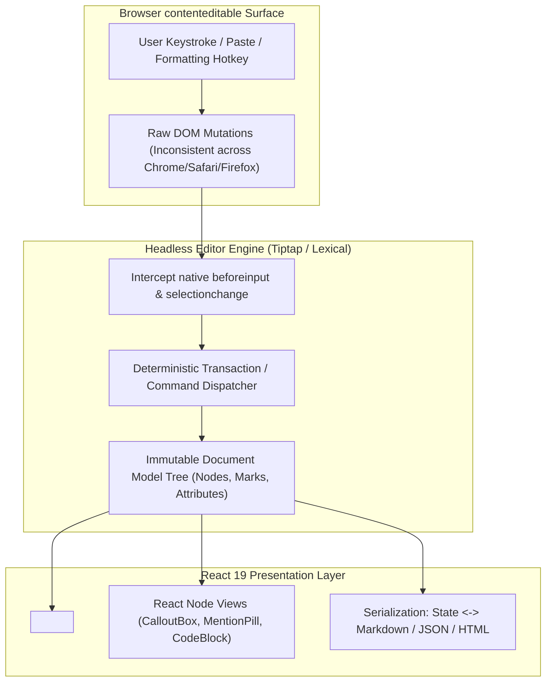

# 07 — Rich Text Editing: Tiptap (ProseMirror) vs. Lexical in React

## Metadata
- **React Version**: 19.0.0+
- **Prerequisites**: [01-components-and-props.md](../01-fundamentals/02-components-and-props.md), DOM Events & Selections, Abstract Syntax Trees
- **Difficulty**: Advanced
- **Estimated Read Time**: 30 minutes
- **Tags**: `rich-text`, `tiptap`, `lexical`, `prosemirror`, `wysiwyg`, `contenteditable`, `editor`

---

## Architecture Diagram

The diagram below compares the headless document modeling architectures of **Tiptap (built on ProseMirror)** and **Lexical (built by Meta)**, illustrating how both frameworks intercept browser `contenteditable` input mutations and translate them into deterministic state transactions before rendering back to the DOM.



---

## Concept Overview

Building rich text editors on the web is notoriously difficult because browser native `contenteditable="true"` is completely inconsistent across operating systems and rendering engines:
- Pressing `Enter` in Chrome inserts `<div><br></div>`, in Safari inserts `<p><br></p>`, and in Firefox inserts `<br>`.
- Copying and pasting from Microsoft Word or Google Docs injects thousands of lines of bloated inline CSS styles.
- Undo/redo stacks desynchronize with React state.

Modern web architecture abandons raw `contenteditable` in favor of **Headless Rich Text Frameworks**:
1. **Tiptap (ProseMirror)**: Built on ProseMirror, the battle-tested standard behind The New York Times, Atlassian, and GitLab. Highly extensible, based on a schema of **Nodes** (blocks) and **Marks** (inline styles), with first-class support for rendering native React components as editor blocks (`ReactNodeViewRenderer`).
2. **Lexical**: Meta's next-generation editor framework (successor to Draft.js). Engineered for extreme performance, tiny bundle footprint (~22KB), strict tree invariants, and accessibility.

### Tiptap vs Lexical Comparison

| Dimension | Tiptap (v2.10+) | Lexical (by Meta v0.20+) |
| :--- | :--- | :--- |
| **Foundation** | ProseMirror (Battle-tested standard) | Meta's custom tree reconciler |
| **Developer Experience**| Outstanding, plug-and-play extensions | Lower-level, modular plugin composition |
| **React Integration** | First-class (`@tiptap/react`) | Native React packages (`@lexical/react`) |
| **Custom Block Nodes** | Easy (`ReactNodeViewRenderer`) | Requires creating custom `DecoratorNode` classes |
| **Bundle Size** | Moderate (~40KB core + extensions) | Ultra-lightweight (~22KB) |
| **Markdown Support** | Native extension (`@tiptap/extension-markdown`)| Built-in markdown transformers |
| **Best Used For** | CMS editors, Notion-like document tools | High-performance social inputs, chat boxes, comments |

---

## Practical Implementation

### Example 1: Full-Featured Document Editor with Tiptap

A complete rich text editor supporting bold, italic, headings, bullet lists, blockquotes, and code blocks.

```tsx
// src/components/TiptapEditor.tsx
import React from 'react';
import { useEditor, EditorContent } from '@tiptap/react';
import StarterKit from '@tiptap/starter-kit';
import Placeholder from '@tiptap/extension-placeholder';

export function TiptapEditor({ initialContent = '<p>Start typing...</p>' }: { initialContent?: string }) {
  const editor = useEditor({
    extensions: [
      StarterKit.configure({
        heading: { levels: [1, 2, 3] },
      }),
      Placeholder.configure({
        placeholder: 'Write something inspiring...',
      }),
    ],
    content: initialContent,
    editorProps: {
      attributes: {
        class: 'prose prose-sm max-w-none p-4 min-h-[200px] focus:outline-none bg-white',
      },
    },
  });

  if (!editor) return null;

  return (
    <div className="border rounded-xl shadow-sm overflow-hidden bg-white">
      {/* Formatting Toolbar */}
      <div className="flex flex-wrap gap-1 p-2 bg-gray-50 border-b text-xs font-semibold">
        <button
          onClick={() => editor.chain().focus().toggleBold().run()}
          className={`px-2.5 py-1 rounded ${editor.isActive('bold') ? 'bg-blue-600 text-white' : 'bg-white border'}`}
        >
          Bold
        </button>
        <button
          onClick={() => editor.chain().focus().toggleItalic().run()}
          className={`px-2.5 py-1 rounded ${editor.isActive('italic') ? 'bg-blue-600 text-white' : 'bg-white border'}`}
        >
          Italic
        </button>
        <button
          onClick={() => editor.chain().focus().toggleHeading({ level: 2 }).run()}
          className={`px-2.5 py-1 rounded ${editor.isActive('heading', { level: 2 }) ? 'bg-blue-600 text-white' : 'bg-white border'}`}
        >
          H2
        </button>
        <button
          onClick={() => editor.chain().focus().toggleBulletList().run()}
          className={`px-2.5 py-1 rounded ${editor.isActive('bulletList') ? 'bg-blue-600 text-white' : 'bg-white border'}`}
        >
          Bullet List
        </button>
        <button
          onClick={() => editor.chain().focus().toggleBlockquote().run()}
          className={`px-2.5 py-1 rounded ${editor.isActive('blockquote') ? 'bg-blue-600 text-white' : 'bg-white border'}`}
        >
          Quote
        </button>
      </div>

      {/* Editor Content Area */}
      <EditorContent editor={editor} />
    </div>
  );
}
```

*Expected Verification Output:*
```text
Renders formatted WYSIWYG editor with functional formatting buttons.
Selecting text and clicking "Bold" toggles <strong> tag; toolbar highlights active status dynamically.
```

---

### Example 2: Custom Interactive React Component Inside Tiptap (Callout Block)

One of Tiptap's greatest features is rendering custom, interactive React components as blocks within the editor document using `ReactNodeViewRenderer` and `NodeViewWrapper`.

```tsx
// src/components/CalloutNodeView.tsx
import React from 'react';
import { NodeViewWrapper, NodeViewContent } from '@tiptap/react';

export function CalloutNodeView({ node, updateAttributes }: any) {
  const type = node.attrs.type || 'info';

  const typeStyles = {
    info: 'border-blue-500 bg-blue-50 text-blue-900',
    warning: 'border-amber-500 bg-amber-50 text-amber-900',
    danger: 'border-red-500 bg-red-50 text-red-900',
  };

  return (
    <NodeViewWrapper className={`my-4 p-4 border-l-4 rounded-r shadow-sm ${typeStyles[type as keyof typeof typeStyles]}`}>
      <div className="flex justify-between items-center mb-2" contentEditable={false}>
        <span className="font-bold text-xs uppercase tracking-wider">💡 {type} Alert</span>
        <select
          value={type}
          onChange={(e) => updateAttributes({ type: e.target.value })}
          className="text-xs bg-white border rounded px-1.5 py-0.5"
        >
          <option value="info">Info</option>
          <option value="warning">Warning</option>
          <option value="danger">Danger</option>
        </select>
      </div>
      {/* NodeViewContent is the editable rich-text slot inside the React block! */}
      <NodeViewContent className="text-sm font-sans" />
    </NodeViewWrapper>
  );
}
```

```ts
// src/extensions/CalloutExtension.ts
import { Node, mergeAttributes } from '@tiptap/core';
import { ReactNodeViewRenderer } from '@tiptap/react';
import { CalloutNodeView } from '../components/CalloutNodeView';

export const Callout = Node.create({
  name: 'callout',
  group: 'block',
  content: 'block+', // Can contain paragraphs, lists, etc.
  addAttributes() {
    return {
      type: { default: 'info' },
    };
  },
  parseHTML() {
    return [{ tag: 'div[data-type="callout"]' }];
  },
  renderHTML({ HTMLAttributes }) {
    return ['div', mergeAttributes(HTMLAttributes, { 'data-type': 'callout' }), 0];
  },
  addNodeView() {
    return ReactNodeViewRenderer(CalloutNodeView);
  },
});
```

*Expected Verification Output:*
```text
Editor inserts interactive callout block.
User can type rich text inside NodeViewContent while selecting variant (info, warning, danger) from React dropdown!
```

---

### Example 3: Fast Lightweight Editor with Meta's Lexical

A streamlined social comment box built using Lexical.

```tsx
// src/components/LexicalCommentEditor.tsx
import React from 'react';
import { LexicalComposer } from '@lexical/react/LexicalComposer';
import { PlainTextPlugin } from '@lexical/react/LexicalPlainTextPlugin';
import { ContentEditable } from '@lexical/react/LexicalContentEditable';
import { HistoryPlugin } from '@lexical/react/LexicalHistoryPlugin';
import { OnChangePlugin } from '@lexical/react/LexicalOnChangePlugin';
import { LexicalErrorBoundary } from '@lexical/react/LexicalErrorBoundary';
import type { EditorState } from 'lexical';

const initialConfig = {
  namespace: 'CommentEditor',
  onError(error: Error) {
    console.error('Lexical Error:', error);
  },
};

export function LexicalCommentEditor({ onChange }: { onChange?: (json: string) => void }) {
  const handleChange = (editorState: EditorState) => {
    editorState.read(() => {
      const json = JSON.stringify(editorState.toJSON());
      onChange?.(json);
    });
  };

  return (
    <div className="border rounded-lg p-3 bg-white shadow-sm max-w-lg">
      <LexicalComposer initialConfig={initialConfig}>
        <div className="relative">
          <PlainTextPlugin
            contentEditable={
              <ContentEditable className="min-h-16 outline-none text-sm text-gray-800" />
            }
            placeholder={
              <div className="absolute top-0 text-sm text-gray-400 pointer-events-none">
                Write a comment...
              </div>
            }
            ErrorBoundary={LexicalErrorBoundary}
          />
          <HistoryPlugin />
          <OnChangePlugin onChange={handleChange} />
        </div>
      </LexicalComposer>
    </div>
  );
}
```

*Expected Verification Output:*
```text
Mounts lightweight (~22KB) Lexical comment input.
Captures key events with native undo/redo history; serializes state JSON on keystrokes.
```

---

### Example 4: Serializing Editor Content to Markdown and JSON AST

Converting document state for database persistence and markdown rendering.

```tsx
// src/components/EditorPersistenceDemo.tsx
import React, { useState } from 'react';
import { useEditor, EditorContent } from '@tiptap/react';
import StarterKit from '@tiptap/starter-kit';

export function EditorPersistenceDemo() {
  const [markdownOutput, setMarkdownOutput] = useState('');
  const [jsonOutput, setJsonOutput] = useState('');

  const editor = useEditor({
    extensions: [StarterKit],
    content: '<h2>Hello World</h2><p>This is persisted content.</p>',
  });

  const handleSave = () => {
    if (!editor) return;
    // 1. Export as raw JSON AST (Recommended for database storage)
    const jsonAst = editor.getJSON();
    setJsonOutput(JSON.stringify(jsonAst, null, 2));

    // 2. Export as clean HTML
    const html = editor.getHTML();
    console.log('Exported HTML:', html);
  };

  return (
    <div className="p-6 border rounded space-y-4">
      <EditorContent editor={editor} className="border p-2 min-h-32 rounded" />

      <button
        onClick={handleSave}
        className="px-4 py-2 bg-blue-600 text-white rounded font-medium hover:bg-blue-700"
      >
        Export AST
      </button>

      {jsonOutput && (
        <pre className="p-3 bg-gray-900 text-emerald-400 rounded text-xs overflow-x-auto max-h-60">
          {jsonOutput}
        </pre>
      )}
    </div>
  );
}
```

*Expected Verification Output:*
```text
Clicking "Export AST":
Generates structured ProseMirror JSON tree:
{
  "type": "doc",
  "content": [
    { "type": "heading", "attrs": { "level": 2 }, "content": [{ "type": "text", "text": "Hello World" }] },
    { "type": "paragraph", "content": [{ "type": "text", "text": "This is persisted content." }] }
  ]
}
```

---

### Example 5: Handling Collaborative Real-Time Editing with Yjs

Tiptap has first-class integration with Yjs for Google Docs-style real-time collaboration.

```tsx
// src/components/CollaborativeTiptap.tsx
import React from 'react';
import { useEditor, EditorContent } from '@tiptap/react';
import StarterKit from '@tiptap/starter-kit';
import Collaboration from '@tiptap/extension-collaboration';
import CollaborationCursor from '@tiptap/extension-collaboration-cursor';
import * as Y from 'yjs';

interface CollabEditorProps {
  ydoc: Y.Doc;
  provider: any; // WebrtcProvider or WebsocketProvider
  username: string;
  userColor: string;
}

export function CollaborativeTiptap({ ydoc, provider, username, userColor }: CollabEditorProps) {
  const editor = useEditor({
    extensions: [
      StarterKit.configure({
        // Disable history because Yjs manages its own collaborative undo manager
        history: false,
      }),
      // Bind editor state directly to Yjs CRDT document!
      Collaboration.configure({
        document: ydoc,
      }),
      // Render remote user cursors and selection highlights
      CollaborationCursor.configure({
        provider: provider,
        user: { name: username, color: userColor },
      }),
    ],
  });

  return (
    <div className="border rounded p-4">
      <div className="text-xs font-semibold mb-2 text-gray-500">
        Editing as: <span style={{ color: userColor }}>{username}</span>
      </div>
      <EditorContent editor={editor} />
    </div>
  );
}
```

*Expected Verification Output:*
```text
Multiple users edit document simultaneously over WebSockets or WebRTC.
Remote user cursor and colored name pill render live inside editor text stream.
```

---

## Mental Model & Analogies

### The Virtual DOM for Text Editing

- **Raw `contenteditable`** is like directly manipulating the physical browser DOM with `document.getElementById().appendChild()`. You run into race conditions, cross-browser quirks, and broken history.
- **Tiptap and Lexical** are like the **React Virtual DOM, but for documents**:
  - The editor maintains an **Abstract Document Tree** in JavaScript memory.
  - When the user presses a key, the editor generates a state transition transaction.
  - The framework computes the minimal diff against the internal schema and safely updates the visible DOM, ensuring 100% deterministic and predictable documents.

---

## Under the Hood / Internal Mechanics

### Nodes vs Marks in ProseMirror / Tiptap

The ProseMirror document model differentiates between:
- **Nodes**: Structural block or inline entities (e.g. `doc`, `paragraph`, `heading`, `bulletList`, `image`, `callout`). Nodes have strict hierarchical parent-child relationships defined in a schema.
- **Marks**: Formatting attributes applied to a range of inline text (e.g. `bold`, `italic`, `strike`, `link`, `highlight`). Marks do not create new parent containers; they decorate character sequences without altering the structural tree depth.

---

## Common Pitfalls & Anti-Patterns

| Anti-Pattern | Why It Breaks | Recommended Solution |
| :--- | :--- | :--- |
| **Storing Raw HTML in Database** | HTML is vulnerable to XSS and difficult to transform to mobile/native or markdown. | Store structured JSON AST (`editor.getJSON()`); serialize to HTML on demand. |
| **Enabling Native History with Collaboration** | Native undo/redo conflicts with Yjs CRDT history, undoing other users' edits. | Set `history: false` when using `Collaboration` extensions. |
| **Mutating Document Nodes Outside Transactions**| Causes the internal editor tree to desynchronize from the visible DOM. | Always use `editor.chain().focus().run()` or Lexical `editor.update()`. |
| **Using `contenteditable="true"` Directly** | Yields completely inconsistent markup across Chrome, Safari, and Firefox. | Always use an established headless framework like Tiptap or Lexical. |
| **Mounting Heavy React State in Custom Node Views**| Complex state trees inside each paragraph can slow typing frame rates. | Keep Node Views lightweight and memoize callbacks. |
| **Missing CSS Styling on `.ProseMirror` Container**| Editor text renders as unstyled raw text without paragraph margins or bullet points. | Style the editor using Tailwind's `@tailwindcss/typography` (`prose prose-sm`). |

---

## Performance & Optimization

### Debouncing Export and Persistence Operations

Avoid calling `editor.getJSON()` or sending network saves on every single keystroke:
```ts
const handleUpdate = debounce(({ editor }) => {
  saveDraftToBackend(editor.getJSON());
}, 500);
```

---

## Edge Cases & Debugging

### Inspecting ProseMirror Documents
Install the **ProseMirror Developer Tools** package:
```bash
npm install prosemirror-dev-tools
```
This adds a live DevTools drawer showing the active document tree, selection coordinates, and transaction history.

---

## Ecosystem & Alternative Approaches

- **Slate.js**: A pure React-based rich text framework. Highly customizable, but historically suffered from frequent breaking changes.
- **Quill.js**: Older WYSIWYG editor with DOM-based mutation models. Less suitable for complex headless architectures.
- **Plate**: A rich text editor framework built on top of Slate.

---

## Exercises & Challenges

<details>
<summary><strong>Exercise 1: Implement an Auto-Linking URL Extension</strong></summary>

**Challenge**: Configure Tiptap to automatically convert typed URLs (e.g. `https://react.dev`) into clickable hyperlinks.

```tsx
import Link from '@tiptap/extension-link';

const editor = useEditor({
  extensions: [
    StarterKit,
    Link.configure({
      openOnClick: false,
      autolink: true,
      defaultProtocol: 'https',
    }),
  ],
});
```
</details>

<details>
<summary><strong>Exercise 2: Character and Word Counter Badge</strong></summary>

**Challenge**: Display a live word and character count badge below the editor using `@tiptap/extension-character-count`.

```tsx
import CharacterCount from '@tiptap/extension-character-count';

// In component:
const characters = editor.storage.characterCount.characters();
const words = editor.storage.characterCount.words();

return (
  <div className="text-xs text-gray-500 mt-2">
    {words} words | {characters} characters (Limit: 500)
  </div>
);
```
</details>

---

## Frequently Asked Interview Questions

<details>
<summary><strong>1. Why is building rich text editors directly with browser `contenteditable` considered an anti-pattern?</strong></summary>

Browser native `contenteditable` implementations are notoriously fragmented and non-standard. Pressing `Enter` produces different HTML tags across Chrome (`<div>`), Safari (`<p>`), and Firefox (`<br>`). Pasting formatted text injects non-standard inline styles, and native browser undo stacks frequently corrupt application state. Modern headless frameworks (Tiptap, Lexical) intercept native input events and map them to an immutable, schema-validated document model tree.
</details>

<details>
<summary><strong>2. What is the difference between a "Node" and a "Mark" in Tiptap/ProseMirror?</strong></summary>

**Nodes** are structural blocks or inline elements that define the hierarchy of the document (such as `doc`, `paragraph`, `heading`, `bulletList`, `listItem`, or custom `callout` blocks). 
**Marks** are styling attributes applied to a range of text characters (such as `bold`, `italic`, `strike`, `link`). Marks decorate text without creating new structural tree nodes.
</details>

<details>
<summary><strong>3. How does Tiptap allow developers to render React components inside an editor?</strong></summary>

Tiptap provides the `ReactNodeViewRenderer` adapter. It bridges ProseMirror's imperative DOM node view lifecycle to React's component model. The custom React component wraps its editable content inside `<NodeViewContent />` and outer container in `<NodeViewWrapper />`, allowing full React state, hooks, and interactions inside the editor canvas.
</details>

<details>
<summary><strong>4. Why is JSON AST preferred over raw HTML for persisting rich text documents in a database?</strong></summary>

Storing structured JSON Abstract Syntax Trees (AST) guarantees strict schema compliance, prevents Cross-Site Scripting (XSS) injection attacks, and decouples content from HTML styling. An AST can be easily transformed into different formats (e.g. mobile React Native views, markdown, plain text search indexes) without complex HTML parsing.
</details>

<details>
<summary><strong>5. How does Meta's Lexical compare to Tiptap and ProseMirror?</strong></summary>

Lexical was built by Meta from the ground up to replace Draft.js. It focuses on extreme lightweight performance (~22KB vs ~40KB+), strict tree validation invariants, and accessibility. While Tiptap provides richer ready-made extensions and effortless React component node views, Lexical is often chosen for high-performance social inputs, chat bars, and mobile web experiences.
</details>

<details>
<summary><strong>6. How do modern rich text editors support real-time collaborative editing?</strong></summary>

Modern editors integrate with Conflict-free Replicated Data Types (CRDTs), most notably **Yjs**. The editor binds its document tree directly to a shared `Y.Doc`. When a user types, changes are translated into atomic CRDT operations and synchronized over WebSockets or WebRTC, allowing multiple users to edit simultaneously without merge conflicts.
</details>

<details>
<summary><strong>7. What is a Transaction in ProseMirror / Tiptap?</strong></summary>

A Transaction is an object that describes a step-by-step change to the document state (inserting text, applying a mark, changing selection). Transactions are pure: they take an existing `EditorState`, apply the transformations, and produce a brand-new `EditorState`. This enables predictable undo/redo histories and plugins that inspect or reject changes before they are applied.
</details>

<details>
<summary><strong>8. How do you handle placeholder text gracefully in headless rich text editors?</strong></summary>

Because headless editors don't rely on native `<input placeholder>`, placeholder text is managed via extensions (e.g. `@tiptap/extension-placeholder`). The extension applies CSS classes (such as `is-editor-empty`) to empty nodes and uses CSS `::before` pseudo-elements with `content: attr(data-placeholder)` to display the prompt without polluting the document model.
</details>

---

## References & Further Reading

- [Tiptap Official Documentation](https://tiptap.dev/docs/editor/introduction)
- [ProseMirror Architecture Guide](https://prosemirror.net/docs/guide/)
- [Lexical by Meta Documentation](https://lexical.dev/)
- [Yjs Collaborative Framework](https://yjs.dev/)
- [Why ContentEditable is Terrible - Nick Santos](https://medium.engineering/why-contenteditable-is-terrible-122494fd7919)
