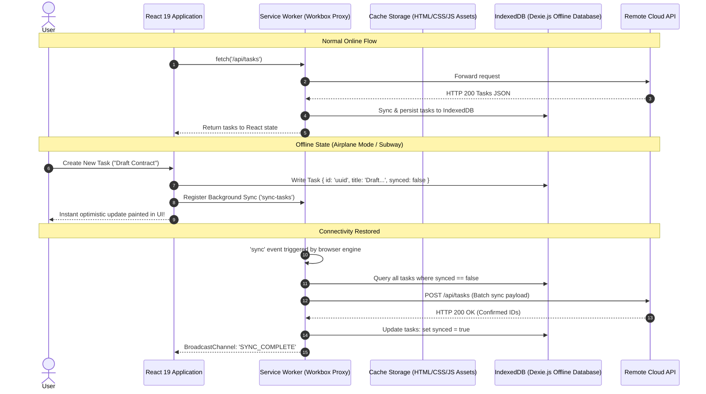

# 08 — Progressive Web Apps (PWA) & Offline-First React

## Metadata
- **React Version**: 19.0.0+
- **Prerequisites**: [11-api-integration/00-fetch.md](../11-api-integration/00-fetch.md), Service Workers & Cache Storage API, IndexedDB
- **Difficulty**: Advanced
- **Estimated Read Time**: 29 minutes
- **Tags**: `pwa`, `offline-first`, `service-worker`, `workbox`, `indexeddb`, `dexie`, `background-sync`

---

## Architecture Diagram

The diagram below details how an Offline-First React application operates: intercepting network requests via a Service Worker running Workbox caching strategies, storing relational entity state inside IndexedDB (via Dexie.js), and queuing offline mutations in a Background Sync queue until connectivity is restored.



---

## Concept Overview

Traditional web applications assume continuous, reliable network connectivity. When a user loses signal (in a subway, elevator, or rural area), the application breaks, displaying Chrome's "Dinosaur" offline screen.

An **Offline-First Progressive Web App (PWA)** treats network connectivity as an opportunistic enhancement rather than a hard dependency:
1. **Application Shell Architecture**: Critical HTML, CSS, JavaScript bundles, and fonts are cached locally in the browser's Cache Storage via a **Service Worker**. The app boots instantly (in <200ms) even with zero network connection.
2. **Local-First Data Persistence**: Application state is stored locally inside the browser's **IndexedDB** database (using Dexie.js). Queries read and write to local disk first, eliminating network round-trip latencies.
3. **Background Synchronization**: When offline, user mutations (such as creating notes, updating profiles, or submitting tickets) are recorded into an offline outbox queue. The browser's **Background Sync API** flushes the queue to the cloud API once the device reconnects.
4. **Installability**: A Web App Manifest allows users to install the web application directly onto mobile and desktop home screens with native window chrome and app icons.

---

## Practical Implementation

### Example 1: Configuring `vite-plugin-pwa` with Workbox

Configuring automated service worker generation and asset caching in a modern Vite 6 / React 19 project.

```ts
// vite.config.ts
import { defineConfig } from 'vite';
import react from '@vitejs/plugin-react';
import { VitePWA } from 'vite-plugin-pwa';

export default defineConfig({
  plugins: [
    react(),
    VitePWA({
      registerType: 'autoUpdate',
      includeAssets: ['favicon.ico', 'apple-touch-icon.png', 'masked-icon.svg'],
      manifest: {
        name: 'Enterprise Tasks PWA',
        short_name: 'Tasks',
        description: 'Offline-First Task Management System',
        theme_color: '#2563eb',
        background_color: '#ffffff',
        display: 'standalone',
        orientation: 'portrait',
        icons: [
          {
            src: 'pwa-192x192.png',
            sizes: '192x192',
            type: 'image/png',
          },
          {
            src: 'pwa-512x512.png',
            sizes: '512x512',
            type: 'image/png',
            purpose: 'any maskable',
          },
        ],
      },
      workbox: {
        // Caching strategies for runtime assets
        runtimeCaching: [
          {
            // Cache Google Fonts
            urlPattern: /^https:\/\/fonts\.googleapis\.com\/.*/i,
            handler: 'CacheFirst',
            options: {
              cacheName: 'google-fonts-cache',
              expiration: { maxEntries: 10, maxAgeSeconds: 60 * 60 * 24 * 365 },
            },
          },
          {
            // Stale-While-Revalidate for API queries
            urlPattern: /\/api\/v1\/.*/i,
            handler: 'NetworkFirst',
            options: {
              cacheName: 'api-cache',
              networkTimeoutSeconds: 3,
              expiration: { maxEntries: 100, maxAgeSeconds: 60 * 60 * 24 },
            },
          },
        ],
      },
    }),
  ],
});
```

*Expected Verification Output:*
```text
Build generates dist/sw.js and registerSW.js.
Application precaches all JS/CSS bundles; registers Service Worker automatically on page load.
```

---

### Example 2: Typed Offline Database with Dexie.js (IndexedDB ORM)

Using Dexie.js to manage local relational persistence in the browser.

```ts
// src/db/appDb.ts
import Dexie, { type Table } from 'dexie';

export interface LocalTask {
  id: string;
  title: string;
  completed: boolean;
  createdAt: number;
  synced: boolean; // Tracking synchronization status
}

export class TaskDatabase extends Dexie {
  tasks!: Table<LocalTask>;

  constructor() {
    super('TaskDatabase');
    // Define schema and indexes
    this.version(1).stores({
      tasks: 'id, completed, createdAt, synced',
    });
  }
}

export const db = new TaskDatabase();
```

*Expected Verification Output:*
```text
Creates IndexedDB database "TaskDatabase" with indexed fields [id, completed, createdAt, synced].
Provides type-safe transactional queries in JavaScript.
```

---

### Example 3: Reactive IndexedDB Hook with Dexie `useLiveQuery`

`useLiveQuery` automatically re-renders the React component whenever data changes inside IndexedDB—even from other tabs or service workers!

```tsx
// src/components/OfflineTaskManager.tsx
import React, { useState } from 'react';
import { useLiveQuery } from 'dexie-react-hooks';
import { db, type LocalTask } from '../db/appDb';

export function OfflineTaskManager() {
  const [taskTitle, setTaskTitle] = useState('');

  // 1. Reactive subscription to IndexedDB!
  const tasks = useLiveQuery(
    () => db.tasks.orderBy('createdAt').reverse().toArray(),
    []
  );

  const handleAddTask = async (e: React.FormEvent) => {
    e.preventDefault();
    if (!taskTitle.trim()) return;

    const newTask: LocalTask = {
      id: crypto.randomUUID(),
      title: taskTitle.trim(),
      completed: false,
      createdAt: Date.now(),
      synced: navigator.onLine, // If offline, marked false
    };

    // Instant local write to IndexedDB!
    await db.tasks.add(newTask);
    setTaskTitle('');

    // Trigger background sync if offline
    if (!navigator.onLine && 'serviceWorker' in navigator && 'SyncManager' in window) {
      const reg = await navigator.serviceWorker.ready;
      await (reg as any).sync.register('sync-tasks');
    }
  };

  const toggleTask = async (task: LocalTask) => {
    await db.tasks.update(task.id, {
      completed: !task.completed,
      synced: false,
    });
  };

  return (
    <div className="p-6 max-w-md mx-auto border rounded-xl bg-white shadow-sm space-y-4">
      <div className="flex justify-between items-center">
        <h3 className="font-bold text-lg">Offline-First Tasks</h3>
        <span className={`text-xs px-2 py-0.5 rounded font-semibold ${
          navigator.onLine ? 'bg-green-100 text-green-800' : 'bg-amber-100 text-amber-800'
        }`}>
          {navigator.onLine ? '● Online' : '○ Offline Mode'}
        </span>
      </div>

      <form onSubmit={handleAddTask} className="flex gap-2">
        <input
          type="text"
          value={taskTitle}
          onChange={(e) => setTaskTitle(e.target.value)}
          placeholder="New task title..."
          className="flex-1 border p-2 rounded text-sm"
        />
        <button type="submit" className="px-4 py-2 bg-blue-600 text-white rounded text-sm font-semibold">
          Add
        </button>
      </form>

      <ul className="divide-y border rounded">
        {tasks?.map((t) => (
          <li key={t.id} className="p-3 flex justify-between items-center">
            <span
              onClick={() => toggleTask(t)}
              className={`cursor-pointer text-sm ${t.completed ? 'line-through text-gray-400' : 'text-gray-800'}`}
            >
              {t.title}
            </span>
            <span className={`text-xs px-1.5 py-0.5 rounded ${t.synced ? 'text-gray-400' : 'text-amber-600 bg-amber-50'}`}>
              {t.synced ? 'Synced' : 'Pending Sync'}
            </span>
          </li>
        ))}
      </ul>
    </div>
  );
}
```

*Expected Verification Output:*
```text
Disconnect Internet -> Add task "Buy Milk".
Task renders immediately in UI marked "Pending Sync".
Task is safely persisted in browser IndexedDB across reloads while offline.
```

---

### Example 4: Custom PWA Install Prompt Banner

Capturing the browser's `beforeinstallprompt` event to display an in-app installation banner.

```tsx
// src/components/PWAInstallBanner.tsx
import React, { useState, useEffect } from 'react';

export function PWAInstallBanner() {
  const [deferredPrompt, setDeferredPrompt] = useState<any>(null);
  const [isVisible, setIsVisible] = useState(false);

  useEffect(() => {
    const handleBeforeInstall = (e: Event) => {
      // Prevent browser default mini-infobar
      e.preventDefault();
      setDeferredPrompt(e);
      setIsVisible(true);
    };

    window.addEventListener('beforeinstallprompt', handleBeforeInstall);
    return () => window.removeEventListener('beforeinstallprompt', handleBeforeInstall);
  }, []);

  const handleInstallClick = async () => {
    if (!deferredPrompt) return;
    // Show native OS install prompt
    deferredPrompt.prompt();
    const { outcome } = await deferredPrompt.userChoice;
    console.log('User install choice:', outcome);
    setDeferredPrompt(null);
    setIsVisible(false);
  };

  if (!isVisible) return null;

  return (
    <div className="fixed bottom-4 left-4 right-4 md:left-auto md:w-96 p-4 bg-gray-900 text-white rounded-xl shadow-2xl flex items-center justify-between z-50">
      <div>
        <h4 className="font-bold text-sm">Install App</h4>
        <p className="text-xs text-gray-400">Add to home screen for offline access</p>
      </div>
      <div className="flex gap-2">
        <button
          onClick={() => setIsVisible(false)}
          className="text-xs text-gray-400 hover:text-white px-2 py-1"
        >
          Later
        </button>
        <button
          onClick={handleInstallClick}
          className="text-xs bg-blue-600 hover:bg-blue-700 text-white font-semibold px-3 py-1.5 rounded"
        >
          Install
        </button>
      </div>
    </div>
  );
}
```

*Expected Verification Output:*
```text
Browser fires beforeinstallprompt -> Custom dark banner slides into view.
Clicking "Install" opens native OS install dialog (Windows/macOS/Android).
```

---

### Example 5: Handling Service Worker Updates with User Notification

Notifying the user when a new version of the application has been built and downloaded in the background.

```tsx
// src/components/PWAUpdateToast.tsx
import React from 'react';
import { useRegisterSW } from 'virtual:pwa-register/react';

export function PWAUpdateToast() {
  const {
    needRefresh: [needRefresh, setNeedRefresh],
    updateServiceWorker,
  } = useRegisterSW({
    onRegistered(r) {
      console.log('SW Registered:', r);
    },
    onRegisterError(error) {
      console.error('SW registration error', error);
    },
  });

  if (!needRefresh) return null;

  return (
    <div className="fixed top-4 right-4 bg-blue-600 text-white p-4 rounded-lg shadow-lg z-50 flex items-center gap-3">
      <span className="text-sm font-medium">New version available!</span>
      <button
        onClick={() => updateServiceWorker(true)}
        className="px-3 py-1 bg-white text-blue-600 rounded text-xs font-bold hover:bg-blue-50"
      >
        Reload Now
      </button>
      <button
        onClick={() => setNeedRefresh(false)}
        className="text-xs text-blue-200 hover:text-white"
      >
        Dismiss
      </button>
    </div>
  );
}
```

*Expected Verification Output:*
```text
New production deploy uploaded to CDN.
Service worker downloads new assets in background -> Toast alerts user -> Click "Reload Now" applies new version instantly.
```

---

## Mental Model & Analogies

### The Local Branch Office and the Headquarters

- **Online-Only Web App**: A remote customer service desk that has no computer, only a direct phone line to the corporate headquarters. If the phone line is severed, the employee throws their hands up and tells customers to go away.
- **Offline-First PWA**: A **fully autonomous local branch office**:
  - The branch office has its own local filing cabinets (`IndexedDB`) and operating manuals (`Cache Storage`).
  - When a customer walks in, the employee files paperwork immediately into the local drawer.
  - An outbox tray (`Background Sync`) holds pending forms.
  - When the phone lines reconnect, the employee faxes all pending files to corporate headquarters in a single batch.

---

## Under the Hood / Internal Mechanics

### The 5 Standard Workbox Caching Strategies

| Strategy | Behavior | Best Used For |
| :--- | :--- | :--- |
| **Cache-First** | Checks cache; returns cached version immediately. Falls back to network only on cache miss. | Version-hashed static assets (`*.hash.js`, fonts, images) |
| **Network-First** | Tries network with timeout. If network fails or times out (e.g. 3s), falls back to cache. | Frequently updated API data, news articles, search feeds |
| **Stale-While-Revalidate** | Returns cached version **instantly** to user, while fetching new version in background for next time. | User avatars, dashboards, profile views |
| **Network-Only** | Always requires network; never caches. | Sensitive financial transactions, checkout payments |
| **Cache-Only** | Only reads from cache; never fetches. | Precached static offline fallback pages (`offline.html`) |

---

## Common Pitfalls & Anti-Patterns

| Anti-Pattern | Why It Breaks | Recommended Solution |
| :--- | :--- | :--- |
| **Caching `index.html` with Cache-First** | Users get permanently stuck on older versions because the browser never checks the server for new asset hashes. | Always use `NetworkFirst` or `StaleWhileRevalidate` for `index.html`. |
| **Using `localStorage` for Offline Relational Data** | `localStorage` is synchronous, limited to 5MB, blocks the main thread, and is inaccessible in workers. | Always use **IndexedDB** (via Dexie.js) for structured offline storage. |
| **Ignoring Background Sync Quota Limits** | Browsers can reject sync registrations if storage quota is exhausted. | Monitor `navigator.storage.estimate()` and handle sync rejections gracefully. |
| **Forgetting to Provide 192px and 512px Icons** | The browser refuses to trigger `beforeinstallprompt`, disqualifying the app as installable. | Include valid 192x192 and 512x512 PNG icons in `manifest.json`. |
| **Uncaught Service Worker Registration Errors** | App crashes on browser environments that disable Service Workers (e.g. Firefox Private Browsing). | Always wrap registration in `if ('serviceWorker' in navigator)`. |
| **Infinite Service Worker Update Loops** | Calling `window.location.reload()` unconditionally in `controllerchange` causes infinite reload loops. | Guard reloads with update status flags. |

---

## Performance & Optimization

### Storage Persistence Guarantee

By default, browser storage is **best-effort**: the browser may purge IndexedDB if disk space runs low. Request **Persistent Storage** to prevent eviction:
```ts
if (navigator.storage && navigator.storage.persist) {
  const isPersisted = await navigator.storage.persist();
  console.log('Persistent storage granted:', isPersisted);
}
```

---

## Edge Cases & Debugging

### Debugging Service Workers in Chrome DevTools
- Open Chrome DevTools -> **Application** tab.
- In the left sidebar:
  - **Service Workers**: View registration status, test "Update on reload", simulate "Offline" network conditions, and trigger manual "Sync" events.
  - **Storage**: Inspect Cache Storage and IndexedDB tables in real time.

---

## Ecosystem & Alternative Approaches

- **`vite-plugin-pwa`**: The premier Vite integration for Workbox and Web App Manifests.
- **Dexie.js (`dexie` + `dexie-react-hooks`)**: The most popular and ergonomic IndexedDB library in the React ecosystem.
- **Workbox (`workbox-webpack-plugin`)**: Google's production-grade service worker toolchain.

---

## Exercises & Challenges

<details>
<summary><strong>Exercise 1: Implement an Online/Offline Status Indicator Hook</strong></summary>

**Challenge**: Write a custom hook `useOnlineStatus()` that listens to browser `online` and `offline` events.

```tsx
import { useState, useEffect } from 'react';

export function useOnlineStatus() {
  const [isOnline, setIsOnline] = useState(navigator.onLine);

  useEffect(() => {
    const handleOnline = () => setIsOnline(true);
    const handleOffline = () => setIsOnline(false);

    window.addEventListener('online', handleOnline);
    window.addEventListener('offline', handleOffline);

    return () => {
      window.removeEventListener('online', handleOnline);
      window.removeEventListener('offline', handleOffline);
    };
  }, []);

  return isOnline;
}
```
</details>

<details>
<summary><strong>Exercise 2: Clear Expired Cache Entries on Activation</strong></summary>

**Challenge**: Write a service worker activation listener that deletes old cache versions.

```ts
self.addEventListener('activate', (event: any) => {
  const currentCache = 'app-v2';
  event.waitUntil(
    caches.keys().then((cacheNames) => {
      return Promise.all(
        cacheNames.map((cacheName) => {
          if (cacheName !== currentCache) {
            return caches.delete(cacheName);
          }
        })
      );
    })
  );
});
```
</details>

---

## Frequently Asked Interview Questions

<details>
<summary><strong>1. What makes a web application a Progressive Web App (PWA)?</strong></summary>

A PWA satisfies three core technical criteria:
1. **HTTPS Security**: Must be served over a secure HTTPS origin.
2. **Web App Manifest**: A valid `manifest.json` defining name, theme colors, display mode (`standalone`), and icons.
3. **Service Worker with Fetch Handler**: A registered Service Worker that precaches the application shell, providing offline capability and fast load times.
</details>

<details>
<summary><strong>2. How does a Service Worker differ from a standard Web Worker?</strong></summary>

A **Web Worker** is spawned by a specific web page to offload CPU-intensive tasks; it terminates when the page closes. 
A **Service Worker** is a programmable network proxy registered by the browser. It operates independently of any active tab, intercepts all HTTP network requests from the origin, manages Cache Storage, and can run background tasks (push notifications, background sync) even when no browser tabs are open.
</details>

<details>
<summary><strong>3. Explain the "Stale-While-Revalidate" caching strategy.</strong></summary>

When a request arrives, the Service Worker immediately serves the cached version to the client (instant response), while simultaneously making a background network fetch to the origin server. When the network response returns, the Service Worker updates the cache with the new data. This strategy delivers instant load speeds while ensuring the cache stays reasonably fresh for subsequent visits.
</details>

<details>
<summary><strong>4. Why is IndexedDB preferred over `localStorage` for offline-first React applications?</strong></summary>

`localStorage` is synchronous, blocks the browser's main JavaScript thread during read/writes, has a strict 5MB quota limit, cannot store binary data or indexes, and is completely inaccessible from Service Workers. 
**IndexedDB** is asynchronous, non-blocking, can store gigabytes of structured data, supports binary objects (`Blob`, `ArrayBuffer`), supports multi-field indexes, and is accessible from both React components and Service Workers.
</details>

<details>
<summary><strong>5. How does the Background Sync API work?</strong></summary>

The Background Sync API allows web apps to defer tasks to be handled in the Service Worker until user connectivity is established. The React client registers a sync event (`reg.sync.register('sync-tag')`). When the browser detects internet access, it wakes up the Service Worker and fires the `sync` event, allowing the Service Worker to flush queued offline requests to the backend API even if the user has navigated away or closed the tab.
</details>

<details>
<summary><strong>6. What is the Service Worker lifecycle, and why can it cause "stale app" bugs?</strong></summary>

The lifecycle consists of: **Registering -> Installing -> Installed (Waiting) -> Activating -> Redundant**. 
When a new Service Worker is deployed, it installs in the background, but enters a **waiting** state until all active tabs running the old Service Worker are closed. If developers do not implement skip-waiting (`self.skipWaiting()`) or user-facing "Reload" update banners, users will continue running the older version indefinitely.
</details>

<details>
<summary><strong>7. How do you handle cache invalidation for static assets in a PWA?</strong></summary>

Static assets (JS, CSS, images) should have content hashes embedded in their filenames by bundlers like Vite (`app.a8f19c.js`). The Service Worker can cache these with `Cache-First` permanently. When code changes, the new build generates a new hash filename, automatically bypassing old caches without collision.
</details>

<details>
<summary><strong>8. Can a PWA be installed on iOS devices?</strong></summary>

Yes. On iOS Safari, users tap the **Share** button and select **Add to Home Screen**. While iOS historically lacked the programmatic `beforeinstallprompt` API available on Android/Chrome, modern iOS supports Web App Manifests, Service Workers, Web Push Notifications, and standalone full-screen display modes.
</details>

---

## References & Further Reading

- [Google Chrome: Workbox Documentation](https://developer.chrome.com/docs/workbox/)
- [Vite PWA Plugin Guide](https://vite-pwa-org.netlify.app/)
- [Dexie.js Official Documentation](https://dexie.org/)
- [MDN Web Docs: Progressive Web Apps](https://developer.mozilla.org/en-US/docs/Web/Progressive_web_apps)
- [W3C Web App Manifest Specification](https://www.w3.org/TR/appmanifest/)
