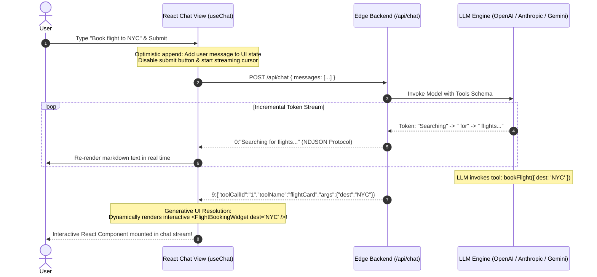

# 10 — Generative AI Chat UIs & Streaming in React

## Metadata
- **React Version**: 19.0.0+
- **Prerequisites**: [11-api-integration/08-sse-and-streaming.md](../11-api-integration/08-sse-and-streaming.md), React Hooks, Generative AI APIs
- **Difficulty**: Advanced
- **Estimated Read Time**: 29 minutes
- **Tags**: `ai`, `chat-ui`, `streaming`, `vercel-ai-sdk`, `generative-ui`, `markdown-streaming`, `llm`

---

## Architecture Diagram

The diagram below details the end-to-end architecture of a modern Generative AI Chat interface in React 19 using the **Vercel AI SDK**: streaming token deltas over HTTP chunked transfer, rendering incremental markdown syntax highlighting, and returning interactive **Generative UI** component blocks (e.g., flight booking cards or stock charts) dynamically from tool calls.



---

## Concept Overview

Building production Generative AI chat interfaces requires solving complex frontend engineering challenges:
1. **Streaming Token Latency**: Large Language Models (LLMs) take seconds or minutes to generate complete responses. Streaming token-by-token (via HTTP chunked streaming or SSE) is mandatory to provide instant feedback (<300ms Time-to-First-Token).
2. **Incomplete Markdown Parsing**: As tokens arrive, markdown syntax is frequently incomplete (e.g. ````ts\nconst x = 1` lacks closing backticks). Standard markdown parsers crash or format improperly when handling unclosed tags.
3. **Auto-Scroll Ergonomics**: The chat view must smoothly scroll to the bottom as new tokens stream in, but must **immediately freeze** if the user scrolls up to read earlier message history.
4. **Generative UI (Component Streaming)**: Moving beyond plain text responses. When the LLM calls a tool (e.g. weather, flights, charts), the frontend renders rich, interactive React components with buttons, forms, and state directly inside the chat feed.

The **Vercel AI SDK (`ai/react`)** is the industry standard toolkit providing high-level reactive hooks (`useChat`, `useCompletion`) and wire protocols for streaming text and tool calls.

---

## Practical Implementation

### Example 1: Core Chat Stream with Vercel AI SDK `useChat`

The `useChat` hook manages message history, user inputs, optimistic updates, streaming tokens, error states, and cancellation.

```tsx
// src/components/AIChatInterface.tsx
import React, { useRef, useEffect } from 'react';
import { useChat } from 'ai/react';

export function AIChatInterface() {
  const {
    messages,
    input,
    handleInputChange,
    handleSubmit,
    isLoading,
    stop,
    reload,
    error,
  } = useChat({
    api: '/api/chat',
    onError: (err) => console.error('Chat stream error:', err),
  });

  const scrollRef = useRef<HTMLDivElement>(null);

  // Auto-scroll to bottom on incoming message updates
  useEffect(() => {
    if (scrollRef.current) {
      scrollRef.current.scrollTop = scrollRef.current.scrollHeight;
    }
  }, [messages]);

  return (
    <div className="flex flex-col h-[600px] max-w-2xl mx-auto border rounded-2xl shadow-xl bg-white overflow-hidden">
      {/* Chat Message History */}
      <div ref={scrollRef} className="flex-1 p-4 overflow-y-auto space-y-4 bg-gray-50">
        {messages.map((m) => (
          <div
            key={m.id}
            className={`flex ${m.role === 'user' ? 'justify-end' : 'justify-start'}`}
          >
            <div
              className={`max-w-[80%] rounded-2xl p-3.5 text-sm leading-relaxed shadow-sm ${
                m.role === 'user'
                  ? 'bg-blue-600 text-white rounded-br-none'
                  : 'bg-white border text-gray-800 rounded-bl-none'
              }`}
            >
              <div className="font-bold text-[10px] uppercase mb-1 opacity-70">
                {m.role === 'user' ? 'You' : 'AI Assistant'}
              </div>
              <p className="whitespace-pre-wrap">{m.content}</p>
            </div>
          </div>
        ))}

        {isLoading && (
          <div className="flex justify-start">
            <div className="bg-white border rounded-2xl rounded-bl-none p-3 shadow-sm flex items-center gap-1.5">
              <span className="w-2 h-2 bg-blue-500 rounded-full animate-bounce" />
              <span className="w-2 h-2 bg-blue-500 rounded-full animate-bounce [animation-delay:0.2s]" />
              <span className="w-2 h-2 bg-blue-500 rounded-full animate-bounce [animation-delay:0.4s]" />
            </div>
          </div>
        )}

        {error && (
          <div className="p-3 bg-red-50 border border-red-200 rounded text-red-700 text-xs flex justify-between items-center">
            <span>Failed to generate response: {error.message}</span>
            <button onClick={() => reload()} className="underline font-bold">
              Retry
            </button>
          </div>
        )}
      </div>

      {/* Input Box */}
      <form onSubmit={handleSubmit} className="p-3 border-t bg-white flex gap-2 items-center">
        <input
          type="text"
          value={input}
          onChange={handleInputChange}
          placeholder="Ask a technical question..."
          className="flex-1 border px-4 py-2.5 rounded-full text-sm focus:outline-none focus:ring-2 focus:ring-blue-500"
        />

        {isLoading ? (
          <button
            type="button"
            onClick={stop}
            className="px-4 py-2 bg-red-600 text-white rounded-full text-xs font-bold hover:bg-red-700"
          >
            Stop
          </button>
        ) : (
          <button
            type="submit"
            disabled={!input.trim()}
            className="px-5 py-2 bg-blue-600 text-white rounded-full text-sm font-semibold hover:bg-blue-700 disabled:opacity-50"
          >
            Send
          </button>
        )}
      </form>
    </div>
  );
}
```

*Expected Verification Output:*
```text
Type prompt -> Optimistic append adds user message instantly.
AI message streams tokens progressively.
Clicking "Stop" aborts the stream via AbortController.
```

---

### Example 2: Streaming Markdown Renderer with Incomplete Syntax Recovery

Using `react-markdown` and `remark-gfm` to format streaming markdown while gracefully handling unclosed code blocks and tables.

```tsx
// src/components/StreamingMarkdown.tsx
import React, { memo } from 'react';
import ReactMarkdown from 'react-markdown';
import remarkGfm from 'remark-gfm';

export const StreamingMarkdown = memo(function StreamingMarkdown({ content }: { content: string }) {
  // If content contains an unclosed code block, auto-append closing backticks
  const normalizedContent = normalizeIncompleteMarkdown(content);

  return (
    <div className="prose prose-sm max-w-none text-gray-800">
      <ReactMarkdown
        remarkPlugins={[remarkGfm]}
        components={{
          code({ node, inline, className, children, ...props }: any) {
            return inline ? (
              <code className="bg-gray-100 text-pink-600 px-1 py-0.5 rounded font-mono text-xs" {...props}>
                {children}
              </code>
            ) : (
              <pre className="bg-gray-900 text-gray-100 p-3 rounded-lg overflow-x-auto text-xs font-mono my-2">
                <code {...props}>{children}</code>
              </pre>
            );
          },
        }}
      >
        {normalizedContent}
      </ReactMarkdown>
    </div>
  );
});

// Helper to close dangling code fence blocks mid-stream
function normalizeIncompleteMarkdown(text: string): string {
  const backtickCount = (text.match(/```/g) || []).length;
  // If odd number of triple-backticks, the block is currently open
  if (backtickCount % 2 !== 0) {
    return text + '\n```';
  }
  return text;
}
```

*Expected Verification Output:*
```text
Receives partial token: "Here is code:\n```ts\nconst greeting = 'Hi'"
Helper auto-appends closing ``` -> ReactMarkdown highlights code cleanly without syntax crash.
```

---

### Example 3: Generative UI: Streaming Rich React Components from Tool Calls

Moving beyond text. When the model invokes a tool (e.g. `showWeatherWidget`), React renders a live, interactive UI component inside the conversation!

```tsx
// src/components/GenerativeUIChat.tsx
import React from 'react';
import { useChat } from 'ai/react';

// An interactive client component rendered inside the AI message stream!
function WeatherWidget({ city, temperature, condition }: { city: string; temperature: number; condition: string }) {
  return (
    <div className="my-3 p-4 bg-gradient-to-r from-blue-500 to-indigo-600 text-white rounded-xl shadow-md max-w-sm">
      <div className="flex justify-between items-center">
        <div>
          <h4 className="font-bold text-lg">{city}</h4>
          <p className="text-xs text-blue-100 capitalize">{condition}</p>
        </div>
        <div className="text-3xl font-extrabold">{temperature}°F</div>
      </div>
      <button
        onClick={() => alert(`Detailed 7-day forecast for ${city}`)}
        className="mt-3 w-full py-1.5 bg-white/20 hover:bg-white/30 rounded text-xs font-semibold backdrop-blur"
      >
        View Hourly Forecast
      </button>
    </div>
  );
}

export function GenerativeUIChat() {
  const { messages } = useChat();

  return (
    <div className="space-y-4 p-4">
      {messages.map((m) => (
        <div key={m.id} className="p-3 border rounded bg-white">
          <p className="text-sm">{m.content}</p>

          {/* Inspect tool invocations in the message payload */}
          {m.toolInvocations?.map((toolInvocation) => {
            const { toolName, toolCallId, state } = toolInvocation;

            if (toolName === 'showWeatherWidget' && state === 'result') {
              const { result } = toolInvocation;
              return (
                <WeatherWidget
                  key={toolCallId}
                  city={result.city}
                  temperature={result.temperature}
                  condition={result.condition}
                />
              );
            }

            return (
              <div key={toolCallId} className="text-xs text-gray-400 italic my-1">
                Executing tool: {toolName}...
              </div>
            );
          })}
        </div>
      ))}
    </div>
  );
}
```

*Expected Verification Output:*
```text
User asks: "What is the weather in Seattle?"
LLM responds with text + invokes showWeatherWidget.
React replaces text tool call with full interactive WeatherWidget component.
```

---

### Example 4: Intelligent Auto-Scroll with User Pause Detection

If a user scrolls up to re-read earlier conversation, auto-scroll must NOT snap them back down against their will.

```tsx
// src/hooks/useSmartScroll.ts
import { useRef, useEffect, useState } from 'react';

export function useSmartScroll(dependency: any) {
  const containerRef = useRef<HTMLDivElement>(null);
  const [isAtBottom, setIsAtBottom] = useState(true);

  const handleScroll = () => {
    if (!containerRef.current) return;
    const { scrollTop, scrollHeight, clientHeight } = containerRef.current;
    // User is considered at bottom if within 60px of the edge
    const nearBottom = scrollHeight - (scrollTop + clientHeight) < 60;
    setIsAtBottom(nearBottom);
  };

  useEffect(() => {
    if (isAtBottom && containerRef.current) {
      containerRef.current.scrollTop = containerRef.current.scrollHeight;
    }
  }, [dependency, isAtBottom]);

  return { containerRef, handleScroll, isAtBottom };
}
```

*Expected Verification Output:*
```text
Streaming tokens scroll view smoothly to bottom.
User manually scrolls up by 100px:
  - isAtBottom flips to false.
  - Streaming continues without hijacking user scroll position!
```

---

### Example 5: Client-Side Tool Confirmation & Human-in-the-Loop

Requiring explicit user confirmation in the UI before an AI agent executes a sensitive mutation (e.g. sending an email or deleting data).

```tsx
// src/components/HumanInTheLoopConfirmation.tsx
import React from 'react';

interface ToolConfirmationProps {
  toolName: string;
  args: Record<string, any>;
  onConfirm: () => void;
  onReject: () => void;
}

export function HumanInTheLoopConfirmation({ toolName, args, onConfirm, onReject }: ToolConfirmationProps) {
  return (
    <div className="my-3 p-4 border border-amber-300 bg-amber-50 rounded-xl shadow-sm text-amber-900">
      <div className="flex items-center gap-2 mb-2 font-bold text-sm">
        <span>⚠️ Action Requires Approval</span>
      </div>
      <p className="text-xs mb-3">
        The assistant requested to execute <code>{toolName}</code> with parameters:
      </p>
      <pre className="p-2 bg-white border rounded text-xs font-mono mb-3 overflow-x-auto">
        {JSON.stringify(args, null, 2)}
      </pre>
      <div className="flex gap-2">
        <button
          onClick={onConfirm}
          className="px-3 py-1 bg-amber-600 hover:bg-amber-700 text-white rounded text-xs font-semibold"
        >
          Approve & Execute
        </button>
        <button
          onClick={onReject}
          className="px-3 py-1 bg-white border border-gray-300 hover:bg-gray-100 text-gray-700 rounded text-xs font-semibold"
        >
          Reject Action
        </button>
      </div>
    </div>
  );
}
```

*Expected Verification Output:*
```text
Agent calls deleteWorkspace({ id: 108 }).
UI pauses execution; mounts confirmation dialog.
User clicks "Approve": Frontend sends confirmation token back to stream.
```

---

## Mental Model & Analogies

### The Live Voice Dictation vs The Sealed Envelope

- **Traditional REST Query** is a **sealed envelope**: You send a letter asking a question, wait in silence for 15 seconds, and receive a completed document.
- **Generative AI Streaming** is **live real-time voice dictation**:
  - The speaker begins speaking immediately (`Time-to-First-Token`).
  - You transcribe words as they fall out of their mouth.
  - If they mention a photograph, an assistant immediately projects a slide onto the screen (`Generative UI`).
  - If you raise your hand and say *"Stop"*, they cease speaking in mid-sentence (`AbortController`).

---

## Under the Hood / Internal Mechanics

### The Vercel AI SDK Wire Protocol

When streaming over HTTP, the Vercel AI SDK uses an efficient newline-delimited protocol:
```text
0:"Hello"
0:" world"
0:"! Let me check the weather."
9:{"toolCallId":"call_123","toolName":"getWeather","args":{"city":"Denver"}}
a:{"city":"Denver","temp":72}
d:{"finishReason":"stop","usage":{"promptTokens":14,"completionTokens":28}}
```
- `0:`: Text token chunk
- `9:`: Tool call initiation
- `a:`: Tool call execution result
- `d:`: Stream completion metadata & token usage counters

---

## Common Pitfalls & Anti-Patterns

| Anti-Pattern | Why It Breaks | Recommended Solution |
| :--- | :--- | :--- |
| **Parsing Raw Streaming Markdown without Boundaries**| Unclosed backticks or tags cause markdown parser crashes or layout flash. | Sanitize stream and automatically close dangling code blocks mid-stream. |
| **Hijacking User Scroll during Streaming** | Snapping to bottom when user scrolled up to read creates frustrating UI. | Implement threshold detection; only auto-scroll if user is already at the bottom. |
| **Omitting the `stop()` Handler** | Users cannot cancel runaway or expensive model generations. | Bind a "Stop" button directly to the `stop` callback returned by `useChat`. |
| **Directly Storing API Keys on Client** | Exposing OpenAI or Anthropic keys in React client code leads to immediate key theft. | Always proxy AI requests through your backend API route (`/api/chat`). |
| **Re-rendering the Entire Chat List on Every Token**| Dispatching full list renders 30 times/sec causes input keystroke lag. | Memoize individual message components using `React.memo`. |
| **Unbounded Message History in Memory** | Chats with hundreds of messages consume significant DOM memory. | Virtualize long message histories using TanStack Virtual. |

---

## Performance & Optimization

### Throttled Markdown Re-renders

Parsing markdown is CPU-intensive. When receiving 100 tokens per second:
- Accumulate incoming tokens in a local ref.
- Throttle `ReactMarkdown` updates to 30ms or 60ms intervals using `requestAnimationFrame`, reducing AST parsing load by 70%.

---

## Edge Cases & Debugging

### Network Drops Mid-Stream
- **Symptom**: Streaming halts with an incomplete sentence, and `isLoading` hangs forever.
- **Root Cause**: The TCP connection dropped without an explicit `[DONE]` signal.
- **Remedy**: Configure `networkTimeoutSeconds` and handle stream errors with a user-facing "Retry from last point" action.

---

## Ecosystem & Alternative Approaches

- **Vercel AI SDK (`ai`)**: The dominant framework for streaming and Generative UI in React and Next.js.
- **LangChain.js**: Heavy orchestration framework for complex agent graphs and vector memory.
- **CopilotKit**: Turnkey React components for in-app AI copilots and sidebars.

---

## Exercises & Challenges

<details>
<summary><strong>Exercise 1: Copy Code Block to Clipboard Button</strong></summary>

**Challenge**: Enhance the code block renderer to include a "Copy Code" button that displays a temporary "Copied!" checkmark.

```tsx
import React, { useState } from 'react';

export function CodeBlockWithCopy({ code }: { code: string }) {
  const [copied, setCopied] = useState(false);

  const handleCopy = () => {
    navigator.clipboard.writeText(code);
    setCopied(true);
    setTimeout(() => setCopied(false), 2000);
  };

  return (
    <div className="relative group my-2">
      <button
        onClick={handleCopy}
        className="absolute top-2 right-2 text-xs bg-gray-800 text-gray-300 hover:text-white px-2 py-1 rounded"
      >
        {copied ? '✓ Copied' : 'Copy'}
      </button>
      <pre className="p-3 bg-gray-900 text-gray-100 rounded text-xs font-mono overflow-x-auto">
        <code>{code}</code>
      </pre>
    </div>
  );
}
```
</details>

<details>
<summary><strong>Exercise 2: Custom System Prompt Selector</strong></summary>

**Challenge**: Pass a dynamic system prompt from a dropdown selector into `useChat` request body.

```tsx
const [persona, setPersona] = useState('technical');
const { messages, input, handleSubmit } = useChat({
  body: { persona }, // Injected into POST /api/chat body
});
```
</details>

---

## Frequently Asked Interview Questions

<details>
<summary><strong>1. Why is streaming essential for Generative AI user experiences?</strong></summary>

Large Language Models generate text sequentially token-by-token. Generating a 500-word response can take 10 to 20 seconds. If an application waits for the entire response before rendering, the user stares at a blank screen and assumes the app has crashed. Streaming lowers the Time-to-First-Token (TTFT) to under 300ms, providing continuous visual feedback that matches human reading speeds.
</details>

<details>
<summary><strong>2. What is "Generative UI" in the context of React AI applications?</strong></summary>

Generative UI is an architectural pattern where an AI model does not merely return static markdown text, but executes tools that instruct the frontend to stream and mount rich, interactive React components (such as flight booking widgets, interactive charts, checkout buttons, or date pickers) directly inside the conversation stream.
</details>

<details>
<summary><strong>3. How does the Vercel AI SDK handle streaming under the hood?</strong></summary>

The SDK utilizes standard HTTP chunked transfer encoding (`Transfer-Encoding: chunked`) and `ReadableStream`. The server streams newline-delimited chunks using a lightweight protocol. The client hook `useChat` consumes the stream via a `TextDecoder` and `ReadableStreamDefaultReader`, updating an immutable messages array that triggers granular React renders.
</details>

<details>
<summary><strong>4. How do you prevent auto-scrolling from hijacking the user's viewport during a fast stream?</strong></summary>

You track the user's scroll position relative to the scroll container's total height (`scrollHeight - scrollTop - clientHeight`). If the user is near the bottom (e.g. within 50px), the application continues auto-scrolling. If the user intentionally scrolls up to inspect previous messages, you set a flag (`isAtBottom = false`) that pauses auto-scrolling until the user manually scrolls back to the bottom.
</details>

<details>
<summary><strong>5. How do you handle incomplete markdown syntax (like code blocks) during streaming?</strong></summary>

Because tokens arrive unpredictably, markdown fences (e.g. ````ts\nconst x = 1`) may be unclosed for several seconds. To prevent markdown parsing glitches, developers implement a pre-processing normalization function that counts open triple-backticks and dynamically appends closing backticks (`\n```) before passing the string to the markdown parser.
</details>

<details>
<summary><strong>6. Why should LLM API keys never be stored directly in client-side React code?</strong></summary>

Any API key embedded in a client bundle (even with `VITE_` env vars) is completely readable by anyone opening browser Developer Tools. Attackers can exfiltrate your API key and rack up thousands of dollars in unauthorized compute billing. All AI requests must be proxied through an authenticated server endpoint (`/api/chat`).
</details>

<details>
<summary><strong>7. How does the `stop()` function work in `useChat`?</strong></summary>

When a user clicks "Stop", the `useChat` hook calls `.abort()` on the underlying `AbortController` linked to the active `fetch` request. The browser immediately closes the HTTP TCP socket, and the server receives an abort signal, halting further LLM token generation and saving server costs.
</details>

<details>
<summary><strong>8. What is the role of Tool Calling (Function Calling) in modern AI chat architectures?</strong></summary>

Tool calling allows an LLM to recognize when it needs external data or actions. Instead of guessing, the model returns a structured JSON object specifying a function name and arguments (e.g. `{ name: 'checkFlight', args: { flightNumber: 'UA102' } }`). The application executes the function (either on client or server) and feeds the result back into the model to produce accurate, real-time responses.
</details>

---

## References & Further Reading

- [Vercel AI SDK Documentation](https://sdk.vercel.ai/docs)
- [React Markdown Documentation](https://github.com/remarkjs/react-markdown)
- [OpenAI Tool Calling Guide](https://platform.openai.com/docs/guides/function-calling)
- [Vercel: Generative UI Concept](https://vercel.com/blog/ai-sdk-3-generative-ui)
- [Anthropic: Streaming Messages API Guide](https://docs.anthropic.com/en/api/messages-streaming)
