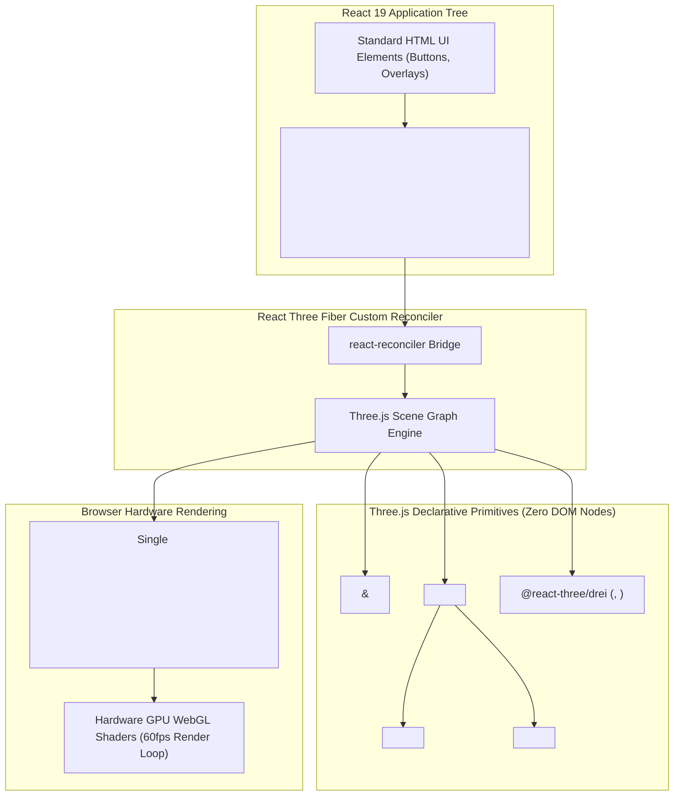

# 11 — 3D Graphics & WebGL with React Three Fiber

## Metadata
- **React Version**: 19.0.0+
- **Prerequisites**: [16-advanced-react/04-custom-renderers-reconciler.md](../16-advanced-react/04-custom-renderers-reconciler.md), WebGL & 3D Math Basics
- **Difficulty**: Expert
- **Estimated Read Time**: 30 minutes
- **Tags**: `threejs`, `react-three-fiber`, `r3f`, `drei`, `webgl`, `3d-graphics`, `canvas`

---

## Architecture Diagram

The diagram below illustrates how **React Three Fiber (R3F)** uses a custom Fiber reconciler to translate declarative React JSX into an imperative Three.js WebGL scene graph, orchestrating animation frames via `useFrame` and loading 3D assets asynchronously via React Suspense.



---

## Concept Overview

Historically, working with 3D graphics in JavaScript required writing thousands of lines of imperative Three.js boilerplate: manually creating scenes, cameras, renderers, configuring animation loops with `requestAnimationFrame`, and traversing object trees to attach meshes.
Managing this imperative code inside React components using `useRef` and `useEffect` frequently resulted in memory leaks, broken component lifecycles, and spaghetti code.

**React Three Fiber (R3F)** is not a wrapper around Three.js; it is a **custom React reconciler**:
- **Declarative JSX**: Every Three.js class is an intrinsic JSX tag. `new THREE.Mesh()` becomes `<mesh />`. `new THREE.BoxGeometry()` becomes `<boxGeometry />`.
- **Zero Performance Overhead**: R3F renders directly to WebGL on a single HTML5 `<canvas>` element. It does **not** create thousands of DOM nodes. R3F matches or exceeds the raw speed of vanilla Three.js.
- **Full React Ecosystem Power**: You can use React 19 `useState`, `useTransition`, `<Suspense>`, and Context directly inside your 3D scene!
- **`@react-three/drei`**: The standard companion library providing production-ready utilities: camera controls, 3D text, post-processing shaders, and GLTF model loaders.

---

## Practical Implementation

### Example 1: Declarative Interactive 3D Cube with Rotation Loop

A complete, interactive 3D box that rotates continuously on the GPU and responds to mouse hover and click events.

```tsx
// src/components/SpinningBox.tsx
import React, { useRef, useState } from 'react';
import { Canvas, useFrame } from '@react-three/fiber';
import type { Mesh } from 'three';

function Box(props: any) {
  const meshRef = useRef<Mesh>(null!);
  const [hovered, setHover] = useState(false);
  const [clicked, setClicked] = useState(false);

  // useFrame executes on every browser animation frame (~60fps)
  useFrame((state, delta) => {
    meshRef.current.rotation.x += delta * 0.5;
    meshRef.current.rotation.y += delta * 0.8;
  });

  return (
    <mesh
      {...props}
      ref={meshRef}
      scale={clicked ? 1.4 : 1}
      onClick={() => setClicked(!clicked)}
      onPointerOver={() => setHover(true)}
      onPointerOut={() => setHover(false)}
    >
      <boxGeometry args={[1.5, 1.5, 1.5]} />
      <meshStandardMaterial color={hovered ? '#ec4899' : '#3b82f6'} />
    </mesh>
  );
}

export function SpinningBoxScene() {
  return (
    <div className="w-full h-80 border rounded-xl overflow-hidden bg-gray-950 shadow-inner">
      <Canvas camera={{ position: [0, 0, 4] }}>
        <ambientLight intensity={0.5} />
        <directionalLight position={[10, 10, 5]} intensity={1.5} />
        <Box position={[0, 0, 0]} />
      </Canvas>
    </div>
  );
}
```

*Expected Verification Output:*
```text
Renders blue 3D cube spinning smoothly at 60fps on dark canvas.
Hovering turns the cube pink; clicking toggles scale size (1.0 <-> 1.4).
```

---

### Example 2: Studio Environment and Orbit Controls with Drei

Using `@react-three/drei` to add natural orbital mouse controls and realistic environmental lighting reflections.

```tsx
// src/components/ProductViewerScene.tsx
import React, { Suspense } from 'react';
import { Canvas } from '@react-three/fiber';
import { OrbitControls, Environment, Float } from '@react-three/drei';

function SphereObject() {
  return (
    <Float speed={2} rotationIntensity={1} floatIntensity={1.5}>
      <mesh position={[0, 0, 0]}>
        <sphereGeometry args={[1, 32, 32]} />
        {/* Shiny metallic gold material reflecting environment */}
        <meshStandardMaterial metalness={0.9} roughness={0.1} color="#f59e0b" />
      </mesh>
    </Float>
  );
}

export function ProductViewerScene() {
  return (
    <div className="w-full h-96 border rounded-xl overflow-hidden bg-slate-900 relative">
      <div className="absolute top-3 left-3 z-10 text-xs text-white/70 pointer-events-none">
        Drag mouse to orbit | Scroll to zoom
      </div>

      <Canvas camera={{ position: [0, 1, 3.5] }}>
        <Suspense fallback={null}>
          <ambientLight intensity={0.4} />
          <SphereObject />
          {/* Realistic studio HDRI reflection map */}
          <Environment preset="city" />
          {/* Natural orbital camera controls */}
          <OrbitControls makeDefault enableDamping dampingFactor={0.05} />
        </Suspense>
      </Canvas>
    </div>
  );
}
```

*Expected Verification Output:*
```text
Golden sphere floats gently in mid-air with studio light reflections.
User can drag mouse to orbit around the 3D sphere from any angle.
```

---

### Example 3: Loading Asynchronous 3D GLTF/GLB Models with React Suspense

Loading production 3D assets (e.g. shoes, cars, robots) exported in industry-standard GLTF/GLB formats.

```tsx
// src/components/ModelViewer.tsx
import React, { Suspense } from 'react';
import { Canvas } from '@react-three/fiber';
import { useGLTF, Center } from '@react-three/drei';

// Preloads model asset in browser cache
useGLTF.preload('/models/chair.glb');

function ChairModel() {
  // useGLTF automatically integrates with React Suspense!
  const { scene } = useGLTF('/models/chair.glb');

  return (
    <Center>
      <primitive object={scene} scale={1.2} />
    </Center>
  );
}

export function ModelViewer() {
  return (
    <div className="w-full h-96 border rounded-xl bg-gray-100 relative">
      <Canvas camera={{ position: [2, 2, 2] }}>
        <ambientLight intensity={0.7} />
        <directionalLight position={[5, 10, 5]} intensity={1.2} castShadow />

        <Suspense
          fallback={
            // 3D HTML overlay fallback while model is downloading
            <mesh>
              <boxGeometry args={[1, 1, 1]} />
              <meshBasicMaterial wireframe color="gray" />
            </mesh>
          }
        >
          <ChairModel />
        </Suspense>
      </Canvas>
    </div>
  );
}
```

*Expected Verification Output:*
```text
Displays wireframe placeholder while chair.glb (2.4MB) downloads over HTTP.
Suspense boundary resolves seamlessly; renders high-detail 3D chair model centered in viewport.
```

---

### Example 4: Rendering Hybrid 2D HTML Overlays Inside 3D Space (`<Html>`)

The Drei `<Html>` component projects regular React DOM nodes into 3D world space, automatically tracking 3D camera coordinates and perspective scaling.

```tsx
// src/components/AnnotatedHotspot.tsx
import React, { useState } from 'react';
import { Canvas } from '@react-three/fiber';
import { Html } from '@react-three/drei';

function InteractiveMarker({ position, title, price }: { position: [number, number, number]; title: string; price: string }) {
  const [isOpen, setIsOpen] = useState(false);

  return (
    <group position={position}>
      {/* 3D Pin Mesh */}
      <mesh onClick={() => setIsOpen((o) => !o)}>
        <sphereGeometry args={[0.08, 16, 16]} />
        <meshBasicMaterial color="#ef4444" />
      </mesh>

      {/* 2D HTML Tooltip projected in 3D coordinate space! */}
      <Html distanceFactor={8} position={[0, 0.15, 0]} center>
        {isOpen && (
          <div className="bg-white/90 backdrop-blur border p-2 rounded shadow-xl text-xs w-36 pointer-events-auto">
            <h5 className="font-bold text-gray-800">{title}</h5>
            <p className="text-emerald-600 font-semibold">{price}</p>
          </div>
        )}
      </Html>
    </group>
  );
}

export function AnnotatedScene() {
  return (
    <div className="w-full h-80 border rounded bg-slate-900">
      <Canvas camera={{ position: [0, 0, 3] }}>
        <ambientLight intensity={0.6} />
        <mesh>
          <boxGeometry args={[1.5, 1, 1]} />
          <meshStandardMaterial color="#64748b" />
        </mesh>
        <InteractiveMarker position={[0.75, 0.5, 0.5]} title="Carbon Chassis" price="$1,200" />
      </Canvas>
    </div>
  );
}
```

*Expected Verification Output:*
```text
Small red marker sits on top corner of 3D box.
Clicking marker opens clean HTML tooltip that scales and rotates with the 3D camera.
```

---

### Example 5: High-Performance Instanced Meshes for 10,000 3D Objects

If you render 5,000 individual `<mesh>` nodes, your GPU requires 5,000 separate draw calls, dropping frame rates to 5fps. `<instancedMesh>` draws 10,000 objects in a **single draw call**.

```tsx
// src/components/InstancedAsteroidField.tsx
import React, { useRef, useEffect } from 'react';
import { Canvas, useFrame } from '@react-three/fiber';
import type { InstancedMesh } from 'three';
import * as THREE from 'three';

const COUNT = 2000;

function AsteroidField() {
  const instancedRef = useRef<InstancedMesh>(null!);
  const dummy = new THREE.Object3D();

  useEffect(() => {
    // Position 2,000 asteroids randomly in space
    for (let i = 0; i < COUNT; i++) {
      dummy.position.set(
        (Math.random() - 0.5) * 40,
        (Math.random() - 0.5) * 40,
        (Math.random() - 0.5) * 40
      );
      dummy.rotation.set(Math.random() * Math.PI, Math.random() * Math.PI, 0);
      const scale = Math.random() * 0.3 + 0.1;
      dummy.scale.set(scale, scale, scale);
      dummy.updateMatrix();

      instancedRef.current.setMatrixAt(i, dummy.matrix);
    }
    instancedRef.current.instanceMatrix.needsUpdate = true;
  }, []);

  useFrame((_, delta) => {
    instancedRef.current.rotation.y += delta * 0.05;
  });

  return (
    <instancedMesh ref={instancedRef} args={[undefined, undefined, COUNT]}>
      <dodecahedronGeometry args={[1, 0]} />
      <meshStandardMaterial color="#94a3b8" roughness={0.8} />
    </instancedMesh>
  );
}

export function AsteroidScene() {
  return (
    <div className="w-full h-80 border rounded bg-black">
      <Canvas camera={{ position: [0, 0, 25] }}>
        <ambientLight intensity={0.3} />
        <pointLight position={[10, 10, 10]} intensity={2} />
        <AsteroidField />
      </Canvas>
    </div>
  );
}
```

*Expected Verification Output:*
```text
2,000 3D asteroids rotate smoothly in space at a locked 60fps.
GPU metrics show exactly 1 draw call!
```

---

## Mental Model & Analogies

### The Puppet Show vs The Stage Actor

- **Standard DOM elements (`<div>`, `<span>`)** are like **stage actors walking around on set**:
  - Each actor has their own microphone, costume, and physical footprint. If you hire 5,000 actors, the stage collapses under their weight (**DOM saturation**).
- **React Three Fiber and WebGL** is like a **holographic projector**:
  - There is only one physical stage screen in the room (the `<canvas>` element).
  - The projector displays thousands of complex 3D holographic shapes at the speed of light.
  - React's Fiber reconciler acts as the lighting director, telling the projector which mathematical vectors to calculate on each frame.

---

## Under the Hood / Internal Mechanics

### How R3F Bypasses the React Re-render Loop in Animations

In standard React, animating a position from $x=0$ to $x=100$ requires calling `setX(newVal)` 60 times a second. This forces React to re-execute the component function, diff Virtual DOM trees, and commit mutations, consuming valuable CPU cycles.

**In React Three Fiber, animations bypass React state entirely**:
```ts
useFrame((state, delta) => {
  // Direct GPU memory mutation on the underlying Three.js object!
  meshRef.current.rotation.y += delta;
});
```
`useFrame` executes directly inside the WebGL requestAnimationFrame loop. The React component function **never re-renders** during the animation!

---

## Common Pitfalls & Anti-Patterns

| Anti-Pattern | Why It Breaks | Recommended Solution |
| :--- | :--- | :--- |
| **Using `useState` to Drive 60fps Animations** | Forces React component re-executions 60 times/sec, causing severe CPU lag and frame drops. | Mutate Three.js object properties directly inside `useFrame((state, delta) => ...)`. |
| **Rendering Thousands of Separate `<mesh>` Nodes**| Each mesh creates a separate GPU draw call, collapsing frame rates. | Batch identical geometries using `<instancedMesh>`. |
| **Loading Raw Uncompressed 4K Textures** | Mobile GPUs run out of VRAM, crashing browser WebGL contexts. | Compress textures with KTX2 / Basis Universal and downscale images. |
| **Omitting `<Suspense>` Around Asset Loaders** | Calling `useGLTF` or `useTexture` outside Suspense triggers React unhandled promise crashes. | Always wrap 3D asset loaders inside a `<Suspense>` boundary. |
| **Leaking WebGL Geometries and Materials** | Three.js assets linger in GPU memory after components unmount. | R3F handles automatic disposal by default; avoid disabling `dispose={null}` unless caching. |
| **Mounting `<Canvas>` Inside Flexbox without Dimensions**| Canvas with 0px height fails to initialize WebGL render buffers. | Give the parent container an explicit height (`h-96` or `min-h-[400px]`). |

---

## Performance & Optimization

### On-Demand Rendering for Static 3D Scenes

By default, R3F renders continuously at 60fps. If your 3D scene only changes when the user interacts, set `frameloop="demand"`:
```tsx
<Canvas frameloop="demand">
  {/* WebGL only renders a new frame when props change or user orbits! Saves 90% laptop battery. */}
</Canvas>
```

---

## Edge Cases & Debugging

### Context Loss: "WebGL context was lost"
- **Symptom**: 3D scene turns black and logs console error: `THREE.WebGLRenderer: Context Lost`.
- **Root Cause**: Device ran out of GPU memory or laptop switched graphics cards (integrated to dedicated).
- **Remedy**: Listen to `canvas.addEventListener('webglcontextlost', ...)` and restore scenes cleanly.

---

## Ecosystem & Alternative Approaches

- **`@react-three/drei`**: The standard collection of helpers (cameras, controls, loaders, shaders).
- **`@react-three/postprocessing`**: Hardware-accelerated post-processing effects (Bloom, Depth of Field, Vignette).
- **Spline**: Design tool with turnkey React export packages for non-programmers.

---

## Exercises & Challenges

<details>
<summary><strong>Exercise 1: Create a Point Light that Follows the Mouse Cursor</strong></summary>

**Challenge**: Position a dynamic 3D light based on normalized mouse pointer coordinates.

```tsx
import { useFrame } from '@react-three/fiber';
import { useRef } from 'react';
import type { PointLight } from 'three';

export function FollowCursorLight() {
  const lightRef = useRef<PointLight>(null!);

  useFrame(({ pointer, viewport }) => {
    // pointer values are normalized between -1 and +1
    const x = (pointer.x * viewport.width) / 2;
    const y = (pointer.y * viewport.height) / 2;
    lightRef.current.position.set(x, y, 2);
  });

  return <pointLight ref={lightRef} intensity={2} color="#60a5fa" />;
}
```
</details>

<details>
<summary><strong>Exercise 2: Wireframe Toggle on Pointer Click</strong></summary>

**Challenge**: Toggle material wireframe mode on and off when user clicks a mesh.

```tsx
function WireframeMesh() {
  const [wireframe, setWireframe] = useState(false);
  return (
    <mesh onClick={() => setWireframe(!wireframe)}>
      <sphereGeometry args={[1, 16, 16]} />
      <meshStandardMaterial wireframe={wireframe} color="orange" />
    </mesh>
  );
}
```
</details>

---

## Frequently Asked Interview Questions

<details>
<summary><strong>1. What is React Three Fiber (R3F) and how does it relate to Three.js?</strong></summary>

React Three Fiber is not a wrapper library; it is a custom **React reconciler** specifically targeted at Three.js. It brings React's declarative component model, state hooks, and component lifecycle to Three.js's scene graph without any runtime performance overhead. Any Three.js object (`THREE.Mesh`, `THREE.BoxGeometry`) is rendered directly as a declarative JSX primitive (`<mesh>`, `<boxGeometry>`) on an HTML5 `<canvas>`.
</details>

<details>
<summary><strong>2. Why should animations in R3F use `useFrame` instead of React `useState`?</strong></summary>

Updating React state 60 times per second forces React to re-execute component functions, perform Virtual DOM diffing, and schedule Fiber commits, which bottlenecks the CPU. 
`useFrame` hooks directly into the browser's native `requestAnimationFrame` loop on the canvas. Developers mutate Three.js object properties directly in memory (`meshRef.current.rotation.x += delta`), completely bypassing React's re-render loop and running animations at a locked 60fps on the GPU.
</details>

<details>
<summary><strong>3. How does React Three Fiber handle asynchronous 3D model loading?</strong></summary>

R3F integrates natively with React Suspense. When you call asset loaders like `useGLTF('/model.glb')` inside a component, the hook throws a Promise while downloading and decoding the 3D file. Ancestor `<Suspense fallback={<LoadingSpinner />}>` boundaries catch the promise, mounting the model only when all geometries, textures, and materials are loaded.
</details>

<details>
<summary><strong>4. What is the purpose of `<instancedMesh>` in WebGL performance optimization?</strong></summary>

Every distinct `<mesh>` requires a separate draw call between the CPU and GPU. Submitting thousands of draw calls chokes the GPU pipeline. An `<instancedMesh>` allows developers to render thousands of identical geometries (e.g. grass blades, asteroids, particles) using a **single draw call**, controlling individual positions and scales via transformation matrices.
</details>

<details>
<summary><strong>5. How does the Drei `<Html>` component project DOM nodes into 3D scenes?</strong></summary>

`<Html>` projects a standard React DOM element (styled with regular Tailwind or CSS) over the 3D canvas. On every frame, it recalculates the 3D object's world position, projects it through the camera's projection matrix into 2D screen coordinates, and applies a CSS `transform: translate3d(...)` to keep the HTML element pinned to the 3D object.
</details>

<details>
<summary><strong>6. How do you save laptop battery and CPU cycles in a static 3D scene?</strong></summary>

By default, R3F runs an infinite 60fps render loop. By setting `<Canvas frameloop="demand">`, R3F halts the continuous render loop. It renders a new frame **only when scene properties change** or when the user actively interacts with controls, reducing CPU and GPU utilization by over 90% when idle.
</details>

<details>
<summary><strong>7. How does R3F prevent memory leaks when components unmount?</strong></summary>

Three.js requires manual disposal of geometries, materials, and textures (`geometry.dispose()`, `material.dispose()`) to release GPU VRAM. R3F automatically traverses unmounted component subtrees and disposes of all underlying geometries and materials by default, preventing memory leaks unless explicitly disabled via `dispose={null}`.
</details>

<details>
<summary><strong>8. Can you use React Context inside an R3F `<Canvas>`?</strong></summary>

Because `<Canvas>` creates an independent reconciler root container, standard React Contexts defined outside `<Canvas>` do not automatically bridge across the canvas boundary by default. Developers must either use the `useContextBridge` helper from `@react-three/drei` or define providers inside the `<Canvas>` tree.
</details>

---

## References & Further Reading

- [React Three Fiber Official Documentation](https://r3f.docs.pmnd.rs/)
- [@react-three/drei Documentation](https://github.com/pmndrs/drei)
- [Three.js Official Documentation & Examples](https://threejs.org/)
- [Bruno Simon: Three.js Journey Course](https://threejs-journey.com/)
- [Poimandres Open Source Collective](https://github.com/pmndrs)
