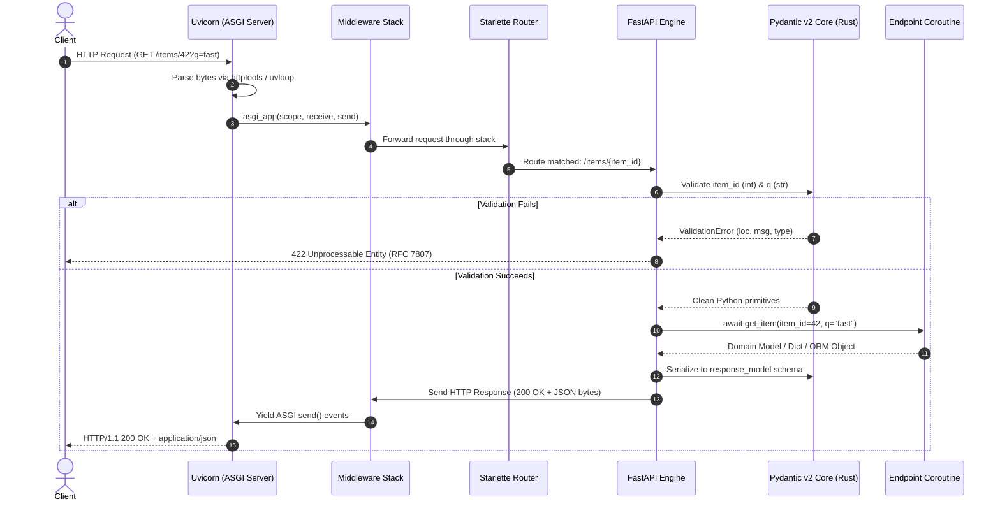

# What is FastAPI & ASGI

FastAPI is a modern, high-performance web framework for building APIs with Python based on standard Python type hints. Built on top of **Starlette** (for web routing, ASGI event loops, WebSockets, and middleware) and **Pydantic** (for data validation, serialization, and JSON Schema generation), FastAPI delivers production performance on par with NodeJS and Go while retaining Python developer productivity.

Understanding FastAPI requires understanding **ASGI (Asynchronous Server Gateway Interface)**, the spiritual successor to WSGI that enables asynchronous HTTP, WebSockets, and long-lived background tasks in Python.

---

## 1. Conceptual Foundation & Mental Model

### The Evolution from WSGI to ASGI

In traditional Python web architectures (Django, Flask), communication between web servers and applications was defined by **WSGI (Web Server Gateway Interface, PEP 3333)**:

```python
# Traditional WSGI signature (synchronous, blocking)
def wsgi_app(environ, start_response):
    start_response('200 OK', [('Content-Type', 'text/plain')])
    return [b"Hello, WSGI World!"]
```

WSGI is strictly synchronous and follows a request-per-worker model. While worker pools can scale via threads or processes (e.g. Gunicorn with sync workers), any I/O operation (database query, third-party API request) blocks the entire OS thread. WSGI is fundamentally incapable of natively handling persistent duplex protocols like WebSockets, Server-Sent Events (SSE), or long-polling without gevent monkey-patching.

**ASGI (PEP 3156 / ASGI Spec 3.0)** defines an asynchronous callable:

```python
# Modern ASGI 3.0 signature (asynchronous coroutine)
async def asgi_app(scope, receive, send):
    assert scope["type"] == "http"
    await send({
        "type": "http.response.start",
        "status": 200,
        "headers": [[b"content-type", b"text/plain"]],
    })
    await send({
        "type": "http.response.body",
        "body": b"Hello, ASGI World!",
    })
```

### The Three Primitives of ASGI

1. `scope`: A dictionary containing connection metadata (protocol type `"http"` or `"websocket"`, client IP, query string, path, headers). It persists for the lifetime of the connection.
2. `receive`: An async callable that yields event messages from the client (e.g., incoming HTTP body chunks, incoming WebSocket text/binary frames).
3. `send`: An async callable used to send event messages back to the client (status headers, streamed chunks, WebSocket closure).

### How FastAPI Composes ASGI

FastAPI itself is an ASGI application. Internally:
- **FastAPI** subclasses **Starlette** (`FastAPI -> Starlette`).
- When a request enters through an ASGI server like **Uvicorn**, Starlette manages routing, middleware pipelines, and exceptions.
- FastAPI injects parameter extraction, Pydantic validation, dependency injection (`Depends`), and automatic OpenAPI schema extraction into the route dispatch pipeline.

---

## 2. Architecture & Internal Mechanics



### Threading Architecture & Concurrency
FastAPI handles two distinct kinds of path functions:
- `async def endpoint()`: Run directly on the asyncio event loop. **Must never contain blocking synchronous I/O** (e.g., standard `time.sleep()`, synchronous `requests.get()`, synchronous DB drivers).
- `def endpoint()`: Automatically offloaded to an asynchronous worker threadpool using **AnyIO** (`anyio.to_thread.run_sync`). This guarantees that legacy synchronous blocking operations do not stall the primary event loop.

---

## 3. Comprehensive Syntax & Core Mechanics

### Basic ASGI Application Definition

```python
from contextlib import asynccontextmanager
from typing import AsyncGenerator
from fastapi import FastAPI

@asynccontextmanager
async def lifespan(app: FastAPI) -> AsyncGenerator[None, None]:
    # Startup actions: establish database connection pools, warm caches
    print("Application startup: Initializing connection pools...")
    yield
    # Shutdown actions: gracefully drain queues, close network sockets
    print("Application shutdown: Draining connections...")

app = FastAPI(
    title="Core ASGI Demonstration API",
    version="1.0.0",
    lifespan=lifespan,
    docs_url="/docs",
    redoc_url="/redoc",
)

@app.get("/health")
async def health_check() -> dict[str, str]:
    return {"status": "healthy", "runtime": "ASGI"}
```

---

## 4. Practical Implementation: 5 Verified Examples

### Example 1: Minimal ASGI Raw Protocol Implementation
Understanding the pure ASGI interface without framework abstractions:

```python
# raw_asgi.py
from typing import Any, Callable, Coroutine, Dict

async def application(
    scope: Dict[str, Any],
    receive: Callable[[], Coroutine[Any, Any, Dict[str, Any]]],
    send: Callable[[Dict[str, Any]], Coroutine[Any, Any, None]],
) -> None:
    if scope["type"] == "http":
        method = scope.get("method")
        path = scope.get("path")
        
        if path == "/raw" and method == "GET":
            response_body = b'{"message": "Direct ASGI Response", "status": "ok"}'
            await send({
                "type": "http.response.start",
                "status": 200,
                "headers": [
                    [b"content-type", b"application/json"],
                    [b"content-length", str(len(response_body)).encode("ascii")],
                ],
            })
            await send({
                "type": "http.response.body",
                "body": response_body,
                "more_body": False,
            })
            return
            
    # Fallback 404 for unhandled paths
    await send({
        "type": "http.response.start",
        "status": 404,
        "headers": [[b"content-type", b"text/plain"]],
    })
    await send({
        "type": "http.response.body",
        "body": b"Not Found",
        "more_body": False,
    })
```

Execution test:
```bash
uv run uvicorn raw_asgi:application --port 8000
curl -i http://127.0.0.1:8000/raw
```
Output:
```http
HTTP/1.1 200 OK
content-type: application/json
content-length: 49

{"message": "Direct ASGI Response", "status": "ok"}
```

### Example 2: FastAPI Layered on Starlette with Modern Lifespan
Demonstrating how FastAPI abstracts the raw ASGI cycle while managing lifecycle state:

```python
# main.py
from contextlib import asynccontextmanager
from typing import AsyncGenerator
from fastapi import FastAPI, Request
from pydantic import BaseModel, Field

class ServiceState:
    db_connected: bool = False

state = ServiceState()

@asynccontextmanager
async def app_lifespan(app: FastAPI) -> AsyncGenerator[None, None]:
    state.db_connected = True
    yield
    state.db_connected = False

app = FastAPI(title="Enterprise Gateway", lifespan=app_lifespan)

class SystemStatus(BaseModel):
    version: str = Field(..., examples=["2.4.0"])
    db_online: bool
    client_host: str

@app.get("/status", response_model=SystemStatus)
async def get_system_status(request: Request) -> SystemStatus:
    # Access raw ASGI scope metadata via request.scope
    client_ip = request.client.host if request.client else "unknown"
    return SystemStatus(
        version="2.4.0",
        db_online=state.db_connected,
        client_host=client_ip,
    )
```

### Example 3: Async vs Sync Execution Comparison
Proving threadpool offloading behavior for synchronous handlers:

```python
import asyncio
import threading
import time
from fastapi import FastAPI

app = FastAPI()

@app.get("/async-handler")
async def async_handler() -> dict[str, str]:
    # Executes directly on main asyncio loop thread
    current_thread = threading.current_thread().name
    return {"handler_type": "async", "thread": current_thread}

@app.get("/sync-handler")
def sync_handler() -> dict[str, str]:
    # Executes on an AnyIO worker thread from the threadpool
    current_thread = threading.current_thread().name
    time.sleep(0.05)  # Safe here because it is isolated on a worker thread
    return {"handler_type": "sync", "thread": current_thread}
```

Verified output:
- `GET /async-handler` -> `{"handler_type": "async", "thread": "MainThread"}`
- `GET /sync-handler` -> `{"handler_type": "sync", "thread": "AnyIO-worker-thread-1"}`

### Example 4: Starlette Middleware Integration into ASGI Chain
Interception of ASGI requests and response headers:

```python
import time
from starlette.middleware.base import BaseHTTPMiddleware, RequestResponseEndpoint
from starlette.requests import Request
from starlette.responses import Response
from fastapi import FastAPI

app = FastAPI()

class PerformanceAuditMiddleware(BaseHTTPMiddleware):
    async def dispatch(self, request: Request, call_next: RequestResponseEndpoint) -> Response:
        start_time = time.perf_counter()
        
        # Pass request down the ASGI chain
        response = await call_next(request)
        
        process_time = time.perf_counter() - start_time
        response.headers["X-Process-Time-Sec"] = f"{process_time:.6f}"
        response.headers["X-Engine"] = "FastAPI-ASGI"
        return response

app.add_middleware(PerformanceAuditMiddleware)

@app.get("/ping")
async def ping() -> dict[str, str]:
    return {"ping": "pong"}
```

Verified response header:
```http
HTTP/1.1 200 OK
content-type: application/json
x-engine: FastAPI-ASGI
x-process-time-sec: 0.000412
```

### Example 5: High-Performance ASGI WebSocket Pipeline
Demonstrating real-time bidirectional communication over ASGI:

```python
from fastapi import FastAPI, WebSocket, WebSocketDisconnect

app = FastAPI()

class ConnectionManager:
    def __init__(self) -> None:
        self.active_connections: list[WebSocket] = []

    async def connect(self, websocket: WebSocket) -> None:
        await websocket.accept()
        self.active_connections.append(websocket)

    def disconnect(self, websocket: WebSocket) -> None:
        if websocket in self.active_connections:
            self.active_connections.remove(websocket)

    async def broadcast(self, message: str) -> None:
        for connection in self.active_connections:
            await connection.send_text(message)

manager = ConnectionManager()

@app.websocket("/ws/telemetry")
async def websocket_telemetry_endpoint(websocket: WebSocket) -> None:
    await manager.connect(websocket)
    try:
        while True:
            # Receive text frames over ASGI receive()
            data = await websocket.receive_text()
            await manager.broadcast(f"Broadcast: {data}")
    except WebSocketDisconnect:
        manager.disconnect(websocket)
```

---

## 5. Anti-Patterns & Common Traps

| Anti-Pattern | Why It Fails | Production Fix |
| :--- | :--- | :--- |
| **Blocking calls inside `async def`** | `time.sleep()`, `requests.get()`, or synchronous DB calls block the single asyncio event loop thread, stalling all concurrent requests. | Use non-blocking equivalents (`await asyncio.sleep()`, `httpx.AsyncClient`) or define the endpoint with standard `def`. |
| **Using deprecated `@app.on_event`** | `@app.on_event("startup")` is deprecated in Starlette/FastAPI; errors inside startup events do not tear down cleanly. | Migrate to standard `@asynccontextmanager async def lifespan(app: FastAPI): yield`. |
| **Mixing WSGI and ASGI servers** | Running FastAPI under standard Gunicorn sync workers without Uvicorn worker classes breaks async capabilities. | Use `uvicorn main:app` or `gunicorn -k uvicorn.workers.UvicornWorker main:app`. |
| **Manual JSON serialization with `json.dumps()`** | Bypasses Pydantic v2's optimized C/Rust serialization engine and produces improper HTTP content-type negotiation. | Return Pydantic models directly or return custom `ORJSONResponse`. |
| **Global mutable connection objects** | Creating unmanaged global client connections causes race conditions and broken connection pools across forks. | Initialize connection pools inside the `lifespan` context manager and bind to `app.state`. |
| **Excessive middleware layers** | Overusing `BaseHTTPMiddleware` creates overhead by wrapping response bodies in generator streams for every request. | Implement raw ASGI middleware functions for performance-critical layers. |

---

## 6. Performance & Resource Characteristics

- **Time Complexity**: Route matching via Starlette's radix tree / regex router operates in $O(k)$ where $k$ is the path depth, independent of the total number of registered routes.
- **Serialization Overhead**: Pydantic v2 is implemented in Rust (`pydantic-core`). Model serialization and validation throughput is 5x to 20x faster than Pydantic v1.
- **Concurrency Scalability**: An async worker on Uvicorn with `uvloop` can easily sustain 20,000 to 50,000 idle concurrent connections (WebSockets or long-polling) with modest memory usage (~50MB to 100MB RAM per worker process).
- **Threadpool Saturation**: Standard `def` endpoints run in an AnyIO threadpool (default 40 threads). Heavy CPU-bound or prolonged blocking operations in sync routes will exhaust the worker pool, queuing subsequent sync requests.

---

## 7. Edge Cases, Failure Modes & Gotchas

1. **Premature Client Disconnect**: If a client terminates an HTTP connection before an async handler completes its work, ASGI receives an `http.disconnect` event. In FastAPI, unless explicitly polled via `await request.is_disconnected()`, the handler continues running to completion in the background, consuming CPU/DB cycles.
2. **Double ASGI Response Execution**: Calling `send({"type": "http.response.start"})` twice in custom ASGI middleware raises `RuntimeError: Response already started`.
3. **ASGI Scope Immutability**: The `scope` dictionary should be treated as mutable only for passing downstream state (e.g., `scope["state"]["user_id"] = 123`). Mutating protocol headers in-place without copying can corrupt downstream middleware.

---

## 8. Security Implications & OWASP Alignment

- **ASGI Header Injection**: Header names and values in raw ASGI are byte strings (`List[Tuple[bytes, bytes]]`). FastAPI automatically strips trailing carriage returns (`\r\n`) preventing HTTP response splitting (CRLF injection).
- **Slowloris Attack Protection**: Because ASGI servers maintain state machine parsers per socket, malicious clients sending bytes at trickle rates (1 byte/sec) can exhaust file descriptors. Mitigate at the reverse proxy (Nginx `client_body_timeout`) and ASGI server level (`--timeout-keep-alive`).
- **Uncaught Exception Disclosure**: Ensure `debug=False` in production. When `debug=True`, Starlette generates rich interactive HTML debug pages containing environment variables and secret tokens.

---

## 9. Ecosystem Integration & Modern Tooling

- **uv**: The modern Rust package manager installs FastAPI and all native ASGI dependencies (httptools, uvloop, websockets) instantaneously.
- **Ruff**: Enforces strict linting for async anti-patterns (e.g. `ASYNC` rules such as checking for unawaited async functions or blocking synchronous calls).
- **FastAPI CLI**: Modern FastAPI installations (`fastapi[standard]`) include the official CLI:
  - `fastapi dev main.py` (Development server with hot-reload, binding to 127.0.0.1)
  - `fastapi run main.py` (Production multi-worker configuration binding to 0.0.0.0)

---

## 10. Real-World Case Study: Production Incident

### The Incident
A high-volume fintech checkout API running FastAPI experienced cascading latency spikes ($p99$ increased from 15ms to 18,000ms), resulting in upstream 504 Gateway Timeouts during peak promotional sales.

### The Root Cause
A junior engineer added an analytics tracking call inside a critical checkout path:
```python
# The culprit code:
@app.post("/api/v1/checkout")
async def checkout(order: OrderPayload) -> CheckoutResult:
    # ... business logic ...
    # Unsuspecting synchronous HTTP call inside async def!
    requests.post("https://analytics.internal/track", json=order.model_dump())
    return CheckoutResult(status="success")
```
Because the handler was declared `async def`, Uvicorn ran it on the main asyncio event loop. The external analytics service responded in 250ms under load. While `requests.post()` blocked for 250ms, the entire event loop was completely halted. Not a single other request could be accepted or processed during that interval, causing requests to pile up in Uvicorn's socket backlog.

### The Resolution
1. Immediate hotfix: Changed the signature to `def checkout(...)`, immediately shifting execution to worker threads and unblocking the main event loop.
2. Permanent architectural fix: Replaced `requests` with a persistent asynchronous client (`httpx.AsyncClient`) and offloaded the analytics emission to a non-blocking background queue:
```python
@app.post("/api/v1/checkout")
async def checkout(order: OrderPayload, bg: BackgroundTasks) -> CheckoutResult:
    bg.add_task(async_analytics_client.send_event, order.id)
    return CheckoutResult(status="success")
```

---

## 11. Hands-On Exercises & Challenge Problems

### Warm-Up Exercises
1. **Raw ASGI Header Inspector**: Write a raw ASGI 3.0 callable (without Starlette or FastAPI) that returns all incoming request headers back to the client as JSON.
2. **Sync vs Async Latency Probe**: Create two endpoints: `/sync-delay` and `/async-delay`. Fire 50 concurrent requests using `curl` or `wrk` and record the latency difference when using `time.sleep(0.1)` vs `await asyncio.sleep(0.1)`.

### Intermediate Challenges
3. **Custom ASGI Timing Middleware**: Implement an ASGI middleware from scratch (taking `scope`, `receive`, `send`) that computes request duration and injects an `X-Server-Execution-Time` header into the response stream.
4. **Lifespan Context Resource Manager**: Build a FastAPI application whose lifespan creates an in-memory dictionary cache on startup, clears it on shutdown, and provides access to route handlers via `request.state`.

### Production-Grade Challenges
5. **Slow-Client Detection Guard**: Create an ASGI middleware that tracks the time taken by `receive()` to stream incoming request bodies. If the client takes longer than 2.0 seconds to transfer a 10KB body, abort the connection with HTTP 408 Request Timeout.
6. **Graceful Connection Drainer**: Implement a custom lifespan handler that maintains an atomic counter of in-flight active WebSocket connections. When SIGTERM is received, stop accepting new connections and broadcast a shutdown notice to all active sockets, waiting up to 5 seconds before terminating.

---

## 12. Interview Mastery: Deep-Dive Questions & Answers

#### Q1: What is the fundamental difference between WSGI and ASGI?
**Answer**: WSGI (PEP 3333) is a synchronous interface where the server invokes a callable passing `(environ, start_response)`. WSGI operates on a one-thread-per-request model, meaning I/O operations block the underlying thread. ASGI is an asynchronous interface where the application is an `async def (scope, receive, send)` coroutine. ASGI natively supports multiple event-driven protocols (HTTP/1.1, HTTP/2, WebSockets) and concurrent asynchronous I/O multiplexing on a single event loop.

#### Q2: What happens under the hood when an endpoint is declared with `def` instead of `async def` in FastAPI?
**Answer**: When an endpoint is declared with standard `def`, FastAPI does not run it on the primary asyncio event loop. Instead, it delegates execution to an internal AnyIO worker threadpool (`anyio.to_thread.run_sync`). This prevents synchronous blocking calls (such as file I/O or legacy synchronous database queries) from blocking the event loop. In contrast, `async def` endpoints execute directly on the event loop thread.

#### Q3: Why is using `requests` inside an `async def` endpoint dangerous?
**Answer**: `requests` is a blocking, synchronous HTTP client. When called inside an `async def` function, it executes directly on the event loop. While waiting for the remote socket response, it does not yield control via `await`. Consequently, the entire Python process event loop is frozen, preventing all other concurrent requests, WebSockets, and scheduled coroutines from progressing.

#### Q4: How does FastAPI achieve automatic OpenAPI documentation generation from code?
**Answer**: FastAPI leverages Python's standard type annotations combined with Pydantic schemas. At application initialization, FastAPI inspects the signature of each registered path operation, extracts path/query/body parameters, converts Pydantic models into JSON Schema definitions conforming to the OpenAPI 3.1 specification, and exposes the resulting contract dynamically at `/openapi.json`.

#### Q5: Explain the lifecycle of an ASGI `scope` dictionary.
**Answer**: The `scope` dictionary is created by the ASGI server (e.g. Uvicorn) upon connection initiation. It contains connection-level metadata including protocol type, HTTP method, path, headers, client IP/port, and server state. The `scope` persists for the entire duration of that specific connection (for HTTP, a single request-response cycle; for WebSockets, the entire duration the socket remains open).

#### Q6: Why was `@app.on_event("startup")` deprecated in favor of `lifespan`?
**Answer**: The `@app.on_event` decorator used two separate, decoupled handlers for startup and shutdown. This made it difficult to manage resources that require cleanup in the same context (e.g., Python `async with` context managers, such as database pools and file handles). The `lifespan` handler utilizes a unified standard Python `@asynccontextmanager`, where code before `yield` executes during startup, and code after `yield` executes during shutdown, guaranteeing reliable cleanup even if startup fails.

#### Q7: How does Uvicorn utilize `httptools` and `uvloop` for high throughput?
**Answer**: Uvicorn is built with pluggable parsers and event loops. By default, on Linux and macOS, it utilizes `uvloop` (an ultra-fast asyncio event loop implementation written in C on top of `libuv`, the same engine powering Node.js) and `httptools` (a Python wrapper around Node.js's C-based HTTP parser). This delegates raw byte parsing and socket multiplexing to compiled C code rather than Python byte code.

#### Q8: Can FastAPI run on Python 3.14 free-threaded (No-GIL) builds?
**Answer**: Yes. FastAPI, Starlette, and Pydantic v2 (via Rust `pyo3`) support free-threaded Python builds (PEP 703). Because the GIL is disabled in free-threaded Python, CPU-bound endpoints executed in the AnyIO worker threadpool can achieve true multi-threaded parallel execution across physical CPU cores without requiring multiprocessing or separate worker processes.
