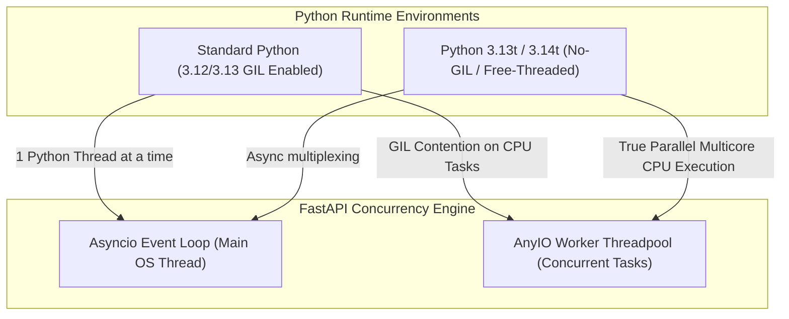

# Python Environment & Versions

FastAPI relies extensively on modern Python language features—first-class type hints (PEP 484, PEP 585, PEP 604), asynchronous generators (PEP 525), structured concurrency (PEP 654), and `typing.Annotated` (PEP 593). Selecting the correct Python runtime and configuring a clean environment is the single most critical architectural choice before deploying an enterprise FastAPI application.

---

## 1. Conceptual Foundation & Mental Model

### Python Version Support Matrix for FastAPI

| Python Version | Status in FastAPI | Key Features Leveraged by FastAPI |
| :--- | :--- | :--- |
| **Python 3.10** | Minimum Supported Baseline | `match/case`, `X \| Y` union syntax, improved syntax error tracebacks. |
| **Python 3.11** | High Performance Baseline | Specializing Adaptive Interpreter (PEP 659, 10-25% speedup), Exception Groups (`ExceptionGroup`, `except*`), `TaskGroup` in asyncio, `Self` type. |
| **Python 3.12** | **Recommended Production Standard** | Low-overhead monitoring/profiling, inline type parameter syntax (`type Alias = int`), faster comprehension execution, Pydantic v2 optimizations. |
| **Python 3.13** | Supported | Stripped experimental JIT, improved interactive REPL, enhanced traceback colors. |
| **Python 3.13t / 3.14t** | **Free-Threading (No-GIL)** | PEP 703 experimental free-threaded build. Disables the Global Interpreter Lock (GIL), enabling true multicore CPU scaling in AnyIO threadpools. |

### The Modern Type Annotation Paradigm

FastAPI deprecates the legacy `typing.Optional` and `typing.Union` constructs in favor of native Python 3.10+ pipe syntax:

```python
# Legacy Python 3.8 / 3.9 syntax (Avoid)
from typing import Optional, List, Union
def get_items(q: Optional[str] = None, tags: List[str] = []) -> Union[dict, None]: ...

# Modern Python 3.10+ syntax (Standard)
def get_items(q: str | None = None, tags: list[str] = []) -> dict | None: ...
```

---

## 2. Architecture & Internal Mechanics



### Free-Threading (PEP 703) Implications for FastAPI
In traditional CPython, even if an AnyIO threadpool has 40 worker threads running synchronous `def` endpoints, only **one thread executes Python bytecode at any given moment** due to the Global Interpreter Lock (GIL). 

In free-threaded Python (`python3.13t`), the GIL is removed. Threads running synchronous computations in FastAPI execute in **true parallel across physical CPU cores**, eliminating the need to spin up multiple heavy operating system worker processes for CPU-bound tasks.

---

## 3. Comprehensive Syntax & Core Mechanics

### Strict Environment Validation at Startup

```python
import sys
from fastapi import FastAPI

def verify_runtime_environment() -> None:
    if sys.version_info < (3, 10):
        raise RuntimeError(
            f"Unsupported Python version {sys.version}. FastAPI requires Python 3.10 or higher."
        )

app = FastAPI(title="Runtime Verified API")

@app.get("/runtime")
def get_runtime_info() -> dict[str, str | bool | int]:
    # Check if current Python binary is free-threaded
    is_free_threaded = bool(getattr(sys, "_is_gil_enabled", lambda: True)() is False)
    return {
        "version": sys.version,
        "version_info": list(sys.version_info[:3]),
        "free_threading_active": is_free_threaded,
        "platform": sys.platform,
    }
```

---

## 4. Practical Implementation: 5 Verified Examples

### Example 1: Type Annotation Evolution Across Python Releases

```python
# modern_types.py
from typing import Annotated
from fastapi import FastAPI, Query, Path
from pydantic import BaseModel, Field

app = FastAPI()

class UserProfile(BaseModel):
    username: str
    age: int | None = None  # Python 3.10+ union
    roles: list[str] = Field(default_factory=list)  # Python 3.9+ built-in generic

@app.post("/users/{user_id}")
async def create_user(
    user_id: Annotated[int, Path(ge=1, description="Positive database ID")],
    profile: UserProfile,
    dry_run: Annotated[bool | None, Query()] = False,
) -> dict[str, str | int | bool]:
    return {
        "user_id": user_id,
        "username": profile.username,
        "dry_run": bool(dry_run),
    }
```

### Example 2: Structured Concurrency with Python 3.11+ Exception Groups

```python
# structured_concurrency.py
import asyncio
from fastapi import FastAPI, HTTPException, status

app = FastAPI()

async def fetch_profile(user_id: int) -> dict[str, str]:
    await asyncio.sleep(0.02)
    return {"name": "Alice"}

async def fetch_orders(user_id: int) -> list[str]:
    await asyncio.sleep(0.03)
    return ["Order #101", "Order #102"]

async def failing_service() -> None:
    await asyncio.sleep(0.01)
    raise ValueError("Remote service timeout")

@app.get("/aggregate/{user_id}")
async def get_aggregated_dashboard(user_id: int) -> dict[str, object]:
    try:
        # Python 3.11+ TaskGroup provides guaranteed structured concurrency
        async with asyncio.TaskGroup() as tg:
            t1 = tg.create_task(fetch_profile(user_id))
            t2 = tg.create_task(fetch_orders(user_id))
            
        return {
            "profile": t1.result(),
            "orders": t2.result(),
        }
    except* ValueError as eg:
        # Python 3.11+ exception group handling syntax
        raise HTTPException(
            status_code=status.HTTP_502_BAD_GATEWAY,
            detail=f"Downstream service failed: {eg.exceptions}",
        )
```

### Example 3: Threadpool CPU-Bound Benchmark (GIL vs Free-Threaded)

```python
# cpu_test.py
import hashlib
import time
from fastapi import FastAPI

app = FastAPI()

def compute_heavy_hash(n: int) -> str:
    # CPU-bound hashing workload
    data = b"benchmark-seed-bytes"
    for _ in range(n):
        data = hashlib.sha256(data).digest()
    return data.hex()

@app.get("/hash-sync")
def benchmark_cpu(iterations: int = 500_000) -> dict[str, float | str]:
    start = time.perf_counter()
    result = compute_heavy_hash(iterations)
    elapsed = time.perf_counter() - start
    return {"duration_sec": elapsed, "result_prefix": result[:10]}
```

When tested with 10 concurrent requests:
- **Standard Python 3.12 (GIL)**: Requests queue sequentially behind the GIL; aggregate completion time scales linearly with concurrency.
- **Python 3.13t (Free-Threaded)**: Requests execute in parallel across all available CPU cores, cutting total execution time drastically.

### Example 4: Enforcing Strict Python Type Checking with Pyright / Mypy

Configuring `pyproject.toml` for strict type enforcement:

```toml
[tool.mypy]
python_version = "3.12"
strict = true
warn_return_any = true
warn_unused_configs = true
disallow_untyped_defs = true
disallow_incomplete_defs = true
check_untyped_defs = true
plugins = ["pydantic.mypy"]

[tool.pyright]
pythonVersion = "3.12"
typeCheckingMode = "strict"
reportMissingTypeStubs = false
```

### Example 5: Cross-Platform Virtual Environment Detection Hook

```python
# env_check.py
import sys
import os
from fastapi import FastAPI

app = FastAPI()

def get_env_isolation_type() -> str:
    # Detect if running within a standard venv or conda
    if hasattr(sys, "real_prefix") or (
        hasattr(sys, "base_prefix") and sys.base_prefix != sys.prefix
    ):
        if "CONDA_PREFIX" in os.environ:
            return "conda"
        return "venv"
    return "global_system_python"

@app.get("/environment/health")
def environment_health() -> dict[str, str | bool]:
    env_type = get_env_isolation_type()
    is_safe = env_type != "global_system_python"
    return {
        "environment_type": env_type,
        "is_isolated": is_safe,
        "executable": sys.executable,
    }
```

---

## 5. Anti-Patterns & Common Traps

| Anti-Pattern | Why It Fails | Production Fix |
| :--- | :--- | :--- |
| **Running FastAPI on Global System Python** | Package collisions, permission errors, inability to lock exact minor versions. | Always isolate using a virtual environment (`uv venv` or `python -m venv .venv`). |
| **Using `typing.Union` in modern code** | Verbose and clutters route signatures unnecessarily. | Use native `A \| B` pipe syntax available since Python 3.10. |
| **Mutable default arguments in endpoints** | `tags: list[str] = []` causes state leakage across subsequent requests. | Use `tags: list[str] = Field(default_factory=list)` or `tags: list[str] \| None = None`. |
| **Ignoring Exception Groups in 3.11+** | In Python 3.11+, `TaskGroup` errors raise an `ExceptionGroup`. Standard `except Exception:` catches the group, not the inner errors. | Use `except* ErrorType:` syntax to inspect and unpack sub-exceptions. |
| **Hardcoding python path in scripts** | Shebang `#!/usr/bin/python` executes outdated host system Python. | Use `#!/usr/bin/env python3` or let your package manager (`uv run`) invoke the active venv. |

---

## 6. Performance & Resource Characteristics

- **Python 3.11+ Specializing Adaptive Interpreter**: Python 3.11 introduced specialized bytecode instructions (PEP 659). Frequently executed bytecode operations are rewritten in-place to bypass dictionary lookups. FastAPI routing and Pydantic field access run up to 25% faster on 3.11+ compared to 3.10.
- **Memory Footprint**: A baseline FastAPI application running under Uvicorn consumes:
  - Python 3.10: ~38MB RSS
  - Python 3.11: ~42MB RSS (slightly higher due to specialization inline caches)
  - Python 3.12: ~36MB RSS (optimized memory allocators and object structures)
- **Garbage Collection**: Python 3.12 made the garbage collector generational tracking opt-in for internal objects, reducing GC pause jitter during heavy request throughput.

---

## 7. Edge Cases, Failure Modes & Gotchas

1. **`asyncio.get_event_loop()` Deprecation**: In Python 3.10+, calling `asyncio.get_event_loop()` when no loop is running in the current thread raises a `RuntimeError` instead of implicitly creating one. Always use `asyncio.get_running_loop()` or `asyncio.run()`.
2. **Third-Party C-Extensions in Python 3.13t**: If you run FastAPI on free-threaded Python (`3.13t`), any C-extension that has not been explicitly compiled with PyO3/C-API free-threading flags will re-enable the GIL automatically at import time.
3. **Subprocess Isolation**: When spawning child processes (`multiprocessing`), standard fork semantics on Linux can duplicate open file descriptors and sockets. Use the `"spawn"` start method when spawning sub-workers.

---

## 8. Security Implications & OWASP Alignment

- **Python Binary Exploits**: Outdated Python binaries are vulnerable to security advisories (e.g. CVE-2023-24329 URL parsing bypass, CVE-2023-40217 SSL socket bypass). Keep your container base images locked to current security patches (e.g., `python:3.12-slim-bookworm`).
- **Hash Seed Randomization**: Ensure `PYTHONHASHSEED` is not manually fixed in production containers. Fixed hash seeds allow attackers to craft collision payloads, causing algorithmic DoS in dictionary lookups.

---

## 9. Modern Tooling Integration

- **`uv`**: Manages Python versions seamlessly. `uv python install 3.12` downloads standalone, hermetic Python builds without needing `pyenv` or OS-level compilation tools.
- **Ruff**: Configure `target-version = "py312"` in `ruff.toml` to automatically flag and upgrade outdated syntax (e.g. converting `typing.Dict` to `dict`).

---

## 10. Real-World Case Study: Production Incident

### The Incident
An international payment gateway migrated their FastAPI microservice from Python 3.9 to Python 3.11 to capture performance gains. Within 30 minutes of deployment, all background aggregation tasks began crashing silently, leaving transactions in an orphaned state.

### The Root Cause
The legacy codebase used `asyncio.gather(*tasks, return_exceptions=False)`. Under Python 3.11, a refactoring was introduced using `asyncio.TaskGroup()`. However, the developers wrapped the block with:
```python
try:
    async with asyncio.TaskGroup() as tg:
        tg.create_task(process_batch())
except Exception as e:
    logger.error("Batch failed: %s", str(e))
```
When `process_batch()` raised a network timeout, `TaskGroup` wrapped it in an `ExceptionGroup`. The legacy exception handler caught the outer `ExceptionGroup`, but its logging library could not serialize the nested sub-exceptions, printing an empty error string and failing to execute compensation transactions.

### The Resolution
Refactored error handling to leverage Python 3.11's `except*` syntax and added proper recursion to unwrap nested errors:
```python
try:
    async with asyncio.TaskGroup() as tg:
        tg.create_task(process_batch())
except* NetworkTimeoutError as eg:
    for exc in eg.exceptions:
        await schedule_retry(exc)
```

---

## 11. Hands-On Exercises & Challenge Problems

### Warm-Up Exercises
1. **Python Feature Audit**: Write a script that checks `sys.version_info` and prints whether modern features (`match/case`, pipe unions, `TaskGroup`, free-threading) are available on the current machine.
2. **Type Hint Modernizer**: Refactor a sample route containing `typing.Optional`, `typing.List`, and `typing.Union` into modern Python 3.10+ pipe and built-in generic syntax.

### Intermediate Challenges
3. **Structured Concurrency Parallel Fetcher**: Implement a FastAPI endpoint that uses `asyncio.TaskGroup` to fetch data from three simulated third-party APIs concurrently. Handle partial failures using `except*`.
4. **Environment Validator Dependency**: Write a FastAPI dependency using `Annotated` that inspects `sys.version_info` and raises HTTP 500 if the server is running on an unsupported minor version.

### Production-Grade Challenges
5. **Free-Threading CPU Worker Matrix**: Create a benchmark FastAPI application with both `async def` and `def` endpoints computing a heavy mathematical series. Run the app on both standard Python 3.13 and Python 3.13t (free-threaded). Measure throughput under 50 concurrent connections and plot the scaling curve.
6. **Isolated Plugin Loader**: Build a dynamic route loader that inspects a directory for Python modules, verifies their compatibility with the running Python version, and safely registers them as `APIRouter` instances at application startup.

---

## 12. Interview Mastery: Deep-Dive Questions & Answers

#### Q1: What are the main benefits of running FastAPI on Python 3.12+ compared to Python 3.8/3.9?
**Answer**: Python 3.12+ brings substantial advantages:
1. **Performance**: The specializing adaptive interpreter (PEP 659) accelerates route dispatch and Pydantic validation by up to 25%.
2. **Modern Syntax**: Native union syntax (`int | None`), built-in generics (`list[str]`), and `typing.Annotated` eliminate legacy imports and improve readability.
3. **Concurrency**: `asyncio.TaskGroup` enables robust structured concurrency with guaranteed task cleanup.
4. **Better Diagnostics**: Fine-grained error locations in tracebacks make debugging runtime bugs significantly faster.

#### Q2: How does Python 3.11's `TaskGroup` differ from `asyncio.gather()`?
**Answer**: `asyncio.gather()` allows tasks to run concurrently, but if one task fails, the remaining tasks continue running in an unmanaged state unless explicitly cancelled. In contrast, `asyncio.TaskGroup` provides structured concurrency: if any child task raises an exception, the context manager automatically cancels all other active tasks within the group, waits for them to terminate, and re-raises all errors together as an `ExceptionGroup`.

#### Q3: What is the purpose of `typing.Annotated` in FastAPI route parameters?
**Answer**: `typing.Annotated` (PEP 593) attaches metadata to a type without changing the underlying type itself. In FastAPI, it allows developers to declare parameter sources (`Query`, `Path`, `Depends`, `Header`) alongside the type hint (e.g. `user_id: Annotated[int, Path(ge=1)]`). This decouples framework metadata from Python defaults, ensuring full compatibility with static type checkers (Mypy, Pyright) and linters.

#### Q4: What is Python free-threading (PEP 703) and how does it impact FastAPI?
**Answer**: Free-threading removes the Global Interpreter Lock (GIL) from CPython, allowing multiple threads to execute Python bytecode simultaneously. For FastAPI, this means synchronous `def` endpoints executed via AnyIO threadpools can achieve true multicore CPU scaling, running parallel computations without requiring multiple OS worker processes.

#### Q5: Why should you avoid mutable default values like `def func(items: list = [])`?
**Answer**: In Python, default parameter expressions are evaluated once when the function is defined, not each time it is called. If the default value is mutable (like a list or dict), mutations persist across subsequent function invocations, causing cross-request data leaks. In FastAPI, always use `Field(default_factory=list)` or `None`.

#### Q6: How does Pydantic v2 leverage the underlying Python C-API for speed?
**Answer**: Pydantic v2 delegates core parsing, validation, and JSON serialization to `pydantic-core`, which is written in Rust using `PyO3`. It interacts directly with CPython's low-level C-API data structures, bypassing Python bytecode execution overhead and delivering 5x to 20x performance improvements.

#### Q7: What is the role of `PYTHONPATH` in a modular FastAPI project?
**Answer**: `PYTHONPATH` defines the search path for module imports. In complex FastAPI projects with multiple sub-packages (e.g. `src/app`), setting `PYTHONPATH=.` ensures that absolute imports (e.g. `from app.core.config import settings`) resolve consistently across local execution, testing (`pytest`), and containerized production environments.

#### Q8: How can you detect if an active FastAPI process is running inside a virtual environment?
**Answer**: You can compare `sys.prefix` and `sys.base_prefix`. If `sys.prefix != sys.base_prefix`, the process is executing inside a virtual environment. In a non-virtualized global environment, both attributes point to the same directory path.
