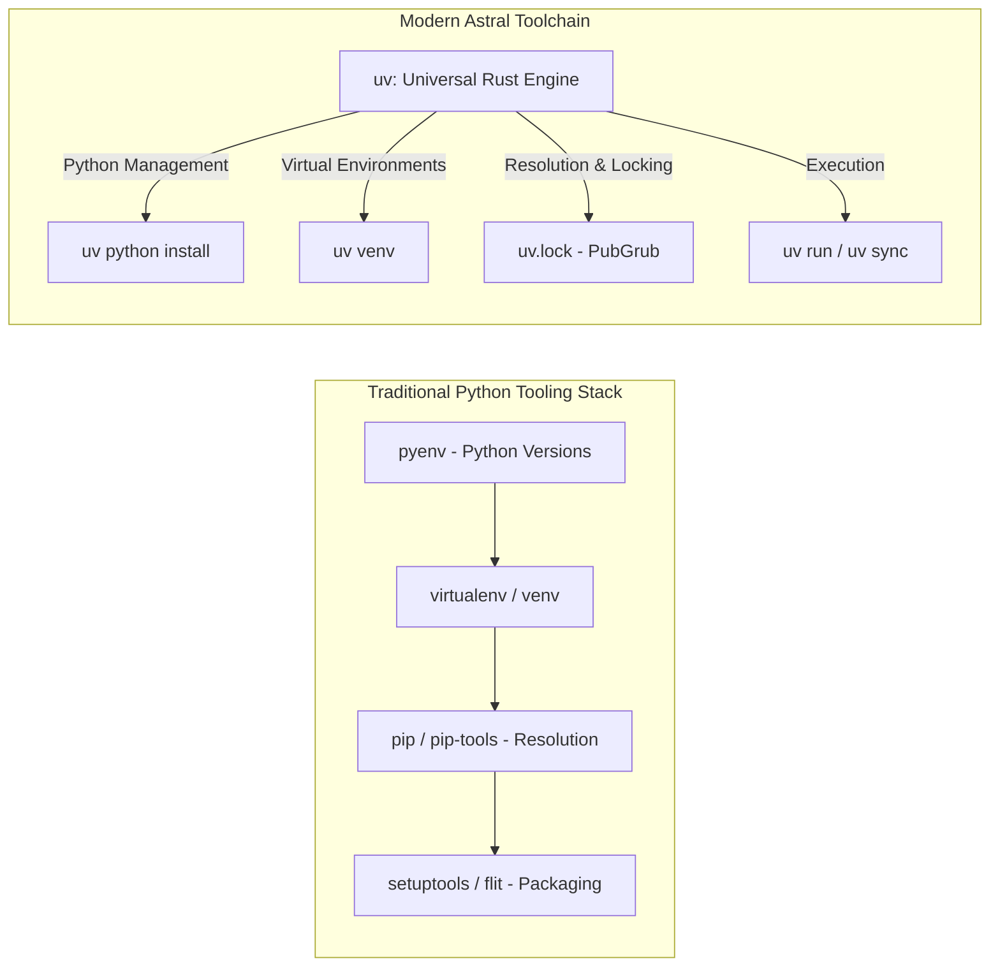
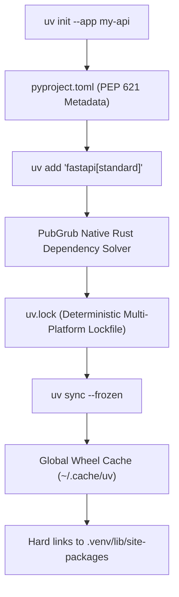

# Project Setup with uv

`uv` is an extremely fast Python package and project manager written in Rust by Astral (the creators of Ruff). Replacing `pip`, `pip-tools`, `virtualenv`, and `poetry`, `uv` resolves dependencies 10x to 100x faster while providing hermetic Python version management and deterministic cross-platform lockfiles.

Setting up a production FastAPI project with `uv` guarantees reproducible builds, rapid CI/CD test runs, and minimal Docker container footprints.

---

## 1. Conceptual Foundation & Mental Model

### Why `uv` Over Traditional Python Tooling?



Traditional Python package management suffers from slow resolution times, lack of deterministic lockfiles (unless using heavyweight tools like Poetry), and friction managing multiple Python binaries. 

`uv` uses the **PubGrub version-solving algorithm** compiled to native machine code. It resolves hundreds of dependencies in milliseconds, caches wheels globally via hard links, and manages Python runtimes without external tools like `pyenv`.

### `fastapi[standard]` vs Minimal `fastapi`

When installing FastAPI, you can choose between two main packages:
1. `fastapi[standard]`: Installs FastAPI along with production-grade defaults:
   - `uvicorn[standard]` (with `uvloop` and `httptools` C-extensions)
   - `fastapi-cli` (provides `fastapi dev` and `fastapi run`)
   - `email-validator` (for Pydantic `EmailStr`)
   - `httpx` (for test clients)
   - `python-multipart` (for form data and file uploads)
2. `fastapi` (minimal): Installs only FastAPI, Starlette, and Pydantic. Use this in minimal microservices or custom lambda layers where every megabyte counts.

---

## 2. Architecture & Internal Mechanics

### Workspace & Lockfile Flow



Because `uv` links installed packages from a global content-addressable cache using OS hard links, creating virtual environments takes virtually zero disk space and completes in less than 10 milliseconds.

---

## 3. Comprehensive Syntax & CLI Commands

### Core `uv` Workflow

```bash
# 1. Initialize a new application project
uv init --app api-service
cd api-service

# 2. Pin specific Python version
uv python pin 3.12

# 3. Add runtime dependencies
uv add "fastapi[standard]>=0.115.0" "pydantic>=2.10.0"

# 4. Add development dependencies in a dedicated group
uv add --dev pytest pytest-asyncio httpx ruff mypy

# 5. Execute commands within the isolated virtual environment
uv run fastapi dev main.py

# 6. Synchronize exact dependencies from uv.lock (CI/CD standard)
uv sync --frozen --no-dev
```

---

## 4. Practical Implementation: 5 Verified Examples

### Example 1: Authoritative `pyproject.toml` (PEP 621 Standard)

```toml
[project]
name = "enterprise-api"
version = "0.1.0"
description = "Production FastAPI Microservice"
readme = "README.md"
requires-python = ">=3.12"
dependencies = [
    "fastapi[standard]>=0.115.6",
    "pydantic-settings>=2.7.0",
    "sqlalchemy[asyncio]>=2.0.36",
    "asyncpg>=0.30.0",
    "structlog>=24.4.0",
]

[dependency-groups]
dev = [
    "pytest>=8.3.4",
    "pytest-asyncio>=0.24.0",
    "httpx>=0.28.1",
    "ruff>=0.8.4",
    "mypy>=1.13.0",
    "testcontainers>=4.9.0",
]

[build-system]
requires = ["hatchling"]
build-backend = "hatchling.build"

[tool.ruff]
line-length = 88
target-version = "py312"

[tool.ruff.lint]
select = ["E", "F", "I", "UP", "ASYNC", "B"]

[tool.pytest.ini_options]
asyncio_mode = "auto"
testpaths = ["tests"]
```

### Example 2: Minimal FastAPI Application Entry Point

```python
# src/enterprise_api/main.py
from contextlib import asynccontextmanager
from typing import AsyncGenerator
from fastapi import FastAPI

@asynccontextmanager
async def lifespan(app: FastAPI) -> AsyncGenerator[None, None]:
    # Application startup lifecycle
    yield
    # Application shutdown lifecycle

app = FastAPI(
    title="Enterprise API",
    version="0.1.0",
    lifespan=lifespan,
)

@app.get("/health")
async def health_check() -> dict[str, str]:
    return {"status": "ok", "environment": "uv-managed"}
```

Run via `uv`:
```bash
uv run fastapi dev src/enterprise_api/main.py --port 8000
```

### Example 3: Ultra-Fast Multi-Stage Dockerfile with `uv`

```dockerfile
# syntax=docker/dockerfile:1
FROM ghcr.io/astral-sh/uv:0.5.10-python3.12-bookworm-slim AS builder

WORKDIR /app

# Enable bytecode compilation for faster cold starts
ENV UV_COMPILE_BYTECODE=1
ENV UV_LINK_MODE=copy

# Install dependencies using cached mounts
RUN --mount=type=cache,target=/root/.cache/uv \
    --mount=type=bind,source=uv.lock,target=uv.lock \
    --mount=type=bind,source=pyproject.toml,target=pyproject.toml \
    uv sync --frozen --no-install-project --no-dev

# Final runtime stage
FROM python:3.12-slim-bookworm AS runner

WORKDIR /app

# Copy the pre-built virtual environment from builder
COPY --from=builder /app/.venv /app/.venv
ENV PATH="/app/.venv/bin:$PATH"

# Copy application source
COPY src/ /app/src/

# Run with non-root security user
RUN useradd -u 1000 appuser && chown -R appuser:appuser /app
USER appuser

EXPOSE 8000

# Execute production server via fastapi run
CMD ["fastapi", "run", "src/enterprise_api/main.py", "--port", "8000"]
```

### Example 4: Testing the Setup with Pytest & AsyncClient

```python
# tests/test_health.py
import pytest
from httpx import ASGITransport, AsyncClient
from enterprise_api.main import app

@pytest.mark.asyncio
async def test_health_check() -> None:
    transport = ASGITransport(app=app)
    async with AsyncClient(transport=transport, base_url="http://test") as client:
        response = await client.get("/health")
        assert response.status_code == 200
        assert response.json() == {"status": "ok", "environment": "uv-managed"}
```

Execute tests via:
```bash
uv run pytest
```

### Example 5: Cross-Platform Python Version Switching

`uv` allows testing code across multiple Python releases without system installations:

```bash
# Test on Python 3.12
uv run --python 3.12 pytest

# Test on Python 3.13
uv run --python 3.13 pytest

# Test on Python 3.13t (Free-Threaded No-GIL build)
uv run --python 3.13t pytest
```

---

## 5. Anti-Patterns & Common Traps

| Anti-Pattern | Why It Fails | Production Fix |
| :--- | :--- | :--- |
| **Committing `.venv` to Git** | Virtual environments contain machine-specific binaries and symlinks that break across platforms. | Add `.venv/` to `.gitignore`. Always commit `uv.lock`. |
| **Running `pip install` inside a `uv` project** | Destroys lockfile synchronization and bypasses `uv.lock`. | Always use `uv add <package>` or `uv run pip`. |
| **Omitting `--frozen` in CI/CD** | If `pyproject.toml` has loose ranges, `uv sync` without `--frozen` might re-resolve newer versions unexpectedly. | Always run `uv sync --frozen` in production CI/CD pipelines. |
| **Forgetting `--no-dev` in Docker images** | Development dependencies (linters, test tools) bloat container image sizes and increase attack surfaces. | Run `uv sync --frozen --no-dev` during image build. |
| **Using `requirements.txt` instead of `pyproject.toml`** | Lacks modern build metadata, dependency grouping, and lockfile guarantees. | Adopt PEP 621 `pyproject.toml` with `uv.lock`. |

---

## 6. Performance & Resource Characteristics

- **Resolution Speed**: `uv` resolves a 50-package FastAPI dependency tree in ~20 milliseconds, compared to 15-45 seconds for standard `pip`.
- **Disk Usage**: Because `uv` uses hard links across projects, installing FastAPI across 10 different local projects takes disk space only once (~45MB for all dependencies combined).
- **Cold-Start Bytecode Optimization**: Setting `ENV UV_COMPILE_BYTECODE=1` precompiles `.pyc` files during container builds, reducing FastAPI startup time by 15-30% upon initial invocation.

---

## 7. Edge Cases, Failure Modes & Gotchas

1. **Lockfile Merge Conflicts**: In high-velocity teams, two PRs adding dependencies can produce conflicts in `uv.lock`. Resolve by running `uv lock` locally; `uv` automatically re-solves the merge cleanly.
2. **Alpine Linux Compatibility**: Alpine uses `musl` libc rather than `glibc`. While `uv` supports Alpine (`x86_64-unknown-linux-musl`), many scientific C-extensions lack musl wheels. Standardize on Debian Slim (`bookworm-slim`) for FastAPI microservices.
3. **Editable Installs**: When developing an installable library or modular package, use `uv pip install -e .` or add `--editable` in `pyproject.toml` so local source changes reflect instantly.

---

## 8. Security Implications & OWASP Alignment

- **Dependency Pinning & Tampering**: `uv.lock` stores SHA256 hashes of every package wheel. If an attacker compromises a PyPI mirror or attempts a supply-chain package substitution, `uv` immediately aborts the installation due to hash mismatch.
- **Vulnerability Scanning**: Use `uv export --format requirements-txt | safety check --stdin` or integrate Snyk / GitHub Dependabot to scan locked dependencies for known CVEs.

---

## 9. Modern Tooling Integration

- **GitHub Actions Integration**: Astral provides the official `astral-sh/setup-uv` action:
```yaml
- name: Set up uv
  uses: astral-sh/setup-uv@v4
  with:
    enable-cache: true
    version: "latest"

- name: Install dependencies
  run: uv sync --frozen --all-groups
```

---

## 10. Real-World Case Study: Production Incident

### The Incident
A SaaS company running 20 FastAPI microservices on AWS ECS suffered a 4-hour deployment freeze when a nightly GitHub Actions workflow began failing during `docker build`. The build failed with `HTTP 429 Too Many Requests` from PyPI, blocking critical hotfix rollouts.

### The Root Cause
The legacy Dockerfiles used `pip install -r requirements.txt` without caching. As the team scaled to 150 deployments per day across a matrix of microservices, thousands of un-cached requests hit PyPI from the same AWS NAT gateway IP, triggering PyPI's IP rate limiter.

### The Resolution
1. Migrated all 20 repositories to `uv` and `uv.lock`.
2. Implemented Docker build cache mounts (`RUN --mount=type=cache,target=/root/.cache/uv`).
3. Build times dropped from 3 minutes 40 seconds to **6.8 seconds** per container.
4. Total egress traffic to PyPI decreased by 98%, completely eliminating rate-limiting errors.

---

## 11. Hands-On Exercises & Challenge Problems

### Warm-Up Exercises
1. **Initialize Project with uv**: Install `uv` and run `uv init --app my-fastapi-app`. Inspect the generated `pyproject.toml` and `.python-version` files.
2. **Add FastAPI & Run Server**: Add `fastapi[standard]` using `uv add`. Create a minimal `main.py` with a root route and launch it using `uv run fastapi dev`.

### Intermediate Challenges
3. **Configuring Dependency Groups**: Add `pytest` and `httpx` to a `test` dependency group. Add `ruff` and `mypy` to a `lint` group. Verify that running `uv sync --only-group test` installs only test tooling.
4. **Hermetic Docker Build**: Write a multi-stage Dockerfile using `ghcr.io/astral-sh/uv`. Build the image and inspect the final size with `docker images`. Ensure the final image is under 150MB.

### Production-Grade Challenges
5. **CI/CD Matrix Testing Pipeline**: Create a GitHub Actions workflow (`.github/workflows/ci.yml`) that uses `astral-sh/setup-uv` to execute tests across Python 3.11, 3.12, and 3.13 in parallel with cache restoration enabled.
6. **Multi-Package Monorepo Workspace**: Configure a `uv` workspace with two subprojects: `api-gateway` and `shared-domain`. Use path dependencies to link `shared-domain` into `api-gateway` and verify that changes in the domain package are reflected immediately.

---

## 12. Interview Mastery: Deep-Dive Questions & Answers

#### Q1: What makes `uv` so much faster than traditional `pip`?
**Answer**: `uv` is written in Rust and utilizes the PubGrub algorithm for concurrent dependency resolution. It downloads and unpacks wheels concurrently, interacts with the PyPI HTTP API using HTTP/2, and links files from a global content-addressable wheel cache into virtual environments using operating system hard links, avoiding redundant disk I/O.

#### Q2: What is the difference between `uv.lock` and `requirements.txt`?
**Answer**: A `requirements.txt` file is typically a flat list of top-level or pinned dependencies. `uv.lock` is a comprehensive, machine-generated cross-platform dependency graph that records every direct and transitive dependency, exact version, platform markers, and cryptographic SHA256 hashes, ensuring bit-for-bit identical environments across Linux, macOS, and Windows.

#### Q3: Why is `fastapi[standard]` recommended over plain `fastapi` for new projects?
**Answer**: `fastapi[standard]` bundles the core framework with essential production components: the official `fastapi-cli` (`fastapi dev` / `fastapi run`), `uvicorn` with high-performance C-extensions (`uvloop`, `httptools`), `email-validator` for Pydantic email fields, and `python-multipart` for processing form uploads.

#### Q4: How does `uv run` manage virtual environments automatically?
**Answer**: When you invoke `uv run <command>`, `uv` automatically inspects `pyproject.toml` and `uv.lock`. If a `.venv` does not exist or is out of sync with the lockfile, `uv` automatically creates or updates the virtual environment before executing the command, eliminating manual environment activation steps.

#### Q5: How do you perform a deterministic deployment in CI using `uv`?
**Answer**: Run `uv sync --frozen --no-dev`. The `--frozen` flag instructs `uv` to fail immediately if `uv.lock` is missing or out of date relative to `pyproject.toml`, preventing accidental dependency drift in production pipelines.

#### Q6: Can `uv` manage Python runtimes on a machine without `pyenv`?
**Answer**: Yes. `uv python install <version>` downloads pre-built, standalone Python binaries directly from Astral's toolchain releases. `uv` can download and switch between Python 3.10, 3.11, 3.12, 3.13, and 3.13t seamlessly without requiring root permissions or system package managers.

#### Q7: How does `uv` handle Docker build caching?
**Answer**: By leveraging BuildKit cache mounts (`--mount=type=cache,target=/root/.cache/uv`), `uv` reuses downloaded wheel packages across Docker builds on the same host, reducing subsequent container build times to mere seconds.

#### Q8: What build backend should be used in `pyproject.toml` when authoring FastAPI apps with `uv`?
**Answer**: Standard modern build backends include `hatchling` or `flit-core`. `hatchling` is widely recommended because it is lightweight, strictly adheres to PEP 517/PEP 621, and integrates seamlessly with `uv`'s workspace and packaging workflows.
