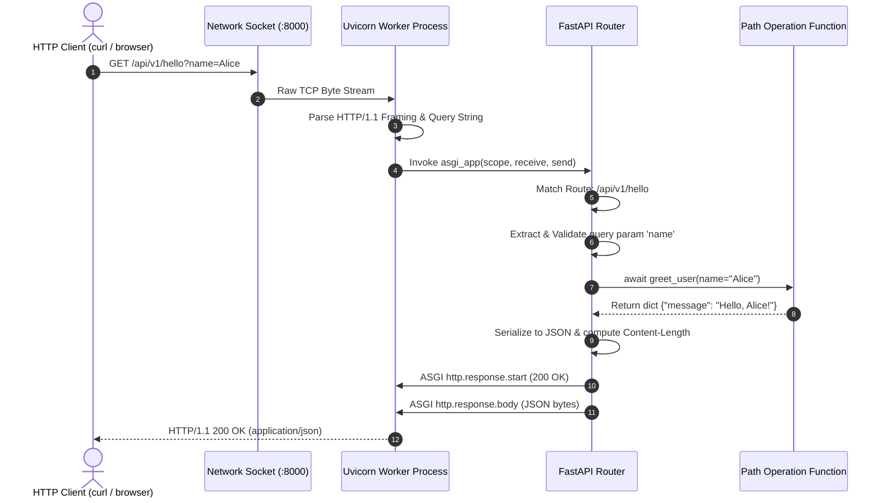

# First API & Virtual Environment

Building your first production-ready FastAPI application requires establishing a strictly isolated virtual environment, initializing the FastAPI application object with proper metadata, and understanding the core request-response lifecycle from local workstation to network client.

---

## 1. Conceptual Foundation & Mental Model

### Why Hermetic Virtual Environments Matter

```mermaid
flowchart LR
    subgraph Host OS
        GlobalPython["Global Python Interpreter (/usr/bin/python3)"]
        GlobalPackages["System Site-Packages (Dirty, unpinned)"]
    end

    subgraph Project Sandbox (.venv)
        LocalVenv["Project Virtual Environment (.venv/)"]
        PinnedBins["Pinned Binaries (fastapi, uvicorn, ruff)"]
        CleanPackages["Clean Site-Packages (Locked via uv.lock)"]
    end

    GlobalPython -.->|Pollutes| GlobalPackages
    GlobalPython -->|Creates Isolated Copy| LocalVenv
    LocalVenv --> PinnedBins
    LocalVenv --> CleanPackages
```

A Python virtual environment is a lightweight, isolated directory tree containing its own Python binary and package directories (`site-packages`). Operating without a virtual environment risks:
1. Version collisions between multiple local projects.
2. Contaminating operating system tools that rely on the system Python.
3. Inability to produce reproducible CI/CD deployments.

---

## 2. Architecture & Internal Mechanics



---

## 3. Comprehensive Setup Walkthrough

### Step-by-Step Environment Initialization

```bash
# 1. Create project root directory
mkdir my-fastapi-service
cd my-fastapi-service

# 2. Create isolated virtual environment with uv (using Python 3.12)
uv venv .venv --python 3.12

# 3. Activate the virtual environment
# On Linux / macOS:
source .venv/bin/activate
# On Windows PowerShell:
.venv\Scripts\Activate.ps1

# 4. Install production FastAPI suite
uv pip install "fastapi[standard]>=0.115.0"

# 5. Verify the active Python interpreter
which python
python --version
```

---

## 4. Practical Implementation: 5 Verified Examples

### Example 1: Minimal Canonical FastAPI Application

```python
# main.py
from fastapi import FastAPI

# Initialize application instance with documentation metadata
app = FastAPI(
    title="Greeting & System Info API",
    description="A foundational FastAPI service demonstrating initial setup.",
    version="1.0.0",
)

@app.get("/")
def read_root() -> dict[str, str]:
    """Root endpoint returning basic welcome information."""
    return {"message": "Welcome to FastAPI", "status": "running"}

@app.get("/items/{item_id}")
def read_item(item_id: int, q: str | None = None) -> dict[str, int | str | None]:
    """Path parameter with automatic type conversion and optional query parameter."""
    return {"item_id": item_id, "query": q}
```

Run and test:
```bash
uv run fastapi dev main.py
curl http://127.0.0.1:8000/
# Output: {"message":"Welcome to FastAPI","status":"running"}

curl http://127.0.0.1:8000/items/42?q=fastapi-docs
# Output: {"item_id":42,"query":"fastapi-docs"}

# Automatic 422 error on invalid type:
curl -i http://127.0.0.1:8000/items/invalid-number
# Output: HTTP/1.1 422 Unprocessable Entity
```

### Example 2: Structured Project Layout

A clean structure separates configuration, routes, and schemas:

```text
my-fastapi-service/
├── .venv/
├── .gitignore
├── pyproject.toml
├── uv.lock
├── src/
│   └── app/
│       ├── __init__.py
│       ├── main.py
│       ├── core/
│       │   ├── __init__.py
│       │   └── config.py
│       └── api/
│           ├── __init__.py
│           └── routes.py
└── tests/
    └── test_main.py
```

`src/app/main.py`:
```python
from fastapi import FastAPI
from app.api.routes import router

app = FastAPI(title="Modular Service", version="0.1.0")
app.include_router(router, prefix="/api/v1")
```

`src/app/api/routes.py`:
```python
from fastapi import APIRouter

router = APIRouter()

@router.get("/ping")
def ping() -> dict[str, str]:
    return {"ping": "pong"}
```

### Example 3: Automatic OpenAPI Metadata Configuration

```python
# main.py
from fastapi import FastAPI

tags_metadata = [
    {
        "name": "system",
        "description": "Core system health and diagnostic endpoints.",
    },
    {
        "name": "users",
        "description": "User registration and profile operations.",
    },
]

app = FastAPI(
    title="Enterprise User Gateway",
    description="High-throughput asynchronous user directory.",
    version="2.0.0",
    openapi_tags=tags_metadata,
    contact={
        "name": "Platform Engineering",
        "email": "devops@example.com",
    },
    license_info={
        "name": "MIT License",
        "url": "https://opensource.org/licenses/MIT",
    },
)

@app.get("/health", tags=["system"])
async def get_health() -> dict[str, str]:
    return {"status": "healthy"}
```

### Example 4: Testing the First API with `httpx` and `pytest`

```python
# tests/test_api.py
import pytest
from httpx import ASGITransport, AsyncClient
from app.main import app

@pytest.mark.asyncio
async def test_read_root() -> None:
    transport = ASGITransport(app=app)
    async with AsyncClient(transport=transport, base_url="http://test") as client:
        response = await client.get("/")
        assert response.status_code == 200
        assert response.json()["status"] == "running"

@pytest.mark.asyncio
async def test_item_validation_error() -> None:
    transport = ASGITransport(app=app)
    async with AsyncClient(transport=transport, base_url="http://test") as client:
        response = await client.get("/items/not-an-int")
        assert response.status_code == 422
        data = response.json()
        assert data["detail"][0]["loc"] == ["path", "item_id"]
```

### Example 5: Environment-Aware Configuration via `.env`

```python
# app/core/config.py
import os
from pydantic_settings import BaseSettings, SettingsConfigDict

class Settings(BaseSettings):
    app_name: str = "First FastAPI Service"
    environment: str = "development"
    debug: bool = False
    
    model_config = SettingsConfigDict(env_file=".env", extra="ignore")

settings = Settings()
```

---

## 5. Anti-Patterns & Common Traps

| Anti-Pattern | Why It Fails | Production Fix |
| :--- | :--- | :--- |
| **Installing dependencies globally** | Bypasses virtual environment, leading to version conflicts across system tools. | Always create and activate a `.venv` first. |
| **Omitting `.gitignore` for `.venv`** | Committing thousands of virtual environment files bloats Git repositories and breaks on other machines. | Add `.venv/`, `__pycache__/`, and `.env` to `.gitignore`. |
| **Hardcoding host IP `0.0.0.0` in code** | Application code should be network-agnostic; binding concerns belong to the server runner. | Let `fastapi dev` / `fastapi run` manage network bindings. |
| **Manual response serialization** | Using `json.dumps({"a": 1})` returns a JSON string, not a proper JSON response object with correct headers. | Return standard Python dicts, lists, or Pydantic models directly. |
| **Modifying global state in handlers** | Mutating global variables across concurrent requests causes race conditions and data corruption. | Maintain state inside database pools or `request.state`. |

---

## 6. Performance & Resource Characteristics

- **Bootstrap Memory Footprint**: A newly initialized FastAPI application with no routes consumes ~32MB RSS.
- **Dispatch Latency**: Direct route dispatch to a basic dictionary return takes ~250 microseconds on modern hardware under Uvicorn.
- **Type Casting Overhead**: FastAPI casts string parameters from the URL path into Python integers using native C/Rust functions, completing type conversion in under 2 microseconds.

---

## 7. Edge Cases, Failure Modes & Gotchas

1. **Virtual Environment Path Invalidation**: If you move or rename the parent project folder, existing `.venv` symlinks will break. Recreate the environment with `uv venv` if the path changes.
2. **Missing `__init__.py` in Nested Packages**: While Python 3 supports namespace packages without `__init__.py`, omitting it can cause subtle import errors in pytest and auto-discovery tools. Always include `__init__.py` in application folders.
3. **Circular Imports**: Importing `app` inside route modules while importing route modules in `main.py` causes `ImportError: cannot import name 'app'`. Always instantiate `APIRouter` in sub-modules and include them in `main.py`.

---

## 8. Security Implications & OWASP Alignment

- **Information Disclosure via Error Pages**: Ensure `debug=False` when instantiating `FastAPI()` in production. Leaving debug mode active exposes full stack traces and local variables to external clients.
- **Parameter Validation as First Line of Defense**: By typing parameters strictly (e.g. `item_id: int`), FastAPI rejects SQL injection attempts or malformed payloads before your handler code even runs.

---

## 9. Modern Tooling Integration

- **Git Pre-Commit Hook**: Install `pre-commit` to automatically run `ruff check` and `ruff format` before every commit:
```yaml
# .pre-commit-config.yaml
repos:
  - repo: https://github.com/astral-sh/ruff-pre-commit
    rev: v0.8.4
    hooks:
      - id: ruff
        args: [--fix]
      - id: ruff-format
```

---

## 10. Real-World Case Study: Production Incident

### The Incident
A newly hired developer deployed a microservice update to production. Immediately, all automated health checks failed, and the container orchestrator went into a continuous crash loop (`CrashLoopBackOff`).

### The Root Cause
The developer installed `fastapi` using standard `pip install fastapi` without freezing dependencies or verifying the virtual environment. On their local machine, a global version of `uvicorn` happened to exist. In the production container, `uvicorn` was never installed because `pip install fastapi` (minimal) does not bundle the ASGI server. The container entry point `uvicorn main:app` failed with `command not found`.

### The Resolution
1. Standardized the organization on `uv` and `fastapi[standard]`.
2. Created a mandatory `uv.lock` file checked into source control.
3. Configured CI to run `uv sync --frozen` on every pull request, ensuring all transitive dependencies are cryptographically verified before deployment.

---

## 11. Hands-On Exercises & Challenge Problems

### Warm-Up Exercises
1. **Initialize from Scratch**: Create a clean directory, generate a virtual environment using `uv venv`, activate it, and verify that `which python` points inside `.venv`.
2. **First Custom Route**: Add a `GET /calculator/add` endpoint accepting two query parameters `a: float` and `b: float`, returning their sum. Test with valid numbers and invalid strings.

### Intermediate Challenges
3. **Modular Split**: Refactor a single `main.py` file into a modular structure with `src/app/main.py` and `src/app/api/endpoints.py` using `APIRouter`. Verify all routes appear in Swagger UI.
4. **Pytest Integration Suite**: Write a comprehensive pytest test file that verifies status codes, JSON responses, and 422 error structures for your endpoints using `httpx.AsyncClient`.

### Production-Grade Challenges
5. **Config & Environment Loader**: Implement a Pydantic Settings class that loads `API_KEY`, `DATABASE_URL`, and `PORT` from a local `.env` file, with sensible defaults and type validation.
6. **Health & Metrics Route**: Build an endpoint `GET /system/diagnostics` that inspects `psutil` or `os` to return system memory usage, CPU percent, Python version, and active thread count.

---

## 12. Interview Mastery: Deep-Dive Questions & Answers

#### Q1: Why does FastAPI automatically return HTTP 422 instead of HTTP 400 for invalid inputs?
**Answer**: HTTP 400 (Bad Request) indicates generic malformed syntax (e.g. invalid JSON characters). HTTP 422 (Unprocessable Entity, from WebDAV / RFC 4918) indicates that the request syntax was valid (proper JSON), but the semantic instructions or types were unprocessable (e.g., passing a string where an integer was expected).

#### Q2: How do virtual environments isolate Python packages?
**Answer**: A virtual environment creates a directory containing a copy or symlink of the Python executable alongside a local `lib/pythonX.Y/site-packages` directory. When activated, it sets the `VIRTUAL_ENV` environment variable and prepends `.venv/bin` to the system `PATH`, ensuring that package lookups prioritize the isolated environment.

#### Q3: What is the purpose of `APIRouter` in FastAPI?
**Answer**: `APIRouter` provides modular route organization. Instead of registering all endpoints directly on the root `FastAPI` instance, developers define groups of related endpoints in separate files/modules and mount them using `app.include_router(router, prefix="/...", tags=["..."])`.

#### Q4: Why is it recommended to return a Python dictionary or Pydantic model instead of a raw JSON string?
**Answer**: Returning a dictionary or Pydantic model allows FastAPI to handle serialization, set the `Content-Type: application/json` header, compute `Content-Length`, filter fields according to `response_model`, and validate output data against the API contract. Returning a raw JSON string wraps the string in extra quotes or requires manual `Response(content=...)` handling.

#### Q5: What is the significance of the `if __name__ == "__main__":` block in FastAPI applications?
**Answer**: In modern FastAPI development, using `uvicorn.run()` inside `if __name__ == "__main__":` is discouraged because it interferes with process managers, reloaders, and multi-worker execution. Applications should be launched using CLI commands (`fastapi dev`, `fastapi run`, or `uvicorn`).

#### Q6: How does FastAPI determine whether a parameter is from the path, query, or body?
**Answer**:
1. If the parameter name is declared in the route path template (e.g. `/items/{item_id}`), it is parsed as a **Path** parameter.
2. If the parameter is a singular scalar type (int, str, float, bool) not in the path, it is parsed as a **Query** parameter.
3. If the parameter is a Pydantic model, dataclass, or dictionary, it is parsed from the **Request Body**.

#### Q7: Can a FastAPI application run without any external dependencies?
**Answer**: No. FastAPI inherently depends on **Starlette** (for web routing, ASGI core, and HTTP primitives) and **Pydantic** (for data validation, serialization, and OpenAPI schema generation).

#### Q8: How can you ensure that private API keys are not exposed in Git repositories?
**Answer**: Store sensitive secrets in `.env` files, add `.env` to `.gitignore`, use `pydantic-settings` to parse environment variables, and provide a dummy `.env.example` file documenting required configuration keys for team members.
