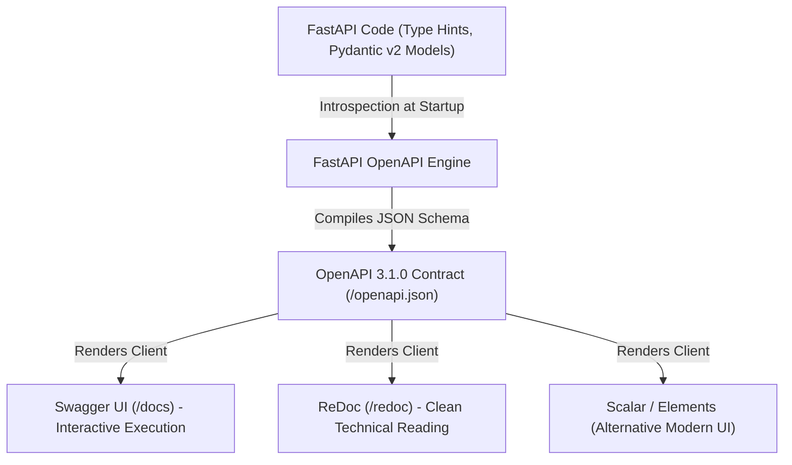
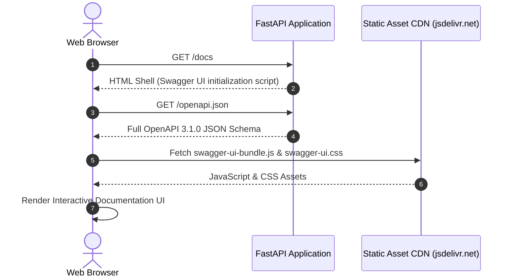

# Automatic Docs: Swagger UI, ReDoc & OpenAPI

One of FastAPI's hallmark features is the automatic generation of interactive API documentation conforming to the **OpenAPI 3.1.0 Specification**. Out of the box, every route, request body, query parameter, and status code defined via type hints and Pydantic schemas is compiled into an OpenAPI JSON contract and served through interactive documentation interfaces: **Swagger UI** and **ReDoc**.

---

## 1. Conceptual Foundation & Mental Model

### The Documentation Pipeline



### The Three Layers
1. **The Contract (`/openapi.json`)**: A machine-readable JSON representation of all API endpoints, parameters, request/response schemas, and security requirements.
2. **Swagger UI (`/docs`)**: An interactive web interface allowing developers and QA engineers to execute real HTTP calls directly from the browser ("Try it out").
3. **ReDoc (`/redoc`)**: A clean, publication-grade three-panel technical documentation interface designed for external API consumers.

---

## 2. Architecture & Internal Mechanics



By default, FastAPI's HTML shell loads Swagger UI JavaScript and CSS bundles from a public CDN (`cdn.jsdelivr.net`). In secure, air-gapped, or offline enterprise environments, these static assets must be self-hosted to prevent external network dependencies.

---

## 3. Comprehensive Syntax & Core Parameters

### Application Documentation Configuration

```python
from fastapi import FastAPI
from fastapi.openapi.docs import get_swagger_ui_html, get_redoc_html

app = FastAPI(
    title="Core Platform API",
    description="Mission-critical enterprise services API.",
    version="1.0.0",
    terms_of_service="https://example.com/terms/",
    contact={
        "name": "API Platform Engineering",
        "url": "https://example.com/support",
        "email": "api@example.com",
    },
    license_info={
        "name": "Apache 2.0",
        "url": "https://www.apache.org/licenses/LICENSE-2.0.html",
    },
    # URL endpoints for docs (set to None to disable)
    docs_url="/docs",
    redoc_url="/redoc",
    openapi_url="/openapi.json",
    # Advanced Swagger UI client parameters
    swagger_ui_parameters={
        "persistAuthorization": True,     # Retain JWT bearer token on page refresh
        "displayRequestDuration": True,   # Show request duration in milliseconds
        "docExpansion": "none",           # Collapse route accordions by default
        "filter": True,                   # Enable fast search filter bar
        "syntaxHighlight.theme": "monokai", # Syntax highlighting color scheme
    },
)
```

---

## 4. Practical Implementation: 5 Verified Examples

### Example 1: Enriching Route Metadata for Interactive Docs

```python
# main.py
from typing import Annotated
from fastapi import FastAPI, Path, Query, status
from pydantic import BaseModel, Field

app = FastAPI(title="Catalog Service")

class ProductResponse(BaseModel):
    id: int = Field(..., description="Unique product identifier", examples=[101])
    name: str = Field(..., description="Product display name", examples=["Ergonomic Desk"])
    price: float = Field(..., gt=0, description="Retail price in USD", examples=[299.99])
    in_stock: bool = Field(default=True, description="Inventory availability flag")

@app.get(
    "/products/{product_id}",
    response_model=ProductResponse,
    status_code=status.HTTP_200_OK,
    summary="Retrieve single product by ID",
    description="Fetches comprehensive product specifications, stock status, and retail pricing.",
    response_description="The matching product record if found",
    tags=["Product Catalog"],
    deprecated=False,
)
async def get_product(
    product_id: Annotated[int, Path(ge=1, le=100_000, description="Target Product ID")],
    include_reviews: Annotated[bool, Query(description="Include customer reviews in response")] = False,
) -> ProductResponse:
    return ProductResponse(
        id=product_id,
        name="Ergonomic Desk",
        price=299.99,
        in_stock=True,
    )
```

### Example 2: Completely Disabling Documentation in Production

In high-security production environments, exposing `/docs`, `/redoc`, and `/openapi.json` can inadvertently reveal internal microservice topologies:

```python
# app/core/app.py
import os
from fastapi import FastAPI

# Check active deployment environment
ENV = os.getenv("ENVIRONMENT", "development")
is_production = ENV == "production"

app = FastAPI(
    title="Secure Payment Gateway",
    # Disable documentation endpoints entirely in production
    docs_url=None if is_production else "/docs",
    redoc_url=None if is_production else "/redoc",
    openapi_url=None if is_production else "/openapi.json",
)
```

### Example 3: Self-Hosting Swagger UI Static Assets (Offline / Air-Gapped)

Eliminating external CDN dependencies by mounting local static assets:

```python
# offline_docs.py
from fastapi import FastAPI
from fastapi.openapi.docs import get_swagger_ui_html, get_redoc_html
from fastapi.staticfiles import StaticFiles
from starlette.responses import HTMLResponse

app = FastAPI(docs_url=None, redoc_url=None)

# Mount local directory containing swagger-ui assets
app.mount("/static", StaticFiles(directory="static"), name="static")

@app.get("/docs", include_in_schema=False)
async def custom_swagger_ui_html() -> HTMLResponse:
    return get_swagger_ui_html(
        openapi_url=app.openapi_url or "/openapi.json",
        title=f"{app.title} - Swagger UI",
        swagger_js_url="/static/swagger-ui-bundle.js",
        swagger_css_url="/static/swagger-ui.css",
        swagger_favicon_url="/static/favicon.png",
    )

@app.get("/redoc", include_in_schema=False)
async def custom_redoc_html() -> HTMLResponse:
    return get_redoc_html(
        openapi_url=app.openapi_url or "/openapi.json",
        title=f"{app.title} - ReDoc",
        redoc_js_url="/static/redoc.standalone.js",
        redoc_favicon_url="/static/favicon.png",
    )
```

### Example 4: Custom OpenAPI Schema Modification (Dynamic Extension)

Injecting custom server URLs, logos, or corporate extensions into the OpenAPI contract:

```python
# custom_openapi.py
from typing import Any
from fastapi import FastAPI
from fastapi.openapi.utils import get_openapi

app = FastAPI(title="Customized API")

@app.get("/items")
def list_items() -> list[str]:
    return ["item1", "item2"]

def custom_openapi_schema() -> dict[str, Any]:
    # Return cached schema if already generated
    if app.openapi_schema:
        return app.openapi_schema

    # Generate baseline OpenAPI 3.1.0 schema
    openapi_schema = get_openapi(
        title="Enterprise Custom Gateway",
        version="2.5.0",
        description="Extended OpenAPI Schema with custom security and server configurations.",
        routes=app.routes,
    )

    # Inject custom branding extension for ReDoc
    openapi_schema["info"]["x-logo"] = {
        "url": "https://fastapi.tiangolo.com/img/logo-margin/logo-teal.png"
    }
    
    # Inject multi-region production server URLs
    openapi_schema["servers"] = [
        {"url": "https://api-us.example.com", "description": "US-East Production"},
        {"url": "https://api-eu.example.com", "description": "EU-West Production"},
        {"url": "http://127.0.0.1:8000", "description": "Local Development"},
    ]

    app.openapi_schema = openapi_schema
    return app.openapi_schema

# Override FastAPI's schema generator method
app.openapi = custom_openapi_schema
```

### Example 5: Integrating Alternative Modern UI (Scalar API Reference)

Scalar is an increasingly popular modern alternative to Swagger UI:

```python
# scalar_docs.py
from fastapi import FastAPI
from fastapi.responses import HTMLResponse

app = FastAPI(docs_url=None)

@app.get("/scalar", include_in_schema=False)
async def scalar_html() -> HTMLResponse:
    return HTMLResponse(
        """
        <!doctype html>
        <html>
          <head>
            <title>API Reference</title>
            <meta charset="utf-8" />
            <meta name="viewport" content="width=device-width, initial-scale=1" />
          </head>
          <body>
            <script
              id="api-reference"
              data-url="/openapi.json">
            </script>
            <script src="https://cdn.jsdelivr.net/npm/@scalar/api-reference"></script>
          </body>
        </html>
        """
    )
```

---

## 5. Anti-Patterns & Common Traps

| Anti-Pattern | Why It Fails | Production Fix |
| :--- | :--- | :--- |
| **Exposing public `/docs` in production microservices** | Reveals internal route parameters, database IDs, and attack surfaces to malicious actors. | Conditionally disable `docs_url=None` and `openapi_url=None` in production environments. |
| **Relying on external CDNs in air-gapped banking/healthcare clouds** | Content Security Policies (CSP) or network firewalls block `jsdelivr.net`, causing blank documentation pages. | Self-host static assets using `StaticFiles` and local JavaScript bundles. |
| **Generating `app.openapi()` on every request** | Regenerating the large OpenAPI dictionary on each request introduces high latency. | Cache the schema dictionary in `app.openapi_schema` as shown in Example 4. |
| **Omitting `examples` in Pydantic models** | Produces generic `{ "id": 0, "name": "string" }` placeholders in Swagger UI, making client onboarding difficult. | Supply realistic documentation examples via `Field(..., examples=[...])`. |
| **Forgetting `include_in_schema=False` on health routes** | Pollutes documentation with infrastructure routes like `/health` or `/metrics`. | Add `include_in_schema=False` to internal operational endpoints. |

---

## 6. Performance & Resource Characteristics

- **Schema Generation Latency**: On application startup, FastAPI parses all registered routes and compiles the OpenAPI JSON dictionary once. For an API with 200 routes, initial generation takes ~8-15ms. Subsequent requests to `/openapi.json` serve the cached in-memory dictionary in under 100 microseconds.
- **Payload Size**: A comprehensive OpenAPI 3.1 specification for a large enterprise service can reach 150KB to 500KB. Ensure gzip/brotli compression middleware is enabled to reduce transfer size.

---

## 7. Edge Cases, Failure Modes & Gotchas

1. **Broken URLs Behind Reverse Proxies**: If Swagger UI is loaded behind Nginx at `https://domain.com/v1/docs`, clicking "Try it out" might send requests to `http://domain.com/items` instead of `https://domain.com/v1/items`. Fix this by passing `root_path="/v1"` to `FastAPI(root_path=...)`.
2. **Duplicate Operation IDs**: If two endpoints share the same function name across different files (e.g. `users.get_item` and `orders.get_item`), client SDK generators (like openapi-python-client) can generate naming collisions. Fix by generating unique operation IDs via `generate_unique_id_function`.
3. **OpenAPI 3.1 vs 3.0 Compatibility**: FastAPI uses OpenAPI 3.1.0, which fully aligns with JSON Schema Draft 2020-12. Some older third-party tools (like legacy API gateways) only support OpenAPI 3.0.

---

## 8. Security Implications & OWASP Alignment

- **OWASP API9:2023 - Improper Inventory Management**: Outdated documentation allows zombie or shadow APIs to persist undetected. FastAPI's automatic generation ensures the documentation is always a 100% faithful reflection of active executable code.
- **Bearer Token Leakage**: The Swagger UI setting `"persistAuthorization": True` stores JWT tokens in the browser's `localStorage`. Ensure developer laptops follow corporate security policies so tokens are not accessed by unauthorized users.

---

## 9. Modern Tooling Integration

- **Client SDK Generation**: Use `openapi-ts` (TypeScript) or `openapi-python-client` to automatically generate fully typed client libraries directly from FastAPI's `/openapi.json` endpoint.

---

## 10. Real-World Case Study: Production Incident

### The Incident
A healthcare tech provider deployed an emergency security update in a HIPAA-compliant VPC with strict outbound internet egress firewalls. Immediately after deployment, the internal frontend engineering team reported that the API documentation at `/docs` was completely blank, displaying a continuous white screen and blocking web app development.

### The Root Cause
FastAPI's default `get_swagger_ui_html` references CDN scripts:
`https://cdn.jsdelivr.net/npm/swagger-ui-dist@5/swagger-ui-bundle.js`
Because the VPC firewall blocked all outbound traffic to public CDNs, the browser failed to load the JavaScript assets with `net::ERR_CONNECTION_TIMED_OUT`.

### The Resolution
1. Downloaded `swagger-ui-bundle.js` and `swagger-ui.css` into a local `static/` directory within the container.
2. Mounted the local directory via `app.mount("/static", StaticFiles(...))`.
3. Overrode the `/docs` route using `get_swagger_ui_html(swagger_js_url="/static/swagger-ui-bundle.js", ...)`.
4. Documentation loaded instantly with zero external network dependencies.

---

## 11. Hands-On Exercises & Challenge Problems

### Warm-Up Exercises
1. **Interactive Docs Tour**: Launch a FastAPI application, navigate to `http://127.0.0.1:8000/docs`, and execute a `GET` request using the interactive "Try it out" button. Then inspect `http://127.0.0.1:8000/redoc`.
2. **Swagger UI Customization**: Configure `swagger_ui_parameters` to collapse all route sections by default (`docExpansion: "none"`) and display execution durations.

### Intermediate Challenges
3. **OpenAPI Tag Grouping**: Define custom `openapi_tags` metadata with titles and external documentation links. Assign different routes to specific tags and observe how Swagger UI groups them into collapsible categories.
4. **Environment-Gated Documentation**: Write a configuration module using `pydantic-settings` that automatically disables `/docs`, `/redoc`, and `/openapi.json` when `ENVIRONMENT=production`.

### Production-Grade Challenges
5. **Self-Contained Offline Docs Bundle**: Implement a script that downloads the official Swagger UI release files, saves them into a `static/` directory, and serves them locally with zero external network calls. Verify in an environment with Wi-Fi disabled.
6. **Automated SDK Generator Hook**: Write a test or pre-commit hook that fetches `/openapi.json` from the running FastAPI app and verifies that every registered endpoint contains a non-empty `summary` and `description`.

---

## 12. Interview Mastery: Deep-Dive Questions & Answers

#### Q1: What is the relationship between FastAPI, OpenAPI, and Swagger UI?
**Answer**: OpenAPI is a formal language-agnostic specification (standardized by the Linux Foundation) for describing RESTful APIs. FastAPI automatically introspects Python route signatures and Pydantic models to generate an OpenAPI 3.1.0 document (`/openapi.json`). Swagger UI is a client-side JavaScript application that reads this OpenAPI JSON document and renders an interactive web interface.

#### Q2: What is the difference between Swagger UI and ReDoc?
**Answer**: Swagger UI is interactive: it allows users to authenticate, fill in parameters, and send live HTTP requests to the backend directly from the browser ("Try it out"). ReDoc is a three-panel, read-only documentation viewer focused on elegance, typography, and clear visualization of complex nested schemas, ideal for public developer portals.

#### Q3: How do you completely disable API documentation in production?
**Answer**: Pass `None` to `docs_url`, `redoc_url`, and `openapi_url` during FastAPI initialization:
```python
app = FastAPI(docs_url=None, redoc_url=None, openapi_url=None)
```

#### Q4: Why does FastAPI default to OpenAPI 3.1.0 instead of OpenAPI 3.0.x?
**Answer**: OpenAPI 3.1.0 achieves 100% dialect compatibility with JSON Schema (Draft 2020-12). Because Pydantic v2 generates JSON Schema compliant with Draft 2020-12 (supporting features like standard `type: ["string", "null"]` for nullable fields), OpenAPI 3.1 allows FastAPI to export Pydantic schemas directly without lossy translation layers.

#### Q5: How can an endpoint be hidden from the Swagger documentation while remaining active?
**Answer**: Pass `include_in_schema=False` to the path operation decorator:
```python
@app.get("/internal-metrics", include_in_schema=False)
def internal_metrics(): ...
```

#### Q6: What is the purpose of `swagger_ui_parameters`?
**Answer**: `swagger_ui_parameters` is a dictionary passed to FastAPI that configures Swagger UI's client-side JavaScript engine. It allows developers to customize UI behavior, such as persisting authorization tokens across reloads (`persistAuthorization`), enabling search filters, and controlling default accordion expansion (`docExpansion`).

#### Q7: How can you inject custom servers (e.g. Production and Staging URLs) into the generated OpenAPI schema?
**Answer**: Either pass a `servers` list to `FastAPI(servers=[{"url": "...", "description": "..."}])` or override the `app.openapi` method to mutate the `openapi_schema["servers"]` list dynamically.

#### Q8: How can you protect Swagger UI behind an authentication wall in production?
**Answer**: Disable the default docs route (`docs_url=None`), then create a custom route `/docs` that requires an authentication dependency (`Depends(verify_admin_cookie)`) before returning `get_swagger_ui_html()`.
