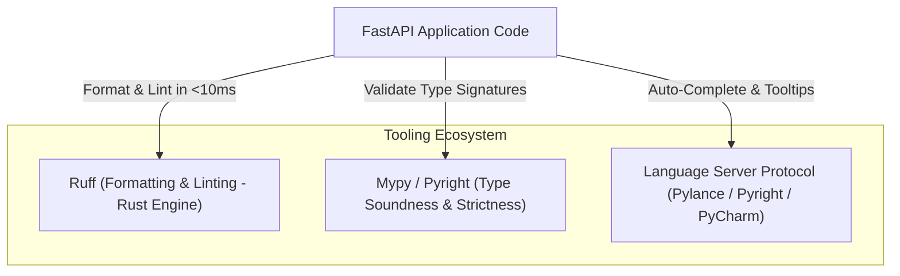

# Editor Setup & Static Type Checking

FastAPI is fundamentally designed around Python type hints. When configured correctly, modern code editors (VS Code, Cursor, PyCharm) provide real-time auto-completion for request parameters, immediate inline error detection for schema mismatches, and automated refactoring.

Combining modern static type checkers (**Pyright / Pylance** and **Mypy**) with the ultra-fast **Ruff** linter and formatter ensures that syntax errors and type regressions are caught before tests or deployments ever run.

---

## 1. Conceptual Foundation & Mental Model

### The Static Analysis Triangle



- **Ruff**: Replaces Black, Flake8, isort, and Bandit. Written in Rust, it analyzes codebases 10-100x faster than legacy Python linters.
- **Pyright / Pylance**: Microsoft's node-based static type checker powering VS Code and Cursor. Delivers sub-second type inference for large FastAPI codebases.
- **Mypy**: The canonical Python reference type checker. Enhanced with the official `pydantic.mypy` plugin to validate model instantiation and field types.

---

## 2. Architecture & Internal Mechanics

```mermaid
flowchart LR
    subgraph Editor (VS Code / PyCharm)
        DevTypes["typing.Annotated + Pydantic Models"]
        LSP["Language Server (Pyright / Pylance)"]
    end

    subgraph CI Pipeline
        RuffCLI["ruff check && ruff format --check"]
        MypyCLI["mypy --strict src/"]
    end

    DevTypes -->|Live AST Introspection| LSP
    LSP -->|Instant Type Warnings| DevTypes
    DevTypes -->|Git Commit| RuffCLI
    RuffCLI -->|Pass| MypyCLI
    MypyCLI -->|Zero Type Errors| Deploy["Production Deploy"]
```

Because FastAPI uses `typing.Annotated` (PEP 593), the first argument is always the pure Python type (e.g., `int`), while the remaining arguments represent framework metadata (e.g., `Query(gt=0)`). This ensures that type checkers treat the parameter as a standard `int` without needing framework-specific stubs.

---

## 3. Authoritative Tooling Configurations

### Complete `ruff.toml` / `pyproject.toml` Configuration

```toml
# pyproject.toml
[tool.ruff]
line-length = 88
target-version = "py312"

[tool.ruff.lint]
select = [
    "E",      # pycodestyle errors
    "W",      # pycodestyle warnings
    "F",      # pyflakes
    "I",      # isort (import sorting)
    "UP",     # pyupgrade (modernizes old Python syntax)
    "ASYNC",  # flake8-async (catches blocking calls in async def)
    "B",      # flake8-bugbear (common design bugs)
    "S",      # flake8-bandit (security issues)
    "T20",    # flake8-print (prevents stray print statements)
    "FAST",   # fastapi specific linter rules
]
ignore = [
    "S101",   # allow assert statements in tests
]

[tool.ruff.format]
quote-style = "double"
indent-style = "space"
```

### Complete `mypy.ini` / `[tool.mypy]` Configuration

```toml
# pyproject.toml
[tool.mypy]
python_version = "3.12"
strict = true
warn_return_any = true
warn_unused_configs = true
disallow_untyped_defs = true
disallow_incomplete_defs = true
check_untyped_defs = true
no_implicit_optional = true
plugins = ["pydantic.mypy"]

[tool.pydantic-mypy]
init_forbid_extra = true
init_typed = true
warn_required_dynamic_aliases = true
```

### Complete `pyrightconfig.json` Configuration

```json
{
  "include": ["src", "tests"],
  "exclude": ["**/node_modules", "**/__pycache__", ".venv"],
  "pythonVersion": "3.12",
  "pythonPlatform": "All",
  "typeCheckingMode": "strict",
  "useLibraryCodeForTypes": true,
  "reportMissingTypeStubs": false,
  "reportUnknownMemberType": false
}
```

---

## 4. Practical Implementation: 5 Verified Examples

### Example 1: Type Soundness with `typing.Annotated`

Demonstrating how `Annotated` satisfies both FastAPI runtime validation and static type checkers:

```python
# app/api/items.py
from typing import Annotated
from fastapi import APIRouter, Path, Query, status
from pydantic import BaseModel, Field

router = APIRouter()

class ItemSchema(BaseModel):
    name: str = Field(..., min_length=2, max_length=50)
    price: float = Field(..., gt=0.0)

# Mypy and Pyright understand that item_id is strictly an 'int'
# and limit is strictly an 'int', while FastAPI extracts URL metadata.
@router.get("/items/{item_id}", response_model=ItemSchema)
async def get_item(
    item_id: Annotated[int, Path(ge=1, description="Database Primary Key")],
    limit: Annotated[int, Query(ge=1, le=100)] = 20,
) -> ItemSchema:
    return ItemSchema(name=f"Item-{item_id}", price=19.99 * limit)
```

### Example 2: Ruff Detecting Async Anti-Patterns

Ruff's `ASYNC` rules automatically flag blocking operations inside coroutines:

```python
# anti_pattern.py
import time
import asyncio
from fastapi import FastAPI

app = FastAPI()

@app.get("/bad-async")
async def bad_async_handler() -> dict[str, str]:
    # Ruff ASYNC251: Do not use `time.sleep` in async functions; use `asyncio.sleep`
    time.sleep(1)  # <-- Flagged by Ruff during linting
    return {"status": "delayed"}
```

Running `uv run ruff check`:
```text
anti_pattern.py:10:5: ASYNC251 Do not use `time.sleep` in async functions; use `asyncio.sleep`
Found 1 error.
```

### Example 3: VS Code Workspace Configuration (`.vscode/settings.json`)

```json
{
  "python.defaultInterpreterPath": "${workspaceFolder}/.venv/bin/python",
  "python.analysis.typeCheckingMode": "strict",
  "[python]": {
    "editor.defaultFormatter": "charliermarsh.ruff",
    "editor.formatOnSave": true,
    "editor.codeActionsOnSave": {
      "source.fixAll.ruff": "explicit",
      "source.organizeImports.ruff": "explicit"
    }
  }
}
```

### Example 4: Enforcing Strict Pydantic Initialization with Mypy

Using the `pydantic.mypy` plugin to catch missing fields at compile time:

```python
# model_check.py
from pydantic import BaseModel

class UserCreate(BaseModel):
    username: str
    email: str
    age: int

# Mypy error: Missing named argument "age" for "UserCreate"
user = UserCreate(username="alice", email="alice@example.com")
```

Running `uv run mypy model_check.py`:
```text
model_check.py:9: error: Missing named argument "age" for "UserCreate"  [call-arg]
Found 1 error in 1 file (checked 1 source file)
```

### Example 5: Type-Safe Dependency Injection with Generics

```python
# app/core/dependencies.py
from typing import Annotated, TypeVar, Generic, Type
from fastapi import Depends
from pydantic import BaseModel

T = TypeVar("T", bound=BaseModel)

class GenericRepository(Generic[T]):
    def __init__(self, model_cls: Type[T]) -> None:
        self.model_cls = model_cls

    def get_by_id(self, item_id: int) -> T | None:
        # Generic query implementation
        return None

def get_user_repo() -> GenericRepository[BaseModel]:
    return GenericRepository(BaseModel)

# Strongly typed dependency injection parameter
UserRepoDep = Annotated[GenericRepository[BaseModel], Depends(get_user_repo)]
```

---

## 5. Anti-Patterns & Common Traps

| Anti-Pattern | Why It Fails | Production Fix |
| :--- | :--- | :--- |
| **Using `q: str = Query(None)` without `Annotated`** | Causes type checkers to infer `q` as type `Any` or `Query` rather than `str \| None`. | Always use `q: Annotated[str \| None, Query()] = None`. |
| **Running without Mypy/Pyright in CI** | Subtly mismatched dictionary return types crash at runtime with Pydantic `ValidationError`. | Add `uv run mypy src/` as a blocking gate in CI. |
| **Using `black` and `flake8` together** | Slower and can produce formatting rule disagreements. | Replace both completely with `ruff format` and `ruff check`. |
| **Suppressing `# type: ignore` globally** | Masks critical type bugs and defeats the purpose of static analysis. | Fix the underlying type signature or use scoped `# type: ignore[specific-code]`. |
| **Omitting `pydantic.mypy` plugin** | Mypy will fail to understand model instantiation and default values. | Add `plugins = ["pydantic.mypy"]` in `pyproject.toml`. |

---

## 6. Performance & Resource Characteristics

- **Ruff Execution Speed**: Ruff checks and formats a 100,000-line FastAPI repository in ~200 milliseconds, allowing seamless "format-on-save" without typing lag in editors.
- **Pyright Memory Usage**: Consumes ~150MB RAM in VS Code, offering instant hover tooltips and completions across all imported FastAPI decorators and dependencies.

---

## 7. Edge Cases, Failure Modes & Gotchas

1. **`Annotated` with Future Annotations**: If using `from __future__ import annotations`, type hints are stored as string literals. While FastAPI handles this cleanly via `eval()`, third-party reflection libraries may fail to resolve runtime types.
2. **Generic Model Type Arguments**: When returning `list[T]` from a generic function, ensure `response_model` is specified or use Python 3.12 `type` parameters so FastAPI can inspect the inner schema.

---

## 8. Security Implications & OWASP Alignment

- **Bandit Rules in Ruff (`S`)**: Ruff's `S` rule family flags hardcoded passwords, SQL injection vulnerabilities via string formatting, insecure random number generation, and weak cryptography (`hashlib.md5`).
- **Strict Typing Prevents Type Confusion**: Strong typing prevents type confusion vulnerabilities where an attacker passes a dictionary where an array was expected.

---

## 9. Modern Tooling Integration

- **Pre-Commit Integration**:
```yaml
# .pre-commit-config.yaml
repos:
  - repo: https://github.com/astral-sh/ruff-pre-commit
    rev: v0.8.4
    hooks:
      - id: ruff
        args: [--fix]
      - id: ruff-format
  - repo: https://github.com/pre-commit/mirrors-mypy
    rev: v1.13.0
    hooks:
      - id: mypy
        additional_dependencies: [pydantic>=2.10.0, fastapi[standard]]
```

---

## 10. Real-World Case Study: Production Incident

### The Incident
A unicorn fintech company deployed an update to their currency exchange service. Shortly after release, 15% of transactions resulted in internal server 500 errors when foreign exchange rates had high precision.

### The Root Cause
A developer changed the return type of a rate conversion function from `float` to `Decimal`, but left the route handler typed as returning `float`. No static type checking was enforced in CI. At runtime, Pydantic attempted to coerce large `Decimal` numbers into 64-bit IEEE floating-point values, losing precision and triggering an assertion exception inside the ledger engine.

### The Resolution
1. Added Pyright in `strict` mode to GitHub Actions.
2. Pyright immediately flagged 47 other latent type mismatches across the repository.
3. Configured CI to block any PR with unresolved type errors.

---

## 11. Hands-On Exercises & Challenge Problems

### Warm-Up Exercises
1. **Configure Ruff**: Add `[tool.ruff]` to a `pyproject.toml` file, select `E`, `F`, and `ASYNC`, and run `uv run ruff check .` on your project.
2. **Annotated Migration**: Refactor three endpoints using legacy `x: int = Query(...)` syntax into modern `x: Annotated[int, Query(...)]`.

### Intermediate Challenges
3. **Mypy Strict Compliance**: Configure `mypy` with `strict = true` and `pydantic.mypy`. Resolve all type warnings in your FastAPI application.
4. **Custom Ruff Pre-Commit Hook**: Set up pre-commit in your local git repository to automatically format and lint all staged `.py` files on commit.

### Production-Grade Challenges
5. **Generic Repository Type Safety**: Write a generic asynchronous CRUD repository class `AsyncRepository[T]` that implements type-safe `get`, `create`, and `list` methods. Ensure Pyright reports zero type errors in strict mode.
6. **Automated Type Coverage Report**: Create a script that calculates type annotation coverage across your FastAPI codebase using `mypy --html-report` or `pyright --stats`.

---

## 12. Interview Mastery: Deep-Dive Questions & Answers

#### Q1: Why is `typing.Annotated` preferred over assigning default values like `q: str = Query(...)`?
**Answer**: In standard Python, assigning `Query(...)` as a default parameter value technically makes the default object an instance of `Query`, not `str`. Static type checkers like Mypy and Pyright become confused unless provided with complex stubs. `typing.Annotated[str, Query(...)]` cleanly separates the true type (`str`) from runtime framework metadata (`Query`), allowing standard type checkers to validate code without ambiguity.

#### Q2: What is the difference between Pyright and Mypy?
**Answer**: Pyright is written in TypeScript/Node.js, developed by Microsoft, and optimized for high-speed real-time language server performance in editors (powering Pylance in VS Code). Mypy is written in Python/C (mypyc) and serves as the canonical reference implementation for Python type hints. Many teams use Pyright for instant editor feedback and Mypy in CI pipelines.

#### Q3: How does Ruff achieve such extreme performance compared to Flake8 or Black?
**Answer**: Ruff is written in Rust and utilizes a hand-crafted AST parser. It executes rules concurrently across multiple threads without Python interpreter overhead, avoids inter-process communication, and evaluates multiple linting and formatting rule sets in a single pass over the AST.

#### Q4: What does the `pydantic.mypy` plugin do?
**Answer**: The `pydantic.mypy` plugin teaches Mypy about Pydantic model initialization semantics. It validates that required fields are supplied, flags unrecognized fields when extra fields are forbidden, and checks type compatibility between input arguments and model field types.

#### Q5: Can Ruff catch unawaited coroutines in FastAPI?
**Answer**: Yes. Ruff's `ASYNC` rule family (specifically `ASYNC100` and related rules) inspects code for unawaited async function calls, improper use of `asyncio.sleep`, and blocking synchronous I/O operations inside coroutines.

#### Q6: What does `strict = true` enforce in Mypy?
**Answer**: It activates a suite of strict flags: disallowing untyped definitions (`disallow_untyped_defs`), disallowing incomplete type hints, warning on `Any` returns, forbidding implicit optional types (`no_implicit_optional`), and checking the bodies of unannotated functions.

#### Q7: How does VS Code resolve Python virtual environments automatically?
**Answer**: The Python extension scans workspace root folders for standard virtual environment directories (e.g. `.venv`, `venv`, `env`). Setting `"python.defaultInterpreterPath": "${workspaceFolder}/.venv/bin/python"` in `.vscode/settings.json` explicitly anchors the editor to the project's isolated environment.

#### Q8: How can you check if an API route handler has missing type annotations?
**Answer**: When Mypy is configured with `disallow_untyped_defs = true`, it flags any function definition that lacks explicit argument types or return type annotations with an error: `Function is missing a type annotation`.
