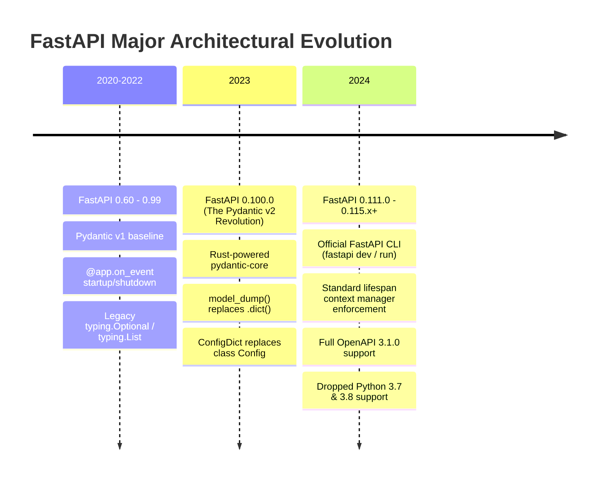

# FastAPI Versions & Upgrade Guide

FastAPI has evolved through major architectural milestones. The release of **FastAPI 0.100** marked the monumental transition to **Pydantic v2**, delivering 5x to 20x performance improvements while modernizing schema validation. Subsequent releases (0.111+) introduced the official **FastAPI CLI**, deprecated legacy lifecycle events in favor of **Lifespan context managers**, and dropped support for legacy Python versions.

Upgrading legacy FastAPI applications requires a structured methodology to eliminate deprecated idioms without breaking production contracts.

---

## 1. Conceptual Foundation & Mental Model

### Major Milestones in FastAPI Evolution



---

## 2. Breaking Changes & Deprecations Matrix

### Core Syntax Comparison: Legacy vs Modern FastAPI

| Architectural Area | Legacy Idiom (FastAPI < 0.100 / Pydantic v1) | Modern Idiom (FastAPI 0.115+ / Pydantic v2) |
| :--- | :--- | :--- |
| **Model Serialization** | `model.dict()` | `model.model_dump()` |
| **JSON String Serialization** | `model.json()` | `model.model_dump_json()` |
| **Model Parsing / Validation** | `Model.parse_obj(data)` | `Model.model_validate(data)` |
| **JSON String Parsing** | `Model.parse_raw(json_str)` | `Model.model_validate_json(json_str)` |
| **Model Configuration** | `class Config: orm_mode = True` | `model_config = ConfigDict(from_attributes=True)` |
| **Field Validation** | `@validator("name")` | `@field_validator("name")` |
| **Root / Whole-Model Validation**| `@root_validator` | `@model_validator(mode="after" / "before")` |
| **Lifecycle Hooks** | `@app.on_event("startup")` / `"shutdown"` | `@asynccontextmanager async def lifespan(app)` |
| **Parameter Declaration** | `q: str = Query(...)` | `q: Annotated[str, Query(...)]` |
| **Arbitrary Type Validation** | `parse_obj_as(list[User], data)` | `TypeAdapter(list[User]).validate_python(data)` |
| **CLI & Execution** | `uvicorn main:app --reload` | `fastapi dev main.py` |

---

## 3. Architecture & Internal Mechanics

```mermaid
flowchart TD
    subgraph Legacy Architecture (FastAPI 0.95 / Pydantic v1)
        PyV1[Pure Python Validation Engine]
        OnEvent[Discrete @app.on_event Listeners]
        PyV1 --> SlowEval[Interpreted Bytecode Type Checks (~50k ops/sec)]
    end

    subgraph Modern Architecture (FastAPI 0.115+ / Pydantic v2)
        RustV2[Rust pydantic-core via PyO3]
        Lifespan[Unified Async Lifespan Context Manager]
        RustV2 --> FastEval[Compiled Native Machine Code (~500k-1M ops/sec)]
    end
```

The transition from Pydantic v1 to v2 rewrote the entire validation and serialization engine in Rust (`pydantic-core`). Because of this, attributes are validated and dumped directly through compiled Rust routines, bypassing CPython interpreter overhead.

---

## 4. Practical Implementation: 5 Verified Upgrade Examples

### Example 1: Migrating Models from Pydantic v1 to v2

#### Legacy Pydantic v1 Code (Deprecated):
```python
# DEPRECATED (FastAPI < 0.100)
from pydantic import BaseModel, validator, root_validator

class UserV1(BaseModel):
    id: int
    name: str
    email: str

    class Config:
        orm_mode = True
        allow_population_by_field_name = True

    @validator("name")
    def validate_name(cls, v):
        if not v.strip():
            raise ValueError("Name cannot be blank")
        return v.title()

    @root_validator
    def check_passwords(cls, values):
        return values
```

#### Modern Pydantic v2 Code (Production Standard):
```python
# MODERN (FastAPI 0.115+ / Pydantic v2)
from pydantic import BaseModel, ConfigDict, field_validator, model_validator

class UserV2(BaseModel):
    id: int
    name: str
    email: str

    # Modern ConfigDict replacing inner class Config
    model_config = ConfigDict(
        from_attributes=True,       # Replaces orm_mode = True
        populate_by_name=True,      # Replaces allow_population_by_field_name
    )

    # Modern @field_validator with classmethod semantics
    @field_validator("name")
    @classmethod
    def validate_name(cls, v: str) -> str:
        if not v.strip():
            raise ValueError("Name cannot be blank")
        return v.title()

    # Modern @model_validator with explicit mode
    @model_validator(mode="after")
    def check_passwords(self) -> "UserV2":
        # Operates directly on the validated self instance
        return self
```

### Example 2: Migrating from `@app.on_event` to Lifespan

#### Legacy Event Listeners:
```python
# DEPRECATED
app = FastAPI()

@app.on_event("startup")
async def startup_db():
    await init_database_pool()

@app.on_event("shutdown")
async def shutdown_db():
    await close_database_pool()
```

#### Modern Async Context Manager Lifespan:
```python
# MODERN
from contextlib import asynccontextmanager
from typing import AsyncGenerator
from fastapi import FastAPI

@asynccontextmanager
async def lifespan(app: FastAPI) -> AsyncGenerator[None, None]:
    # Everything before yield executes during startup
    db_pool = await init_database_pool()
    app.state.db_pool = db_pool
    try:
        yield
    finally:
        # Everything after yield executes during shutdown
        await close_database_pool(db_pool)

app = FastAPI(lifespan=lifespan)
```

### Example 3: Automated Migration with `bump-pydantic`

Astral and the Pydantic team developed `bump-pydantic` to automate 90% of code upgrades:

```bash
# 1. Install bump-pydantic
uv tool install bump-pydantic

# 2. Run automated migration across application source
bump-pydantic src/

# 3. Inspect git diff
git diff
```

`bump-pydantic` automatically converts:
- `.dict()` to `.model_dump()`
- `.parse_obj()` to `.model_validate()`
- `class Config:` to `model_config = ConfigDict(...)`
- `orm_mode = True` to `from_attributes = True`

### Example 4: Migrating `parse_obj_as` to `TypeAdapter`

#### Legacy:
```python
# DEPRECATED
from pydantic.tools import parse_obj_as

users = parse_obj_as(list[UserV1], raw_database_rows)
```

#### Modern:
```python
# MODERN
from pydantic import TypeAdapter

user_list_adapter = TypeAdapter(list[UserV2])
users = user_list_adapter.validate_python(raw_database_rows)
```

### Example 5: Handling `response_model_exclude_unset` Migration

```python
# modern_response.py
from fastapi import FastAPI
from pydantic import BaseModel

app = FastAPI()

class Item(BaseModel):
    name: str
    description: str | None = None
    price: float
    tax: float = 10.5

@app.get("/items/{item_id}", response_model=Item, response_model_exclude_unset=True)
def get_item(item_id: int) -> Item:
    # If description was not set by the caller, it will not be emitted in JSON
    return Item(name="Mechanical Keyboard", price=120.0)
```

Response payload:
```json
{
  "name": "Mechanical Keyboard",
  "price": 120.0,
  "tax": 10.5
}
```

---

## 5. Anti-Patterns & Common Traps

| Anti-Pattern | Why It Fails | Production Fix |
| :--- | :--- | :--- |
| **Using `pydantic.v1` compatibility layer permanently** | Running `from pydantic.v1 import BaseModel` forfeits all Rust core performance gains. | Fully migrate schemas to native Pydantic v2 models. |
| **Calling `.dict()` on Pydantic v2 models** | `.dict()` is deprecated and raises runtime warnings; it will be removed in future releases. | Use `.model_dump()`. |
| **Using `@validator` without `@classmethod`** | In Pydantic v2, `@field_validator` requires `@classmethod` decorator. | Decorate with `@field_validator("...")` followed by `@classmethod`. |
| **Mixing `@app.on_event` and `lifespan`** | If both are defined on the same `FastAPI` instance, unexpected initialization orders or silent drops occur. | Standardize exclusively on `lifespan`. |
| **Leaving `orm_mode = True` in v2** | Silently ignored or raises configuration validation errors in Pydantic v2. | Use `from_attributes = True`. |

---

## 6. Performance & Resource Characteristics

- **Validation Throughput**: Pydantic v2 processes nested JSON payloads between **400% and 1,800% faster** than Pydantic v1.
- **Memory Consumption During Serialization**: Pydantic v1 created intermediate Python dictionary copies when serializing models. Pydantic v2 serializes directly from Rust structs to JSON strings, reducing peak memory usage by up to 60%.

---

## 7. Edge Cases, Failure Modes & Gotchas

1. **`model_validator` Mode Semantics**: In Pydantic v2, `@model_validator` accepts `mode="before"` (receives unvalidated raw dict) or `mode="after"` (receives validated model instance `self`). Omitting the mode raises a configuration error.
2. **Regex Field Parameter Renamed**: `regex` parameter in `Field()` was renamed to `pattern` (`Field(pattern=r"^[a-z]+$")`).
3. **Pydantic Settings Extraction**: In Pydantic v2, `BaseSettings` was moved from core Pydantic to a dedicated standalone package: `pip install pydantic-settings`.

---

## 8. Security Implications & OWASP Alignment

- **Strict Mode Validation**: Pydantic v2 introduces `strict=True` mode. In strict mode, Pydantic refuses type coercions (e.g., parsing the string `"123"` into the integer `123`), preventing subtle type confusion attacks.
- **JSON Parsing Depth Limits**: Pydantic v2's Rust parser includes built-in recursive depth guards against deeply nested JSON payloads designed to cause stack overflow DoS.

---

## 9. Modern Tooling Integration

- **`bump-pydantic` CI Check**: Add a linting check to CI to prevent developers from accidentally introducing legacy v1 syntax:
```bash
bump-pydantic --diff src/
```

---

## 10. Real-World Case Study: Production Incident

### The Incident
A fast-growing e-commerce platform upgraded their FastAPI dependency from 0.95 to 0.103. Immediately after release, all database query responses returned empty payloads (`{}`) to frontend clients, causing widespread checkout failures.

### The Root Cause
The SQLAlchemy ORM models were converted to Pydantic schemas using:
```python
class OrderSchema(BaseModel):
    id: int
    total: float
    class Config:
        orm_mode = True
```
In Pydantic v2, `class Config: orm_mode = True` is ignored. Instead, Pydantic v2 expects `model_config = ConfigDict(from_attributes=True)`. Without this, Pydantic attempted to read properties from dictionary keys (`row["id"]`) rather than object attributes (`row.id`), resulting in empty serialized objects.

### The Resolution
Ran `bump-pydantic` across the codebase, replacing all occurrences of `orm_mode = True` with `from_attributes = True`. Added automated regression tests to verify that ORM entities serialize properly.

---

## 11. Hands-On Exercises & Challenge Problems

### Warm-Up Exercises
1. **Audit Deprecated Calls**: Run `grep -rn "\.dict()" src/` across an existing project and list all legacy serialization calls.
2. **Field Validator Refactor**: Convert a Pydantic v1 `@validator` function checking that an email ends with `@company.com` to a modern v2 `@field_validator`.

### Intermediate Challenges
3. **Lifespan Migration**: Take an application using both `@app.on_event("startup")` and `@app.on_event("shutdown")` and refactor it into a single `@asynccontextmanager async def lifespan(app: FastAPI)` function.
4. **TypeAdapter Conversion**: Replace three instances of `parse_obj_as(list[MyModel], ...)` with `TypeAdapter(list[MyModel])`.

### Production-Grade Challenges
5. **Zero-Downtime Upgrade Pipeline**: Design a staging test harness that executes your full test suite against both FastAPI 0.99 (Pydantic v1) and FastAPI 0.115 (Pydantic v2) to guarantee complete backward contract compatibility.
6. **Strict Mode Schema Enforcement**: Configure an enterprise Pydantic schema with `model_config = ConfigDict(strict=True)`. Test with payloads sending integers as strings, floats as strings, and verify exact 422 error outputs.

---

## 12. Interview Mastery: Deep-Dive Questions & Answers

#### Q1: What was the primary motivation behind the Pydantic v2 rewrite, and how does it benefit FastAPI?
**Answer**: Pydantic v1 was written in pure Python, making data parsing and validation a significant CPU bottleneck in high-throughput APIs. Pydantic v2 rewrote the core parsing and validation engine in Rust (`pydantic-core`). This delivered a 5x to 20x performance improvement, reduced memory allocations, introduced strict mode parsing, and provided 100% compliance with JSON Schema Draft 2020-12 and OpenAPI 3.1.

#### Q2: What is the replacement for `model.dict()` in Pydantic v2?
**Answer**: `model.model_dump()`. Similarly, `model.json()` is replaced by `model.model_dump_json()`.

#### Q3: What is the replacement for `orm_mode = True` in Pydantic v2?
**Answer**: `model_config = ConfigDict(from_attributes=True)`.

#### Q4: Why was `@app.on_event` replaced by `lifespan` in FastAPI?
**Answer**: `@app.on_event` required separate handlers for startup and shutdown, preventing the use of standard Python `async with` context managers for resource pooling. `lifespan` uses standard ASGI 3.0 lifespan protocol mechanics, guaranteeing that shutdown cleanup (code after `yield`) runs reliably even if exceptions occur during startup.

#### Q5: How does `@model_validator` in Pydantic v2 differ from `@root_validator` in v1?
**Answer**: In v1, `@root_validator` operated ambiguously on dictionary values. In v2, `@model_validator` requires an explicit `mode`:
- `mode="before"`: Runs before field validation and receives the raw input dictionary.
- `mode="after"`: Runs after field validation and operates directly on the validated model instance (`self`).

#### Q6: Where is `BaseSettings` located in modern FastAPI projects?
**Answer**: In Pydantic v2, `BaseSettings` was moved to a separate package: `pydantic-settings` (`from pydantic_settings import BaseSettings, SettingsConfigDict`).

#### Q7: How does `TypeAdapter` replace `parse_obj_as`?
**Answer**: `TypeAdapter` creates a reusable validation adapter for any arbitrary type (e.g. `list[int]`, `dict[str, User]`). Instead of calling `parse_obj_as(type, data)` every time, you instantiate `adapter = TypeAdapter(type)` once and call `adapter.validate_python(data)`.

#### Q8: What tool can automatically upgrade Pydantic v1 codebases to Pydantic v2?
**Answer**: `bump-pydantic`, an official AST-based refactoring tool that analyzes Python code and automatically updates deprecated methods, configurations, and decorators to Pydantic v2 standards.
