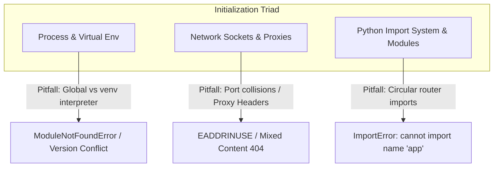
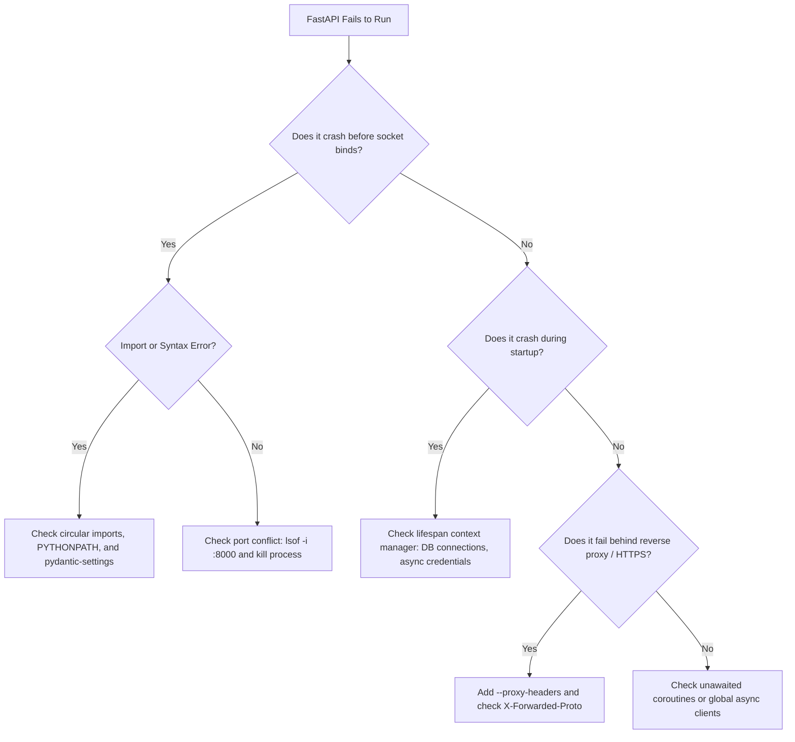

# Common Setup Pitfalls & Troubleshooting

Bootstrapping a production FastAPI service involves coordinating ASGI event loops, reverse proxies, operating system networking, virtual environments, and Python import paths. Subtle misconfigurations at initialization often manifest as cryptic runtime errors, container reboot loops, or silent security vulnerabilities.

This guide catalogs the most prevalent initialization traps, their underlying mechanics, and verified production resolutions.

---

## 1. Conceptual Foundation & Mental Model

### The Bootstrap Triad: Process, Network & Import Space



When diagnosing setup failures, isolate which layer is failing:
1. **Import Layer**: Code fails before Uvicorn starts (syntax errors, circular imports, missing packages).
2. **Socket Layer**: Uvicorn fails during socket bind (`EADDRINUSE`, permission denied on privileged ports < 1024).
3. **ASGI Lifespan Layer**: Application starts but crashes during startup hooks (failed DB connections, unhandled async exceptions).
4. **Proxy / Network Layer**: Server runs locally but Swagger UI assets fail or routes return 404 behind Nginx/Traefik.

---

## 2. The Top 8 Setup Pitfalls: Diagnosis & Fixes

### Pitfall 1: Circular Imports Between `app` and `APIRouter`

#### Symptom:
```text
ImportError: cannot import name 'app' from partially initialized module 'app.main' 
(most likely due to a circular import) (/workspace/src/app/main.py)
```

#### Root Cause:
`main.py` imports `users_router` from `routes/users.py`, while `routes/users.py` imports `app` from `main.py` (e.g. to use `@app.get` or access `app.state`).

#### Verified Resolution:
Never import `app` into route modules. Route modules must instantiate and use `APIRouter()`. `main.py` alone imports and mounts routers via `app.include_router()`:

```python
# src/app/api/users.py (CORRECT)
from fastapi import APIRouter

router = APIRouter(prefix="/users", tags=["Users"])

@router.get("/")
def list_users() -> list[str]:
    return ["alice", "bob"]
```

```python
# src/app/main.py (CORRECT)
from fastapi import FastAPI
from app.api.users import router as users_router

app = FastAPI()
app.include_router(users_router)
```

---

### Pitfall 2: `ModuleNotFoundError: No module named 'src'` or 'app'

#### Symptom:
```text
ModuleNotFoundError: No module named 'app'
```
Occurs when running `uvicorn app.main:app` or running tests with `pytest`.

#### Root Cause:
Python does not know that the root directory or `src` is in `sys.path`. When executing scripts from subdirectories or invoking tools from outside the package root, Python's import resolver fails to locate top-level packages.

#### Verified Resolution:
1. **PEP 517 / uv editable install**: Ensure `pyproject.toml` defines the package and install in editable mode:
   ```bash
   uv pip install -e .
   ```
2. **Explicit PYTHONPATH in local execution**:
   ```bash
   PYTHONPATH=. uv run fastapi dev src/app/main.py
   ```
3. **Configure `pytest.ini`**:
   ```ini
   [pytest]
   pythonpath = . src
   ```

---

### Pitfall 3: Port Collision (`[Errno 98] Address already in use`)

#### Symptom:
```text
ERROR:    [Errno 98] error while attempting to bind on address ('127.0.0.1', 8000): address already in use
```

#### Root Cause:
An orphaned Uvicorn process, Docker container, or background development server is already bound to port 8000.

#### Verified Resolution:
Locate and terminate the occupying process:

On Linux / macOS:
```bash
# Find PID listening on 8000
lsof -i :8000
# Terminate the process
kill -9 <PID>
```

On Windows PowerShell:
```powershell
Get-Process -Id (Get-NetTCPConnection -LocalPort 8000).OwningProcess | Stop-Process -Force
```

Alternatively, start FastAPI on a distinct port:
```bash
uv run fastapi dev main.py --port 8080
```

---

### Pitfall 4: Missing Dependencies for Form Data or Email Fields

#### Symptom:
```text
RuntimeError: Form data requires "python-multipart" to be installed. 
You can install it with "pip install python-multipart".
```
or
```text
ImportError: email-validator is required to use EmailStr with Pydantic
```

#### Root Cause:
Minimal `pip install fastapi` does not include optional protocol parsers.

#### Verified Resolution:
Install `fastapi[standard]`, which includes `python-multipart`, `email-validator`, `httpx`, and `uvicorn`:
```bash
uv add "fastapi[standard]"
```

---

### Pitfall 5: Pydantic v1 Import Failures in Pydantic v2 Environment

#### Symptom:
```text
ImportError: cannot import name 'BaseSettings' from 'pydantic'
```

#### Root Cause:
In Pydantic v2, `BaseSettings` was moved to a standalone package (`pydantic-settings`).

#### Verified Resolution:
Install `pydantic-settings` and update the import statement:
```bash
uv add pydantic-settings
```
Update code:
```python
# WRONG (Pydantic v1)
# from pydantic import BaseSettings

# CORRECT (Pydantic v2)
from pydantic_settings import BaseSettings, SettingsConfigDict

class Settings(BaseSettings):
    db_url: str
    model_config = SettingsConfigDict(env_file=".env")
```

---

### Pitfall 6: Swagger UI Mixed Content / HTTPS Protocol Drop

#### Symptom:
In production behind an AWS Application Load Balancer or Nginx, the website is loaded via `https://api.example.com/docs`, but Swagger UI displays:
```text
Mixed Content: The page at 'https://api.example.com/docs' was loaded over HTTPS, 
but requested an insecure resource 'http://api.example.com/openapi.json'.
```

#### Root Cause:
The reverse proxy terminates SSL and forwards cleartext HTTP to Uvicorn. Without proxy headers, Uvicorn assumes the protocol is `http://` and generates `http://` URLs in the Swagger UI template.

#### Verified Resolution:
1. Ensure reverse proxy forwards `X-Forwarded-Proto`:
   ```nginx
   proxy_set_header X-Forwarded-Proto $scheme;
   proxy_set_header X-Forwarded-For $proxy_add_x_forwarded_for;
   ```
2. Launch FastAPI with `--proxy-headers`:
   ```bash
   fastapi run main.py --proxy-headers
   ```

---

### Pitfall 7: `RuntimeError: Event loop is closed`

#### Symptom:
```text
RuntimeError: Event loop is closed
sys:1: RuntimeWarning: coroutine 'AsyncSession.close' was never awaited
```
Frequently occurs during application shutdown or inside `pytest-asyncio` suites.

#### Root Cause:
An asynchronous resource (e.g. SQLAlchemy `AsyncEngine` or `aiohttp.ClientSession`) was created outside of the active event loop (e.g. at global module level during import) or closed after the event loop had already terminated.

#### Verified Resolution:
Never instantiate client pools or database engines at global module import time. Initialize and close all async resources inside the `lifespan` context manager:

```python
# CORRECT
@asynccontextmanager
async def lifespan(app: FastAPI):
    # Created inside the running event loop
    engine = create_async_engine(DATABASE_URL)
    app.state.engine = engine
    yield
    # Closed cleanly before the event loop shuts down
    await engine.dispose()
```

---

### Pitfall 8: File Modification Limit Exceeded (`watchfiles` inotify leak)

#### Symptom:
```text
OSError: [Errno 28] No space left on device (inotify watch limit reached)
```
Occurs on Linux when running `fastapi dev` inside Docker or a large repository containing `node_modules` or `.venv`.

#### Root Cause:
Linux limits the number of directories a single user can monitor via `fs.inotify.max_user_watches`. Large subdirectories consume all available watch handles.

#### Verified Resolution:
Increase system inotify limit:
```bash
sudo sysctl -w fs.inotify.max_user_watches=524288
```
Add to `/etc/sysctl.conf` for persistence:
```text
fs.inotify.max_user_watches=524288
```

---

## 3. Comprehensive Diagnostics Flowchart



---

## 4. Anti-Patterns & Common Traps Summary

| Anti-Pattern | Why It Fails | Production Fix |
| :--- | :--- | :--- |
| **Instantiating async clients at global module scope** | Global clients bind to a defunct or missing event loop when workers fork. | Create async clients inside `lifespan` context manager. |
| **Using `uvicorn.run()` inside handler** | Starting servers recursively inside routes breaks ASGI state. | Launch servers via CLI. |
| **Forgetting to await async functions** | Leaves unawaited coroutines in memory and returns `<coroutine object ...>` instead of data. | Always use `await` on coroutines; enable Ruff `ASYNC` rules. |
| **Running dev server on privileged port (<1024)** | Fails with `PermissionError: [Errno 13] Permission denied` unless root. | Run on non-privileged ports (`8000`, `8080`) and forward via reverse proxy. |

---

## 5. Production Incident: The Case of the Dropped SSL

### The Incident
A SaaS platform rolled out their FastAPI API behind AWS CloudFront and an Application Load Balancer. While the API responded correctly to curl requests, enterprise customers reported that the interactive documentation at `/docs` would not execute any API calls, failing with `CORS Network Error` or `Failed to fetch`.

### The Root Cause
1. CloudFront forwarded HTTPS to the ALB.
2. The ALB terminated HTTPS and routed HTTP to FastAPI on port 8000.
3. FastAPI was started with `uvicorn main:app --host 0.0.0.0 --port 8000` without `--proxy-headers`.
4. FastAPI observed an incoming HTTP request and generated Swagger UI JavaScript containing `http://api.example.com/openapi.json`.
5. Modern browsers strictly block mixed-content HTTP requests initiated from HTTPS pages.

### The Resolution
Updated the container command to include `--proxy-headers`:
```dockerfile
CMD ["fastapi", "run", "main.py", "--proxy-headers", "--port", "8000"]
```
FastAPI correctly read `X-Forwarded-Proto: https`, generated secure HTTPS asset URLs, and the documentation console restored full functionality immediately.

---

## 6. Hands-On Exercises & Challenge Problems

### Warm-Up Exercises
1. **Trigger and Resolve Circular Import**: Intentionally create two modules that import each other. Run `fastapi dev` and observe the exact Python traceback. Then refactor using `APIRouter`.
2. **Diagnose Port Collision**: In one terminal, run `python -m http.server 8000`. In a second terminal, launch `fastapi dev --port 8000`. Observe the error message and resolve it.

### Intermediate Challenges
3. **Reproduce and Fix Mixed Content**: Configure a local Nginx reverse proxy terminating SSL with a self-signed certificate, proxying to FastAPI. Observe Swagger UI behavior with and without `--proxy-headers`.
4. **Lifecycle Resource Leak Test**: Write an endpoint that initializes an `httpx.AsyncClient` globally. Send 100 requests, shut down the server, and observe the `Unclosed client session` warning. Refactor into `lifespan`.

---

## 7. Interview Mastery: Deep-Dive Questions & Answers

#### Q1: How do you resolve a circular import between `APIRouter` instances and the main `FastAPI` app?
**Answer**: By strictly adhering to a one-way dependency flow. Sub-modules must only instantiate and configure `APIRouter`. They should never import `app` from `main.py`. The root `main.py` is the only file that imports the routers and mounts them onto the central `FastAPI` instance via `app.include_router()`.

#### Q2: What causes `[Errno 98] Address already in use` and how do you resolve it programmatically or via CLI?
**Answer**: It occurs when an application attempts to bind a TCP socket to an IP and port combination that is already held by another process in the `LISTEN` state. It can be resolved by identifying the PID using `lsof -i :<port>` or `netstat` and terminating it, or by specifying an alternative port via `--port`.

#### Q3: Why does `pydantic-settings` need to be installed separately in Pydantic v2?
**Answer**: In Pydantic v1, `BaseSettings` was bundled into the core library. In Pydantic v2, the core was rewritten in Rust (`pydantic-core`) to focus strictly on serialization and validation. Settings management, dotenv parsing, and environment variable loading were decoupled into the independent `pydantic-settings` package to keep the core library minimal.

#### Q4: What does the `--proxy-headers` flag do in Uvicorn / FastAPI CLI?
**Answer**: It instructs the ASGI server to parse standard proxy headers (`X-Forwarded-For`, `X-Forwarded-Proto`, `X-Forwarded-Port`). This allows FastAPI to accurately determine the original client IP address and whether the client connected via `http` or `https`, ensuring generated redirects and OpenAPI URLs use the correct scheme.

#### Q5: What is the cause of `RuntimeError: Event loop is closed` during application teardown?
**Answer**: It typically occurs when an asynchronous object (like a database connection pool or HTTP client session) attempts to await cleanup tasks inside its `__del__` destructor after the asyncio event loop has already finished executing. Managing the lifecycle of these objects explicitly inside the `lifespan` context manager ensures they are awaited and closed before the loop shuts down.
