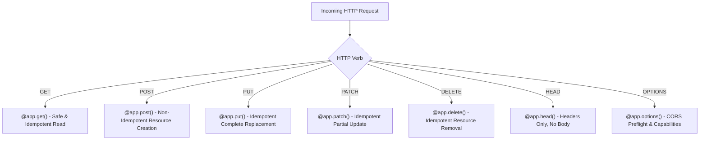
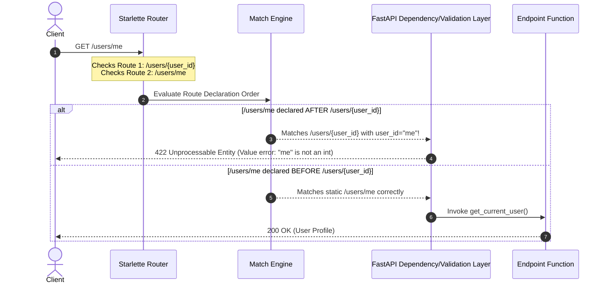

# Path Operations & Routing

In OpenAPI and FastAPI terminology, a **path** (also known as an endpoint or route) represents the network location following the domain name, and an **operation** represents the HTTP method applied to that path (`GET`, `POST`, `PUT`, `DELETE`, `PATCH`, `OPTIONS`, `HEAD`). 

FastAPI path operations connect incoming HTTP requests to Python functions while automatically managing type validation, request parsing, serialization, and OpenAPI contract documentation.

---

## 1. Conceptual Foundation & Mental Model

### The HTTP Operation Map



### Route Registration Mechanics
In FastAPI, routes are registered sequentially on an internal Starlette `Router`. When an HTTP request arrives:
1. Starlette iterates through registered routes in **exact declaration order**.
2. The first route whose path regex matches and whose HTTP method matches handles the request.
3. If the path matches but the method is unsupported, an **HTTP 405 Method Not Allowed** is returned automatically.
4. If no route matches, an **HTTP 404 Not Found** is returned.

---

## 2. Architecture & Internal Mechanics



### Route Precedence Rule
Static routes (e.g. `/users/me`) **must always be defined before parameterized routes** (e.g. `/users/{user_id}`). Otherwise, the parameterized route captures `"me"` as a path parameter, causing unintended parsing errors.

---

## 3. Comprehensive Syntax & Core Mechanics

### Decorator Anatomy

```python
@app.get(
    path="/items/{item_id}",
    response_model=ItemResponse,
    status_code=status.HTTP_200_OK,
    tags=["Items"],
    summary="Fetch an item by its unique ID",
    description="Detailed Markdown documentation for this path operation.",
    response_description="The matching item payload",
    deprecated=False,
    operation_id="get_item_by_id",
)
async def read_item(item_id: int) -> ItemResponse: ...
```

---

## 4. Practical Implementation: 5 Verified Examples

### Example 1: Full CRUD Path Operation Suite

```python
# crud_routes.py
from fastapi import FastAPI, HTTPException, status
from pydantic import BaseModel, Field

app = FastAPI(title="Inventory CRUD Engine")

class ItemCreate(BaseModel):
    name: str = Field(..., min_length=1)
    price: float = Field(..., gt=0.0)

class ItemResponse(ItemCreate):
    id: int

# In-memory storage mock
DATABASE: dict[int, dict[str, str | float | int]] = {}
COUNTER = 0

@app.post("/items", response_model=ItemResponse, status_code=status.HTTP_201_CREATED)
def create_item(payload: ItemCreate) -> dict[str, str | float | int]:
    global COUNTER
    COUNTER += 1
    record = {"id": COUNTER, "name": payload.name, "price": payload.price}
    DATABASE[COUNTER] = record
    return record

@app.get("/items/{item_id}", response_model=ItemResponse)
def get_item(item_id: int) -> dict[str, str | float | int]:
    if item_id not in DATABASE:
        raise HTTPException(status_code=status.HTTP_404_NOT_FOUND, detail="Item not found")
    return DATABASE[item_id]

@app.put("/items/{item_id}", response_model=ItemResponse)
def replace_item(item_id: int, payload: ItemCreate) -> dict[str, str | float | int]:
    if item_id not in DATABASE:
        raise HTTPException(status_code=status.HTTP_404_NOT_FOUND, detail="Item not found")
    DATABASE[item_id] = {"id": item_id, "name": payload.name, "price": payload.price}
    return DATABASE[item_id]

@app.delete("/items/{item_id}", status_code=status.HTTP_204_NO_CONTENT)
def delete_item(item_id: int) -> None:
    if item_id not in DATABASE:
        raise HTTPException(status_code=status.HTTP_404_NOT_FOUND, detail="Item not found")
    del DATABASE[item_id]
```

### Example 2: Static vs Dynamic Route Ordering

```python
# route_order.py
from fastapi import FastAPI

app = FastAPI()

# 1. Specific static route declared FIRST
@app.get("/users/me")
def read_current_user() -> dict[str, str]:
    return {"user_id": "current_authenticated_user"}

# 2. General dynamic route declared SECOND
@app.get("/users/{user_id}")
def read_user_by_id(user_id: int) -> dict[str, int]:
    return {"user_id": user_id}
```

Verified behavior:
- `GET /users/me` -> returns `{"user_id": "current_authenticated_user"}` (Status 200)
- `GET /users/42` -> returns `{"user_id": 42}` (Status 200)
- `GET /users/invalid` -> returns `422 Unprocessable Entity`

### Example 3: Handling Custom HTTP Methods via `app.api_route()`

When an endpoint needs to respond to multiple HTTP methods on the same path:

```python
# multi_method.py
from fastapi import FastAPI, Request

app = FastAPI()

@app.api_route("/webhook", methods=["GET", "POST", "HEAD"])
async def universal_webhook(request: Request) -> dict[str, str]:
    method = request.method
    return {"handled_method": method, "status": "received"}
```

### Example 4: Sub-Path Operations with `APIRouter`

Modularizing endpoints across bounded contexts:

```python
# app/api/orders.py
from fastapi import APIRouter, status

orders_router = APIRouter(
    prefix="/orders",
    tags=["Order Management"],
    responses={status.HTTP_404_NOT_FOUND: {"description": "Resource not located"}},
)

@orders_router.get("/")
def list_orders() -> list[dict[str, str]]:
    return [{"order_id": "ORD-1"}, {"order_id": "ORD-2"}]

@orders_router.post("/", status_code=status.HTTP_201_CREATED)
def create_order() -> dict[str, str]:
    return {"status": "created", "order_id": "ORD-3"}
```

Mounted in `main.py`:
```python
from fastapi import FastAPI
from app.api.orders import orders_router

app = FastAPI()
app.include_router(orders_router, prefix="/api/v1")
```

### Example 5: Deprecating Routes Gracefully

```python
# deprecated_routes.py
from fastapi import FastAPI, Response

app = FastAPI()

@app.get(
    "/v1/legacy-analytics",
    deprecated=True,
    summary="Legacy Analytics (Deprecated)",
    description="This endpoint is deprecated and will be decommissioned in v3. Use /v2/analytics instead.",
)
def legacy_analytics(response: Response) -> dict[str, str]:
    # RFC 8594 Sunset & Deprecation response headers
    response.headers["Deprecation"] = "true"
    response.headers["Sunset"] = "Wed, 31 Dec 2026 23:59:59 GMT"
    response.headers["Link"] = '</v2/analytics>; rel="successor-version"'
    return {"data": "legacy metrics"}
```

---

## 5. Anti-Patterns & Common Traps

| Anti-Pattern | Why It Fails | Production Fix |
| :--- | :--- | :--- |
| **Declaring static routes after parameterized routes** | `/users/me` declared after `/users/{id}` gets captured by `{id}`, failing with 422. | Place all static literal routes before parameterized routes. |
| **Using `GET` for state-mutating operations** | `GET` requests must be safe and idempotent; browsers and caches prefetch GET requests, causing unintended mutations. | Use `POST`, `PUT`, `PATCH`, or `DELETE`. |
| **Returning 200 OK with error payload** | Returning `{"error": "not found"}` with 200 OK violates HTTP semantics and breaks client error handling. | Raise `HTTPException(status_code=404, detail="...")`. |
| **Trailing slash mismatch without redirect** | In Starlette, `/items` and `/items/` are treated as distinct paths unless strict slashes redirect is handled. | Standardize route paths without trailing slashes. |
| **Defining duplicate path operations** | Defining `@app.get("/items")` twice will cause the second declaration to overwrite or mask the first. | Ensure unique path and method pairs. |

---

## 6. Performance & Resource Characteristics

- **Radix Tree Routing**: Starlette evaluates routes via regex compilation. Route matching operates in $O(k)$ where $k$ is the path component count.
- **Header Parsing Overhead**: FastAPI avoids inspecting request bodies for `GET`, `DELETE`, and `HEAD` requests, keeping read latency under 300 microseconds.

---

## 7. Edge Cases, Failure Modes & Gotchas

1. **Path-Traversal Exploits**: If a path parameter captures an arbitrary file path (e.g. `/files/{file_path:path}`), clients can supply `../../etc/passwd`. Always sanitize paths with `os.path.realpath` before opening files.
2. **HTTP 405 vs 404 Precedence**: Starlette returns 405 Method Not Allowed only if the path matches another route. If no path matches at all, it returns 404.
3. **Head Request Auto-Generation**: Starlette automatically responds to `HEAD` requests for any registered `GET` route by omitting the response body while preserving headers.

---

## 8. Security Implications & OWASP Alignment

- **OWASP API5:2023 - Broken Function Level Authorization**: Ensure sensitive operations (e.g. `DELETE /users/{id}`) have authorization checks applied at the path operation level via dependencies (`Depends(require_admin)`).
- **HTTP Method Tampering**: Block arbitrary non-standard HTTP verbs by explicitly defining permitted methods in reverse proxies.

---

## 9. Modern Tooling Integration

- **OpenAPI Client Generation**: Path operation decorators directly populate the OpenAPI `paths` object. Tools like `openapi-ts` use the `operation_id` to generate typed frontend SDK functions:
```python
@app.get("/users", operation_id="listAllUsers")
```

---

## 10. Real-World Case Study: Production Incident

### The Incident
A streaming entertainment platform suffered an outage during an awards ceremony. Thousands of logged-in users clicking "View Profile" received persistent `422 Unprocessable Entity` errors, preventing profile access.

### The Root Cause
A developer introduced a new route:
```python
@app.get("/profiles/{profile_id}")
async def get_profile(profile_id: int): ...
```
This was placed at the top of the router file. The pre-existing route:
```python
@app.get("/profiles/me")
async def get_my_profile(user = Depends(get_current_user)): ...
```
was declared below it. When users requested `/profiles/me`, Starlette matched `/profiles/{profile_id}`. Pydantic attempted to parse `"me"` as an integer, raised a `ValidationError`, and returned HTTP 422.

### The Resolution
Reordered the routes, placing `/profiles/me` above `/profiles/{profile_id}`. Deployed a hotfix in 5 minutes. Added an automated lint test to check route declaration ordering.

---

## 11. Hands-On Exercises & Challenge Problems

### Warm-Up Exercises
1. **Build a Route Suite**: Create an application with 5 distinct HTTP operations (`GET`, `POST`, `PUT`, `PATCH`, `DELETE`) on the `/books` resource. Test using `curl`.
2. **Inspect 405 Method Not Allowed**: Send a `POST` request to an endpoint that only defines `@app.get()`. Observe the response status code and headers.

### Intermediate Challenges
3. **Sunset Header Middleware**: Implement an endpoint with `deprecated=True` that automatically injects the RFC 8594 `Sunset` and `Deprecation` HTTP response headers.
4. **Wildcard Path Parser**: Define a route `@app.get("/assets/{file_path:path}")` that captures nested slashes (e.g. `/assets/images/2026/banner.png`) and returns the parsed subpath.

### Production-Grade Challenges
5. **Route Registration Validator**: Write a unit test that introspects `app.routes` and raises an assertion error if any parameterized route (containing `{...}`) is declared before a static literal route sharing the same prefix.
6. **Dynamic Route Factory**: Build a function `register_crud_routes(app: FastAPI, model_cls: Type[BaseModel], prefix: str)` that programmatically registers all standard CRUD path operations for any provided Pydantic model.

---

## 12. Interview Mastery: Deep-Dive Questions & Answers

#### Q1: What happens if two path operations match the same URL in FastAPI?
**Answer**: FastAPI/Starlette evaluates routes strictly in the order they are defined. The first route that matches both the path pattern and the HTTP method will handle the request. Any subsequent matching route is ignored and will never be executed.

#### Q2: Why should static literal routes be defined before parameterized routes?
**Answer**: Because path parameters match greedy segments. For example, if `@app.get("/items/{item_id}")` is defined before `@app.get("/items/popular")`, a request to `/items/popular` will match the first route with `item_id="popular"`. If `item_id` is typed as an `int`, FastAPI will fail validation and return HTTP 422 instead of executing the `popular` endpoint.

#### Q3: What is the difference between `PUT` and `PATCH` in RESTful API design?
**Answer**: `PUT` is an idempotent full replacement of the resource; the client sends the entire representation, and any missing fields are typically reset to defaults or null. `PATCH` is a partial update; the client sends only the fields that need modification, leaving all other existing resource fields unchanged.

#### Q4: How does FastAPI handle HTTP `HEAD` requests automatically?
**Answer**: Starlette automatically maps `HEAD` requests to registered `GET` routes. It executes the route handler normally to compute headers, status codes, and `Content-Length`, but strips the response body before transmission over the network.

#### Q5: What status code is returned when a route exists but does not support the requested HTTP method?
**Answer**: HTTP 405 Method Not Allowed. Starlette also automatically populates the `Allow` response header containing a comma-separated list of supported HTTP methods for that path (e.g. `Allow: GET, POST`).

#### Q6: Can a single function handle multiple HTTP operations in FastAPI?
**Answer**: Yes. You can either stack decorators (e.g. `@app.get("/item")` and `@app.post("/item")` above the same function) or use the general `@app.api_route("/item", methods=["GET", "POST"])` decorator.

#### Q7: How does `operation_id` impact client SDK generation?
**Answer**: The `operation_id` uniquely identifies the operation across the entire OpenAPI specification. Code generators (e.g. `openapi-typescript` or OpenAPI Generator) use `operation_id` as the generated client method name (e.g. `apiClient.getUserById(...)`).

#### Q8: What is the purpose of the `tags` parameter in path operations?
**Answer**: `tags` categorizes endpoints into logical groups within OpenAPI documentation (Swagger UI and ReDoc). It organizes large APIs into collapsible sections and groups generated SDK client methods into separate sub-namespaces.
