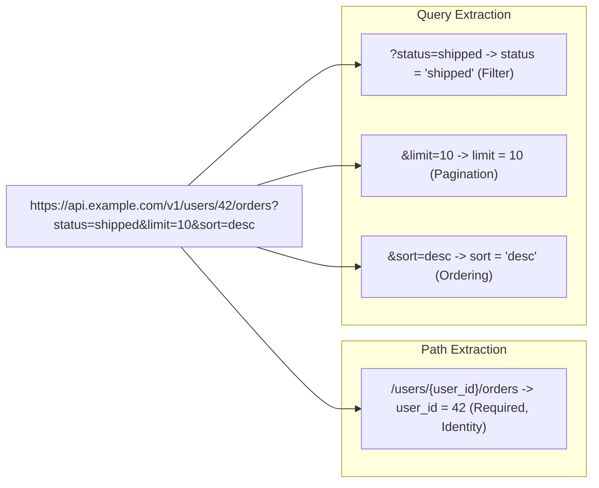
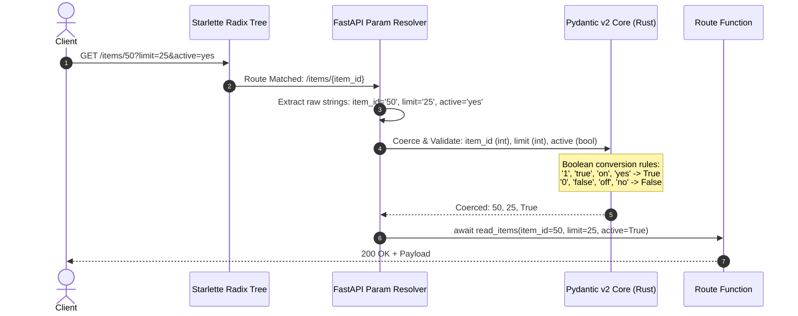

# Path & Query Parameters

FastAPI automatically parses, validates, and documents URL components by inspecting Python function signatures. Parameters declared within the path template string (`{param}`) are extracted as **Path Parameters**, while any remaining scalar arguments are parsed from the URL search query string as **Query Parameters**.

Using `typing.Annotated` alongside `Path()` and `Query()` metadata constructs enables fine-grained numeric limits, regex pattern enforcement, and rich documentation definitions.

---

## 1. Conceptual Foundation & Mental Model

### Disambiguating Path vs Query Parameters



- **Path Parameters**: Identify a specific resource or entity hierarchy. They are strictly required by definition; an omitted path parameter fails URL matching entirely (HTTP 404).
- **Query Parameters**: Modify the representation or subset of resources returned (filtering, sorting, pagination, flags). They can be optional or provide sensible defaults.

---

## 2. Architecture & Internal Mechanics



FastAPI leverages Pydantic's underlying C/Rust parser to perform type coercion. For example, the query parameter `active=yes`, `active=1`, or `active=True` will all parse cleanly into Python `True`.

---

## 3. Comprehensive Syntax & Core Constraints

### Constraint Reference for `Path` and `Query`

| Constraint Argument | Applies To | Description | Example |
| :--- | :--- | :--- | :--- |
| `gt` | Numeric | Greater than ($x > n$) | `Path(gt=0)` |
| `ge` | Numeric | Greater than or equal ($x \ge n$) | `Query(ge=1)` |
| `lt` | Numeric | Less than ($x < n$) | `Path(lt=1000)` |
| `le` | Numeric | Less than or equal ($x \le n$) | `Query(le=100)` |
| `min_length` | String / List | Minimum length | `Query(min_length=3)` |
| `max_length` | String / List | Maximum length | `Query(max_length=50)` |
| `pattern` | String | Regular expression regex match | `Query(pattern=r"^[A-Z]{3}-\d+$")` |
| `alias` | Any | Alternate query param name in URL | `Query(alias="item-query")` |
| `deprecated` | Any | Flags parameter as deprecated in docs | `Query(deprecated=True)` |

---

## 4. Practical Implementation: 5 Verified Examples

### Example 1: Annotated Path Parameters with Strict Numeric Boundaries

```python
# path_params.py
from typing import Annotated
from fastapi import FastAPI, Path, status
from pydantic import BaseModel

app = FastAPI()

class ItemResponse(BaseModel):
    item_id: int
    name: str

@app.get("/items/{item_id}", response_model=ItemResponse)
async def get_item(
    item_id: Annotated[
        int,
        Path(
            title="Item Identifier",
            description="The unique database ID of the requested item.",
            ge=1,
            le=1_000_000,
            examples=[42],
        ),
    ],
) -> ItemResponse:
    return ItemResponse(item_id=item_id, name=f"Product #{item_id}")
```

Validation output on negative number:
```bash
curl -i http://127.0.0.1:8000/items/-5
```
Response:
```json
{
  "detail": [
    {
      "type": "greater_than_equal",
      "loc": ["path", "item_id"],
      "msg": "Input should be greater than or equal to 1",
      "input": "-5",
      "ctx": {"ge": 1}
    }
  ]
}
```

### Example 2: Complex Query Parameters with Defaults, Regex & Aliases

```python
# query_params.py
from typing import Annotated
from fastapi import FastAPI, Query

app = FastAPI()

@app.get("/search")
async def search_records(
    q: Annotated[
        str,
        Query(
            min_length=3,
            max_length=50,
            pattern=r"^[a-zA-Z0-9_\-\s]+$",
            description="Sanitized search query",
        ),
    ],
    page: Annotated[int, Query(ge=1)] = 1,
    size: Annotated[int, Query(ge=1, le=100)] = 20,
    sort_by: Annotated[str, Query(alias="sort-by")] = "created_at",
    include_archived: bool = False,
) -> dict[str, str | int | bool]:
    return {
        "query": q,
        "page": page,
        "size": size,
        "sort_by": sort_by,
        "include_archived": include_archived,
    }
```

Executed request:
```bash
curl "http://127.0.0.1:8000/search?q=fastapi_notes&page=2&sort-by=price&include_archived=yes"
```
Response:
```json
{
  "query": "fastapi_notes",
  "page": 2,
  "size": 20,
  "sort_by": "price",
  "include_archived": true
}
```

### Example 3: Multiple Values (List) in Query Parameters

Parsing repeated query parameters (e.g. `?tags=python&tags=fastapi&tags=backend`):

```python
# query_lists.py
from typing import Annotated
from fastapi import FastAPI, Query

app = FastAPI()

@app.get("/articles")
async def filter_articles(
    tags: Annotated[
        list[str],
        Query(
            description="List of tag filters to apply",
            min_length=1,
            max_length=5,
        ),
    ] = ["technology"],
) -> dict[str, list[str]]:
    return {"applied_tags": tags}
```

Executed request:
```bash
curl "http://127.0.0.1:8000/articles?tags=rust&tags=python&tags=asgi"
```
Response:
```json
{
  "applied_tags": ["rust", "python", "asgi"]
}
```

### Example 4: Path Parameters Containing Slashes (`:path` Converter)

When capturing arbitrary file paths or URIs in the URL:

```python
# path_converter.py
from typing import Annotated
from fastapi import FastAPI, Path

app = FastAPI()

@app.get("/storage/{file_path:path}")
async def fetch_storage_file(
    file_path: Annotated[str, Path(description="Full virtual file path")],
) -> dict[str, str]:
    return {"resolved_path": file_path}
```

Executed request:
```bash
curl "http://127.0.0.1:8000/storage/media/images/2026/avatar.png"
```
Response:
```json
{
  "resolved_path": "media/images/2026/avatar.png"
}
```

### Example 5: Deprecating Query Parameters Gracefully

```python
# deprecated_params.py
from typing import Annotated
from fastapi import FastAPI, Query

app = FastAPI()

@app.get("/users")
async def list_users(
    limit: Annotated[int, Query(ge=1, le=100)] = 20,
    count: Annotated[
        int | None,
        Query(
            deprecated=True,
            description="DEPRECATED: Use 'limit' instead. Will be removed in v2.0.",
        ),
    ] = None,
) -> dict[str, int]:
    # Backward-compatible fallback logic
    effective_limit = count if count is not None else limit
    return {"effective_limit": effective_limit}
```

---

## 5. Anti-Patterns & Common Traps

| Anti-Pattern | Why It Fails | Production Fix |
| :--- | :--- | :--- |
| **Omitting `Annotated` (`q: str = Query(...)`)** | Type checkers infer `q` as type `Query`, breaking static analysis. | Standardize on `q: Annotated[str, Query(...)]`. |
| **Mutable default values for list queries** | `tags: list[str] = []` causes state leakage across subsequent requests. | Use `Query(default_factory=list)` or `tags: list[str] = ["default"]`. |
| **Using unvalidated `:path` parameters** | Allows directory traversal attacks (e.g. `../../etc/passwd`). | Strictly validate and sanitize resolved paths using `pathlib.Path.resolve()`. |
| **Missing `alias` when handling kebab-case queries** | Python variable names cannot contain hyphens (`sort-by` is invalid syntax). | Use `sort_by: Annotated[str, Query(alias="sort-by")]`. |
| **Unbounded string query parameters** | Allows clients to send 10MB search queries, consuming server CPU. | Always enforce `max_length` (e.g. `max_length=100`). |

---

## 6. Performance & Resource Characteristics

- **Coercion Speed**: Path and query string coercion via Pydantic v2 Rust core processes ~1,000,000 parameter extractions per second per CPU core.
- **Regex Caching**: Regular expressions declared in `pattern=r"..."` are compiled once during route registration and cached in memory, incurring zero recompilation cost per request.

---

## 7. Edge Cases, Failure Modes & Gotchas

1. **Boolean Query Parameter Gotchas**: Passing `?active=0`, `?active=false`, `?active=no`, or `?active=off` evaluates to `False`. Passing `?active=` (empty value) raises a 422 validation error.
2. **Empty List Query Fallbacks**: If a client passes `?tags=`, FastAPI parses this as a list containing one empty string (`[""]`), not an empty list (`[]`).
3. **URL Encoding**: Special characters (spaces, slashes, ampersands) in path parameters must be URL percent-encoded (`%20`, `%2F`, `%26`) by the client.

---

## 8. Security Implications & OWASP Alignment

- **OWASP API3:2023 - Broken Object Property Level Authorization**: When using query parameters like `?role=admin` or `?is_superuser=true`, never map query parameters directly into database update models without explicit role checks.
- **Regex DoS (ReDoS)**: Ensure regular expressions supplied to `pattern` do not contain catastrophic backtracking patterns (e.g. `(a+)+$`).

---

## 9. Modern Tooling Integration

- **OpenAPI Schema Compliance**: `Path` and `Query` parameters directly populate the `parameters` section in OpenAPI 3.1:
```json
{
  "name": "item_id",
  "in": "path",
  "required": true,
  "schema": {
    "type": "integer",
    "minimum": 1,
    "maximum": 1000000
  }
}
```

---

## 10. Real-World Case Study: Production Incident

### The Incident
An online ticketing platform crashed due to high database memory consumption when a scrapers' botnet sent millions of queries:
`GET /events?page=1&size=99999999`

### The Root Cause
The endpoint was defined as:
```python
@app.get("/events")
def list_events(page: int = 1, size: int = 20):
    return db.query(Event).offset((page - 1) * size).limit(size).all()
```
Because `size` lacked an upper limit constraint, the database executed queries with `LIMIT 99999999`, loading millions of rows into PostgreSQL shared buffers and causing Linux kernel OOM killer terminations.

### The Resolution
Added strict bounds using `Query(ge=1, le=100)`:
```python
@app.get("/events")
def list_events(
    page: Annotated[int, Query(ge=1)] = 1,
    size: Annotated[int, Query(ge=1, le=100)] = 20,
): ...
```
Any request attempting `size=99999999` is rejected immediately at the HTTP gateway with `422 Unprocessable Entity` in under 150 microseconds, never touching the database.

---

## 11. Hands-On Exercises & Challenge Problems

### Warm-Up Exercises
1. **Numeric Range Enforcement**: Build a path parameter `user_id` that strictly enforces values between 100 and 999 inclusive.
2. **Boolean Query Filter**: Create an endpoint `/products?in_stock=true` that returns different message strings depending on whether `in_stock` is True or False.

### Intermediate Challenges
3. **Kebab-Case Query Parser**: Create an endpoint that parses three query parameters with hyphenated names (`page-number`, `page-size`, `sort-direction`) using the `alias` argument.
4. **List Validation Rules**: Write an endpoint `/filter` accepting a query parameter `categories: list[str]`. Require between 2 and 4 categories, each having a minimum length of 3 characters.

### Production-Grade Challenges
5. **Path Traversal Guard**: Build a file server endpoint using `/files/{file_path:path}` that serves files from a local directory. Verify that attempting to access `/files/../../etc/passwd` raises an explicit HTTP 403 Forbidden error.
6. **Dynamic Query Filter Dependency**: Write a reusable Pydantic model or dependency class `PaginationParams` that encapsulates `page`, `limit`, and `sort_by` validation, and inject it across multiple endpoints.

---

## 12. Interview Mastery: Deep-Dive Questions & Answers

#### Q1: How does FastAPI distinguish between a path parameter and a query parameter?
**Answer**: FastAPI checks the path template string defined in the decorator (e.g. `@app.get("/users/{user_id}")`). Any parameter declared in the function signature whose name matches a `{...}` placeholder in the path template is parsed as a **Path** parameter. Any other singular scalar parameter (e.g. `limit: int = 10`) is automatically parsed as a **Query** parameter.

#### Q2: What happens if a required query parameter is omitted in the request URL?
**Answer**: If a query parameter has no default value and is not typed with `None` (e.g. `q: str`), FastAPI rejects the request with an **HTTP 422 Unprocessable Entity** status code, returning a JSON body detailing that the field is missing: `{"type": "missing", "loc": ["query", "q"], "msg": "Field required"}`.

#### Q3: How do you allow a query parameter to receive multiple values in FastAPI?
**Answer**: Annotate the parameter with `list[T]` (e.g. `tags: Annotated[list[str], Query()] = []`). The client can then supply multiple values by repeating the parameter name in the query string: `?tags=python&tags=fastapi`.

#### Q4: Why is the `alias` parameter useful in `Query()`?
**Answer**: Python variable names cannot contain hyphens (`-`) or reserved keywords. If an API contract requires kebab-case query parameters (e.g. `?filter-by=name`) or reserved words (`?from=2026`), `alias="filter-by"` maps the external URL query parameter to a valid Python identifier (`filter_by`).

#### Q5: What values does FastAPI accept for boolean query parameters?
**Answer**: FastAPI accepts a wide variety of truthy and falsy representations:
- **True**: `"1"`, `"true"`, `"True"`, `"on"`, `"yes"`, `"Yes"`
- **False**: `"0"`, `"false"`, `"False"`, `"off"`, `"no"`, `"No"`

#### Q6: How does the `:path` converter function in path templates?
**Answer**: By default, path parameters match a single URL segment up to the next `/`. Adding `:path` (e.g. `/files/{file_path:path}`) instructs Starlette's router to match all characters greedily, including slashes, allowing full nested file paths to be captured in a single variable.

#### Q7: Can a path parameter be optional?
**Answer**: No. By definition in the HTTP specification, a path parameter is part of the URL path hierarchy. If the path parameter is missing, the URL will fail to match the route and result in an HTTP 404 Not Found.

#### Q8: What is the purpose of `gt`, `ge`, `lt`, and `le` in `Path()` and `Query()`?
**Answer**: They enforce mathematical boundaries on numeric inputs:
- `gt`: Greater than ($>$)
- `ge`: Greater than or equal ($\ge$)
- `lt`: Less than ($<$)
- `le`: Less than or equal ($\le$)
Inputs violating these bounds are automatically rejected with HTTP 422 errors before handler execution.
