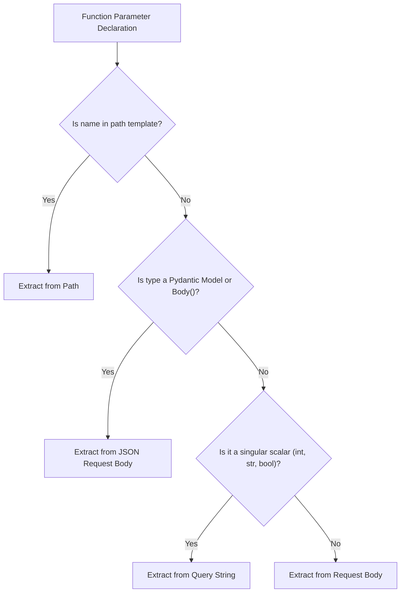
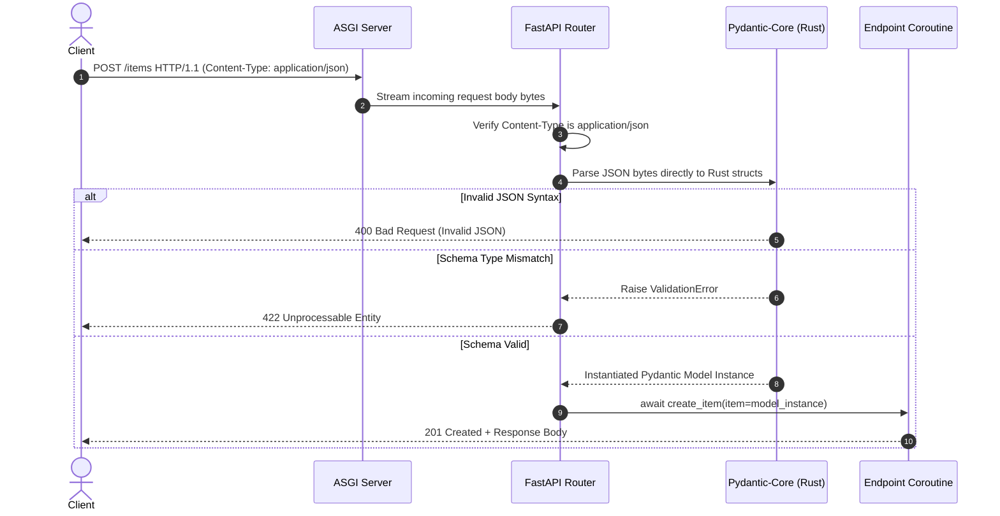

# Request Body & Pydantic Models

When client applications send data to create or update resources (via `POST`, `PUT`, or `PATCH`), the data is transmitted in the **HTTP Request Body**, typically encoded as JSON. 

FastAPI seamlessly parses incoming JSON byte streams, validates the fields against **Pydantic v2 Models**, coerces nested types, and passes typed domain objects to your path operation functions—all while automatically documenting the payload schema in the OpenAPI contract.

---

## 1. Conceptual Foundation & Mental Model

### The Request Disambiguation Engine



When FastAPI inspects an endpoint's signature:
- `item_id: int` matching `/items/{item_id}` -> **Path**
- `q: str | None = None` -> **Query**
- `item: ItemPayload` (subclass of `BaseModel`) -> **Request Body**

---

## 2. Architecture & Internal Mechanics



In Pydantic v2, JSON parsing and validation occur in compiled Rust code (`pydantic-core`). FastAPI passes the raw incoming ASGI byte stream directly to the Rust engine, avoiding intermediate Python dictionary allocations and delivering sub-millisecond parsing throughput.

---

## 3. Comprehensive Syntax & Core Parameters

### Mixing Parameters & Embed Mechanics

```python
from typing import Annotated
from fastapi import FastAPI, Body, Path, Query
from pydantic import BaseModel, Field

app = FastAPI()

class Item(BaseModel):
    name: str = Field(..., min_length=2)
    price: float = Field(..., gt=0)

class User(BaseModel):
    username: str

# Multiple body parameters combined with Path and Query
@app.put("/items/{item_id}")
async def update_item(
    item_id: Annotated[int, Path(ge=1)],
    item: Item,
    user: User,
    importance: Annotated[int, Body(gt=0)] = 1,
    q: Annotated[str | None, Query()] = None,
) -> dict[str, object]: ...
```

When multiple models are declared as request bodies, FastAPI expects a composite JSON payload:
```json
{
  "item": {"name": "Laptop", "price": 999.99},
  "user": {"username": "alice"},
  "importance": 5
}
```

---

## 4. Practical Implementation: 5 Verified Examples

### Example 1: Standard Pydantic Model Request Body

```python
# basic_body.py
from fastapi import FastAPI, status
from pydantic import BaseModel, Field

app = FastAPI()

class ItemCreate(BaseModel):
    name: str = Field(..., min_length=1, max_length=100, examples=["Ergonomic Chair"])
    description: str | None = Field(None, max_length=500, examples=["High mesh back support"])
    price: float = Field(..., gt=0.0, examples=[199.99])
    tax: float | None = Field(default=None, ge=0.0, examples=[15.50])

@app.post("/items", status_code=status.HTTP_201_CREATED)
async def create_item(item: ItemCreate) -> dict[str, str | float]:
    total_price = item.price + (item.tax or 0.0)
    return {
        "name": item.name,
        "base_price": item.price,
        "total_price": round(total_price, 2),
        "status": "created",
    }
```

Execution test:
```bash
curl -X POST http://127.0.0.1:8000/items \
  -H "Content-Type: application/json" \
  -d '{"name": "Ergonomic Chair", "price": 199.99, "tax": 15.50}'
```
Response:
```json
{
  "name": "Ergonomic Chair",
  "base_price": 199.99,
  "total_price": 215.49,
  "status": "created"
}
```

### Example 2: Deeply Nested Hierarchical Pydantic Models

```python
# nested_models.py
from fastapi import FastAPI
from pydantic import BaseModel, EmailStr, Field

app = FastAPI()

class Image(BaseModel):
    url: str = Field(..., pattern=r"^https?://")
    name: str

class Address(BaseModel):
    street: str
    city: str
    postal_code: str

class Organization(BaseModel):
    name: str
    contact_email: EmailStr
    headquarters: Address
    images: list[Image] = Field(default_factory=list)

@app.post("/organizations")
async def register_organization(org: Organization) -> Organization:
    return org
```

Nested JSON payload:
```json
{
  "name": "Acme Corp",
  "contact_email": "admin@acme.com",
  "headquarters": {
    "street": "100 Innovation Way",
    "city": "Austin",
    "postal_code": "78701"
  },
  "images": [
    {"url": "https://images.example.com/logo.png", "name": "Primary Logo"}
  ]
}
```

### Example 3: Body Embedding with `Body(embed=True)`

By default, a single Pydantic model expects the JSON body to match the model directly. To embed it under a key:

```python
# body_embed.py
from typing import Annotated
from fastapi import FastAPI, Body
from pydantic import BaseModel

app = FastAPI()

class Item(BaseModel):
    name: str
    price: float

@app.post("/items/embed")
async def create_embedded_item(
    item: Annotated[Item, Body(embed=True)],
) -> dict[str, Item]:
    return {"received": item}
```

Expected JSON input:
```json
{
  "item": {
    "name": "Headphones",
    "price": 79.99
  }
}
```

### Example 4: Singular Values in Body via `Body()`

Parsing scalar values directly from the request body rather than query parameters:

```python
# singular_body.py
from typing import Annotated
from fastapi import FastAPI, Body

app = FastAPI()

@app.post("/login-pin")
async def verify_pin(
    user_id: Annotated[int, Body(ge=1)],
    pin: Annotated[str, Body(min_length=4, max_length=6, pattern=r"^\d+$")],
) -> dict[str, str | int]:
    return {"user_id": user_id, "status": "pin_verified"}
```

Client request:
```bash
curl -X POST http://127.0.0.1:8000/login-pin \
  -H "Content-Type: application/json" \
  -d '{"user_id": 1024, "pin": "4829"}'
```

### Example 5: Collections of Models in Body (`list[Model]`)

Accepting an array of JSON objects at the root of the request body:

```python
# bulk_models.py
from fastapi import FastAPI, status
from pydantic import BaseModel, Field

app = FastAPI()

class LogEntry(BaseModel):
    timestamp: str
    level: str = Field(..., pattern=r"^(INFO|WARNING|ERROR|CRITICAL)$")
    message: str

@app.post("/logs/bulk", status_code=status.HTTP_202_ACCEPTED)
async def ingest_logs(logs: list[LogEntry]) -> dict[str, int]:
    # Bulk batch processing
    return {"ingested_count": len(logs)}
```

Client request:
```bash
curl -X POST http://127.0.0.1:8000/logs/bulk \
  -H "Content-Type: application/json" \
  -d '[
    {"timestamp": "2026-11-24T10:00:00Z", "level": "INFO", "message": "App started"},
    {"timestamp": "2026-11-24T10:00:05Z", "level": "ERROR", "message": "Connection timeout"}
  ]'
```

---

## 5. Anti-Patterns & Common Traps

| Anti-Pattern | Why It Fails | Production Fix |
| :--- | :--- | :--- |
| **Using `dict` instead of Pydantic model** | `body: dict` forfeits all automatic type validation, schema docs, and auto-completion. | Define explicit Pydantic `BaseModel` classes. |
| **Expecting body parameters in `GET` requests** | HTTP GET requests with bodies violate RFC 7231 and are discarded by many proxies and CDNs. | Use query parameters for `GET`; use `POST` for search queries with heavy payload filters. |
| **Omitting `Content-Type: application/json` header** | FastAPI cannot parse the raw stream without the proper header, failing with HTTP 422. | Ensure HTTP clients send `Content-Type: application/json`. |
| **Modifying request body in-place** | Mutating parsed Pydantic objects directly can cause unintended side effects across downstream dependencies. | Treat validated input models as immutable data transfer objects. |
| **Using `class Config:` in Pydantic models** | Deprecated in Pydantic v2; triggers runtime warnings. | Use `model_config = ConfigDict(...)`. |

---

## 6. Performance & Resource Characteristics

- **Zero Python Intermediary Allocations**: Pydantic v2 parses JSON bytes directly to Rust types (`PyObject`), reducing memory allocations by 60% compared to Pydantic v1.
- **Large Payload Streaming**: For payloads exceeding several megabytes, FastAPI loads the stream into memory before Pydantic parsing. For massive file ingestion, use `UploadFile` (spooled temporary file) rather than JSON request bodies.

---

## 7. Edge Cases, Failure Modes & Gotchas

1. **Empty Body on Required Model**: If a route expects `item: ItemCreate` and the client sends an empty HTTP body (0 bytes), FastAPI returns `422 Unprocessable Entity` with `{"type": "missing", "loc": ["body"], "msg": "Field required"}`.
2. **Additional Fields in JSON**: By default, Pydantic v2 ignores extra fields passed in JSON. If you want to reject unexpected fields with an error, set `model_config = ConfigDict(extra="forbid")`.
3. **Deep Recursion Limit**: Pydantic v2 sets a default recursion limit of 1,000 for deeply nested JSON objects to prevent stack overflow attacks.

---

## 8. Security Implications & OWASP Alignment

- **OWASP API3:2023 - Broken Object Property Level Authorization (Mass Assignment)**: Never pass client request models directly to database ORM models (`User(**payload.model_dump())`). An attacker could inject fields like `is_admin: True`. Always define separate `UserCreate` schemas that exclude privileged fields.
- **JSON Bomb / Hash Collision**: Pydantic v2 mitigates JSON parsing attacks through Rust's `serde_json`, which enforces depth limits and fast parsing.

---

## 9. Modern Tooling Integration

- **OpenAPI Schema Generation**: Pydantic models automatically populate the `requestBody` component in OpenAPI 3.1:
```json
{
  "requestBody": {
    "required": true,
    "content": {
      "application/json": {
        "schema": {
          "$ref": "#/components/schemas/ItemCreate"
        }
      }
    }
  }
}
```

---

## 10. Real-World Case Study: Production Incident

### The Incident
A financial technology startup suffered a data corruption incident where account balances were unexpectedly overwritten with `null` during customer profile updates.

### The Root Cause
The update endpoint used a single model for both creation and updates:
```python
class ProfileUpdate(BaseModel):
    email: str | None = None
    balance: float | None = None

@app.put("/users/{user_id}")
async def update_user(user_id: int, payload: ProfileUpdate):
    # DANGEROUS: model_dump() included unset null fields!
    db.update_user(user_id, **payload.model_dump())
```
When customers updated their email via a form that didn't include the balance field, `payload.model_dump()` emitted `{"email": "new@example.com", "balance": None}`, overwriting the existing balance with `None` in the database.

### The Resolution
Updated the update logic to exclude unset fields using `exclude_unset=True`:
```python
update_data = payload.model_dump(exclude_unset=True)
db.update_user(user_id, **update_data)
```
Additionally, split the schema into dedicated models and forbade sensitive attributes like `balance` from being exposed in user-facing update schemas.

---

## 11. Hands-On Exercises & Challenge Problems

### Warm-Up Exercises
1. **Basic Model Validation**: Create a `POST /books` endpoint that validates a `Book` model requiring `title` (min 2 chars), `author`, and `pages` (gt 0).
2. **Embedded Body Parameter**: Configure a route using `Body(embed=True)` and send a matching curl request verifying successful receipt.

### Intermediate Challenges
3. **Strict Extra Field Rejection**: Configure a Pydantic model with `ConfigDict(extra="forbid")`. Send a request with an extra unregistered field and verify that FastAPI returns an HTTP 422 error detailing the extra field.
4. **Hierarchical Cart Model**: Build a nested shopping cart model containing `cart_id`, `customer_email`, and a list of `CartItem` objects, each with `product_id`, `quantity` (ge 1), and `unit_price`.

### Production-Grade Challenges
5. **Partial Patch Updater**: Implement a `PATCH /users/{user_id}` endpoint that updates an in-memory dictionary. Use `payload.model_dump(exclude_unset=True)` so that only fields explicitly provided by the client are mutated.
6. **Polymorphic Request Body**: Create a route that accepts a union of models: `CatPayload | DogPayload` using a discriminator field `animal_type: Literal["cat", "dog"]`. Verify that FastAPI parses the exact subtype based on the incoming discriminator.

---

## 12. Interview Mastery: Deep-Dive Questions & Answers

#### Q1: How does FastAPI recognize that a parameter represents a request body rather than a query parameter?
**Answer**: If a parameter is typed as a subclass of Pydantic's `BaseModel`, a dataclass, or explicitly annotated with `Body(...)`, FastAPI determines that it must be extracted from the HTTP request body. Singular scalar types (like `int`, `str`, `bool`) are treated as query parameters unless wrapped in `Body(...)`.

#### Q2: What is the difference between `model.model_dump()` and `model.model_dump(exclude_unset=True)`?
**Answer**: `model.model_dump()` returns all model fields, including default values that were not supplied in the request. `model.model_dump(exclude_unset=True)` returns only the fields that were explicitly sent by the client in the request payload, which is essential for partial `PATCH` updates to prevent overwriting existing database fields with default values.

#### Q3: What happens when an endpoint declares multiple Pydantic models in its signature?
**Answer**: FastAPI expects a single root JSON object containing keys named after the parameter variables. For example, `def update(item: Item, user: User)` expects `{"item": {...}, "user": {...}}`.

#### Q4: When should you use `Body(embed=True)`?
**Answer**: When you have a single Pydantic model parameter in your endpoint, but you want the client to send it wrapped inside a JSON key matching the parameter name (e.g. `{"item": {...}}`) rather than as the root JSON object.

#### Q5: Can an endpoint accept a list of Pydantic models at the root of the JSON body?
**Answer**: Yes. Declare the parameter as `items: list[Item]`. FastAPI will validate that the root incoming JSON payload is an array of objects matching the `Item` schema.

#### Q6: How do you forbid extra, undeclared fields in request bodies?
**Answer**: Add `model_config = ConfigDict(extra="forbid")` to the Pydantic model definition. If a client sends an undeclared field, FastAPI rejects the request with an HTTP 422 error.

#### Q7: Why is it an anti-pattern to use raw `dict` for request bodies in FastAPI?
**Answer**: Using `body: dict` completely disables FastAPI's automated validation, type coercion, and OpenAPI documentation generation. The handler must manually inspect dictionary keys, parse strings into dates/integers, and raise custom exceptions.

#### Q8: How does FastAPI validate JSON syntax errors vs schema validation errors?
**Answer**: If the client sends malformed JSON (e.g. missing closing brace or invalid quotes), the parser raises a JSON decode error, returning an **HTTP 400 Bad Request**. If the JSON is syntactically valid but fails Pydantic schema rules (e.g. string where an integer is expected), FastAPI returns an **HTTP 422 Unprocessable Entity**.
