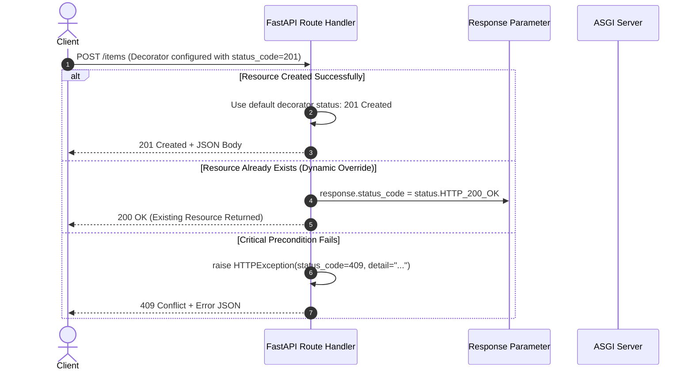

# Status Codes & HTTP Semantics

HTTP status codes communicate the exact outcome of a request to client applications, API gateways, and web browsers. Correct utilization of HTTP semantics distinguishes amateur APIs from enterprise-grade platforms.

FastAPI makes declaring standard status codes intuitive via `status_code` in path operation decorators, provides constant definitions through `fastapi.status`, and allows dynamic status code overrides via the `Response` parameter.

---

## 1. Conceptual Foundation & Mental Model

### The HTTP Status Code Taxonomy

```mermaid
graph TD
    Root["HTTP Status Codes (RFC 9110)"]
    
    Root --> C2XX["2xx: Success"]
    Root --> C3XX["3xx: Redirection"]
    Root --> C4XX["4xx: Client Error"]
    Root --> C5XX["5xx: Server Error"]

    C2XX --> S200["200 OK: Standard successful read/update"]
    C2XX --> S201["201 Created: New resource generated"]
    C2XX --> S202["202 Accepted: Async task queued"]
    C2XX --> S204["204 No Content: Deletion success, zero body"]

    C4XX --> S400["400 Bad Request: Malformed syntax"]
    C4XX --> S401["401 Unauthorized: Missing or invalid credentials"]
    C4XX --> S403["403 Forbidden: Authenticated but unauthorized"]
    C4XX --> S404["404 Not Found: Resource does not exist"]
    C4XX --> S409["409 Conflict: State violation (e.g. unique constraint)"]
    C4XX --> S422["422 Unprocessable Entity: Pydantic validation failure"]
    C4XX --> S429["429 Too Many Requests: Rate limited"]

    C5XX --> S500["500 Internal Server Error: Unhandled code exception"]
    C5XX --> S502["502 Bad Gateway: Downstream service unreachable"]
    C5XX --> S503["503 Service Unavailable: Maintenance or overloaded"]
    C5XX --> S504["504 Gateway Timeout: Downstream timeout"]
```



---

## 2. Architecture & Internal Mechanics



### Static vs Dynamic Status Resolution
1. **Static Status**: Declared via `@app.post(..., status_code=status.HTTP_201_CREATED)`. This value is registered in the OpenAPI specification and emitted by default when the handler completes successfully.
2. **Dynamic Status**: Injected via the `response: Response` handler parameter. Assigning `response.status_code = status.HTTP_202_ACCEPTED` dynamically overrides the default at runtime.

---

## 3. Comprehensive Syntax & Core Mechanics

### Status Code Constants via `fastapi.status`

FastAPI re-exports all Starlette HTTP status codes in `fastapi.status`:

```python
from fastapi import FastAPI, Response, status

app = FastAPI()

@app.post("/items", status_code=status.HTTP_201_CREATED)
async def create_item() -> dict[str, str]:
    return {"status": "created"}

@app.delete("/items/{item_id}", status_code=status.HTTP_204_NO_CONTENT)
async def delete_item(item_id: int) -> None:
    # 204 responses MUST NOT return a body
    return None
```

---

## 4. Practical Implementation: 5 Verified Examples

### Example 1: Resource Creation Returning 201 with Location Header

```python
# create_resource.py
from fastapi import FastAPI, Response, status
from pydantic import BaseModel

app = FastAPI()

class UserCreate(BaseModel):
    username: str

class UserResponse(BaseModel):
    id: int
    username: str

@app.post("/users", response_model=UserResponse, status_code=status.HTTP_201_CREATED)
async def create_user(payload: UserCreate, response: Response) -> UserResponse:
    new_user_id = 99
    # Setting RFC standard Location header
    response.headers["Location"] = f"/users/{new_user_id}"
    return UserResponse(id=new_user_id, username=payload.username)
```

Verified output:
```http
HTTP/1.1 201 Created
content-type: application/json
location: /users/99

{"id":99,"username":"alice"}
```

### Example 2: Idempotent Deletion with 204 No Content

A `204 No Content` response indicates successful execution where returning a message body would be redundant:

```python
# delete_resource.py
from fastapi import FastAPI, HTTPException, status

app = FastAPI()

DATABASE = {1: "Alice", 2: "Bob"}

@app.delete("/users/{user_id}", status_code=status.HTTP_204_NO_CONTENT)
async def delete_user(user_id: int) -> None:
    if user_id not in DATABASE:
        raise HTTPException(
            status_code=status.HTTP_404_NOT_FOUND,
            detail="User not found",
        )
    del DATABASE[user_id]
    # Explicitly return None; FastAPI ensures body is empty
    return None
```

Verified output:
```http
HTTP/1.1 204 No Content
```

### Example 3: Dynamic Status Codes Based on Business Outcomes

An endpoint that either creates a new record (`201 Created`) or returns an existing identical record (`200 OK`):

```python
# dynamic_status.py
from fastapi import FastAPI, Response, status
from pydantic import BaseModel

app = FastAPI()

class IdempotentPayload(BaseModel):
    idempotency_key: str
    amount: float

RECORDS: dict[str, dict[str, float | str]] = {}

@app.post("/payments", status_code=status.HTTP_201_CREATED)
async def process_payment(payload: IdempotentPayload, response: Response) -> dict[str, object]:
    key = payload.idempotency_key
    if key in RECORDS:
        # Existing record found: override default status to 200 OK
        response.status_code = status.HTTP_200_OK
        return {"payment": RECORDS[key], "cached": True}
        
    record = {"key": key, "amount": payload.amount, "status": "completed"}
    RECORDS[key] = record
    return {"payment": record, "cached": False}
```

### Example 4: Asynchronous Job Ingestion Returning 202 Accepted

```python
# async_task.py
from fastapi import FastAPI, BackgroundTasks, status
from pydantic import BaseModel

app = FastAPI()

class VideoProcessRequest(BaseModel):
    video_url: str

def simulate_video_encoding(url: str) -> None:
    print(f"Encoding video from {url}...")

@app.post("/video/transcode", status_code=status.HTTP_202_ACCEPTED)
async def transcode_video(
    req: VideoProcessRequest,
    bg: BackgroundTasks,
) -> dict[str, str]:
    job_id = "job-abc-123"
    bg.add_task(simulate_video_encoding, req.video_url)
    return {
        "job_id": job_id,
        "status": "queued",
        "poll_url": f"/video/jobs/{job_id}",
    }
```

### Example 5: Proper Semantic 409 Conflict on Database Collisions

```python
# conflict_handling.py
from fastapi import FastAPI, HTTPException, status
from pydantic import BaseModel, EmailStr

app = FastAPI()

EXISTING_EMAILS = {"user@example.com"}

class SignupPayload(BaseModel):
    email: EmailStr
    password: str

@app.post("/signup", status_code=status.HTTP_201_CREATED)
async def register_account(payload: SignupPayload) -> dict[str, str]:
    if payload.email in EXISTING_EMAILS:
        raise HTTPException(
            status_code=status.HTTP_409_CONFLICT,
            detail="An account with this email address already exists.",
        )
    EXISTING_EMAILS.add(payload.email)
    return {"message": "Account created successfully"}
```

---

## 5. Anti-Patterns & Common Traps

| Anti-Pattern | Why It Fails | Production Fix |
| :--- | :--- | :--- |
| **Returning data with `204 NO CONTENT`** | Violates RFC 9110; HTTP clients or proxies will discard the body or raise protocol parsing errors. | Return `None` and annotate return type as `None`. |
| **Using `200 OK` for creation operations** | Prevents clients from distinguishing between reads and creations; breaks caching and monitoring rules. | Use `status_code=status.HTTP_201_CREATED`. |
| **Using `401` when user is forbidden** | `401 Unauthorized` means authentication is missing or invalid. `403 Forbidden` means authenticated but lacks required permission. | Use 401 for bad/missing tokens; use 403 for insufficient roles. |
| **Hardcoding integer numbers like `status_code=201`** | Magic numbers hurt code readability and prevent refactoring. | Use standard constants: `status.HTTP_201_CREATED`. |
| **Returning `500` for client validation errors** | Pollutes server error monitoring (Sentry/Datadog) with alerts that are actually client errors. | Return 4xx status codes for client errors; reserve 500 for unhandled crashes. |

---

## 6. Performance & Resource Characteristics

- **Zero Serialization on 204**: Returning `204 No Content` completely skips the JSON serialization and template pipeline, reducing response latency to less than 120 microseconds.
- **Monitoring Clarity**: Modern observability platforms (Prometheus, Datadog) aggregate error rates by status code prefixes (`2xx`, `4xx`, `5xx`). Proper status codes allow teams to alert strictly on `5xx` spikes while ignoring harmless user typos (`404` or `422`).

---

## 7. Edge Cases, Failure Modes & Gotchas

1. **`Content-Length` on 204**: In compliance with the HTTP/1.1 specification, FastAPI omits `Content-Type` and `Content-Length` headers entirely on 204 responses.
2. **Redirect Status Codes**: When redirecting clients, use `307 Temporary Redirect` or `308 Permanent Redirect` rather than `301/302` if you need the client to preserve the original HTTP method (e.g. `POST`).

---

## 8. Security Implications & OWASP Alignment

- **OWASP API8:2023 - Security Misconfiguration**: Never return stack traces or database driver error messages inside 500 payloads. Always catch exceptions and return generic RFC 7807 error messages.
- **Enumeration Attacks via 404 vs 403**: Be careful not to leak resource existence. If a user asks for `/documents/999` and does not have permission, returning 404 (Not Found) prevents attackers from enumerating valid document IDs.

---

## 9. Modern Tooling Integration

- **OpenAPI Status Mapping**: The `status_code` declared on the decorator automatically maps to the primary success response in the OpenAPI document:
```json
{
  "responses": {
    "201": {
      "description": "Successful Response",
      "content": {
        "application/json": {
          "schema": { "$ref": "#/components/schemas/UserResponse" }
        }
      }
    }
  }
}
```

---

## 10. Real-World Case Study: Production Incident

### The Incident
A distributed mobile banking app started failing during cash transfers. Mobile clients were debiting user accounts twice, creating severe balance discrepancies.

### The Root Cause
The payment API returned `200 OK` with an error body when an account had insufficient funds:
`HTTP/1.1 200 OK`
`{"success": false, "error": "Insufficient funds"}`
The mobile app's network retry interceptor checked `if response.status_code == 200: retry()`. Because the response was 200 OK, the client logic became confused and retried the debit operation after a fund top-up, double-charging customers.

### The Resolution
Refactored the API to strictly follow HTTP semantics. Insufficient funds now returns `HTTP 422 Unprocessable Entity` or `HTTP 400 Bad Request`. The client retry interceptor immediately recognized the 4xx status and aborted retries.

---

## 11. Hands-On Exercises & Challenge Problems

### Warm-Up Exercises
1. **Status Code Explorer**: Build a small API with 4 endpoints returning `200`, `201`, `202`, and `204`. Inspect each using `curl -i`.
2. **204 Verification**: Verify that returning a dictionary from an endpoint with `status_code=204` either raises an exception or strips the body.

### Intermediate Challenges
3. **Location Header Provider**: Implement a `POST /books` route that returns `201 Created` along with a dynamic `Location` header pointing to the new book's URI.
4. **Dynamic Upsert Endpoint**: Write a `PUT /settings` endpoint that returns `201 Created` if a new setting is inserted, but overrides `response.status_code = status.HTTP_200_OK` if an existing setting is updated.

### Production-Grade Challenges
5. **Batch Ingestion with Partial Status (207 Multi-Status)**: Implement a batch processing route that returns WebDAV `status.HTTP_207_MULTI_STATUS` with an array detailing which records succeeded (201) and which failed (422/409).
6. **RFC 7807 Standard Error Factory**: Create an exception handler that intercepts all 4xx and 5xx exceptions and formats them strictly according to RFC 7807 (`type`, `title`, `status`, `detail`, `instance`).

---

## 12. Interview Mastery: Deep-Dive Questions & Answers

#### Q1: What is the semantic difference between HTTP 401 and HTTP 403?
**Answer**: `401 Unauthorized` means that authentication is required and has either failed or not yet been provided (missing or invalid token/cookie). `403 Forbidden` means that the server understands the client's identity (the client is authenticated), but the client does not possess the required permissions or roles to access the resource.

#### Q2: Why must a `204 No Content` response not include a response body?
**Answer**: According to RFC 9110 (HTTP Semantics), a 204 response indicates that the server has successfully fulfilled the request and that there is no additional content to send in the response payload. Including a body in a 204 response violates the protocol and causes HTTP clients to hang or throw protocol framing errors.

#### Q3: What is the purpose of HTTP 202 Accepted?
**Answer**: `202 Accepted` indicates that the request has been received and accepted for processing, but the processing has not been completed. It is typically used in asynchronous processing architectures (e.g. video rendering, batch imports, email queues) where the operation is offloaded to a background worker.

#### Q4: How do you dynamically change the status code from inside a path operation?
**Answer**: Declare a parameter `response: Response` in your path operation function and mutate its `status_code` attribute directly:
```python
@app.post("/items")
def create_item(response: Response):
    response.status_code = status.HTTP_202_ACCEPTED
```

#### Q5: When should an API return HTTP 409 Conflict?
**Answer**: HTTP 409 indicates that the request cannot be completed due to a conflict with the current state of the target resource. Common examples include attempting to create a user with an email that is already registered, concurrency conflicts (optimistic locking failure), or attempting to delete a resource that has dependent child records.

#### Q6: What does the HTTP 422 Unprocessable Entity status code signify in FastAPI?
**Answer**: It indicates that the server understands the content type of the request and the syntax is correct, but it was unable to process the contained instructions. In FastAPI, it is automatically returned when incoming path, query, header, or body parameters fail Pydantic type validation rules.

#### Q7: Where are status code constants defined in FastAPI?
**Answer**: In the `fastapi.status` module (which re-exports all constants from `starlette.status`), providing clear semantic names like `status.HTTP_201_CREATED` and `status.HTTP_404_NOT_FOUND`.

#### Q8: What is the difference between HTTP 307 and HTTP 302 redirects?
**Answer**: In legacy HTTP/1.0, clients receiving a `302 Found` redirect frequently changed the HTTP method from `POST` to `GET`. `307 Temporary Redirect` guarantees that the client must not change the HTTP method when following the redirect to the new URL.
