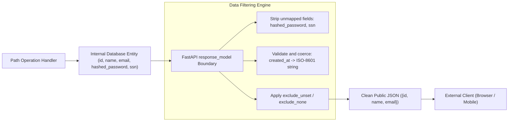
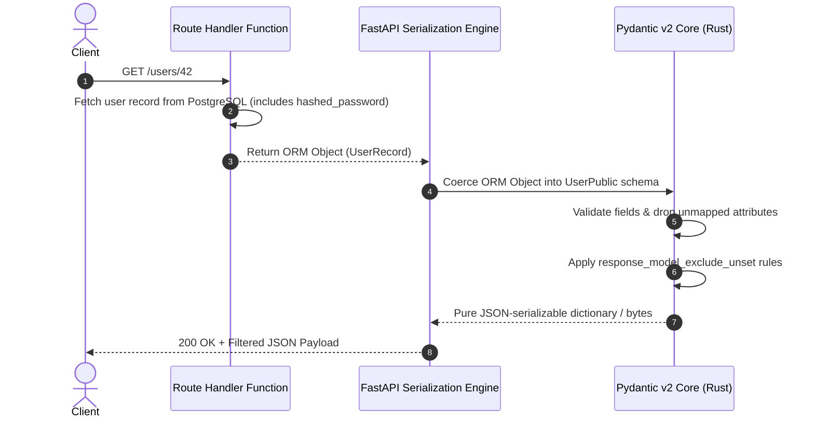

# Response Model & Data Filtering

Returning raw database records or internal domain models directly from API routes is one of the most hazardous security vulnerabilities in backend engineering. Internal models frequently contain password hashes, private encryption keys, internal state flags, and soft-delete metadata.

FastAPI solves this at the architectural boundary through the **`response_model`** mechanism. It filters out unauthorized fields, validates outbound data against strict contracts, automatically documents the response schema in OpenAPI, and serializes Python objects to JSON.

---

## 1. Conceptual Foundation & Mental Model

### The Outbound Security Boundary



### `response_model` vs Return Type Hint
- **Return Type Annotation (`-> UserResponse`)**: Used by IDEs (Pylance, PyCharm) and static type checkers (Mypy) to verify that your function returns the correct internal type. In modern FastAPI, if `response_model` is not explicitly declared, FastAPI uses the return type annotation as the default `response_model`.
- **Explicit `response_model=UserResponse`**: Takes precedence over return type hints. Crucial when your handler returns an ORM object or dictionary that has *more* data than what the public contract allows.

---

## 2. Architecture & Internal Mechanics



---

## 3. Comprehensive Syntax & Core Parameters

### Response Configuration Options

| Parameter | Type | Purpose | Example |
| :--- | :--- | :--- | :--- |
| `response_model` | `Type[BaseModel]` | Target public schema for filtering and OpenAPI generation | `response_model=UserPublic` |
| `response_model_exclude_unset` | `bool` | Exclude fields that were not explicitly set on the model | `response_model_exclude_unset=True` |
| `response_model_exclude_defaults`| `bool` | Exclude fields whose values equal their schema defaults | `response_model_exclude_defaults=True`|
| `response_model_exclude_none` | `bool` | Exclude fields whose value is `None` | `response_model_exclude_none=True` |
| `response_model_include` | `set[str]` | Explicit whitelist of fields to include in output | `response_model_include={"id", "name"}`|
| `response_model_exclude` | `set[str]` | Explicit blacklist of fields to exclude from output | `response_model_exclude={"password"}` |

---

## 4. Practical Implementation: 5 Verified Examples

### Example 1: Preventing Secret Leakage via Output Schemas

```python
# security_filter.py
from fastapi import FastAPI, status
from pydantic import BaseModel, EmailStr, Field

app = FastAPI()

class UserInDB(BaseModel):
    id: int
    username: str
    email: EmailStr
    hashed_password: str
    security_clearance: str

class UserPublic(BaseModel):
    id: int
    username: str
    email: EmailStr

# Mock database row
MOCK_USER = UserInDB(
    id=101,
    username="alice_dev",
    email="alice@company.internal",
    hashed_password="$argon2id$v=19$m=65536,t=3,p=4$dGVzdHNhbHQ$...",
    security_clearance="TOP_SECRET",
)

@app.get("/users/me", response_model=UserPublic)
async def get_my_profile() -> UserInDB:
    # Handler returns the full internal DB object
    # FastAPI automatically filters out hashed_password and security_clearance!
    return MOCK_USER
```

Verified output:
```bash
curl http://127.0.0.1:8000/users/me
```
Response:
```json
{
  "id": 101,
  "username": "alice_dev",
  "email": "alice@company.internal"
}
```

### Example 2: Filtering Unset Values with `response_model_exclude_unset`

Distinguishing between fields that were never set versus fields set explicitly to `None`:

```python
# exclude_unset.py
from fastapi import FastAPI
from pydantic import BaseModel

app = FastAPI()

class Item(BaseModel):
    name: str
    description: str | None = None
    price: float
    tax: float = 10.0
    tags: list[str] = []

ITEMS = {
    1: Item(name="Wireless Mouse", price=25.0),
    2: Item(name="Mechanical Keyboard", description="RGB backlit", price=120.0, tax=12.0),
}

@app.get(
    "/items/{item_id}",
    response_model=Item,
    response_model_exclude_unset=True,
)
async def read_item(item_id: int) -> Item:
    return ITEMS[item_id]
```

Executing `GET /items/1`:
```json
{
  "name": "Wireless Mouse",
  "price": 25.0
}
```
Notice that `description`, `tax`, and `tags` are completely omitted from the JSON payload because they were never set on instance 1.

### Example 3: Eliminating Null Values via `response_model_exclude_none`

Keeping API payloads compact by omitting null attributes:

```python
# exclude_none.py
from fastapi import FastAPI
from pydantic import BaseModel

app = FastAPI()

class ServerStatus(BaseModel):
    host: str
    uptime_seconds: int
    error_message: str | None = None
    warning_code: int | None = None

@app.get("/status", response_model=ServerStatus, response_model_exclude_none=True)
async def get_server_status() -> ServerStatus:
    return ServerStatus(host="node-us-east-1", uptime_seconds=86400)
```

Verified response:
```json
{
  "host": "node-us-east-1",
  "uptime_seconds": 86400
}
```

### Example 4: Direct Response Serialization Bypassing `response_model`

When maximum raw performance is required and data is already verified, returning `ORJSONResponse` or `JSONResponse` directly bypasses Pydantic re-validation:

```python
# direct_response.py
from fastapi import FastAPI
from fastapi.responses import ORJSONResponse

app = FastAPI(default_response_class=ORJSONResponse)

@app.get("/high-throughput-feed")
async def get_feed() -> ORJSONResponse:
    raw_payload = [
        {"ticker": "AAPL", "price": 224.50, "volume": 1400000},
        {"ticker": "GOOGL", "price": 182.30, "volume": 980000},
    ]
    # Completely skips Pydantic schema validation overhead!
    return ORJSONResponse(content=raw_payload)
```

### Example 5: Union Return Types & Discriminators

Handling endpoints that return different models based on criteria:

```python
# union_responses.py
from typing import Literal
from fastapi import FastAPI
from pydantic import BaseModel, Field

app = FastAPI()

class SuccessResult(BaseModel):
    status: Literal["success"] = "success"
    transaction_id: str

class ErrorResult(BaseModel):
    status: Literal["error"] = "error"
    error_code: str
    remediation_url: str

@app.get(
    "/process/{tx_id}",
    response_model=SuccessResult | ErrorResult,
)
async def process_transaction(tx_id: str) -> SuccessResult | ErrorResult:
    if tx_id.startswith("ERR"):
        return ErrorResult(
            error_code="INVALID_ROUTING_NUMBER",
            remediation_url="https://help.bank.com/routing",
        )
    return SuccessResult(transaction_id=tx_id)
```

---

## 5. Anti-Patterns & Common Traps

| Anti-Pattern | Why It Fails | Production Fix |
| :--- | :--- | :--- |
| **Returning SQLAlchemy ORM models directly without `response_model`** | Serializing raw ORM objects triggers lazy loads or leaks internal database column names. | Always specify a typed Pydantic `response_model`. |
| **Using `response_model_exclude` for security** | If a new sensitive field is added to the model later, it is automatically included unless manually blacklisted. | Use a dedicated whitelist schema (`response_model=PublicSchema`) rather than exclusions. |
| **Double validation penalty** | Instantiating a Pydantic model inside the handler and then letting `response_model` validate it again adds redundant CPU overhead. | Return dicts or ORM objects directly from the handler; let `response_model` perform the single validation. |
| **Assuming return type annotations filter data without `response_model`** | In older FastAPI versions (<0.100), return type hints did not automatically act as response models. | Explicitly set `response_model=...` or use FastAPI 0.115+. |
| **Serializing massive lists through heavy Pydantic models** | Validating 10,000 complex nested models in Python introduces noticeable latency. | Use `ORJSONResponse` or stream data in chunks. |

---

## 6. Performance & Resource Characteristics

- **Pydantic v2 Serialization Speed**: In Pydantic v2, serialization from Python objects to JSON dictionaries via `response_model` is implemented in Rust. It runs ~10x faster than Pydantic v1.
- **Direct Response vs Response Model**: Returning an `ORJSONResponse` directly from the route takes ~180 microseconds, compared to ~450 microseconds when passing through `response_model` validation for small schemas.

---

## 7. Edge Cases, Failure Modes & Gotchas

1. **ORM Lazy Loading in Async Endpoints**: If your `response_model` accesses a related relationship attribute (e.g. `user.orders`) that was not eagerly loaded (`selectinload`), SQLAlchemy will attempt a synchronous lazy load, raising `MissingGreenlet: greenlet_spawn has not been called`.
2. **Inheritance Field Overrides**: If a child response model redefines a field from a parent model with a narrower type, ensure the types are compatible to prevent serialization crashes.

---

## 8. Security Implications & OWASP Alignment

- **OWASP API3:2023 - Broken Object Property Level Authorization (Mass Exposure)**: The primary defense against data exposure in FastAPI is `response_model`. By strictly defining whitelist schemas, the API guarantees that database passwords, encryption salts, and internal tokens never leave the server boundary.

---

## 9. Modern Tooling Integration

- **OpenAPI Schema Consistency**: The schema declared in `response_model` is automatically published under `responses.200.content.application/json.schema` in `/openapi.json`, ensuring generated TypeScript or mobile client SDKs have exact type definitions.

---

## 10. Real-World Case Study: Production Incident

### The Incident
A healthcare telemedicine API accidentally exposed patients' Social Security Numbers (SSN) and medical billing codes to public frontend clients.

### The Root Cause
The endpoint was implemented as:
```python
@app.get("/patients/{patient_id}")
async def get_patient(patient_id: int):
    # Returns SQLAlchemy model directly
    return await db.get_patient_by_id(patient_id)
```
When the backend engineer added an `ssn` column to the `Patient` database model for insurance billing, FastAPI's default JSON serializer serialized all model columns, exposing the SSN in cleartext to the frontend web application.

### The Resolution
Created a dedicated `PatientPublicResponse` schema that explicitly omitted `ssn` and `billing_history`:
```python
class PatientPublicResponse(BaseModel):
    id: int
    name: str
    assigned_physician: str
    model_config = ConfigDict(from_attributes=True)

@app.get("/patients/{patient_id}", response_model=PatientPublicResponse)
async def get_patient(patient_id: int):
    return await db.get_patient_by_id(patient_id)
```
FastAPI automatically dropped the SSN column during output serialization, completely eliminating the leak.

---

## 11. Hands-On Exercises & Challenge Problems

### Warm-Up Exercises
1. **Password Filter**: Write a model `UserInDB` with `id`, `email`, and `password_hash`. Create an endpoint that returns this model, but configure `response_model=UserOut` (containing only `id` and `email`). Verify with curl.
2. **Omit None Test**: Build an endpoint using `response_model_exclude_none=True` and verify that any attribute set to `None` is absent in the response JSON.

### Intermediate Challenges
3. **Partial Serialization with `exclude_unset`**: Implement an endpoint that returns an `Item` model where only fields specified during creation are returned in the response.
4. **Fast Direct JSON Response**: Create a route that generates 1,000 dummy transaction records and returns them using `ORJSONResponse`. Benchmark the latency against standard `response_model` serialization.

### Production-Grade Challenges
5. **Role-Based Response Model Filter**: Write a dependency or custom route decorator that inspects the current user's role: if the user is an admin, return `UserAdminResponse` (includes email and role); if regular user, return `UserPublicResponse`.
6. **OpenAPI Multi-Status Response Documenter**: Configure a path operation that explicitly documents distinct response models for `200 OK`, `400 Bad Request`, and `404 Not Found` in the `responses={...}` dictionary.

---

## 12. Interview Mastery: Deep-Dive Questions & Answers

#### Q1: What is the primary purpose of the `response_model` argument in FastAPI?
**Answer**: `response_model` serves four critical functions:
1. **Data Filtering**: It strips any private or unmapped fields from outbound data before sending it to the client.
2. **Data Validation**: It validates that the response data conforms to the intended public contract.
3. **Data Serialization**: It converts Python types (dates, UUIDs, ORM objects) into JSON-serializable primitives.
4. **OpenAPI Documentation**: It automatically generates the response schema in the interactive Swagger UI and OpenAPI JSON contract.

#### Q2: What is the difference between `response_model_exclude_unset` and `response_model_exclude_defaults`?
**Answer**: `response_model_exclude_unset=True` excludes fields that were not explicitly set during model instantiation (even if they have default values). `response_model_exclude_defaults=True` excludes fields whose values equal their defined default value in the model, regardless of whether they were explicitly passed or defaulted.

#### Q3: Why is using `response_model_exclude` discouraged for sensitive data?
**Answer**: `response_model_exclude` is a blacklist approach. If a developer adds a new sensitive field (e.g. `two_factor_secret`) to the underlying model in the future, it will be automatically exposed to the client unless someone remembers to manually update the blacklist. Using an explicit whitelist schema (`response_model=PublicSchema`) is secure by default.

#### Q4: How does FastAPI handle SQLAlchemy ORM models in `response_model`?
**Answer**: When the Pydantic model is configured with `model_config = ConfigDict(from_attributes=True)` (formerly `orm_mode = True`), FastAPI reads attributes from the ORM object (e.g. `obj.name`) rather than dictionary keys (`obj["name"]`), validating and filtering the object cleanly.

#### Q5: Can you return a direct `Response` or `JSONResponse` without triggering `response_model` validation?
**Answer**: Yes. If an endpoint directly returns an instance of `Response` (or subclasses like `JSONResponse`, `ORJSONResponse`, `HTMLResponse`), FastAPI skips the `response_model` serialization and validation pipeline entirely, streaming the response directly to the client.

#### Q6: How does FastAPI deduce the `response_model` if it is not explicitly provided in the decorator?
**Answer**: In modern FastAPI (0.100+), if `response_model` is omitted from the decorator, FastAPI inspects the Python return type annotation of the function (e.g. `def read_item() -> ItemResponse:`) and uses that type as the default `response_model`.

#### Q7: What status code is returned if your code returns data that violates the `response_model` schema?
**Answer**: If your internal code returns data that does not conform to the `response_model` schema, FastAPI raises an internal `ResponseValidationError` which results in an **HTTP 500 Internal Server Error**. This protects the client from receiving invalid data and alerts the backend engineering team of an internal contract violation.

#### Q8: How can an endpoint return multiple different schemas based on runtime logic?
**Answer**: By declaring a Union type (e.g. `response_model=SuccessPayload | ErrorPayload`). Using a shared discriminator field (e.g. `status: Literal["ok", "error"]`) allows Pydantic to parse and validate the exact matching schema cleanly.
