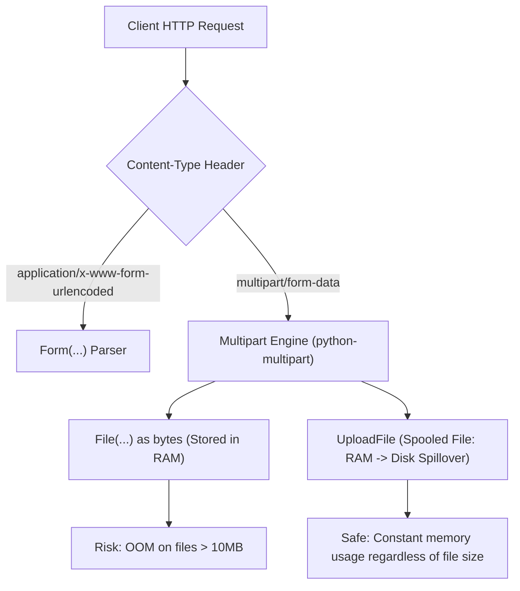

# Form Data & File Uploads

While modern REST APIs predominantly communicate using `application/json`, specific operations—such as OAuth2 password grant authentication, HTML form submissions, and binary media uploads—require parsing `application/x-www-form-urlencoded` and `multipart/form-data`.

FastAPI natively supports form parsing and provides two distinct paradigms for file uploads: raw **`bytes`** (for small files loaded in memory) and **`UploadFile`** (a spooled temporary file backed by disk, essential for production streaming without memory exhaustion).

---

## 1. Conceptual Foundation & Mental Model

### Form Encodings & Storage Mechanics



### `bytes` vs `UploadFile`
- **`File(bytes)`**: Loads the entire file contents directly into RAM. Uploading a 2GB file will consume 2GB of server memory, easily triggering the operating system OOM (Out-Of-Memory) killer.
- **`UploadFile`**: Uses a Python `SpooledTemporaryFile`. Small files (<1MB) stay in RAM for speed; once the size threshold is crossed, bytes automatically spill over to a temporary file on disk, guaranteeing near-constant memory consumption.

---

## 2. Architecture & Internal Mechanics

```mermaid
sequenceDiagram
    autonumber
    actor Client
    participant ASGI as Uvicorn (ASGI Server)
    participant Multipart as python-multipart Parser
    participant Spool as SpooledTemporaryFile (Disk/RAM)
    participant Endpoint as Route Handler

    Client->>ASGI: POST /upload (multipart/form-data; boundary=---xyz)
    ASGI->>Multipart: Stream chunks of multipart boundary stream
    Multipart->>Spool: Write incoming chunks sequentially
    Note over Spool: Memory < 1MB: kept in RAM<br/>Memory > 1MB: written to /tmp
    Multipart-->>FastAPI: Wrap Spool into UploadFile instance
    FastAPI->>Endpoint: await handle_upload(file=upload_file)
    Endpoint->>Endpoint: Read file stream in 1MB chunks and stream to S3 / disk
    Endpoint->>UploadFile: await file.close()
    Note over UploadFile: Temporary file in /tmp deleted automatically
    Endpoint-->>Client: 201 Created + Metadata
```

---

## 3. Comprehensive Syntax & Core Parameters

### UploadFile Methods & Attributes

| Method / Attribute | Type | Description |
| :--- | :--- | :--- |
| `file.filename` | `str` | Original file name sent by client (e.g. `"report.pdf"`) |
| `file.content_type` | `str` | MIME type from client header (e.g. `"image/png"`) |
| `file.size` | `int \| None` | File size in bytes (populated if Content-Length provided) |
| `await file.read(size)` | `Coroutine[bytes]` | Read `size` bytes from the file stream |
| `await file.write(data)`| `Coroutine[None]` | Write bytes to the temporary file |
| `await file.seek(offset)`| `Coroutine[None]`| Move the file pointer position |
| `await file.close()` | `Coroutine[None]` | Close and delete the underlying temporary file |

---

## 4. Practical Implementation: 5 Verified Examples

### Example 1: Standard HTML Form Data Parsing

FastAPI requires `python-multipart` (`uv add python-multipart`) to parse forms:

```python
# form_login.py
from typing import Annotated
from fastapi import FastAPI, Form, HTTPException, status

app = FastAPI()

@app.post("/login")
async def login(
    username: Annotated[str, Form(description="Registered username or email")],
    password: Annotated[str, Form(min_length=8, description="Account password")],
    remember_me: Annotated[bool, Form()] = False,
) -> dict[str, str | bool]:
    if username != "admin" or password != "SecretPassword123!":
        raise HTTPException(
            status_code=status.HTTP_401_UNAUTHORIZED,
            detail="Invalid credentials",
        )
    return {"user": username, "authenticated": True, "remember": remember_me}
```

Verified curl request:
```bash
curl -X POST http://127.0.0.1:8000/login \
  -H "Content-Type: application/x-www-form-urlencoded" \
  -d "username=admin&password=SecretPassword123!&remember_me=true"
```

### Example 2: Safe File Uploading via `UploadFile` with Streaming

Writing incoming file streams to disk in fixed-size chunks to maintain constant memory usage:

```python
# safe_upload.py
import aiofiles
import os
from pathlib import Path
from typing import Annotated
from fastapi import FastAPI, File, UploadFile, HTTPException, status

app = FastAPI()
UPLOAD_DIR = Path("/tmp/uploads")
UPLOAD_DIR.mkdir(parents=True, exist_ok=True)

CHUNK_SIZE = 1024 * 1024  # 1MB buffer

@app.post("/upload/document", status_code=status.HTTP_201_CREATED)
async def upload_document(
    file: Annotated[UploadFile, File(description="Target document to upload")],
) -> dict[str, str | int]:
    # Validate MIME type
    if file.content_type not in ["application/pdf", "image/jpeg", "image/png"]:
        raise HTTPException(
            status_code=status.HTTP_415_UNSUPPORTED_MEDIA_TYPE,
            detail="Only PDF, JPEG, and PNG files are accepted.",
        )

    destination_path = UPLOAD_DIR / file.filename
    total_bytes_written = 0

    try:
        # Stream file in chunks using async file I/O
        async with aiofiles.open(destination_path, "wb") as buffer:
            while chunk := await file.read(CHUNK_SIZE):
                await buffer.write(chunk)
                total_bytes_written += len(chunk)
    finally:
        # Crucial: always close UploadFile to release temporary OS handles
        await file.close()

    return {
        "filename": file.filename,
        "content_type": file.content_type,
        "bytes_stored": total_bytes_written,
    }
```

### Example 3: Multiple File Uploads (`list[UploadFile]`)

Uploading a batch of files in a single request:

```python
# multi_upload.py
from typing import Annotated
from fastapi import FastAPI, File, UploadFile

app = FastAPI()

@app.post("/gallery/batch-upload")
async def batch_upload_photos(
    photos: Annotated[list[UploadFile], File(description="Multiple image files")],
) -> dict[str, object]:
    uploaded_manifest = []
    
    for photo in photos:
        size = photo.size or 0
        uploaded_manifest.append({
            "filename": photo.filename,
            "content_type": photo.content_type,
            "size_bytes": size,
        })
        await photo.close()

    return {"uploaded_count": len(photos), "files": uploaded_manifest}
```

Verified curl command:
```bash
curl -X POST http://127.0.0.1:8000/gallery/batch-upload \
  -F "photos=@image1.png" \
  -F "photos=@image2.jpg"
```

### Example 4: Mixing Form Fields and Files in a Single Multipart Request

```python
# mixed_form_file.py
from typing import Annotated
from fastapi import FastAPI, File, Form, UploadFile
from pydantic import BaseModel

app = FastAPI()

@app.post("/profiles/avatar")
async def update_profile_avatar(
    user_id: Annotated[int, Form(ge=1)],
    caption: Annotated[str, Form(max_length=140)],
    avatar: Annotated[UploadFile, File()],
) -> dict[str, str | int]:
    try:
        filename = avatar.filename
        content_type = avatar.content_type
    finally:
        await avatar.close()

    return {
        "user_id": user_id,
        "caption": caption,
        "avatar_filename": filename,
        "content_type": content_type,
    }
```

Verified curl command:
```bash
curl -X POST http://127.0.0.1:8000/profiles/avatar \
  -F "user_id=42" \
  -F "caption=Summer vacation avatar" \
  -F "avatar=@profile.jpg"
```

### Example 5: Enforcing Maximum File Size Limits at Runtime

Detecting and aborting oversized uploads before disk exhaustion occurs:

```python
# size_guarded_upload.py
from typing import Annotated
from fastapi import FastAPI, File, UploadFile, HTTPException, status

app = FastAPI()

MAX_FILE_SIZE = 5 * 1024 * 1024  # 5 Megabytes

@app.post("/upload/guarded")
async def upload_with_size_limit(
    file: Annotated[UploadFile, File()],
) -> dict[str, str | int]:
    bytes_read = 0
    chunk_size = 512 * 1024  # 512KB

    try:
        while chunk := await file.read(chunk_size):
            bytes_read += len(chunk)
            if bytes_read > MAX_FILE_SIZE:
                raise HTTPException(
                    status_code=status.HTTP_413_REQUEST_ENTITY_TOO_LARGE,
                    detail=f"File exceeds maximum allowed size of {MAX_FILE_SIZE} bytes.",
                )
    finally:
        await file.close()

    return {"status": "accepted", "size": bytes_read}
```

---

## 5. Anti-Patterns & Common Traps

| Anti-Pattern | Why It Fails | Production Fix |
| :--- | :--- | :--- |
| **Using `file: bytes = File(...)` for large uploads** | Reads the whole file into RAM, crashing the worker with an OOM panic. | Always use `file: UploadFile = File(...)`. |
| **Forgetting to `await file.close()`** | Leaves temporary files in `/tmp` and leaks OS file descriptors. | Use a `try...finally:` block to ensure `await file.close()` executes. |
| **Relying solely on `file.content_type` for security** | The client controls the `Content-Type` header; an attacker can upload an `.exe` with `Content-Type: image/png`. | Validate magic bytes using `python-magic` or inspect file extensions. |
| **Mixing JSON body and Form fields** | HTTP does not allow a single request to have both `application/json` and `multipart/form-data` encoding. | Use `Form(...)` for fields if uploading files in the same request. |
| **Forgetting `python-multipart` installation** | Results in `RuntimeError: Form data requires 'python-multipart'`. | Install `uv add python-multipart` or use `fastapi[standard]`. |

---

## 6. Performance & Resource Characteristics

- **Memory Usage**: `UploadFile` utilizes `tempfile.SpooledTemporaryFile(max_size=1048576)`. Memory usage is capped at 1MB per in-flight file upload, regardless of whether the file is 100MB or 10GB.
- **Disk I/O Bottlenecks**: Heavy concurrent uploads can saturate disk I/O on standard cloud storage. Offload large uploads directly to AWS S3 / Cloudflare R2 using pre-signed upload URLs.

---

## 7. Edge Cases, Failure Modes & Gotchas

1. **Client Disconnects Mid-Upload**: If a client drops the connection while streaming a 500MB file, FastAPI raises an ASGI disconnect exception. Wrap stream loops in `try...except:` to clean up partially written files on disk.
2. **Missing Filename Attribute**: Some programmatic HTTP clients omit the `filename` parameter in the multipart header. Always check `if not file.filename: file.filename = "unnamed.bin"`.

---

## 8. Security Implications & OWASP Alignment

- **Malicious File Upload Attacks (OWASP Top 10)**:
  - **Zip Bomb / Decompression Attacks**: Never automatically extract archives without checking uncompressed size.
  - **Executable Uploads**: Block dangerous extensions (`.php`, `.py`, `.sh`, `.exe`, `.bat`). Store uploaded files outside the web root on isolated storage (S3) or set `Content-Disposition: attachment`.
  - **Path Traversal in Filename**: Attackers can send `filename="../../etc/cron.d/malicious"`. Sanitize filenames using `os.path.basename()` or generate a fresh UUID: `uuid.uuid4().hex`.

---

## 9. Modern Tooling Integration

- **OpenAPI Form Specification**: Declaring `UploadFile` automatically generates the OpenAPI binary upload component:
```json
{
  "content": {
    "multipart/form-data": {
      "schema": {
        "type": "object",
        "properties": {
          "avatar": { "type": "string", "format": "binary" }
        }
      }
    }
  }
}
```

---

## 10. Real-World Case Study: Production Incident

### The Incident
An HR portal crashed every Monday morning when employees uploaded PDF receipts. Server memory spiked to 100%, and Uvicorn workers died continuously with `SIGKILL`.

### The Root Cause
The receipt upload endpoint was typed as:
```python
@app.post("/receipts")
async def upload_receipt(receipt: bytes = File(...)):
    # ... process receipt ...
```
When multiple employees concurrently uploaded 50MB scanned PDF files, each worker loaded the entire 50MB into memory. With 10 concurrent requests across 4 workers, memory exceeded the 2GB container limit, triggering Linux kernel OOM kills.

### The Resolution
Refactored the endpoint from `bytes` to `UploadFile` and streamed directly to S3:
```python
@app.post("/receipts")
async def upload_receipt(receipt: UploadFile = File(...)):
    try:
        await s3_client.upload_fileobj(receipt.file, "receipts-bucket", receipt.filename)
    finally:
        await receipt.close()
```
Memory usage dropped from 2,000MB to a stable 45MB during peak morning traffic.

---

## 11. Hands-On Exercises & Challenge Problems

### Warm-Up Exercises
1. **Form Login Route**: Build a `POST /token` endpoint that accepts `username` and `password` via `Form(...)` and returns a dummy access token.
2. **File Metadata Reader**: Create an endpoint that accepts an `UploadFile` and returns its `filename`, `content_type`, and size without saving it to disk.

### Intermediate Challenges
3. **Chunked Local Storage**: Write an endpoint that saves an uploaded file to a local `uploads/` directory in 64KB chunks using `aiofiles`. Verify that the saved file matches the original SHA256 checksum.
4. **File Extension Whitelist**: Implement a validation dependency that checks whether an uploaded file ends with an allowed extension (`.jpg`, `.png`, `.pdf`) and raises an HTTP 400 error otherwise.

### Production-Grade Challenges
5. **Streaming Size Guard with Auto-Cleanup**: Build an upload handler that streams incoming chunks into a temporary file. If the total bytes exceed 10MB, immediately delete the partially written file and raise HTTP 413 Payload Too Large.
6. **Multi-Part Document Ingestor**: Implement an endpoint that accepts:
   - Metadata JSON (via Form string parsed into a Pydantic model)
   - A primary PDF document (`UploadFile`)
   - An array of supporting image attachments (`list[UploadFile]`)
   Process and close all files cleanly.

---

## 12. Interview Mastery: Deep-Dive Questions & Answers

#### Q1: What is the crucial operational difference between `file: bytes = File(...)` and `file: UploadFile = File(...)`?
**Answer**: `bytes` reads the entire uploaded file into memory (RAM) at once, which can easily trigger Out-Of-Memory (OOM) crashes on large files. `UploadFile` uses a `SpooledTemporaryFile`: small files are held in RAM, but larger files (over 1MB) are spooled to temporary files on disk. `UploadFile` provides async stream methods (`read`, `write`, `seek`, `close`) that allow chunked streaming with constant, minimal memory consumption.

#### Q2: Why is `python-multipart` required in FastAPI projects handling forms or files?
**Answer**: Starlette and FastAPI do not include a built-in multipart/form-data parser in their minimal package to reduce footprint. `python-multipart` is the underlying Python library that handles streaming boundary parsing for `application/x-www-form-urlencoded` and `multipart/form-data`.

#### Q3: Why is it critical to call `await file.close()` on an `UploadFile`?
**Answer**: `UploadFile` allocates temporary files on the host operating system's filesystem (typically in `/tmp`). Calling `await file.close()` releases internal file handles and deletes the underlying temporary spooled file. Failing to close uploaded files leads to file descriptor leaks and eventual disk space exhaustion.

#### Q4: How does FastAPI document file upload parameters in Swagger UI?
**Answer**: When a parameter is annotated with `UploadFile` or `File()`, FastAPI sets the schema format in OpenAPI to `type: string, format: binary` under `multipart/form-data`. Swagger UI automatically renders a native file selector ("Browse..." button) allowing users to upload files interactively.

#### Q5: Can an endpoint accept both a JSON request body and an `UploadFile` simultaneously?
**Answer**: No. HTTP protocol specifications do not allow a single request to have both `application/json` and `multipart/form-data` content encodings. If you need to send structured data alongside a file, transmit the structured fields as `Form(...)` parameters or pass a JSON string inside a form field.

#### Q6: How do you handle multiple file uploads in a single endpoint?
**Answer**: Annotate the parameter as a list of `UploadFile`: `files: Annotated[list[UploadFile], File()]`. The client can then upload multiple files under the same multipart field name.

#### Q7: Why is relying on `file.content_type` insufficient for verifying file security?
**Answer**: The `content_type` attribute reflects the `Content-Type` header supplied by the HTTP client. Attackers can easily spoof this header (e.g. labeling a malicious `.exe` file as `image/jpeg`). Production applications must validate magic bytes (file signatures) or pass files through antivirus scanners.

#### Q8: How can you implement streaming file uploads to cloud storage like AWS S3?
**Answer**: Access the underlying Python file-like object via `file.file` and pass it directly to `boto3`'s `upload_fileobj`, or stream chunks asynchronously via `aioboto3` reading with `while chunk := await file.read(CHUNK_SIZE)`.
