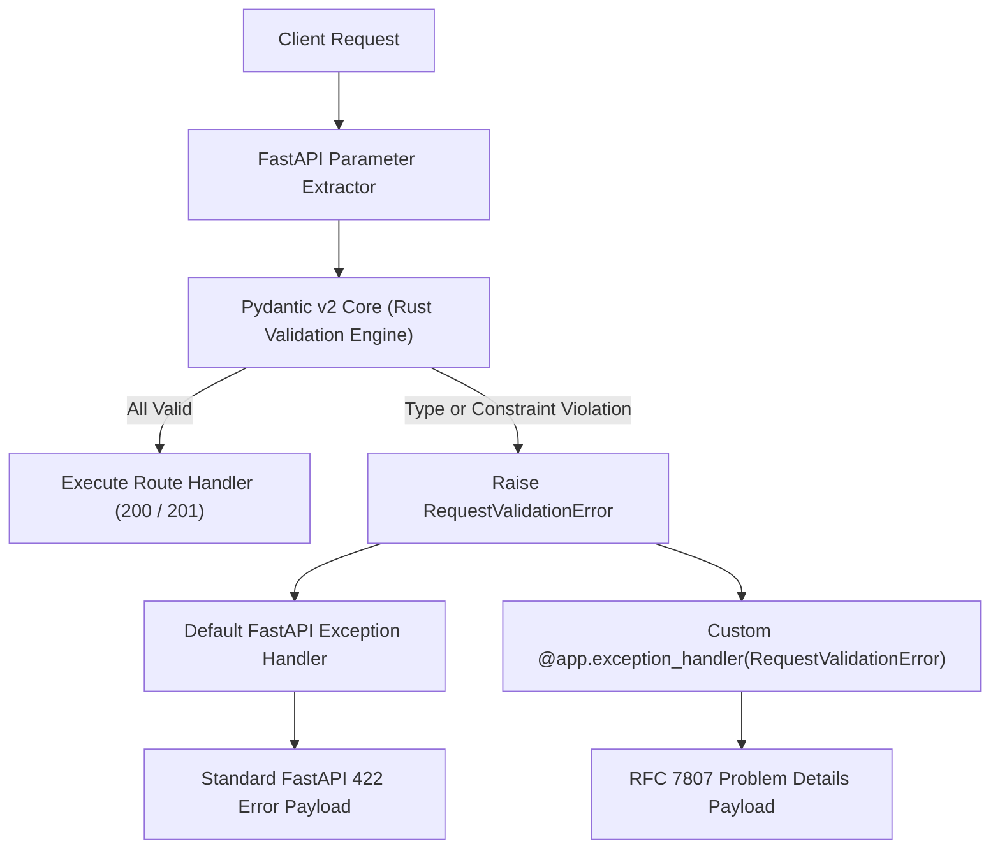

# Request Validation & 422 Errors

Whenever incoming data fails type conversion, constraint bounds, or custom validation logic, FastAPI rejects the request with an **HTTP 422 Unprocessable Entity** response. Rather than returning cryptic strings, FastAPI generates a structured JSON error body detailing the exact parameter location, error type, and remediation message.

Understanding the internal anatomy of `RequestValidationError` and how to intercept it enables building production APIs that conform strictly to international standards like **RFC 7807 (Problem Details for HTTP APIs)**.

---

## 1. Conceptual Foundation & Mental Model

### The Validation Interception Pipeline



### The Difference: `RequestValidationError` vs `ValidationError`
- **`pydantic.ValidationError`**: Raised internally when a Pydantic model is instantiated with invalid data anywhere in Python code.
- **`fastapi.exceptions.RequestValidationError`**: A FastAPI-specific subclass that wraps Pydantic's error when the failure originates from an **incoming client HTTP request** (path, query, body, headers, cookies). FastAPI automatically catches this exception and transforms it into an HTTP 422 status response.

---

## 2. Architecture & Internal Mechanics

### Anatomy of the Default 422 Response

When a validation error occurs, FastAPI returns an object containing a `detail` list:

```json
{
  "detail": [
    {
      "type": "greater_than_equal",
      "loc": ["body", "price"],
      "msg": "Input should be greater than or equal to 0",
      "input": -15.5,
      "ctx": {
        "ge": 0.0
      }
    }
  ]
}
```

### The Anatomy Elements
1. **`loc` (Location)**: An array tracing the exact hierarchical location of the invalid data:
   - First element: Data source (`"body"`, `"query"`, `"path"`, `"header"`, `"cookie"`).
   - Subsequent elements: Nested field names or array indices (e.g. `["body", "users", 2, "email"]`).
2. **`msg` (Message)**: Human-readable error description generated by Pydantic.
3. **`type` (Type)**: A machine-readable string identifier (e.g. `"missing"`, `"string_type"`, `"value_error"`).
4. **`input` (Input Value)**: The exact invalid value supplied by the client (requires careful redaction for sensitive fields like passwords).
5. **`ctx` (Context)**: Optional metadata providing boundary constraints (e.g. `{"ge": 0.0}`).

---

## 3. Comprehensive Syntax & Core Mechanics

### Intercepting Request Validation Errors

```python
from fastapi import FastAPI, Request, status
from fastapi.exceptions import RequestValidationError
from fastapi.responses import JSONResponse

app = FastAPI()

@app.exception_handler(RequestValidationError)
async def custom_validation_exception_handler(
    request: Request,
    exc: RequestValidationError,
) -> JSONResponse:
    # exc.errors() returns the list of raw Pydantic error dictionaries
    errors = exc.errors()
    # exc.body contains the raw input payload
    return JSONResponse(
        status_code=status.HTTP_422_UNPROCESSABLE_ENTITY,
        content={"error_count": len(errors), "validation_errors": errors},
    )
```

---

## 4. Practical Implementation: 5 Verified Examples

### Example 1: Triggering and Inspecting Multiple Validation Errors

```python
# multi_validation.py
from typing import Annotated
from fastapi import FastAPI, Path, Query
from pydantic import BaseModel, Field, EmailStr

app = FastAPI()

class UserCreate(BaseModel):
    username: str = Field(..., min_length=3, max_length=20)
    email: EmailStr
    age: int = Field(..., ge=18, le=120)

@app.post("/users/{tenant_id}")
async def create_user(
    tenant_id: Annotated[int, Path(ge=1)],
    payload: UserCreate,
    notify: Annotated[bool, Query()] = True,
) -> dict[str, str]:
    return {"status": "created"}
```

Sending invalid data across path, query, and body:
```bash
curl -X POST "http://127.0.0.1:8000/users/invalid-tenant?notify=not-a-bool" \
  -H "Content-Type: application/json" \
  -d '{"username": "a", "email": "not-an-email", "age": 12}'
```

Verified 422 JSON Response:
```json
{
  "detail": [
    {
      "type": "int_parsing",
      "loc": ["path", "tenant_id"],
      "msg": "Input should be a valid integer, unable to parse string as an integer",
      "input": "invalid-tenant"
    },
    {
      "type": "bool_parsing",
      "loc": ["query", "notify"],
      "msg": "Input should be a valid boolean, unable to interpret input",
      "input": "not-a-bool"
    },
    {
      "type": "string_too_short",
      "loc": ["body", "username"],
      "msg": "String should have at least 3 characters",
      "input": "a",
      "ctx": {"min_length": 3}
    },
    {
      "type": "value_error",
      "loc": ["body", "email"],
      "msg": "value is not a valid email address: The email address is not valid. It must have exactly one @-sign.",
      "input": "not-an-email"
    },
    {
      "type": "greater_than_equal",
      "loc": ["body", "age"],
      "msg": "Input should be greater than or equal to 18",
      "input": 12,
      "ctx": {"ge": 18}
    }
  ]
}
```

### Example 2: Transforming Errors to RFC 7807 (Problem Details)

Standardizing error outputs across an enterprise ecosystem:

```python
# rfc7807_handler.py
from fastapi import FastAPI, Request, status
from fastapi.exceptions import RequestValidationError
from fastapi.responses import JSONResponse
from pydantic import BaseModel, Field

app = FastAPI()

class Order(BaseModel):
    item_id: int = Field(..., gt=0)
    quantity: int = Field(..., ge=1, le=10)

@app.exception_handler(RequestValidationError)
async def rfc7807_exception_handler(
    request: Request,
    exc: RequestValidationError,
) -> JSONResponse:
    invalid_params = []
    for err in exc.errors():
        field_path = ".".join(str(loc) for loc in err["loc"])
        invalid_params.append({
            "name": field_path,
            "reason": err["msg"],
            "code": err["type"],
        })

    problem_details = {
        "type": "https://api.example.com/errors/validation-error",
        "title": "Your request parameters failed validation.",
        "status": status.HTTP_422_UNPROCESSABLE_ENTITY,
        "detail": f"{len(invalid_params)} field(s) failed validation constraints.",
        "instance": str(request.url.path),
        "invalid_params": invalid_params,
    }

    return JSONResponse(
        status_code=status.HTTP_422_UNPROCESSABLE_ENTITY,
        content=problem_details,
        headers={"Content-Type": "application/problem+json"},
    )

@app.post("/orders")
async def place_order(order: Order) -> Order:
    return order
```

Verified output:
```http
HTTP/1.1 422 Unprocessable Entity
content-type: application/problem+json

{
  "type": "https://api.example.com/errors/validation-error",
  "title": "Your request parameters failed validation.",
  "status": 422,
  "detail": "1 field(s) failed validation constraints.",
  "instance": "/orders",
  "invalid_params": [
    {
      "name": "body.quantity",
      "reason": "Input should be greater than or equal to 1",
      "code": "greater_than_equal"
    }
  ]
}
```

### Example 3: Redacting Sensitive Input Data from Error Payloads

Preventing password or credit card leakage in validation error responses:

```python
# redact_sensitive.py
from fastapi import FastAPI, Request, status
from fastapi.exceptions import RequestValidationError
from fastapi.responses import JSONResponse
from pydantic import BaseModel, Field

app = FastAPI()

SENSITIVE_FIELD_NAMES = {"password", "secret", "token", "card_number", "cvv"}

class AccountRegister(BaseModel):
    username: str
    password: str = Field(..., min_length=12, description="High-entropy password")

@app.exception_handler(RequestValidationError)
async def secure_validation_handler(request: Request, exc: RequestValidationError) -> JSONResponse:
    cleaned_errors = []
    for err in exc.errors():
        error_copy = dict(err)
        # Check if any part of the field path matches sensitive keywords
        loc_keys = {str(k).lower() for k in err.get("loc", ())}
        if loc_keys.intersection(SENSITIVE_FIELD_NAMES):
            error_copy["input"] = "[REDACTED]"
        cleaned_errors.append(error_copy)

    return JSONResponse(
        status_code=status.HTTP_422_UNPROCESSABLE_ENTITY,
        content={"detail": cleaned_errors},
    )

@app.post("/accounts")
async def create_account(account: AccountRegister) -> dict[str, str]:
    return {"status": "ok"}
```

When client sends `{"username": "bob", "password": "short"}`:
```json
{
  "detail": [
    {
      "type": "string_too_short",
      "loc": ["body", "password"],
      "msg": "String should have at least 12 characters",
      "input": "[REDACTED]",
      "ctx": {"min_length": 12}
    }
  ]
}
```

### Example 4: Custom Field-Level Validation Error Messages

```python
# custom_validators.py
from fastapi import FastAPI
from pydantic import BaseModel, field_validator

app = FastAPI()

class PromoCodePayload(BaseModel):
    code: str

    @field_validator("code")
    @classmethod
    def validate_promo_code(cls, v: str) -> str:
        clean_code = v.strip().upper()
        if not clean_code.startswith("SAVE-"):
            raise ValueError("Promo code must start with the prefix 'SAVE-'")
        return clean_code

@app.post("/promo/apply")
async def apply_promo(payload: PromoCodePayload) -> dict[str, str]:
    return {"applied": payload.code}
```

Sending `{"code": "DISCOUNT10"}` returns an automatic 422 with the exact custom error message:
```json
{
  "detail": [
    {
      "type": "value_error",
      "loc": ["body", "code"],
      "msg": "Value error, Promo code must start with the prefix 'SAVE-'",
      "input": "DISCOUNT10"
    }
  ]
}
```

### Example 5: Testing 422 Errors with `pytest` and `httpx`

```python
# tests/test_validation.py
import pytest
from httpx import ASGITransport, AsyncClient
from multi_validation import app

@pytest.mark.asyncio
async def test_validation_error_structure() -> None:
    transport = ASGITransport(app=app)
    async with AsyncClient(transport=transport, base_url="http://test") as client:
        response = await client.post(
            "/users/99",
            json={"username": "ab", "email": "bad", "age": 10},
        )
        assert response.status_code == 422
        data = response.json()
        assert "detail" in data
        assert len(data["detail"]) >= 2
        # Verify location matches expected field
        locs = [err["loc"] for err in data["detail"]]
        assert ["body", "username"] in locs
```

---

## 5. Anti-Patterns & Common Traps

| Anti-Pattern | Why It Fails | Production Fix |
| :--- | :--- | :--- |
| **Catching `RequestValidationError` with `except Exception:`** | Hides validation failures and mistakenly converts 422 errors into generic 500 errors. | Use `@app.exception_handler(RequestValidationError)`. |
| **Leaking cleartext passwords in `input` fields** | Pydantic mirrors invalid input in the error payload, exposing plaintext credentials in error responses and log aggregators. | Redact sensitive inputs in a custom exception handler. |
| **Returning 400 Bad Request for validation errors** | Violates REST convention; 400 indicates malformed syntax, whereas 422 indicates valid syntax with unprocessable schema instructions. | Retain HTTP 422 for schema/constraint validation errors. |
| **Ignoring nested array error indices** | Flattening `loc` without array indices makes it impossible for clients to identify which item in a bulk array failed. | Preserve array indices in `loc` (e.g. `items.3.sku`). |
| **Hardcoding error response strings** | Breaks client-side localization and programmatic field highlighting in UI forms. | Provide structured error payloads containing both a `code` and field path. |

---

## 6. Performance & Resource Characteristics

- **Zero-Allocation Rust Validation**: Pydantic v2 compiles field constraints into Rust state machines. Evaluating a 20-field payload with 5 nested objects takes ~15 microseconds.
- **Error Generation Overhead**: When validation fails, Pydantic collects all errors in a single pass before raising `RequestValidationError`, preventing multiple round-trips for multi-field failures.

---

## 7. Edge Cases, Failure Modes & Gotchas

1. **JSON Syntax Error vs Pydantic Error**: If a client sends broken JSON (e.g. `{name: "Alice"` with no closing brace), Starlette raises a `starlette.exceptions.HTTPException` with status **400 Bad Request**, not a 422 `RequestValidationError`.
2. **Missing `Content-Type` Header**: Sending a body without `Content-Type: application/json` causes FastAPI to skip body parsing or return a 422 stating the body is missing.

---

## 8. Security Implications & OWASP Alignment

- **Information Exposure in Validation Messages**: Ensure database column names, internal table constraints, or internal server paths are not leaked in custom validation error messages.
- **Log Injection via `input`**: If logging `exc.errors()`, sanitize input values to prevent carriage return / newline (`\r\n`) log injection attacks.

---

## 9. Modern Tooling Integration

- **Frontend Form Libraries**: Form libraries like React Hook Form and Zod map directly to FastAPI's `loc` array. A `loc` of `["body", "address", "zip_code"]` maps cleanly to form field `address.zip_code` for inline UI highlighting.

---

## 10. Real-World Case Study: Production Incident

### The Incident
A cybersecurity audit of a fintech bank flagged a high-severity vulnerability: registration error payloads were being stored in third-party client monitoring logs (Datadog) containing cleartext user passwords.

### The Root Cause
When users attempted to register with passwords that failed complexity checks (e.g. fewer than 12 characters), FastAPI's default 422 handler returned:
```json
{
  "loc": ["body", "password"],
  "msg": "String should have at least 12 characters",
  "input": "MySecretPass1"
}
```
The client mobile application sent the entire response body to an external logging service, creating a massive credential leak in plain text.

### The Resolution
Implemented an application-wide exception handler for `RequestValidationError` that automatically identifies fields named `password`, `pin`, `ssn`, or `token` and replaces their `input` value with `"[REDACTED]"` before emitting the HTTP response.

---

## 11. Hands-On Exercises & Challenge Problems

### Warm-Up Exercises
1. **Trigger Every Parameter Error**: Create an endpoint with path, query, and body parameters. Send a single curl request that simultaneously fails validation on all three, and observe the resulting `detail` list.
2. **Custom Validation Message**: Write a Pydantic model with a `@field_validator` that raises a custom `ValueError("Username must not contain spaces")`. Test that this message appears in the 422 payload.

### Intermediate Challenges
3. **RFC 7807 Compliance Layer**: Implement an `@app.exception_handler(RequestValidationError)` that reformats all validation errors into standard RFC 7807 Problem Details with `application/problem+json` content-type.
4. **Input Sanitization Guard**: Write an exception handler that recursively strips all `input` fields from the error payload if `ENVIRONMENT=production`.

### Production-Grade Challenges
5. **Localized Error Translator**: Build a validation exception handler that inspects the incoming `Accept-Language` header (e.g. `es`, `fr`, `en`) and translates standard Pydantic error messages into the requested language using a localization lookup map.
6. **Bulk Upload Error Aggregator**: Create an endpoint accepting a list of 100 `Product` records. Write an exception handler that groups validation errors by array index, returning a summary of which rows succeeded and which rows failed.

---

## 12. Interview Mastery: Deep-Dive Questions & Answers

#### Q1: What is the difference between an HTTP 400 Bad Request and an HTTP 422 Unprocessable Entity in FastAPI?
**Answer**: HTTP 400 is returned when the client sends malformed HTTP or invalid JSON syntax that the parser cannot read (e.g. broken quotes, unclosed braces). HTTP 422 is returned when the JSON syntax is completely valid, but the data fails semantic Pydantic validation rules, constraint checks, or data type requirements.

#### Q2: What are the primary keys present in each item of the `detail` list in a 422 error?
**Answer**:
- `loc`: The location hierarchy of the parameter (`["body", "field_name"]`).
- `msg`: The human-readable description of what failed.
- `type`: The machine-readable error classification string (e.g. `"string_too_short"`).
- `input`: The raw invalid value provided by the client.
- `ctx`: Optional dictionary with boundary parameters (e.g. `{"min_length": 8}`).

#### Q3: How do you intercept and override FastAPI's default 422 validation response?
**Answer**: Use the `@app.exception_handler(RequestValidationError)` decorator to register a custom async exception handler. Inside the handler, access `exc.errors()` and return a custom `JSONResponse` with your desired status code and structure.

#### Q4: Why is returning raw `input` in validation errors considered a security risk?
**Answer**: If a user submits a sensitive field like a password, PIN, or credit card number that fails a validation rule, Pydantic's default behavior includes the plaintext value in the `input` field of the error payload. If error responses are cached by proxies or logged by client telemetry, sensitive credentials become compromised.

#### Q5: What is RFC 7807 and why is it recommended for API error payloads?
**Answer**: RFC 7807 (Problem Details for HTTP APIs) is an IETF standard defining a uniform machine-readable JSON structure for communicating errors in HTTP APIs. It defines standard fields (`type`, `title`, `status`, `detail`, `instance`) to prevent disparate microservices within an organization from inventing incompatible proprietary error schemas.

#### Q6: Can a custom `@field_validator` return custom error structures?
**Answer**: Yes. Raising a standard `ValueError("custom message")` will set `"msg": "Value error, custom message"` in the 422 payload. You can also raise Pydantic's `PydanticCustomError` to define custom error types and contexts.

#### Q7: How does the `loc` list trace errors in nested models?
**Answer**: It appends each nested key to the list in order. For example, if an error occurs in the `city` field of an `address` object inside a `user` body payload, the location is represented as `["body", "user", "address", "city"]`. For items in lists, it includes the integer index: `["body", "items", 2, "price"]`.

#### Q8: Does FastAPI stop validation at the first error or collect all errors?
**Answer**: FastAPI and Pydantic collect **all** validation errors across all fields, parameters, and models in a single pass before raising `RequestValidationError`. This allows clients to receive a comprehensive list of all invalid fields in a single HTTP response rather than discovering them one by one.
