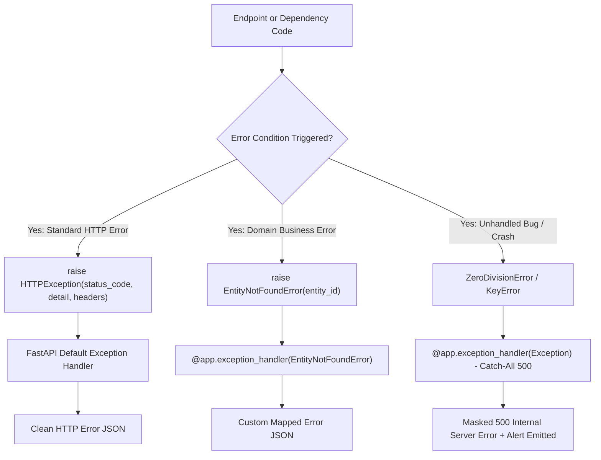
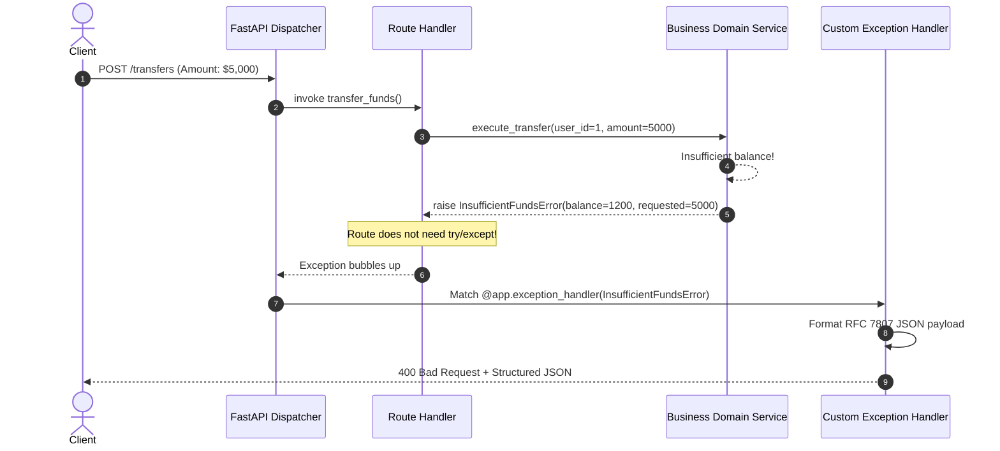

# Handling Errors & HTTPException

Robust error handling is the foundation of dependable API architecture. Unhandled exceptions crash worker threads, leak stack traces containing database schemas and secrets, and return confusing generic 500 pages to clients.

FastAPI provides **`fastapi.HTTPException`** for raising semantic HTTP errors from anywhere in your application stack, alongside a powerful **Exception Handler** framework that intercepts domain exceptions, maps them to RFC-compliant error payloads, and injects essential security headers.

---

## 1. Conceptual Foundation & Mental Model

### The Exception Routing Architecture



### `fastapi.HTTPException` vs `starlette.exceptions.HTTPException`
- **FastAPI's `HTTPException`** accepts any JSON-serializable data structure for `detail` (strings, lists, dictionaries) and integrates with OpenAPI documentation.
- **Starlette's `HTTPException`** accepts only plain string messages for `detail`. Always import `from fastapi import HTTPException`.

---

## 2. Architecture & Internal Mechanics



By decoupling domain exceptions from HTTP concerns, your core business logic remains independent of the web framework. Route handlers and services raise pure Python exceptions, while centralized exception handlers map them to HTTP status codes and headers.

---

## 3. Comprehensive Syntax & Core Parameters

### `fastapi.HTTPException` Signature

```python
from fastapi import HTTPException, status

raise HTTPException(
    status_code=status.HTTP_401_UNAUTHORIZED,
    detail="Invalid authentication token",
    headers={"WWW-Authenticate": "Bearer"},
)
```

---

## 4. Practical Implementation: 5 Verified Examples

### Example 1: Standard HTTPException with Custom Dictionary Detail

```python
# standard_http_exc.py
from fastapi import FastAPI, HTTPException, status

app = FastAPI()

ITEMS = {"chair": 45.0, "table": 120.0}

@app.get("/items/{item_name}")
async def get_item(item_name: str) -> dict[str, str | float]:
    if item_name not in ITEMS:
        # Raising structured dictionary details
        raise HTTPException(
            status_code=status.HTTP_404_NOT_FOUND,
            detail={
                "error_code": "ITEM_NOT_FOUND",
                "message": f"Item '{item_name}' is not in the active catalog.",
                "available_items": list(ITEMS.keys()),
            },
        )
    return {"item": item_name, "price": ITEMS[item_name]}
```

Executing `GET /items/lamp`:
```http
HTTP/1.1 404 Not Found
content-type: application/json

{
  "detail": {
    "error_code": "ITEM_NOT_FOUND",
    "message": "Item 'lamp' is not in the active catalog.",
    "available_items": ["chair", "table"]
  }
}
```

### Example 2: Decoupled Domain Exceptions with Custom Handlers

```python
# domain_exceptions.py
from fastapi import FastAPI, Request, status
from fastapi.responses import JSONResponse

# 1. Pure Python Domain Exception (no FastAPI dependencies)
class InsufficientFundsError(Exception):
    def __init__(self, current_balance: float, required_amount: float) -> None:
        self.current_balance = current_balance
        self.required_amount = required_amount
        super().__init__(f"Balance {current_balance} is below required {required_amount}")

app = FastAPI()

# 2. Centralized Exception Handler
@app.exception_handler(InsufficientFundsError)
async def insufficient_funds_handler(
    request: Request,
    exc: InsufficientFundsError,
) -> JSONResponse:
    return JSONResponse(
        status_code=status.HTTP_402_PAYMENT_REQUIRED,
        content={
            "error": "INSUFFICIENT_FUNDS",
            "message": "Transaction declined due to low account balance.",
            "current_balance": exc.current_balance,
            "shortfall": round(exc.required_amount - exc.current_balance, 2),
        },
    )

@app.post("/debit")
async def debit_account(amount: float) -> dict[str, str]:
    user_balance = 250.00
    if amount > user_balance:
        # Service raises clean domain exception
        raise InsufficientFundsError(current_balance=user_balance, required_amount=amount)
    return {"status": "debited"}
```

### Example 3: Injecting Required HTTP Headers (e.g. `WWW-Authenticate`)

RFC 6750 mandates that 401 Unauthorized responses include the `WWW-Authenticate` header:

```python
# auth_headers.py
from typing import Annotated
from fastapi import FastAPI, Header, HTTPException, status

app = FastAPI()

@app.get("/secure-vault")
async def read_vault(
    authorization: Annotated[str | None, Header()] = None,
) -> dict[str, str]:
    if not authorization or not authorization.startswith("Bearer valid-token"):
        raise HTTPException(
            status_code=status.HTTP_401_UNAUTHORIZED,
            detail="Valid Bearer access token is required.",
            headers={"WWW-Authenticate": 'Bearer error="invalid_token"'},
        )
    return {"secret": "Vault unlocked"}
```

Verified output:
```http
HTTP/1.1 401 Unauthorized
www-authenticate: Bearer error="invalid_token"
content-type: application/json

{"detail":"Valid Bearer access token is required."}
```

### Example 4: Global Catch-All Handler (Masking 500 Errors in Production)

Preventing internal tracebacks from leaking to clients while ensuring error logs are recorded:

```python
# global_catch_all.py
import uuid
import structlog
from fastapi import FastAPI, Request, status
from fastapi.responses import JSONResponse

logger = structlog.get_logger()
app = FastAPI()

@app.exception_handler(Exception)
async def global_catch_all_handler(request: Request, exc: Exception) -> JSONResponse:
    # Generate unique incident correlation ID
    incident_id = str(uuid.uuid4())
    
    # Log full traceback internally with context
    logger.error(
        "Unhandled server crash",
        incident_id=incident_id,
        path=request.url.path,
        method=request.method,
        exc_info=exc,
    )

    # Return safe, masked payload to client
    return JSONResponse(
        status_code=status.HTTP_500_INTERNAL_SERVER_ERROR,
        content={
            "error": "INTERNAL_SERVER_ERROR",
            "message": "An unexpected error occurred. Please contact support.",
            "incident_id": incident_id,
        },
    )

@app.get("/trigger-crash")
def trigger_crash() -> None:
    # Simulating an unexpected runtime bug
    1 / 0
```

Verified client response:
```json
{
  "error": "INTERNAL_SERVER_ERROR",
  "message": "An unexpected error occurred. Please contact support.",
  "incident_id": "7b588db6-e97c-4a33-b9b2-309e4bf05d39"
}
```

### Example 5: Testing Error Handlers with `pytest`

```python
# tests/test_exceptions.py
import pytest
from httpx import ASGITransport, AsyncClient
from domain_exceptions import app

@pytest.mark.asyncio
async def test_domain_exception_mapping() -> None:
    transport = ASGITransport(app=app)
    async with AsyncClient(transport=transport, base_url="http://test") as client:
        response = await client.post("/debit?amount=500.00")
        assert response.status_code == 402
        data = response.json()
        assert data["error"] == "INSUFFICIENT_FUNDS"
        assert data["shortfall"] == 250.00
```

---

## 5. Anti-Patterns & Common Traps

| Anti-Pattern | Why It Fails | Production Fix |
| :--- | :--- | :--- |
| **Using `from starlette.exceptions import HTTPException`** | Starlette's HTTPException does not support dictionary or list payloads for `detail`. | Always import `from fastapi import HTTPException`. |
| **Swallowing exceptions with bare `except:`** | Silently hides database deadlocks or network errors; endpoints return broken 200 OK responses. | Catch specific exceptions or let them bubble to centralized handlers. |
| **Leaking database tracebacks in 500 errors** | Gives attackers direct insight into table names, SQL dialect, and password hashing algorithms. | Mask internal 500 errors and return an opaque `incident_id`. |
| **Raising `HTTPException` inside pure domain services** | Couples your core business entities directly to the web framework. | Raise custom Python domain exceptions and map them via `@app.exception_handler`. |
| **Missing `WWW-Authenticate` on 401 errors** | Violates RFC 7235; OAuth2/OIDC clients will fail to trigger automatic token refresh flows. | Supply `headers={"WWW-Authenticate": "..."}`. |

---

## 6. Performance & Resource Characteristics

- **Exception Flow Overhead**: Python 3.11+ zero-cost exception handling (PEP 657) means that `try` blocks incur zero runtime overhead when no exception is raised. Raising an exception and unwinding the stack takes ~3 microseconds.
- **Exception Handler Lookup**: FastAPI stores exception handlers in a dictionary indexed by exception class type. Handler lookup operates in $O(1)$ time complexity.

---

## 7. Edge Cases, Failure Modes & Gotchas

1. **Subclass Exception Resolution**: FastAPI matches the most specific exception handler first. If you register handlers for both `ValueError` and `Exception`, a raised `ValueError` will execute the `ValueError` handler.
2. **Streaming Response Exceptions**: If an exception occurs *after* a streaming response has started sending bytes, FastAPI cannot change the HTTP status code (since headers were already sent). It terminates the connection immediately.

---

## 8. Security Implications & OWASP Alignment

- **OWASP API8:2023 - Security Misconfiguration**: Uncaught exceptions in FastAPI can expose debug traces if `debug=True` is enabled in production. Always ensure `debug=False` and use a global catch-all exception handler.
- **Incident Correlation IDs**: Returning an `incident_id` allows users to report issues without needing to screenshot sensitive logs, enabling engineers to grep the exact log trace securely in internal observability systems.

---

## 9. Modern Tooling Integration

- **OpenAPI Documenting Custom Errors**: Document expected HTTP exceptions using the `responses` parameter in decorators:
```python
@app.get(
    "/items/{id}",
    responses={
        404: {"description": "Item was not found in catalog"},
        402: {"description": "Insufficient account balance"},
    },
)
```

---

## 10. Real-World Case Study: Production Incident

### The Incident
A SaaS scheduling company suffered a security breach audit failure. When users requested resources belonging to other organizations, the API returned:
`HTTP/1.1 500 Internal Server Error`
`{"error": "psycopg2.errors.ForeignKeyViolation: insert or update on table 'tenants' violates foreign key constraint"}`
The raw SQL query and database schema were exposed directly in the HTTP response.

### The Root Cause
The route handler lacked a try/except block for database integrity errors, and the application had no global exception handler. Uncaught SQLAlchemy exceptions bypassed Starlette and dumped the raw psycopg2 exception message to the HTTP client.

### The Resolution
1. Created an `@app.exception_handler(IntegrityError)` that translates database constraint violations into clean `409 Conflict` responses.
2. Implemented a global catch-all handler for `Exception` that logs tracebacks securely to Datadog and returns a sanitized `500 Internal Server Error` with an incident tracking UUID.

---

## 11. Hands-On Exercises & Challenge Problems

### Warm-Up Exercises
1. **Raise a 404**: Create a route that checks if a user exists in a dictionary; if missing, raise `HTTPException(404, detail="User not found")`.
2. **Dictionary Detail Inspector**: Return a structured dictionary inside `detail={...}` and verify the output using `curl`.

### Intermediate Challenges
3. **Custom Domain Exception Suite**: Define a custom domain exception `EntityAlreadyExistsError(entity_name, entity_id)`. Register an exception handler that returns HTTP 409 Conflict with a formatted message.
4. **Auth Challenge Header**: Write an endpoint that requires an `X-Api-Key` header. If missing, raise `HTTPException(401)` with a `WWW-Authenticate: ApiKey` header.

### Production-Grade Challenges
5. **Secure Incident Masker**: Implement a production-grade global exception handler that catches `Exception`, logs the full stack trace with structlog including request path and client IP, generates a UUID `incident_id`, and returns an RFC 7807 problem payload.
6. **OpenAPI Error Model Generator**: Write an endpoint that uses Pydantic models to document error payloads for status codes `400`, `401`, and `404` directly in the OpenAPI Swagger UI.

---

## 12. Interview Mastery: Deep-Dive Questions & Answers

#### Q1: What is the difference between `from fastapi import HTTPException` and `from starlette.exceptions import HTTPException`?
**Answer**: FastAPI's `HTTPException` inherits from Starlette's `HTTPException` but extends it to accept any JSON-serializable data structure (such as dictionaries, lists, or Pydantic models) for the `detail` parameter. Starlette's `HTTPException` strictly permits only plain strings for `detail`.

#### Q2: What happens when an unhandled Python exception is raised inside a route handler?
**Answer**: If no custom exception handler matches the exception, FastAPI allows it to bubble up to Starlette's `ServerErrorMiddleware`. In development (`debug=True`), it renders a full HTML traceback. In production (`debug=False`), it returns a plain text `500 Internal Server Error`. Registering a global `@app.exception_handler(Exception)` allows you to return structured JSON and capture logs securely.

#### Q3: Why is it considered best practice to raise domain exceptions rather than `HTTPException` inside service layers?
**Answer**: Raising `HTTPException` couples your business domain logic directly to the HTTP transport layer and the FastAPI framework. If the service layer is later reused in CLI scripts, background Celery workers, or gRPC services, HTTP status codes become meaningless. Raising pure Python domain exceptions preserves separation of concerns; the web framework maps them to HTTP responses via exception handlers.

#### Q4: How do you supply custom HTTP response headers when raising an `HTTPException`?
**Answer**: Pass a dictionary of header strings to the `headers` argument:
```python
raise HTTPException(
    status_code=status.HTTP_401_UNAUTHORIZED,
    detail="Unauthorized",
    headers={"WWW-Authenticate": "Bearer"},
)
```

#### Q5: Can an `@app.exception_handler` be asynchronous?
**Answer**: Yes. Exception handlers can be declared as `async def handler(request: Request, exc: CustomException) -> JSONResponse:` or standard `def`. Using `async def` allows the handler to perform non-blocking operations, such as asynchronously writing incident logs or metrics to a database.

#### Q6: How does FastAPI resolve multiple registered exception handlers when an exception has an inheritance hierarchy?
**Answer**: FastAPI traverses the Method Resolution Order (MRO) of the raised exception class and selects the most specific matching handler registered in the application.

#### Q7: What is the purpose of returning an `incident_id` in 500 error responses?
**Answer**: It allows clients or frontend applications to provide a unique reference ID when contacting customer support. Engineers can query centralized log aggregators (e.g. Datadog, Elasticsearch) using that exact UUID to locate the complete internal stack trace without exposing sensitive system internals to the user.

#### Q8: Can you re-use FastAPI's default exception handlers inside custom handlers?
**Answer**: Yes. You can import default handlers like `from fastapi.exception_handlers import http_exception_handler` or `request_validation_exception_handler` and call them within your custom handler after performing custom logging or metrics tracking.
