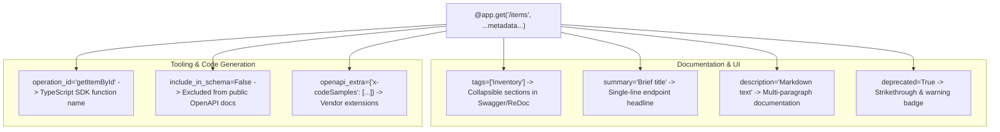
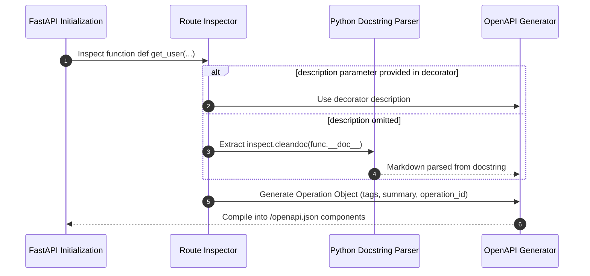

# Path Operation Configuration & Metadata

Path operation decorators in FastAPI are far more than simple route mappers. They accept a rich suite of configuration parameters that dictate how endpoints are registered, documented in the OpenAPI specification, grouped in developer portals, and consumed by automated SDK generators.

Proper configuration transforms an undocumented backend into an interactive, beautifully documented developer platform.

---

## 1. Conceptual Foundation & Mental Model

### The Route Metadata Ecosystem



---

## 2. Architecture & Internal Mechanics



FastAPI automatically parses standard Python triple-quoted function docstrings as Markdown for the endpoint `description` if the parameter is not explicitly provided in the decorator.

---

## 3. Comprehensive Syntax & Core Parameters

### Master Configuration Reference

| Parameter | Type | Default | Purpose |
| :--- | :--- | :--- | :--- |
| `tags` | `list[str \| Enum]` | `None` | Categorizes endpoints into sections in Swagger and ReDoc |
| `summary` | `str` | `None` | Short single-line title for the endpoint (derived from function name if omitted) |
| `description` | `str` | `None` | Detailed Markdown documentation (falls back to Python docstring) |
| `response_description` | `str` | `"Successful Response"` | Description of the 200/201 response in OpenAPI |
| `deprecated` | `bool` | `False` | Flags the route as deprecated in Swagger UI with a strikethrough |
| `operation_id` | `str` | Auto-generated | Unique identifier used by client SDK generators |
| `include_in_schema` | `bool` | `True` | Set to `False` to hide internal or probe routes from documentation |
| `openapi_extra` | `dict[str, Any]` | `None` | Raw dictionary merged directly into the OpenAPI operation specification |

---

## 4. Practical Implementation: 5 Verified Examples

### Example 1: Full Metadata Enrichment with Markdown Docstrings

```python
# enriched_metadata.py
from fastapi import FastAPI, status
from pydantic import BaseModel, Field

app = FastAPI(title="Warehouse Logistics API")

class Item(BaseModel):
    id: int
    name: str
    quantity: int

@app.post(
    "/items",
    response_model=Item,
    status_code=status.HTTP_201_CREATED,
    tags=["Inventory Management"],
    summary="Register a new inventory item",
    response_description="The freshly created inventory entity with assigned serial ID",
)
def create_inventory_item(item: Item) -> Item:
    """
    Register a newly received physical product into warehouse storage.

    ### Architectural Notes:
    - Automatically notifies the **procurement message queue**.
    - Generates a **unique barcode** in warehouse storage.
    - Synchronizes with regional distribution nodes.

    ### Preconditions:
    * `quantity` must be greater than zero.
    * `name` must be registered in the central supplier registry.
    """
    return item
```

### Example 2: Clean SDK Method Naming via `operation_id`

By default, FastAPI generates `operation_id` using the format `function_name_path_method` (e.g. `get_items_items__get`). This creates unwieldy names in generated TypeScript SDKs. You can define exact names:

```python
# sdk_names.py
from fastapi import FastAPI

app = FastAPI()

@app.get("/users/{user_id}", operation_id="getUserById", tags=["Users"])
def get_user(user_id: int) -> dict[str, int]:
    return {"user_id": user_id}

@app.delete("/users/{user_id}", operation_id="deleteUserById", tags=["Users"])
def delete_user(user_id: int) -> dict[str, str]:
    return {"status": "deleted"}
```

Generated TypeScript SDK now yields clean methods:
```typescript
await client.users.getUserById(42);
await client.users.deleteUserById(42);
```

### Example 3: Automatic Global `operation_id` Generator

To avoid manually declaring `operation_id` on hundreds of endpoints, configure a global generator on the `FastAPI` instance:

```python
# global_operation_ids.py
from fastapi import FastAPI
from fastapi.routing import APIRoute

def custom_generate_unique_id(route: APIRoute) -> str:
    # Generates names like 'users_create' or 'items_list'
    tag = route.tags[0] if route.tags else "default"
    return f"{tag}_{route.name}"

app = FastAPI(generate_unique_id_function=custom_generate_unique_id)

@app.get("/products", tags=["products"])
def list_all() -> list[str]:
    # Generated operation_id: "products_list_all"
    return ["keyboard", "monitor"]
```

### Example 4: Hiding Infrastructure Routes with `include_in_schema=False`

Internal Kubernetes probes or operational metrics endpoints should not clutter public API documentation:

```python
# hidden_routes.py
from fastapi import FastAPI

app = FastAPI()

@app.get("/healthz", include_in_schema=False)
def kubernetes_liveness_probe() -> dict[str, str]:
    return {"status": "alive"}

@app.get("/metrics/prometheus", include_in_schema=False)
def internal_metrics() -> str:
    return "# HELP http_requests_total Total HTTP Requests\n"
```

Navigating to `/docs` or `/openapi.json` will show zero traces of `/healthz` or `/metrics/prometheus`.

### Example 5: Injecting OpenAPI Vendor Extensions (`openapi_extra`)

Injecting documentation extensions, code snippets, or rate limit notices:

```python
# openapi_extensions.py
from fastapi import FastAPI

app = FastAPI()

@app.get(
    "/exchange-rates",
    tags=["Financials"],
    openapi_extra={
        "x-rate-limit": "100 requests per minute",
        "x-codeSamples": [
            {
                "lang": "Shell",
                "label": "cURL",
                "source": "curl -X GET https://api.example.com/exchange-rates -H 'Authorization: Bearer KEY'",
            },
            {
                "lang": "Python",
                "label": "Requests",
                "source": "import requests\nres = requests.get('https://api.example.com/exchange-rates')",
            },
        ],
    },
)
def get_rates() -> dict[str, float]:
    return {"EUR_USD": 1.085, "GBP_USD": 1.272}
```

ReDoc natively reads `x-codeSamples` and renders a tabbed interactive code snippet box.

---

## 5. Anti-Patterns & Common Traps

| Anti-Pattern | Why It Fails | Production Fix |
| :--- | :--- | :--- |
| **Omitting `tags` across a large API** | All 100+ endpoints collapse into a giant unstructured "default" category in Swagger UI. | Group endpoints by domain context (`tags=["Billing"]`). |
| **Duplicate `operation_id` strings** | Code generators crash with name collision errors when two endpoints share the same `operation_id`. | Ensure `operation_id` is globally unique. |
| **Putting sensitive architecture details in docstrings** | Public Swagger UI exposes internal server IP addresses, credentials, or architectural vulnerabilities. | Keep docstrings customer-facing; keep internal notes in code comments (`#`). |
| **Forgetting `include_in_schema=False` on health routes** | Public clients attempt to integrate against internal monitoring endpoints. | Hide internal infrastructure routes. |
| **Writing descriptions in decorator instead of docstrings** | Decorator strings cannot easily span multiple formatted paragraphs. | Write Markdown directly inside standard Python docstrings. |

---

## 6. Performance & Resource Characteristics

- **Zero Runtime Overhead**: Route metadata is evaluated once during application startup when `openapi.json` is generated. It introduces 0.00ms latency to incoming HTTP requests.
- **Payload Footprint**: Extensive docstrings increase the size of `/openapi.json`. For large APIs with 500+ endpoints, compress the schema using `GZipMiddleware`.

---

## 7. Edge Cases, Failure Modes & Gotchas

1. **Tag Enum Support**: You can pass standard Python `Enum` values to `tags` (e.g. `tags=[APITags.USERS]`). FastAPI automatically resolves `.value` to string.
2. **Missing Function Docstring Indentation**: In multiline docstrings, inconsistent indentation can cause Markdown code blocks to render incorrectly in Swagger UI. Ensure consistent 4-space indentation.

---

## 8. Security Implications & OWASP Alignment

- **OWASP API9:2023 - Improper Inventory Management**: Accurately marking old versions with `deprecated=True` signals clients to migrate away from legacy contracts before retirement.
- **Accidental Route Disclosure**: Ensure administrative internal routes (`/admin/reset-database`) are either completely hidden (`include_in_schema=False`) or segregated onto an internal network port.

---

## 9. Modern Tooling Integration

- **ReDoc & Scalar Visuals**: Rich Markdown docstrings render bulleted lists, bold text, tables, and LaTeX math cleanly in ReDoc and Scalar documentation consoles.

---

## 10. Real-World Case Study: Production Incident

### The Incident
A SaaS company released a major version of their public TypeScript SDK. Immediately, hundreds of developer issues poured in: method calls like `api.get_users()` were failing at runtime because the generated method name in TypeScript had silently changed to `api.get_users_api_v1_users__get()`.

### The Root Cause
A developer refactored the router prefix from `/v1/users` to `/api/v1/users`. Because `operation_id` was auto-generated by FastAPI based on the full path, every single SDK function name changed, breaking all customer code across production.

### The Resolution
Configured a deterministic `generate_unique_id_function`:
```python
def deterministic_id(route: APIRoute) -> str:
    return f"{route.tags[0]}_{route.name}"

app = FastAPI(generate_unique_id_function=deterministic_id)
```
SDK method names remained locked to `users.list_users`, completely immune to URL path refactorings.

---

## 11. Hands-On Exercises & Challenge Problems

### Warm-Up Exercises
1. **Markdown Docstring Formatting**: Create an endpoint with a multi-line docstring containing Markdown headings, bullet points, and a fenced code block. Verify its appearance in `/docs`.
2. **Deprecated Badge**: Add `deprecated=True` to an endpoint and observe the visual strikethrough in Swagger UI.

### Intermediate Challenges
3. **Enum-Based Tags**: Create an `Enum` named `RouteTag` containing `AUTH`, `PAYMENTS`, and `ADMIN`. Use the enum to tag 3 separate routes.
4. **Unique ID Function**: Implement a custom `generate_unique_id_function` that strips the `api_` prefix from function names to produce clean operation IDs.

### Production-Grade Challenges
5. **Vendor Extension Code Sample Generator**: Build a decorator helper that automatically generates `x-codeSamples` containing cURL and Python requests snippets and injects them via `openapi_extra`.
6. **OpenAPI Tag Order & Metadata Customizer**: Define `openapi_tags` with custom descriptions and external documentation URLs, and verify that the sections appear in the exact configured sequence in Swagger UI.

---

## 12. Interview Mastery: Deep-Dive Questions & Answers

#### Q1: What is the difference between `summary` and `description` in path operation decorators?
**Answer**: `summary` is a brief, single-line headline describing what the endpoint does (e.g. "Create User"). `description` provides a comprehensive, multi-paragraph Markdown explanation of the endpoint's behavior, preconditions, error scenarios, and business rules. If `description` is omitted, FastAPI automatically extracts the function's Python docstring.

#### Q2: What is the purpose of `operation_id` in FastAPI?
**Answer**: The `operation_id` is a unique string identifying the operation across the entire OpenAPI specification. Automated client SDK generators (like `openapi-generator` or `openapi-typescript`) use the `operation_id` as the exact name of the generated client method.

#### Q3: How do you hide an endpoint from the Swagger documentation while keeping it accessible over the network?
**Answer**: Set `include_in_schema=False` in the path operation decorator:
```python
@app.get("/health", include_in_schema=False)
def health_check(): ...
```

#### Q4: How does FastAPI extract the `description` if it is not provided in the decorator?
**Answer**: FastAPI inspects the Python function's docstring (`func.__doc__`) using `inspect.cleandoc()`. It parses the docstring as Markdown and renders it directly in Swagger UI and ReDoc.

#### Q5: What does `deprecated=True` do to a path operation?
**Answer**: It sets `"deprecated": true` in the OpenAPI operation schema. Swagger UI visualizes this with a strikethrough line across the endpoint and displays a prominent "Deprecated" warning label.

#### Q6: How do you ensure that `operation_id` values remain stable across URL path refactorings?
**Answer**: By configuring `generate_unique_id_function` on the `FastAPI` instance to derive the ID strictly from the function name and tag (e.g. `f"{tag}_{route.name}"`), rather than including the variable URL path string.

#### Q7: What is `openapi_extra` used for?
**Answer**: `openapi_extra` allows developers to pass an arbitrary dictionary of OpenAPI fields that are merged directly into the generated path operation JSON schema. It is commonly used to inject vendor extensions (like `x-codeSamples` or `x-rate-limit`) that are supported by tools like ReDoc.

#### Q8: Can Python Enums be used for route `tags`?
**Answer**: Yes. Passing an `Enum` or list of `Enum` instances to `tags` is fully supported. FastAPI extracts the underlying string values (`enum.value`) for the OpenAPI specification.
