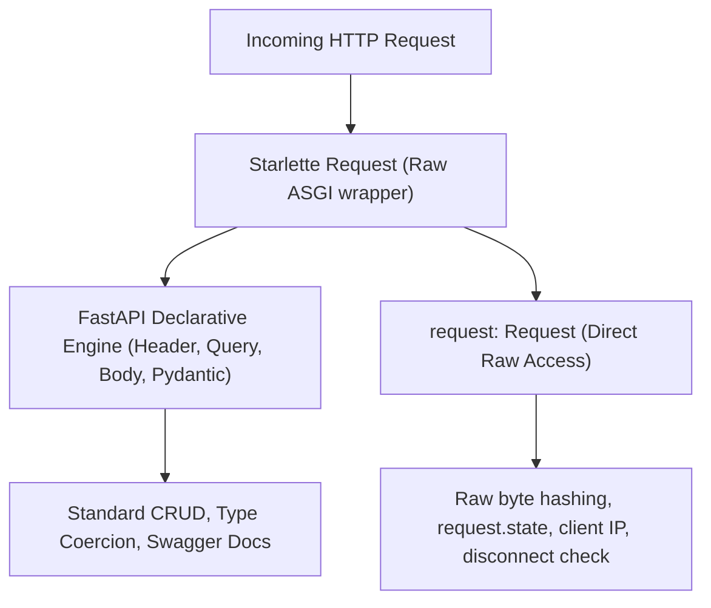
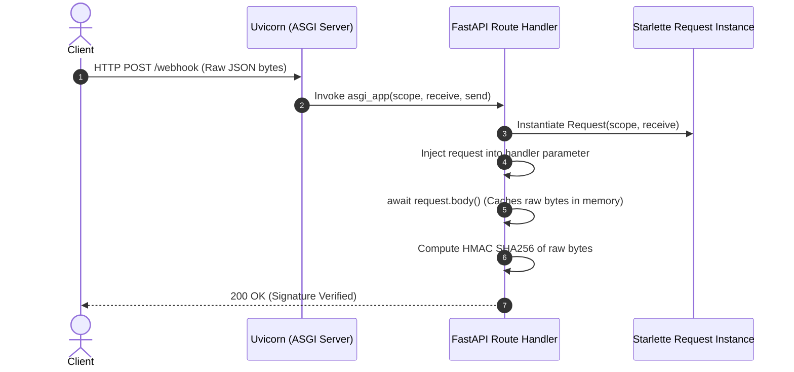

# Direct Request Object Access

While FastAPI's declarative signature parameters (`Query`, `Path`, `Header`, `Body`) cover 95% of standard API engineering requirements, specific low-level operations—such as calculating HMAC request signatures, detecting premature client disconnections, accessing arbitrary ASGI scope attributes, or streaming raw binary streams—require direct access to the underlying **`starlette.requests.Request`** object.

---

## 1. Conceptual Foundation & Mental Model

### High-Level Declarations vs Low-Level Raw Access



- **Use Declarative Parameters (`Header`, `Query`, `Body`)**: When building standard REST endpoints. They provide automatic OpenAPI documentation, schema validation, and type coercion.
- **Use `request: Request` Directly**: When you need raw unparsed bytes (e.g. Stripe webhook HMAC verification), custom middleware state (`request.state.tenant_id`), connection socket metadata (`request.client`), or raw ASGI stream generators.

---

## 2. Architecture & Internal Mechanics



### Body Caching in `Request`
When you call `await request.body()`, Starlette streams the chunks from the ASGI `receive` callable and caches the resulting bytes in `request._body`. Subsequent calls to `await request.body()` return the cached bytes immediately, allowing both signature verification and Pydantic parsing on the same request.

---

## 3. Comprehensive Syntax & Core Attributes

### Master `Request` API Reference

| Attribute / Method | Return Type | Description |
| :--- | :--- | :--- |
| `request.method` | `str` | HTTP method (e.g. `"GET"`, `"POST"`) |
| `request.url` | `URL` | Full parsed URL object (`path`, `query`, `scheme`, `port`) |
| `request.headers` | `Headers` | Case-insensitive multi-dict of incoming HTTP headers |
| `request.query_params` | `QueryParams` | Multi-dict of query string parameters |
| `request.cookies` | `dict[str, str]` | Dictionary of parsed cookies |
| `request.client` | `Address \| None` | Named tuple containing client `host` (IP) and `port` |
| `request.state` | `State` | Arbitrary storage bag for request-scoped middleware data |
| `request.scope` | `dict[str, Any]` | Raw underlying ASGI scope dictionary |
| `await request.body()` | `bytes` | Full raw body bytes (cached after first read) |
| `request.stream()` | `AsyncIterator[bytes]`| Async generator streaming body chunks without buffering |
| `await request.is_disconnected()`| `bool` | Polls ASGI channel to check if client aborted the connection |

---

## 4. Practical Implementation: 5 Verified Examples

### Example 1: Webhook HMAC Signature Verification (Stripe / GitHub Style)

Cryptographic signature verification requires the exact raw byte sequence received over the wire before any JSON parsing or whitespace alterations occur:

```python
# webhook_hmac.py
import hmac
import hashlib
from fastapi import FastAPI, Request, HTTPException, status

app = FastAPI()
WEBHOOK_SECRET = b"production-signing-secret-key-321"

@app.post("/webhooks/payments")
async def handle_payment_webhook(request: Request) -> dict[str, str]:
    # 1. Extract signature header
    signature = request.headers.get("X-Signature-SHA256")
    if not signature:
        raise HTTPException(
            status_code=status.HTTP_400_BAD_REQUEST,
            detail="Missing X-Signature-SHA256 header",
        )

    # 2. Read exact raw byte stream
    raw_body = await request.body()

    # 3. Compute expected HMAC hash
    computed_signature = hmac.new(
        WEBHOOK_SECRET,
        raw_body,
        hashlib.sha256,
    ).hexdigest()

    # 4. Constant-time comparison to prevent timing attacks
    if not hmac.compare_digest(computed_signature, signature):
        raise HTTPException(
            status_code=status.HTTP_401_UNAUTHORIZED,
            detail="Invalid cryptographic signature",
        )

    # 5. Parse JSON safely now that payload authenticity is guaranteed
    payload = await request.json()
    return {"status": "verified", "event_id": payload.get("id", "unknown")}
```

### Example 2: Client IP Address & Geolocation Tracking

Safely reading the client IP address behind reverse proxies:

```python
# client_ip.py
from fastapi import FastAPI, Request

app = FastAPI()

def get_real_client_ip(request: Request) -> str:
    # 1. Check standard proxy headers (if behind ALB or Cloudflare)
    x_forwarded_for = request.headers.get("X-Forwarded-For")
    if x_forwarded_for:
        # First IP in the list represents the original client
        return x_forwarded_for.split(",")[0].strip()
    
    # 2. Fall back to socket client host
    if request.client:
        return request.client.host
    return "unknown"

@app.get("/client-info")
async def client_info(request: Request) -> dict[str, str | int]:
    client_ip = get_real_client_ip(request)
    user_agent = request.headers.get("User-Agent", "unknown")
    return {
        "client_ip": client_ip,
        "user_agent": user_agent,
        "method": request.method,
        "url_path": request.url.path,
    }
```

### Example 3: Sharing Request-Scoped Context via `request.state`

Middleware can enrich `request.state` with tenant or user data for downstream handlers:

```python
# request_state.py
import time
from starlette.middleware.base import BaseHTTPMiddleware, RequestResponseEndpoint
from starlette.requests import Request
from starlette.responses import Response
from fastapi import FastAPI

app = FastAPI()

class TenantContextMiddleware(BaseHTTPMiddleware):
    async def dispatch(self, request: Request, call_next: RequestResponseEndpoint) -> Response:
        # Extract custom subdomain or header
        tenant_id = request.headers.get("X-Tenant-ID", "default-tenant")
        # Store in request.state bag
        request.state.tenant_id = tenant_id
        request.state.request_start = time.perf_counter()
        
        response = await call_next(request)
        return response

app.add_middleware(TenantContextMiddleware)

@app.get("/tenant/dashboard")
async def get_dashboard(request: Request) -> dict[str, str]:
    # Access state attached by upstream middleware
    active_tenant = getattr(request.state, "tenant_id", "none")
    return {"tenant": active_tenant, "status": "active"}
```

### Example 4: Premature Client Disconnection Detection

Aborting expensive database queries or ML inference jobs if the user cancels or closes the browser tab:

```python
# disconnect_guard.py
import asyncio
from fastapi import FastAPI, Request, HTTPException, status

app = FastAPI()

@app.get("/heavy-ai-inference")
async def heavy_inference(request: Request) -> dict[str, str]:
    print("Starting multi-stage neural computation...")
    
    for step in range(1, 6):
        # Check if client has disconnected before starting the next heavy computation
        if await request.is_disconnected():
            print(f"Client disconnected at step {step}! Aborting inference...")
            return {"status": "aborted"}
            
        await asyncio.sleep(1.0)  # Simulating computation
        print(f"Completed step {step}/5")

    return {"status": "completed", "result": "Model output"}
```

### Example 5: Streaming Raw Request Bodies Without Buffering

Processing massive incoming data streams without holding the entire payload in RAM:

```python
# raw_streaming.py
from fastapi import FastAPI, Request, status

app = FastAPI()

@app.post("/stream-consumer", status_code=status.HTTP_202_ACCEPTED)
async def consume_raw_stream(request: Request) -> dict[str, int]:
    total_bytes = 0
    chunk_count = 0

    # Stream chunks asynchronously directly from the ASGI receive channel
    async for chunk in request.stream():
        chunk_count += 1
        total_bytes += len(chunk)
        # Process chunk (e.g. stream to S3 or write to disk)

    return {"total_bytes_received": total_bytes, "chunks_processed": chunk_count}
```

---

## 5. Anti-Patterns & Common Traps

| Anti-Pattern | Why It Fails | Production Fix |
| :--- | :--- | :--- |
| **Using `request.query_params` for typed parameters** | Bypasses Pydantic validation, type coercion, and OpenAPI documentation generation. | Use declarative `Annotated[int, Query(...)]` parameters. |
| **Reading `request.stream()` after `await request.body()`** | Calling `stream()` after `body()` has already consumed the stream can raise an error or return empty chunks. | Choose either `await request.body()` for buffered access or `request.stream()` for streaming. |
| **Relying blindly on `request.client.host` behind Nginx** | Returns the internal reverse proxy IP (`127.0.0.1` or `10.0.0.x`) instead of the true client IP. | Parse `X-Forwarded-For` with `--proxy-headers` enabled. |
| **Mutating `request.scope` directly** | Mutating low-level ASGI scope keys unexpectedly can break downstream Starlette middleware. | Store custom request data inside `request.state`. |
| **Calling `await request.json()` without error handling** | If client sends invalid JSON, raises `JSONDecodeError` resulting in an unhandled 500 error instead of a clean 400. | Let FastAPI's declarative Pydantic body handling parse JSON automatically. |

---

## 6. Performance & Resource Characteristics

- **Body Caching Memory Footprint**: `await request.body()` buffers the entire incoming payload in memory. If a client sends a 500MB payload, `request.body()` consumes 500MB of RAM. For large payloads, use `UploadFile` or `request.stream()`.
- **Disconnect Polling**: Calling `await request.is_disconnected()` performs an immediate non-blocking poll of the ASGI receive queue, completing in under 2 microseconds.

---

## 7. Edge Cases, Failure Modes & Gotchas

1. **State Isolation**: Attributes set on `request.state` exist strictly for the lifespan of that specific HTTP request. They are discarded once the response is sent and are completely isolated from other concurrent requests.
2. **Missing `request.client`**: In Unix domain socket (UDS) deployments, `request.client` can be `None`. Always check `if request.client:` before reading `host`.

---

## 8. Security Implications & OWASP Alignment

- **Timing Attacks on Signature Checks**: Never compare cryptographic signatures using standard equality (`sig1 == sig2`). Python string comparisons short-circuit on the first mismatched character, allowing attackers to deduce signatures via microsecond timing differences. Always use `hmac.compare_digest()`.
- **IP Spoofing via `X-Forwarded-For`**: Attackers can send arbitrary `X-Forwarded-For: 1.1.1.1` headers. Only trust `X-Forwarded-For` if your application is deployed behind a trusted reverse proxy that strips untrusted upstream headers.

---

## 9. Modern Tooling Integration

- **OpenAPI Documentation Note**: Endpoints that only declare `request: Request` without Pydantic models will appear in OpenAPI documentation without request body schemas. If documentation is needed alongside raw access, declare both:
```python
@app.post("/items")
async def create(item: Item, request: Request): ...
```

---

## 10. Real-World Case Study: Production Incident

### The Incident
A SaaS billing service integrated with Stripe webhooks began failing randomly under load, returning `401 Unauthorized` on 10% of webhook events and failing to activate paid customer subscriptions.

### The Root Cause
The developers used Pydantic models to validate the incoming webhook:
```python
@app.post("/webhook")
async def stripe_webhook(payload: StripeEvent, request: Request):
    # Re-serializing parsed Pydantic model to JSON string for HMAC check:
    serialized_str = payload.model_dump_json()
    verify_signature(serialized_str.encode(), request.headers.get("Stripe-Signature"))
```
When Pydantic re-serialized the model to JSON, key ordering and float formatting slightly differed from the exact byte stream transmitted by Stripe (e.g. `10.0` vs `10`). Because HMAC hashes change entirely with a single altered bit, the signature check failed intermittently.

### The Resolution
Updated the webhook handler to read raw wire bytes directly before any parsing:
```python
@app.post("/webhook")
async def stripe_webhook(request: Request):
    raw_body = await request.body()
    stripe.Webhook.construct_event(
        raw_body, request.headers.get("Stripe-Signature"), WEBHOOK_SECRET
    )
```
Signature verification restored 100% reliability.

---

## 11. Hands-On Exercises & Challenge Problems

### Warm-Up Exercises
1. **Raw Scope Inspector**: Build an endpoint that inspects `request.scope` and returns a list of all available ASGI scope keys.
2. **Client Header Reflector**: Write a route that reads `request.headers` and returns all headers starting with `X-` back to the client.

### Intermediate Challenges
3. **HMAC SHA-256 Verifier**: Create an endpoint `/secure-ingest` that validates an `X-Signature` header against the raw request body using `hmac.compare_digest`. Test with python `requests` or `curl`.
4. **Client Disconnect Simulator**: Implement a route with a 10-second loop. Send a request using `curl`, press `Ctrl+C` after 2 seconds, and observe the server log confirming the client disconnected.

### Production-Grade Challenges
5. **Raw Stream File Sink**: Implement an endpoint that streams incoming bytes via `request.stream()` directly into a temporary file on disk in 64KB chunks without ever loading the full body into memory.
6. **Multi-Tenant State Middleware**: Build a middleware that extracts an account ID from JWT or subdomain, stores a database connection pool handle in `request.state.db`, and access it from within a path operation.

---

## 12. Interview Mastery: Deep-Dive Questions & Answers

#### Q1: When should you use `request: Request` instead of FastAPI's declarative parameters?
**Answer**: Use `request: Request` when you need access to low-level HTTP/ASGI primitives that declarative parameters do not expose:
1. Accessing raw unparsed body bytes for HMAC cryptographic signature verification (e.g. webhooks).
2. Checking connection socket status (`await request.is_disconnected()`).
3. Reading or writing custom request-scoped data attached by middleware (`request.state`).
4. Streaming raw bytes chunk-by-chunk without loading the entire payload into RAM (`request.stream()`).

#### Q2: What happens if you call `await request.body()` multiple times within the same request?
**Answer**: Starlette caches the raw body bytes in memory (`request._body`) after the first read. Subsequent calls to `await request.body()` return the cached bytes immediately without reading from the ASGI channel again.

#### Q3: How do you detect if a client has closed the connection before an async handler finishes?
**Answer**: Call `await request.is_disconnected()`. This checks the incoming ASGI event channel for an `http.disconnect` event. If `True`, the handler can abort long-running database queries, ML inferences, or background tasks to conserve server resources.

#### Q4: Why is it dangerous to re-serialize a Pydantic model to verify webhook HMAC signatures?
**Answer**: Re-serializing a parsed model to JSON can alter whitespace, key ordering, number formatting (e.g. `10.0` vs `10`), or escape sequences. Because cryptographic hash functions (HMAC-SHA256) are avalanche-sensitive, any byte-level discrepancy between the re-serialized JSON and the original wire payload will cause signature validation to fail. Signatures must always be verified against the exact raw bytes (`await request.body()`).

#### Q5: What is `request.state` and what is its typical use case?
**Answer**: `request.state` is a dynamic storage object (`starlette.datastructures.State`) scoped strictly to a single request lifecycle. It is primarily used by middleware to attach shared context (such as the authenticated user ID, tenant ID, request correlation ID, or start timestamp) so that downstream route handlers and dependencies can access it.

#### Q6: How can you safely extract the real client IP address when your FastAPI app is deployed behind a reverse proxy?
**Answer**: Inspect the `X-Forwarded-For` header. The first IP address in the comma-separated list represents the original client. Ensure your ASGI server is started with `--proxy-headers` and your reverse proxy (e.g. Nginx or AWS ALB) is configured to overwrite untrusted incoming `X-Forwarded-For` headers from the public internet.

#### Q7: Can you use both `request: Request` and a Pydantic model in the same path operation function?
**Answer**: Yes. You can declare both parameters in the signature:
```python
@app.post("/items")
async def create_item(item: ItemCreate, request: Request): ...
```
FastAPI parses and validates the JSON body into `item` while making `request` available for raw header, state, or client IP inspections.

#### Q8: What is the difference between `await request.body()` and `request.stream()`?
**Answer**: `await request.body()` reads the entire incoming payload into memory and returns a single `bytes` object. `request.stream()` returns an asynchronous iterator that yields byte chunks as they arrive from the network, enabling memory-efficient streaming of large payloads directly to disk or cloud storage.
