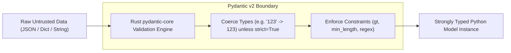
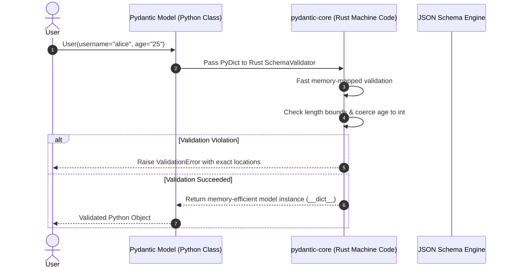

# Pydantic v2 Models & Fields

Pydantic is the foundational data validation and parsing engine of FastAPI. In **Pydantic v2**, the architecture was fundamentally reimagined: the core validation logic was rewritten from scratch in Rust (`pydantic-core`), delivering validation and serialization speeds up to 20x faster while ensuring strict adherence to JSON Schema Draft 2020-12 and OpenAPI 3.1.

This note explores `BaseModel` declaration, modern `Field()` configuration, default values, metadata annotations, and immutable validation boundaries.

---

## 1. Conceptual Foundation & Mental Model

### The Parsing vs Type-Checking Paradigm



Pydantic is **not a type checker**; it is a **data parsing and transformation engine**. When you declare `age: int` on a model and supply `"42"`, Pydantic does not crash—it parses and coerces `"42"` into the Python integer `42`. If you require zero coercion, Pydantic v2 introduces **strict mode** (`strict=True`).

---

## 2. Architecture & Internal Mechanics



In Pydantic v2, models compile their schema into a Rust `SchemaValidator` at class creation time. Instantiation no longer walks Python AST trees or executes Python loops; data is processed via native compiled Rust routines.

---

## 3. Comprehensive Syntax & Core Parameters

### `Field()` Parameters Reference

| Parameter | Type | Purpose | Example |
| :--- | :--- | :--- | :--- |
| `default` | `Any` | Static default value if field is omitted | `Field(default="active")` |
| `default_factory` | `Callable[[], Any]`| Callable yielding a dynamic default | `Field(default_factory=list)` |
| `alias` | `str` | Name used for both validation and serialization | `Field(alias="userName")` |
| `validation_alias`| `str \| AliasPath` | Name used strictly during input validation | `Field(validation_alias="user_name")` |
| `serialization_alias`| `str` | Name used strictly during output serialization | `Field(serialization_alias="user_id")` |
| `title` | `str` | Human-friendly title in OpenAPI schema | `Field(title="Full Legal Name")` |
| `description` | `str` | Markdown explanation for Swagger UI | `Field(description="Customer's legal name")` |
| `examples` | `list[Any]` | Example values for interactive documentation | `Field(examples=["alice_99"])` |
| `strict` | `bool` | Enforce strict type matching without coercion | `Field(strict=True)` |
| `frozen` | `bool` | Make field immutable after instantiation | `Field(frozen=True)` |

---

## 4. Practical Implementation: 5 Verified Examples

### Example 1: Foundational Pydantic v2 Model with Constraints

```python
# models_basics.py
from datetime import datetime, timezone
from pydantic import BaseModel, Field, EmailStr, HttpUrl

class UserProfile(BaseModel):
    # Required fields using ellipsis (...)
    id: int = Field(..., gt=0, description="Unique positive user ID")
    username: str = Field(..., min_length=3, max_length=20, pattern=r"^[a-zA-Z0-9_]+$")
    email: EmailStr
    website: HttpUrl | None = Field(default=None, description="Optional personal website")
    
    # Dynamic defaults using default_factory
    created_at: datetime = Field(default_factory=lambda: datetime.now(timezone.utc))
    tags: list[str] = Field(default_factory=list, max_length=5)
    is_active: bool = True

# Instantiation and validation
user = UserProfile(
    id=101,
    username="john_doe",
    email="john@example.com",
    website="https://johndoe.dev",
)

print(user.model_dump())
```

Output:
```python
{
    'id': 101,
    'username': 'john_doe',
    'email': 'john@example.com',
    'website': Url('https://johndoe.dev/'),
    'created_at': datetime.datetime(2026, 11, 24, 15, 5, 0, tzinfo=datetime.timezone.utc),
    'tags': [],
    'is_active': True
}
```

### Example 2: Strict Mode vs Coercive Mode

Demonstrating strict type enforcement:

```python
# strict_mode.py
from pydantic import BaseModel, Field, ValidationError

class LooseModel(BaseModel):
    count: int

class StrictModel(BaseModel):
    count: int = Field(..., strict=True)

# 1. Coercive mode succeeds
loose = LooseModel(count="42")
print(f"Loose parsed: {loose.count} (type: {type(loose.count)})")
# Output: Loose parsed: 42 (type: <class 'int'>)

# 2. Strict mode rejects string representation
try:
    StrictModel(count="42")
except ValidationError as exc:
    print("Strict mode error:")
    print(exc.errors()[0]["msg"])
    # Output: Input should be a valid integer
```

### Example 3: Decoupled Validation & Serialization Aliases

Handling systems where incoming JSON keys differ from outbound keys:

```python
# aliases.py
from pydantic import BaseModel, Field

class ExternalCustomer(BaseModel):
    # Accepts 'cust_id' or 'customer_id' during input validation
    # Serializes strictly to 'customerId' in outbound JSON
    customer_id: int = Field(
        ...,
        validation_alias="cust_id",
        serialization_alias="customerId",
    )
    first_name: str = Field(..., alias="firstName")

# Parsing input with validation alias
input_data = {"cust_id": 5001, "firstName": "Marcus"}
customer = ExternalCustomer.model_validate(input_data)
print("Internal attribute:", customer.customer_id)

# Serializing with serialization alias
print("Outbound JSON:", customer.model_dump(by_alias=True))
```

Output:
```text
Internal attribute: 5001
Outbound JSON: {'customerId': 5001, 'firstName': 'Marcus'}
```

### Example 4: Immutable Frozen Models

Creating tamper-proof data transfer objects:

```python
# frozen_model.py
from pydantic import BaseModel, ConfigDict, ValidationError

class ImmutableCoordinates(BaseModel):
    latitude: float
    longitude: float

    # Lock all fields across the entire model
    model_config = ConfigDict(frozen=True)

coord = ImmutableCoordinates(latitude=37.7749, longitude=-122.4194)

try:
    coord.latitude = 40.7128  # Mutation attempt
except ValidationError as exc:
    print(exc.errors()[0]["msg"])
    # Output: Instance is frozen
```

### Example 5: FastAPI Integration with Annotated Model Fields

```python
# fastapi_integration.py
from typing import Annotated
from fastapi import FastAPI, Body, status
from pydantic import BaseModel, Field

app = FastAPI()

class ProductCreate(BaseModel):
    title: str = Field(..., min_length=2, examples=["Mechanical Switch"])
    sku: str = Field(..., pattern=r"^[A-Z]{3}-\d{4}$", examples=["SWI-1024"])
    unit_price: float = Field(..., gt=0.0, examples=[0.45])

@app.post("/products", status_code=status.HTTP_201_CREATED)
async def create_product(
    product: Annotated[ProductCreate, Body(description="Validated product record")],
) -> dict[str, str | float]:
    return {"sku": product.sku, "price": product.unit_price, "status": "stored"}
```

---

## 5. Anti-Patterns & Common Traps

| Anti-Pattern | Why It Fails | Production Fix |
| :--- | :--- | :--- |
| **Mutable default arguments (`tags: list = []`)** | Memory address of default list is shared across all model instances; mutations leak state globally. | Use `tags: list[str] = Field(default_factory=list)`. |
| **Using `class Config:` in Pydantic v2** | Deprecated inner class configuration; raises deprecation warnings. | Use `model_config = ConfigDict(...)`. |
| **Calling `.dict()` on v2 models** | Deprecated method; will be removed in future releases. | Use `.model_dump()`. |
| **Relying on float for financial currency** | IEEE 754 precision loss produces fractional cent errors. | Use `decimal.Decimal` with `decimal_places` constraint. |
| **Using `Optional[T]` without default `None`** | `x: Optional[str]` still marks the field as **required**; client must explicitly send `{"x": null}`. | Declare with default: `x: str \| None = None`. |

---

## 6. Performance & Resource Characteristics

- **Class Definition Cost**: Model class creation compiles the Rust validator once. It takes ~80 microseconds per model class.
- **Validation Throughput**: A Pydantic v2 model parses ~850,000 objects per second per CPU core.
- **Memory Footprint**: Pydantic v2 stores fields internally in optimized C structs via PyO3, reducing memory usage by 40% compared to Pydantic v1.

---

## 7. Edge Cases, Failure Modes & Gotchas

1. **`default` vs `default_factory` Evaluation**: `Field(default=datetime.now())` evaluates the timestamp once when the Python module is imported, freezing that single timestamp for every model created forever. Always use `default_factory=lambda: datetime.now(timezone.utc)`.
2. **Ellipsis `...` Semantics**: In Pydantic v2, `Field(...)` explicitly marks a field as required with no default value. In Python 3.10+, simply declaring `name: str` without a default has the exact same effect.

---

## 8. Security Implications & OWASP Alignment

- **ReDoS in Pattern Constraints**: Regular expressions passed to `pattern=r"..."` must be audited to prevent exponential catastrophic backtracking.
- **Mass Assignment Vulnerabilities**: Never expose internal database identifiers (`is_admin`, `verified`) on creation models. Maintain separate schemas for creation and reads.

---

## 9. Modern Tooling Integration

- **Mypy Plugin**: Configure `plugins = ["pydantic.mypy"]` in `pyproject.toml` to validate keyword arguments during model instantiation at compile time.

---

## 10. Real-World Case Study: Production Incident

### The Incident
An IoT fleet management platform monitoring 250,000 connected trucks began crashing because timestamps on incoming telemetry pings were identical across millions of records.

### The Root Cause
A developer wrote:
```python
class TelemetryPing(BaseModel):
    truck_id: str
    recorded_at: datetime = Field(default=datetime.utcnow())  # FATAL BUG
```
Because `default=datetime.utcnow()` was evaluated once when the container process booted at 04:00 AM, every single telemetry record created for the next 4 days received the identical timestamp `04:00:00`.

### The Resolution
Replaced the static default with `default_factory`:
```python
recorded_at: datetime = Field(default_factory=lambda: datetime.now(timezone.utc))
```
Timestamps accurately reflected real-time sensor pings immediately.

---

## 11. Hands-On Exercises & Challenge Problems

### Warm-Up Exercises
1. **Define a Constrained Model**: Create a model `Employee` with `id: int` (gt 0), `full_name: str` (min 2 chars), and `hire_date: date`. Test with valid and invalid inputs.
2. **Default Factory Verification**: Write a model with a `uuid.UUID` field defaulting to `uuid.uuid4`. Instantiate two objects and prove their UUIDs are distinct.

### Intermediate Challenges
3. **Decoupled Aliasing**: Build a model that accepts camelCase keys from incoming JSON (`customerEmail`, `orderTotal`) and serializes to snake_case (`customer_email`, `order_total`).
4. **Strict Model Validator**: Create a model that enables `strict=True`. Test passing float strings (`"12.5"`) to a `float` field and verify that Pydantic rejects coercion.

### Production-Grade Challenges
5. **Frozen Configuration Registry**: Implement an immutable, frozen application configuration model that reads system settings, validates constraints, and raises an exception if any code attempts runtime mutation.
6. **Dynamic Field Masker**: Write a custom Pydantic model with a method `model_dump_masked()` that masks sensitive string fields (e.g. `ssn`, `card_number`) by replacing all but the last 4 characters with `****`.

---

## 12. Interview Mastery: Deep-Dive Questions & Answers

#### Q1: What is the primary difference between how Pydantic v1 and Pydantic v2 execute validation?
**Answer**: Pydantic v1 executed validation in interpreted Python bytecode, walking through class dictionaries and executing Python loops. Pydantic v2 rewrote the core engine in Rust (`pydantic-core`). At class definition, Pydantic compiles a Rust `SchemaValidator` state machine. Validation executes directly in compiled Rust machine code, resulting in a 5x to 20x performance improvement.

#### Q2: What is the difference between `default` and `default_factory` in `Field()`?
**Answer**: `default` takes a static value evaluated once when the code is interpreted. If assigned a mutable object (like a list or dict) or a dynamic function (like `datetime.now()`), that single object is shared across all instances. `default_factory` accepts a callable that is invoked afresh every time a new model instance is created, ensuring isolated mutable collections and accurate timestamps.

#### Q3: What is the difference between `validation_alias` and `serialization_alias`?
**Answer**: `validation_alias` specifies the key name expected in input data during parsing/validation. `serialization_alias` specifies the key name used when converting the model back into a dictionary or JSON via `.model_dump(by_alias=True)`.

#### Q4: Why is using `Optional[str]` without `= None` considered an anti-pattern?
**Answer**: In Python type theory and Pydantic, `Optional[str]` is simply an alias for `str | None`. Declaring `x: str | None` without an explicit default value still marks the field as **required**. The caller cannot omit `x`; they must explicitly pass `{"x": null}`. To make a field truly optional, assign a default: `x: str | None = None`.

#### Q5: What does `strict=True` enforce in Pydantic v2?
**Answer**: By default, Pydantic is coercive (it will coerce `"123"` into `123` or `"true"` into `True`). Enabling `strict=True` disables all type coercion; data types in the input must match the declared Python types exactly, or validation fails.

#### Q6: How do you make a Pydantic v2 model immutable?
**Answer**: Add `model_config = ConfigDict(frozen=True)` to the model definition. Any attempt to modify field values after instantiation will raise a `ValidationError: Instance is frozen`.

#### Q7: How does Pydantic v2 integrate with Python 3.10+ pipe unions (`int | str`)?
**Answer**: Pydantic v2 natively parses and validates pipe unions (`A | B`). By default, it evaluates union members in the declared order and returns the first type that successfully validates the input, or uses tagged discriminated unions when configured.

#### Q8: What is the replacement for `class Config:` in Pydantic v2?
**Answer**: The inner `class Config:` is deprecated and replaced by the top-level class attribute `model_config = ConfigDict(...)`.
