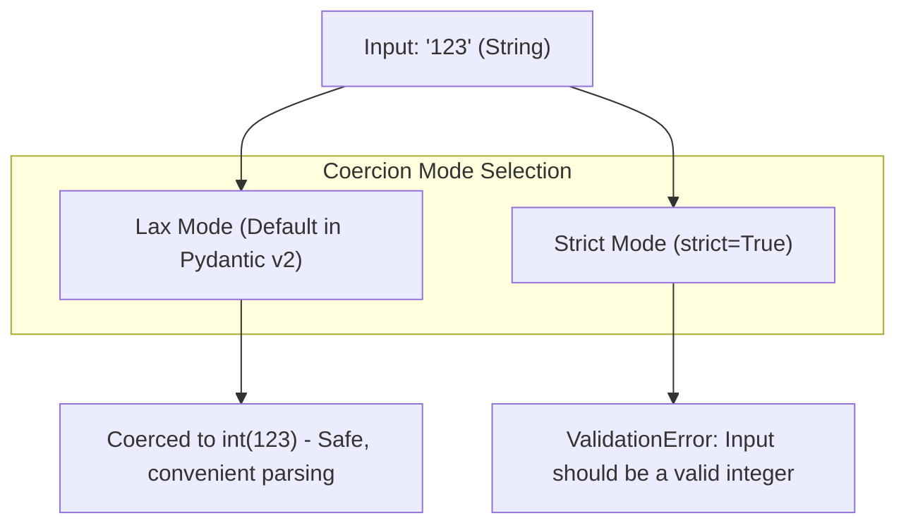
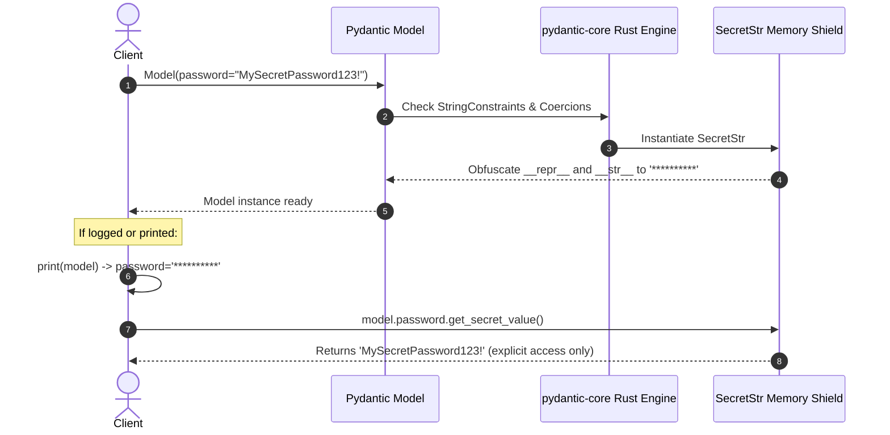

# Data Types & Type Coercion in Pydantic v2

Pydantic's core philosophy centers on **parsing, not just validating**. When untrusted data enters an application from web requests, environment variables, or CLI flags, it often arrives as raw strings. 

Pydantic v2 uses a sophisticated, predictable type coercion engine implemented in Rust (`pydantic-core`) that automatically converts wire formats into rich, strongly typed Python primitives and specialized safety wrappers (like **`SecretStr`**, **`EmailStr`**, and **`HttpUrl`**).

---

## 1. Conceptual Foundation & Mental Model

### The Coercion Spectrum: Lax vs Strict



### Lossless vs Lossy Coercion Rules
- **Permitted (Lossless) Coercions**:
  - `str -> int` if the string contains only base-10 digits (e.g. `"42"` -> `42`).
  - `int -> float` (e.g. `10` -> `10.0`).
  - `str -> bool` (e.g. `"true"`, `"yes"`, `"1"` -> `True`).
- **Forbidden (Lossy) Coercions in v2**:
  - `float -> int` where precision would be lost (e.g. `42.9` -> raises `ValidationError`, unlike v1 which silently truncated to `42`).
  - Arbitrary objects to string unless explicitly parsed.

---

## 2. Architecture & Internal Mechanics



Specialized types like `SecretStr` encapsulate raw credentials inside a protective Python object that overrides `__repr__` and `__str__`. If an engineer logs the model or an exception triggers a dump, credentials are masked, preventing secret leakage in production log aggregators.

---

## 3. Comprehensive Specialized Types Reference

| Pydantic Type | Purpose & Validation Rules | Example |
| :--- | :--- | :--- |
| **`SecretStr`** | Masked string that hides secrets in logs and representations | `SecretStr("token")` |
| **`EmailStr`** | RFC 5322 validated email (requires `email-validator`) | `EmailStr("user@domain.com")` |
| **`HttpUrl`** | HTTP/HTTPS URL with host, scheme, and path validation | `HttpUrl("https://api.com")` |
| **`Json[T]`** | Raw JSON string that is parsed into type `T` on input | `Json[dict[str, int]]` |
| **`PositiveInt`** | Integer strictly greater than 0 ($x > 0$) | `PositiveInt(1)` |
| **`NonNegativeFloat`**| Float greater than or equal to 0 ($x \ge 0.0$) | `NonNegativeFloat(0.0)` |
| **`IPvAnyAddress`** | Validates either IPv4 or IPv6 network address | `IPvAnyAddress("10.0.0.1")` |
| **`StringConstraints`**| Constrained string with strip_whitespace, regex, bounds | `Annotated[str, StringConstraints(...)]` |

---

## 4. Practical Implementation: 5 Verified Examples

### Example 1: Preventing Credential Leakage with `SecretStr`

```python
# secret_masking.py
from pydantic import BaseModel, SecretStr

class DatabaseCredentials(BaseModel):
    username: str
    password: SecretStr
    api_key: SecretStr

creds = DatabaseCredentials(
    username="db_admin",
    password="SuperSecretPassword99!",
    api_key="sk-live-998877665544",
)

# 1. Standard string representation and logging hides the secrets
print("String representation:", str(creds))
print("Model dump (default):", creds.model_dump())

# 2. Explicit access when connecting to the database
raw_password = creds.password.get_secret_value()
print("Secret extracted explicitly:", raw_password)
```

Verified output:
```text
String representation: username='db_admin' password=SecretStr('**********') api_key=SecretStr('**********')
Model dump (default): {'username': 'db_admin', 'password': SecretStr('**********'), 'api_key': SecretStr('**********')}
Secret extracted explicitly: SuperSecretPassword99!
```

### Example 2: Modern `StringConstraints` via `typing.Annotated`

In Pydantic v2, legacy types like `constr` are replaced with `typing.Annotated` and `StringConstraints`:

```python
# string_constraints.py
from typing import Annotated
from pydantic import BaseModel, StringConstraints

# Clean, reusable constrained type
UsernameType = Annotated[
    str,
    StringConstraints(
        strip_whitespace=True,
        to_lower=True,
        min_length=3,
        max_length=15,
        pattern=r"^[a-z0-9_]+$",
    ),
]

class Account(BaseModel):
    username: UsernameType

# Automatic whitespace stripping and lowercasing
acc = Account(username="  John_Doe_99  ")
print("Sanitized username:", acc.username)
# Output: Sanitized username: john_doe_99
```

### Example 3: Parsing Embedded JSON Strings with `Json[T]`

Handling webhook payloads or database records that store JSON as escaped strings:

```python
# json_subpayload.py
from pydantic import BaseModel, Json

class TelemetryData(BaseModel):
    sensor_id: int
    temperature: float

class IngestPayload(BaseModel):
    device_name: str
    # 'data' arrives as an escaped JSON string but parses into TelemetryData!
    data: Json[TelemetryData]

raw_json_input = {
    "device_name": "WeatherStation-1",
    "data": '{"sensor_id": 401, "temperature": 23.8}',
}

ingest = IngestPayload.model_validate(raw_json_input)
print("Device:", ingest.device_name)
print("Parsed temperature:", ingest.data.temperature)
print("Sensor type:", type(ingest.data))
```

Output:
```text
Device: WeatherStation-1
Parsed temperature: 23.8
Sensor type: <class 'TelemetryData'>
```

### Example 4: Strict Mode at the Model & Field Level

```python
# strict_enforcement.py
from pydantic import BaseModel, ConfigDict, Field, ValidationError

class StrictTransaction(BaseModel):
    # Enforce strict parsing across the entire model
    model_config = ConfigDict(strict=True)

    transaction_id: str
    amount: float
    confirmed: bool

# Valid matching payload
tx = StrictTransaction(transaction_id="TX-100", amount=50.25, confirmed=True)

# Invalid payload: "true" as a string is rejected in strict mode!
try:
    StrictTransaction(transaction_id="TX-101", amount=50.25, confirmed="true")
except ValidationError as exc:
    print("Strict rejection:", exc.errors()[0]["msg"])
    # Output: Strict rejection: Input should be a valid boolean
```

### Example 5: URL Validation & Component Extraction with `HttpUrl`

```python
# url_validation.py
from pydantic import BaseModel, HttpUrl

class WebhookSubscription(BaseModel):
    endpoint_url: HttpUrl

sub = WebhookSubscription(endpoint_url="https://api.partner.com:8443/events?version=2")

print("Host:", sub.endpoint_url.host)
print("Port:", sub.endpoint_url.port)
print("Path:", sub.endpoint_url.path)
print("Scheme:", sub.endpoint_url.scheme)
```

Output:
```text
Host: api.partner.com
Port: 8443
Path: /events
Scheme: https
```

---

## 5. Anti-Patterns & Common Traps

| Anti-Pattern | Why It Fails | Production Fix |
| :--- | :--- | :--- |
| **Storing plain passwords in `str` fields** | Accidental logging (`logger.info("User created: %s", user)`) leaks plaintext credentials into logs. | Always wrap secrets in `SecretStr` or `SecretBytes`. |
| **Using `constr(...)` in new Pydantic v2 code** | `constr` is legacy syntax and produces suboptimal typing stubs. | Use `Annotated[str, StringConstraints(...)]`. |
| **Expecting `float` to truncate cleanly into `int`** | In Pydantic v2, passing `42.5` to an `int` field raises `ValidationError` to prevent silent data loss. | Provide integers or define an explicit field validator if truncation is intended. |
| **Logging `secret.get_secret_value()` directly** | Defeats the security protection of `SecretStr`. | Only invoke `.get_secret_value()` when passing credentials to connection drivers or encryption functions. |
| **Omitting `email-validator` dependency** | Using `EmailStr` without `email-validator` raises an `ImportError` at startup. | Run `uv add email-validator`. |

---

## 6. Performance & Resource Characteristics

- **Zero-Allocation String Validation**: In Pydantic v2, ASCII string length and whitespace stripping are performed in compiled Rust before allocating Python `str` objects.
- **URL Parsing Throughput**: `HttpUrl` delegates parsing to the Rust `url` crate, executing URL validation ~15x faster than Python's standard `urllib.parse`.

---

## 7. Edge Cases, Failure Modes & Gotchas

1. **`SecretStr` in JSON Serialization**: Calling `model.model_dump()` retains `SecretStr` objects. To dump secrets in cleartext (e.g. when serializing for internal secure IPC), use `model.model_dump(context={"expose_secrets": True})` with a custom serializer or call `.get_secret_value()`.
2. **Boolean Strictness**: In lax mode, `"yes"`, `"1"`, `"true"`, and `1` coerce to `True`. In strict mode, **only** Python boolean literals (`True` and `False`) are accepted.

---

## 8. Security Implications & OWASP Alignment

- **OWASP A09:2023 - Security Logging and Monitoring Failures**: Accidental exposure of API tokens and passwords in system logs is one of the most common cloud vulnerabilities. Standardizing on `SecretStr` guarantees that secrets remain redacted even if unhandled exceptions dump request scopes.
- **URL SSRF Protection**: When accepting callback URLs from clients, validate with `HttpUrl` and verify that `url.host` does not resolve to internal metadata endpoints (e.g. `169.254.169.254` or `localhost`).

---

## 9. Modern Tooling Integration

- **OpenAPI Secret Formatting**: Pydantic v2 maps `SecretStr` to OpenAPI schema `type: "string", format: "password"`. Swagger UI automatically renders the field as a masked password input box (`••••••••`).

---

## 10. Real-World Case Study: Production Incident

### The Incident
A SaaS billing platform experienced an audit catastrophe when a security researcher reported that customer API tokens were visible in public error logging dashboards (Sentry).

### The Root Cause
The incoming payment model stored the webhook signature token as a standard string:
```python
class PaymentWebhook(BaseModel):
    transaction_id: str
    provider_api_key: str  # Plain string!
```
When a downstream payment processor timeout occurred, the uncaught exception logged the full local variable dictionary, capturing `provider_api_key` in Sentry.

### The Resolution
Converted the field to `SecretStr`:
```python
class PaymentWebhook(BaseModel):
    transaction_id: str
    provider_api_key: SecretStr
```
Sentry stack trace variable inspectors immediately displayed `provider_api_key=SecretStr('**********')`, completely neutralizing the leak.

---

## 11. Hands-On Exercises & Challenge Problems

### Warm-Up Exercises
1. **Secret Masking Verification**: Instantiate a model containing a `SecretStr`. Print the model using `print()`, serialize with `.model_dump()`, and verify that the plaintext value is never displayed.
2. **Strict Mode Boolean Probe**: Test passing `1`, `"true"`, `"yes"`, and `True` to a model with `strict=True`. Record which values pass and which fail.

### Intermediate Challenges
3. **Constrained Phone Number Type**: Define a custom `PhoneNumberType` using `Annotated` and `StringConstraints` that enforces the international E.164 phone format (`^\+[1-9]\d{1,14}$`).
4. **Embedded JSON Ingestion**: Create a route that accepts a form parameter containing an escaped JSON string. Parse it using `Json[MySubModel]` and verify automatic schema validation.

### Production-Grade Challenges
5. **SSRF Guard with HttpUrl**: Build a validator for `HttpUrl` that resolves the hostname's DNS records and raises a `ValueError` if the IP address belongs to a private network (RFC 1918) or AWS metadata IP (`169.254.169.254`).
6. **Lossless Financial Type Adapter**: Create a custom type adapter using `TypeAdapter` that parses monetary values: if given a string or integer, it returns `Decimal`; if given a float, it raises an explicit validation error to prevent silent precision loss.

---

## 12. Interview Mastery: Deep-Dive Questions & Answers

#### Q1: How does Pydantic v2 handle type coercion differently than Pydantic v1?
**Answer**: Pydantic v1 permitted lossy coercions (for example, passing `42.9` to an `int` field silently truncated the value to `42`). Pydantic v2 strictly forbids lossy coercions: passing `42.9` to an `int` field raises a `ValidationError`. Furthermore, Pydantic v2 introduces `strict=True` mode, which completely disables all type coercion, requiring inputs to match the declared Python type exactly.

#### Q2: What is the purpose of `SecretStr` in Pydantic?
**Answer**: `SecretStr` protects sensitive credentials (passwords, tokens, API keys) from accidental exposure. It overrides `__str__` and `__repr__` to display `'**********'`. Even if an entire model is printed, serialized, or dumped in a traceback log, the secret remains masked. The plaintext value can only be retrieved via explicit programmatic invocation of `.get_secret_value()`.

#### Q3: Why is `Annotated[str, StringConstraints(...)]` preferred over `constr(...)` in Pydantic v2?
**Answer**: `constr` was a custom metaclass construct in Pydantic v1. In modern Python, `typing.Annotated` (PEP 593) is the official language standard for attaching metadata to types. Using `Annotated[str, StringConstraints(...)]` ensures that standard static type checkers (Mypy, Pyright) treat the type as a standard Python `str` without needing specialized compiler plugins.

#### Q4: How does the `Json[T]` type work in Pydantic?
**Answer**: `Json[T]` is used when a field arrives as an escaped JSON string over the wire (for example, a JSON string stored inside a database column or form parameter). Pydantic automatically deserializes the JSON string and parses the resulting data into the specified type `T` (which can be a dictionary, list, or another Pydantic model).

#### Q5: Can you enable `strict` mode for a single field rather than the whole model?
**Answer**: Yes. Pass `strict=True` to `Field()`: `age: int = Field(..., strict=True)`. This enforces strict type matching on that specific field while allowing other fields in the model to use standard coercive parsing.

#### Q6: What happens when an invalid URL is passed to an `HttpUrl` field?
**Answer**: Pydantic's Rust URL parser validates the scheme (`http` or `https`), host presence, and TLD syntax. If the input is malformed or uses an unpermitted scheme (e.g. `ftp://`), it raises a `ValidationError` with type `"url_parsing"`.

#### Q7: What is the difference between `PositiveInt` and `int = Field(..., gt=0)`?
**Answer**: Functionally, they are identical. `PositiveInt` is a convenient semantic alias provided by Pydantic for `Annotated[int, Field(gt=0)]`.

#### Q8: How does Swagger UI display `SecretStr` fields?
**Answer**: FastAPI inspects the Pydantic schema and assigns `format: "password"` to `SecretStr` fields in the OpenAPI specification. Swagger UI automatically renders the input as an obfuscated password field.
