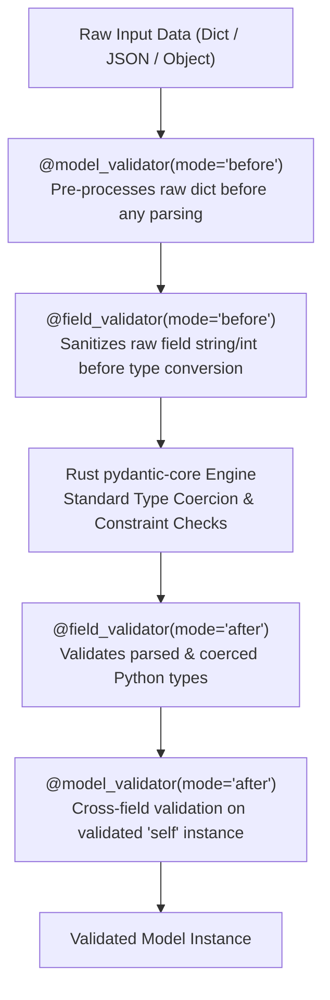
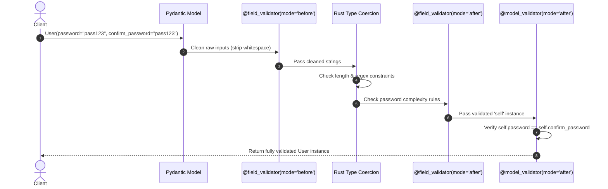

# Validators & Model Validators in Pydantic v2

In Pydantic v2, custom validation logic was completely overhauled. The legacy `@validator` and `@root_validator` decorators were deprecated and replaced by **`@field_validator`** (for targeting individual or grouped fields) and **`@model_validator`** (for whole-model, multi-field cross-validation).

Understanding the precise execution modes—**`mode='before'`**, **`mode='after'`**, and **`mode='wrap'`**—is critical for authoring robust validation pipelines without introducing subtle runtime bugs.

---

## 1. Conceptual Foundation & Mental Model

### The Validation Mode Pipeline



### The Three Execution Modes
1. **`mode='before'`**: Runs **before** Pydantic's internal parsing and type coercion. It receives raw, untrusted input (e.g., strings, unparsed dicts) and is primarily used for custom data normalization, stripping, or type adaptation.
2. **`mode='after'` (Default)**: Runs **after** Pydantic's internal type coercion and constraint validation. It receives fully coerced, strongly typed Python primitives.
3. **`mode='wrap'`**: Wraps the internal validation logic, giving the developer complete control to execute code before validation, call the standard validator via `handler(value)`, catch validation errors, or mutate the result.

---

## 2. Architecture & Internal Mechanics



---

## 3. Comprehensive Syntax & Core Parameters

### `@field_validator` and `@model_validator` Signatures

```python
from pydantic import BaseModel, ValidationInfo, field_validator, model_validator

class ExampleModel(BaseModel):
    name: str

    # Field validators MUST be classmethods in Pydantic v2
    @field_validator("name", mode="after")
    @classmethod
    def validate_name(cls, v: str, info: ValidationInfo) -> str:
        # 'v' is the coerced value; 'info' provides field and context metadata
        return v.title()

    # Model validators in 'after' mode receive 'self'
    @model_validator(mode="after")
    def validate_model(self) -> "ExampleModel":
        # Cross-field checks on self
        return self
```

---

## 4. Practical Implementation: 5 Verified Examples

### Example 1: Sanitizing Input with `mode='before'` vs `mode='after'`

```python
# field_validators.py
from pydantic import BaseModel, ValidationInfo, field_validator

class Product(BaseModel):
    sku: str
    price: float

    # 1. 'before' mode: receives raw input before Pydantic checks string constraints
    @field_validator("sku", mode="before")
    @classmethod
    def clean_sku(cls, v: object) -> object:
        if isinstance(v, str):
            # Strip whitespace and convert to uppercase before regex check
            return v.strip().upper()
        return v

    # 2. 'after' mode: receives coerced float
    @field_validator("price", mode="after")
    @classmethod
    def validate_price(cls, v: float, info: ValidationInfo) -> float:
        if v <= 0.0:
            raise ValueError(f"Field '{info.field_name}' must be strictly positive.")
        return round(v, 2)

p = Product(sku="  abc-1024  ", price=19.999)
print(p.model_dump())
# Output: {'sku': 'ABC-1024', 'price': 20.0}
```

### Example 2: Cross-Field Password Confirmation via `@model_validator(mode='after')`

In Pydantic v2, cross-field validation is performed in `mode='after'` directly on the instance `self`:

```python
# password_validator.py
from pydantic import BaseModel, Field, model_validator

class UserRegistration(BaseModel):
    email: str
    password: str = Field(..., min_length=8)
    confirm_password: str

    @model_validator(mode="after")
    def verify_passwords_match(self) -> "UserRegistration":
        # Direct attribute access on validated self
        if self.password != self.confirm_password:
            raise ValueError("Passwords do not match.")
        return self

# Valid registration
reg = UserRegistration(
    email="user@test.com",
    password="SuperPassword123!",
    confirm_password="SuperPassword123!",
)
print("Registration verified for:", reg.email)
```

Sending mismatched passwords triggers a clean 422:
```python
try:
    UserRegistration(
        email="user@test.com",
        password="PasswordA123!",
        confirm_password="PasswordB456!",
    )
except Exception as e:
    print(e)
    # Output: Value error, Passwords do not match. [type=value_error, ...]
```

### Example 3: Date Range Validation (`end_date > start_date`)

```python
# date_range.py
from datetime import date
from pydantic import BaseModel, model_validator

class BookingRequest(BaseModel):
    check_in: date
    check_out: date

    @model_validator(mode="after")
    def validate_stay_duration(self) -> "BookingRequest":
        if self.check_out <= self.check_in:
            raise ValueError("check_out date must be strictly after check_in date.")
        
        duration = (self.check_out - self.check_in).days
        if duration > 30:
            raise ValueError("Maximum reservation duration is 30 consecutive days.")
            
        return self

booking = BookingRequest(check_in=date(2026, 12, 1), check_out=date(2026, 12, 5))
print("Booking valid for 4 nights.")
```

### Example 4: Pre-Processing Legacy Wire Formats with `mode='before'`

Normalizing legacy data structures (e.g. converting a comma-separated string into a list):

```python
# legacy_preprocessor.py
from typing import Any
from pydantic import BaseModel, model_validator

class TaggedArticle(BaseModel):
    title: str
    tags: list[str]

    # Pre-processes the entire raw dictionary before field parsing
    @model_validator(mode="before")
    @classmethod
    def normalize_tags(cls, data: Any) -> Any:
        if isinstance(data, dict):
            raw_tags = data.get("tags")
            # If tags arrived as "news,tech,python", convert to list
            if isinstance(raw_tags, str):
                data = dict(data)  # shallow copy to avoid mutating input
                data["tags"] = [t.strip() for t in raw_tags.split(",") if t.strip()]
        return data

article = TaggedArticle.model_validate({
    "title": "FastAPI 0.115 Released",
    "tags": "backend, python, asgi",
})

print(article.tags)
# Output: ['backend', 'python', 'asgi']
```

### Example 5: Advanced `mode='wrap'` for Fallbacks and Error Interception

Using wrap validators to intercept validation errors and supply fallback values:

```python
# wrap_validator.py
from pydantic import BaseModel, field_validator, ValidationInfo
from pydantic_core import PydanticCustomError

class ResilientMetric(BaseModel):
    count: int

    @field_validator("count", mode="wrap")
    @classmethod
    def fallback_on_invalid_int(cls, v: object, handler, info: ValidationInfo) -> int:
        try:
            # Delegate to standard Pydantic validation routine
            return handler(v)
        except Exception:
            # Fallback to zero if client passed 'N/A' or empty string
            if v in ("N/A", "", None):
                return 0
            raise PydanticCustomError(
                "invalid_metric",
                "Metric value '{input}' is invalid and has no fallback",
                {"input": v},
            )

m1 = ResilientMetric(count="50")
m2 = ResilientMetric(count="N/A")
print(f"Parsed count: {m1.count}, Fallback count: {m2.count}")
# Output: Parsed count: 50, Fallback count: 0
```

---

## 5. Anti-Patterns & Common Traps

| Anti-Pattern | Why It Fails | Production Fix |
| :--- | :--- | :--- |
| **Omitting `@classmethod` on `@field_validator`** | In Pydantic v2, field validators are classmethods; omitting it raises a decorator binding error. | Always add `@classmethod` beneath `@field_validator(...)`. |
| **Using deprecated `@validator` or `@root_validator`** | Deprecated in Pydantic v2; triggers deprecation warnings and will be removed in v3. | Migrate to `@field_validator` and `@model_validator`. |
| **Mutating input dictionary in `mode='before'` in-place** | Modifying caller dictionaries causes unexpected side effects in the upstream calling code. | Create a shallow copy: `data = dict(data)`. |
| **Forgetting to `return self` in `@model_validator(mode='after')`** | If the validator does not return `self`, the instantiated model becomes `None`. | Always return `self` at the end of the method. |
| **Using `mode='before'` when standard types are needed** | The validator receives raw unparsed strings; performing numeric comparisons requires manual casting. | Use the default `mode='after'` where inputs are already strongly typed. |

---

## 6. Performance & Resource Characteristics

- **Rust vs Python Execution**: Standard constraints (`ge`, `min_length`, regex) execute in compiled Rust. Custom `@field_validator` functions require a boundary jump from Rust into CPython bytecode, incurring a small overhead (~400 nanoseconds per invocation).
- **Optimization Strategy**: Always prefer native `Field(ge=0, pattern=...)` constraints over custom Python `@field_validator` methods when expressing basic numeric bounds or regex patterns.

---

## 7. Edge Cases, Failure Modes & Gotchas

1. **Validation Order**: Field validators execute in the order fields are declared in the model. Model validators (`mode='after'`) execute strictly after all field validators have completed successfully.
2. **Short-Circuit on Field Failure**: If a field validator raises an exception, subsequent field validators still execute to collect all errors, but `@model_validator(mode='after')` is **never invoked**.

---

## 8. Security Implications & OWASP Alignment

- **Timing Attacks on Password Confirmations**: While password confirmation in registration models does not require constant-time comparison, secret comparisons in authentication models should use `secrets.compare_digest()`.
- **Validation Bypass Prevention**: Ensure critical business rules (e.g. `withdrawal_amount <= balance`) are validated at the domain model level, preventing invalid states from reaching database persistence layers.

---

## 9. Modern Tooling Integration

- **`PydanticCustomError`**: Pydantic v2 exports `PydanticCustomError` from `pydantic_core`. It allows raising custom structured errors with parameterized context that maps directly to OpenAPI 422 JSON payloads:
```python
from pydantic_core import PydanticCustomError
raise PydanticCustomError("code_expired", "The code '{code}' has expired", {"code": v})
```

---

## 10. Real-World Case Study: Production Incident

### The Incident
An airline ticket booking engine suffered an inventory reservation leak where passengers were able to book return flights arriving *before* their departure flights, corrupting flight manifest databases.

### The Root Cause
The booking request model was authored in Pydantic v1:
```python
class FlightBooking(BaseModel):
    departure_date: date
    return_date: date

    @root_validator
    def check_dates(cls, values):
        # BUG: If departure_date failed validation, values was empty or missing keys!
        dep = values.get("departure_date")
        ret = values.get("return_date")
        if dep and ret and ret < dep:
            raise ValueError("Return date must be after departure.")
        return values
```
When `return_date` arrived with an unexpected format, the check was skipped silently, allowing invalid inverted reservations into the database.

### The Resolution
Migrated to Pydantic v2's `@model_validator(mode='after')`:
```python
@model_validator(mode="after")
def check_dates(self) -> "FlightBooking":
    if self.return_date <= self.departure_date:
        raise ValueError("return_date must be strictly after departure_date.")
    return self
```
Because `mode='after'` guarantees that both fields are valid `datetime.date` objects before execution, invalid dates are blocked 100% of the time.

---

## 11. Hands-On Exercises & Challenge Problems

### Warm-Up Exercises
1. **Title Case Sanitizer**: Write a `@field_validator("name", mode="after")` that capitalizes every word in a user's name.
2. **Password Mismatch Trap**: Implement a model with `password` and `confirm_password` using `@model_validator(mode='after')`. Verify that mismatched inputs raise a validation error.

### Intermediate Challenges
3. **Credit Card Luhn Algorithm Validator**: Implement a `@field_validator("card_number")` that validates a 16-digit credit card number using the Luhn checksum algorithm.
4. **Pre-Processing Phone Normalizer**: Write a `@field_validator("phone", mode="before")` that strips dashes, parentheses, and spaces before regex validation.

### Production-Grade Challenges
5. **Wrap Fallback Validator**: Implement a `@field_validator("currency_rate", mode="wrap")` that catches validation failures and attempts to query an in-memory cache for a fallback rate before failing.
6. **Multi-Model Hierarchical Validator**: Build an `Order` model containing a list of `OrderItem` models. Add a model validator on `Order` that calculates the sum of item prices and ensures it equals `total_amount` within \$0.01.

---

## 12. Interview Mastery: Deep-Dive Questions & Answers

#### Q1: What are the primary replacements for `@validator` and `@root_validator` in Pydantic v2?
**Answer**: `@validator` was replaced by `@field_validator` (for single or multiple individual fields), and `@root_validator` was replaced by `@model_validator` (for whole-model cross-field validation). Both require an explicit `mode` parameter (`'before'`, `'after'`, or `'wrap'`).

#### Q2: What is the difference between `mode='before'` and `mode='after'` in `@field_validator`?
**Answer**: `mode='before'` executes before Pydantic's internal type coercion and constraint checks, receiving the raw untrusted input (e.g. raw string or dictionary). `mode='after'` (the default) executes after Pydantic has validated and coerced the data, receiving the strongly typed Python object.

#### Q3: Why must `@field_validator` methods be decorated with `@classmethod` in Pydantic v2?
**Answer**: In Pydantic v2, field validators operate at the class level during the parsing lifecycle before the model instance `self` exists. Declaring them as `@classmethod` reflects this architectural reality and ensures full compatibility with static type checkers.

#### Q4: How do you access `self` in a cross-field validator in Pydantic v2?
**Answer**: Use `@model_validator(mode='after')`. In `'after'` mode, Pydantic passes the fully validated model instance as `self`, allowing direct attribute access (e.g. `if self.end_date <= self.start_date: raise ValueError(...)`).

#### Q5: What does `mode='wrap'` allow you to do?
**Answer**: `mode='wrap'` gives developers complete control over the validation flow. It receives the input value and a `handler` callable representing Pydantic's standard validation logic. You can execute code before validation, invoke `handler(v)`, catch exceptions to provide fallback defaults, or modify the validated result.

#### Q6: What information does the `ValidationInfo` object provide in a validator?
**Answer**: `ValidationInfo` provides runtime metadata about the validation context:
- `info.field_name`: The name of the field currently being validated.
- `info.data`: A dictionary of already-validated fields (in field validators).
- `info.context`: Arbitrary external context passed via `model_validate(data, context={...})`.
- `info.mode`: Whether validation is running in `'python'` or `'json'` mode.

#### Q7: Can a single `@field_validator` validate multiple fields at once?
**Answer**: Yes. Pass multiple field names to the decorator: `@field_validator("first_name", "last_name", mode="after")`. The method will be executed independently for each named field.

#### Q8: What exception should custom validators raise to signal validation errors?
**Answer**: Custom validators should raise standard Python `ValueError`, `AssertionError`, or `pydantic_core.PydanticCustomError`. Pydantic automatically catches these exceptions and incorporates them into the structured `ValidationError` / HTTP 422 payload.
