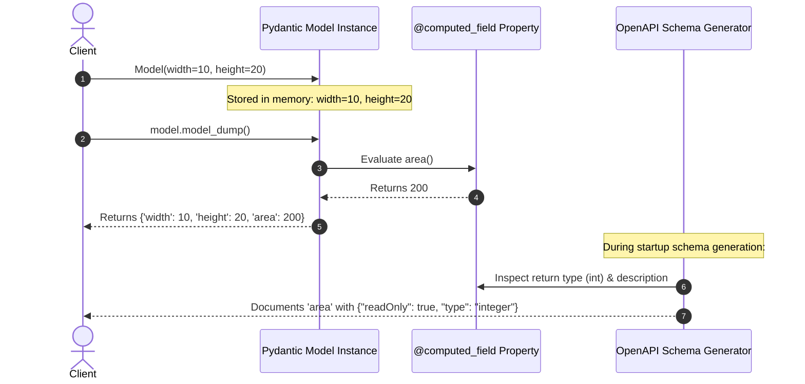

# Computed Fields & Properties in Pydantic v2

In real-world domain engineering, many attributes are dynamically derived from other properties rather than stored directly in databases—such as full names, discounted subtotals, tax calculations, and status flags.

In Pydantic v1, `@property` getters were excluded from serialization by default unless awkward private attributes and custom serializers were used. In **Pydantic v2**, the official **`@computed_field`** decorator provides first-class support for calculated attributes, automatically including them in `.model_dump()`, `.model_dump_json()`, and documenting them as **`readOnly`** properties in OpenAPI schemas.

---

## 1. Conceptual Foundation & Mental Model

### Stored vs Derived Attributes

```mermaid
flowchart LR
    Input["Input JSON: {first_name: 'John', last_name: 'Doe', unit_price: 100, tax_rate: 0.15}"]
    
    subgraph Stored Model Fields
        F1["first_name: str"]
        F2["last_name: str"]
        F3["unit_price: float"]
        F4["tax_rate: float"]
    end

    subgraph @computed_field Properties
        C1["@computed_field full_name -> 'John Doe'"]
        C2["@computed_field total_price -> 115.00"]
    end

    Output["Serialized Output: {first_name, last_name, unit_price, tax_rate, full_name, total_price}"]

    Input --> Stored
    Stored --> C1
    Stored --> C2
    C1 --> Output
    C2 --> Output
```

- **Stored Fields**: Parsed and validated from incoming payloads or databases. They can be mutated or initialized.
- **Computed Fields**: Calculated on the fly by executing a method. They cannot be set directly by clients; they are computed dynamically and automatically included in serialized outputs.

---

## 2. Architecture & Internal Mechanics



In the generated OpenAPI 3.1 specification, FastAPI automatically flags computed fields with `"readOnly": true`, explicitly signaling to frontend API clients that the field cannot be sent in `POST` or `PUT` request bodies.

---

## 3. Comprehensive Syntax & Core Parameters

### `@computed_field` Decorator Anatomy

```python
from pydantic import BaseModel, computed_field

class Example(BaseModel):
    base_val: int

    @computed_field(
        return_type=int,                     # Explicit return type annotation
        alias="calculatedTotal",             # Serialized alias name
        title="Computed Total Value",        # OpenAPI title
        description="Dynamic sum attribute", # OpenAPI description
        examples=[42],                       # Documentation examples
    )
    @property
    def total(self) -> int:
        return self.base_val * 2
```

---

## 4. Practical Implementation: 5 Verified Examples

### Example 1: Full Name and Account Display Generation

```python
# computed_basics.py
from pydantic import BaseModel, computed_field

class UserProfile(BaseModel):
    first_name: str
    last_name: str
    email: str

    @computed_field
    @property
    def full_name(self) -> str:
        return f"{self.first_name} {self.last_name}".strip()

    @computed_field
    @property
    def display_tag(self) -> str:
        return f"{self.full_name} <{self.email}>"

user = UserProfile(first_name="Ada", last_name="Lovelace", email="ada@computing.org")

# Computed fields are present directly in model_dump!
print("Dumped Model:", user.model_dump())
print("JSON Output:", user.model_dump_json())
```

Verified output:
```json
{
  "first_name": "Ada",
  "last_name": "Lovelace",
  "email": "ada@computing.org",
  "full_name": "Ada Lovelace",
  "display_tag": "Ada Lovelace <ada@computing.org>"
}
```

### Example 2: Financial Invoice with Line-Item Taxes & Discounts

```python
# financial_computed.py
from decimal import Decimal
from pydantic import BaseModel, Field, computed_field

class InvoiceLineItem(BaseModel):
    description: str
    quantity: int = Field(..., ge=1)
    unit_price: Decimal = Field(..., gt=Decimal("0.00"))
    discount_percent: Decimal = Field(default=Decimal("0.00"), ge=0, le=100)
    tax_rate: Decimal = Field(default=Decimal("0.10"), ge=0)

    @computed_field
    @property
    def subtotal_before_tax(self) -> Decimal:
        raw_total = Decimal(self.quantity) * self.unit_price
        discount_factor = (Decimal("100") - self.discount_percent) / Decimal("100")
        return round(raw_total * discount_factor, 2)

    @computed_field
    @property
    def tax_amount(self) -> Decimal:
        return round(self.subtotal_before_tax * self.tax_rate, 2)

    @computed_field
    @property
    def total_line_price(self) -> Decimal:
        return self.subtotal_before_tax + self.tax_amount

item = InvoiceLineItem(
    description="Mechanical Keyboard",
    quantity=2,
    unit_price=Decimal("120.00"),
    discount_percent=Decimal("10.00"),  # 10% off
    tax_rate=Decimal("0.08"),           # 8% tax
)

print(item.model_dump(mode="json"))
```

Output:
```json
{
  "description": "Mechanical Keyboard",
  "quantity": 2,
  "unit_price": "120.00",
  "discount_percent": "10.00",
  "tax_rate": "0.08",
  "subtotal_before_tax": "216.00",
  "tax_amount": "17.28",
  "total_line_price": "233.28"
}
```

### Example 3: Expensive Computations with `@cached_property`

When a computed field involves an expensive calculation (e.g. hashing, cryptographic signing, or heavy mathematical operations), decorate with `@cached_property` so the method executes only once per model instance:

```python
# cached_computed.py
import hashlib
import time
from functools import cached_property
from pydantic import BaseModel, computed_field

class DocumentArchive(BaseModel):
    document_id: str
    raw_content: str

    @computed_field
    @cached_property
    def content_sha256(self) -> str:
        # Executed only on the first access; result is cached on the instance!
        print("Computing expensive SHA-256 hash...")
        return hashlib.sha256(self.raw_content.encode("utf-8")).hexdigest()

doc = DocumentArchive(
    document_id="DOC-99",
    raw_content="Confidential corporate report text...",
)

# First access computes the hash
hash1 = doc.content_sha256
# Second access reads the cached value without recomputing!
hash2 = doc.content_sha256

print("SHA256:", hash1)
print(doc.model_dump())
```

### Example 4: Aliasing Computed Fields for Public APIs

Exporting camelCase keys to frontend clients while maintaining Pythonic snake_case properties:

```python
# aliased_computed.py
from pydantic import BaseModel, computed_field

class Circle(BaseModel):
    radius: float

    @computed_field(
        alias="circleArea",
        title="Calculated Surface Area",
        description="The mathematical area of the circle (pi * r^2)",
    )
    @property
    def area(self) -> float:
        import math
        return round(math.pi * (self.radius ** 2), 4)

c = Circle(radius=5.0)
print(c.model_dump_json(by_alias=True))
# Output: {"radius":5.0,"circleArea":78.5398}
```

### Example 5: FastAPI Route Integration & OpenAPI Inspection

Demonstrating that computed fields are automatically included in FastAPI responses:

```python
# fastapi_computed.py
from fastapi import FastAPI
from pydantic import BaseModel, computed_field

app = FastAPI()

class Rectangle(BaseModel):
    width: float
    height: float

    @computed_field
    @property
    def perimeter(self) -> float:
        return 2 * (self.width + self.height)

    @computed_field
    @property
    def area(self) -> float:
        return self.width * self.height

@app.get("/rectangles/sample", response_model=Rectangle)
def get_sample_rectangle() -> Rectangle:
    # Handler simply returns width and height;
    # FastAPI automatically serializes perimeter and area!
    return Rectangle(width=10.0, height=5.0)
```

Verified output:
```bash
curl http://127.0.0.1:8000/rectangles/sample
```
Response:
```json
{
  "width": 10.0,
  "height": 5.0,
  "perimeter": 30.0,
  "area": 50.0
}
```

---

## 5. Anti-Patterns & Common Traps

| Anti-Pattern | Why It Fails | Production Fix |
| :--- | :--- | :--- |
| **Using plain `@property` without `@computed_field`** | Plain `@property` getters are ignored by `.model_dump()` and excluded from OpenAPI schemas. | Always stack `@computed_field` above `@property`. |
| **Performing blocking I/O in computed fields** | Making network calls or synchronous database queries inside property getters blocks serialization. | Computed fields must be pure CPU computations; do I/O in services or dependencies. |
| **Stacking decorators in the wrong order** | Putting `@property` above `@computed_field` raises an attribute error. | Correct order: `@computed_field` on top, `@property` underneath. |
| **Attempting to pass computed fields in input JSON** | Computed fields are read-only; incoming client values for computed fields are ignored or raise validation errors. | Declare computed fields strictly for outputs; pass inputs via stored fields. |
| **Mutating state inside computed fields** | Property getters should be side-effect free; mutating other attributes during serialization causes unpredictable behavior. | Keep computed properties idempotent and pure. |

---

## 6. Performance & Resource Characteristics

- **Zero Storage Overhead**: Computed fields consume zero memory bytes in the model's internal `__dict__` until evaluated.
- **Evaluation Cost**: Computed fields are evaluated once per serialization invocation (`.model_dump()` or `.model_dump_json()`). Use `@cached_property` to cache expensive results.

---

## 7. Edge Cases, Failure Modes & Gotchas

1. **Cached Property with Frozen Models**: `@cached_property` mutates the instance dictionary to store the cached value. In models with `ConfigDict(frozen=True)`, standard `@cached_property` may conflict with immutability rules.
2. **Exclusion in `model_dump`**: You can explicitly exclude computed fields during dump just like normal fields: `model.model_dump(exclude={"full_name"})`.

---

## 8. Security Implications & OWASP Alignment

- **Information Leakage via Unchecked Derivations**: Ensure computed fields do not accidentally expose internal state or private identifiers (e.g. deriving a token or secret hash into a computed field).
- **CPU Exhaustion via Uncached Derivations**: If a computed field evaluates a heavy regex or mathematical loop and is returned in a list of 1,000 items, serialization time will skyrocket unless cached.

---

## 9. Modern Tooling Integration

- **OpenAPI `readOnly` Enforcement**: FastAPI automatically injects `"readOnly": true` into the OpenAPI 3.1 specification for every computed field:
```json
{
  "properties": {
    "full_name": {
      "type": "string",
      "readOnly": true,
      "title": "Full Name"
    }
  }
}
```

---

## 10. Real-World Case Study: Production Incident

### The Incident
A fast-growing food delivery application deployed an update to their cart checkout service. Within minutes, mobile clients started crashing because orders returned `total_price: null` or omitted the field entirely.

### The Root Cause
In Pydantic v1, the team used custom root serializers to inject dynamic totals into output dictionaries. When upgrading to Pydantic v2, an engineer replaced the logic with standard Python `@property`:
```python
class CartResponse(BaseModel):
    items: list[CartItem]

    @property
    def total_price(self) -> float:
        return sum(item.price for item in self.items)
```
Because standard `@property` is not recognized as a field by Pydantic v2, `.model_dump()` completely omitted `total_price` from the JSON response sent to mobile apps.

### The Resolution
Added the `@computed_field` decorator:
```python
@computed_field
@property
def total_price(self) -> float:
    return sum(item.price for item in self.items)
```
`total_price` was restored to all serialized JSON payloads immediately.

---

## 11. Hands-On Exercises & Challenge Problems

### Warm-Up Exercises
1. **Full Name Property**: Create a model with `first_name` and `last_name`. Add a `@computed_field` returning `full_name`. Verify that `.model_dump()` contains the computed attribute.
2. **Age Calculator**: Create a model with `birth_date: date`. Add a computed field that calculates the current age in years.

### Intermediate Challenges
3. **Discounted Cart Summary**: Build a `Cart` model containing a list of `Item` objects. Implement computed fields for `subtotal`, `tax`, and `grand_total`. Verify accuracy in serialized JSON.
4. **Aliased Computed Metric**: Write a model with a computed field using `alias="retentionRate"`. Verify that `model_dump(by_alias=True)` emits the alias key.

### Production-Grade Challenges
5. **Cached Cryptographic Checksum**: Create a model representing a uploaded binary chunk. Use `@computed_field` and `@cached_property` to compute an MD5 and SHA-256 checksum. Benchmark the execution time on repeated access.
6. **OpenAPI Schema Conformance Test**: Write a pytest test that introspects FastAPI's `/openapi.json` and verifies that all computed fields in response models contain `"readOnly": true`.

---

## 12. Interview Mastery: Deep-Dive Questions & Answers

#### Q1: What is the purpose of `@computed_field` in Pydantic v2?
**Answer**: `@computed_field` allows dynamic, calculated properties (methods decorated with `@property` or `@cached_property`) to be treated as formal model fields. Pydantic automatically evaluates these properties and includes them in `.model_dump()` and `.model_dump_json()`, and FastAPI documents them as `readOnly` fields in the OpenAPI specification.

#### Q2: How did developers achieve computed fields in Pydantic v1, and why was it problematic?
**Answer**: In Pydantic v1, `@property` getters were not serialized by default. Developers had to use cumbersome custom root validators, override `.dict()`, or configure custom encoders. This caused inconsistencies between Python model access and serialized JSON wire representations.

#### Q3: What is the correct ordering when stacking `@computed_field` and `@property`?
**Answer**: `@computed_field` must be placed **above** `@property`:
```python
@computed_field
@property
def my_computed_val(self) -> int: ...
```

#### Q4: How are computed fields documented in OpenAPI 3.1?
**Answer**: FastAPI inspects the return type annotation of the computed field and adds it to the schema `properties` object with the attribute `"readOnly": true`. This informs client developers and code generators that the field is generated by the server and should not be included in client request bodies.

#### Q5: When should you use `@cached_property` instead of standard `@property` with `@computed_field`?
**Answer**: Use `@cached_property` when the computation is CPU-intensive (e.g. calculating cryptographic hashes, parsing deep trees, or running complex mathematical algorithms). `@cached_property` evaluates the method on the first access and caches the result on the instance, avoiding redundant calculations if the field is accessed multiple times.

#### Q6: Can a computed field accept arguments?
**Answer**: No. Computed fields represent properties of the model instance and must have only a single parameter: `self`.

#### Q7: Can a client send a value for a computed field in an incoming JSON request body?
**Answer**: No. Computed fields are derived properties, not stored fields. Any value sent by the client for a computed field is ignored during input validation, or rejected if `extra="forbid"` is configured.

#### Q8: Can you exclude computed fields during `.model_dump()`?
**Answer**: Yes. Computed fields can be excluded using the standard `exclude` parameter: `model.model_dump(exclude={"my_computed_field"})`.
