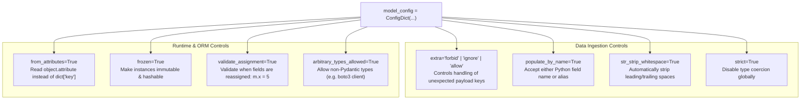
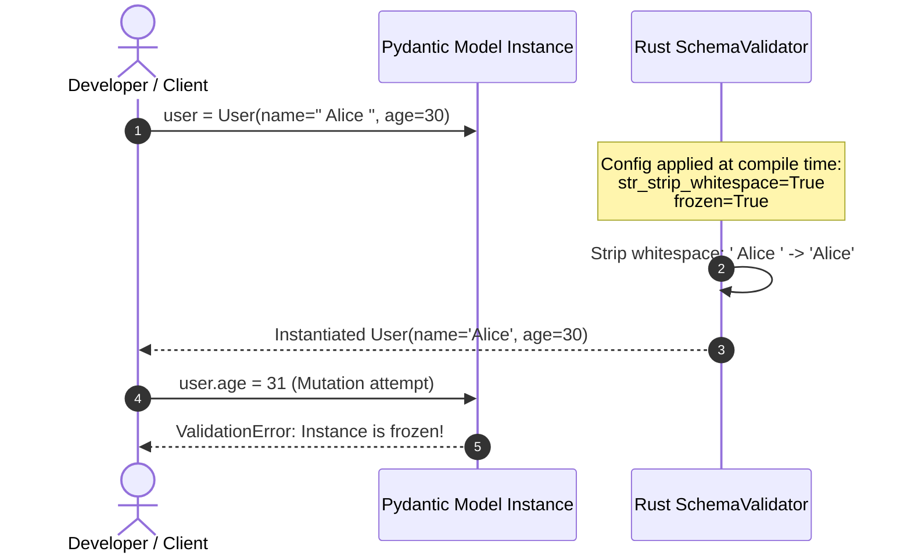

# Model Configuration & ConfigDict in Pydantic v2

In Pydantic v2, model configuration was streamlined from the legacy inner `class Config:` into a type-safe, static-analysis-friendly dictionary type called **`ConfigDict`**. 

Configuring models via `model_config = ConfigDict(...)` governs critical operational behaviors: whether extra fields are rejected, whether ORM object attributes are read directly (**`from_attributes=True`**), whether fields can be mutated after initialization (**`frozen=True`**), and whether string inputs are automatically stripped of whitespace.

---

## 1. Conceptual Foundation & Mental Model

### The Model Configuration Engine



---

## 2. Architecture & Internal Mechanics



In Pydantic v2, `ConfigDict` options are compiled directly into the underlying Rust `SchemaValidator` when the class is imported. This ensures that flags like `extra='forbid'` or `str_strip_whitespace=True` execute at native C/Rust machine speed.

---

## 3. Comprehensive `ConfigDict` Flag Reference

| Flag Name | Type | Default | Purpose & Production Impact |
| :--- | :--- | :--- | :--- |
| **`from_attributes`** | `bool` | `False` | **Replaces `orm_mode = True`**. Enables reading attributes directly from ORM objects (SQLAlchemy, Tortoise). |
| **`extra`** | `'ignore' \| 'forbid' \| 'allow'` | `'ignore'` | `'forbid'` rejects unexpected JSON fields with 422; `'ignore'` drops them silently; `'allow'` preserves them in `__extra__`. |
| **`populate_by_name`** | `bool` | `False` | **Replaces `allow_population_by_field_name`**. Allows instantiating models using the Python field name even if an alias exists. |
| **`frozen`** | `bool` | `False` | Makes instances immutable. Instances become hashable (can be used in sets or as dictionary keys). |
| **`str_strip_whitespace`**| `bool` | `False` | Automatically strips leading and trailing whitespace from all string fields in the model. |
| **`strict`** | `bool` | `False` | Disables type coercion globally for all fields in the model. |
| **`validate_assignment`**| `bool` | `False` | Runs validation logic when a field is reassigned after instantiation (`model.age = 50`). |
| **`validate_default`** | `bool` | `False` | Forces Pydantic to validate default field values during class definition. |
| **`use_enum_values`** | `bool` | `False` | Serializes Enums to their raw `.value` primitive rather than the Enum object itself. |
| **`arbitrary_types_allowed`**| `bool` | `False` | Permits complex external types that lack Pydantic schemas (e.g. database connection handles). |

---

## 4. Practical Implementation: 5 Verified Examples

### Example 1: Enterprise Schema with Strict Security Controls

Enforcing strict bounds: forbidding extra fields and auto-stripping whitespace:

```python
# strict_config.py
from pydantic import BaseModel, ConfigDict, Field, ValidationError

class StrictAccountPayload(BaseModel):
    model_config = ConfigDict(
        extra="forbid",                # Reject unknown fields with 422
        str_strip_whitespace=True,     # Strip string whitespace automatically
        str_min_length=2,              # Global minimum string length
    )

    username: str
    email: str

# 1. Whitespace is stripped automatically
account = StrictAccountPayload(username="   marcus_dev   ", email="marcus@company.com")
print(f"Sanitized username: '{account.username}'")
# Output: Sanitized username: 'marcus_dev'

# 2. Extra unmapped fields trigger immediate validation rejection
try:
    StrictAccountPayload(
        username="marcus_dev",
        email="marcus@company.com",
        is_admin=True,  # Extra unmapped field!
    )
except ValidationError as exc:
    print("Extra field rejected:")
    print(exc.errors()[0]["msg"])
    # Output: Extra inputs are not permitted
```

### Example 2: SQLAlchemy ORM Integration with `from_attributes=True`

Converting database rows into Pydantic models:

```python
# orm_config.py
from datetime import datetime, timezone
from pydantic import BaseModel, ConfigDict

# Simulated SQLAlchemy ORM Object
class UserORM:
    def __init__(self, id: int, username: str, created_at: datetime) -> None:
        self.id = id
        self.username = username
        self.created_at = created_at
        self.password_hash = "super_secret_argon2_hash"  # Private DB column

# Pydantic Public Schema
class UserPublic(BaseModel):
    id: int
    username: str
    created_at: datetime

    # Modern v2 replacement for orm_mode = True
    model_config = ConfigDict(from_attributes=True)

# Instantiate ORM object
db_row = UserORM(id=42, username="alice", created_at=datetime.now(timezone.utc))

# Read directly from ORM object attributes
public_user = UserPublic.model_validate(db_row)
print(public_user.model_dump())
# Output: {'id': 42, 'username': 'alice', 'created_at': datetime.datetime(...)}
```

### Example 3: Dual Ingestion via `populate_by_name=True`

Accepting both external camelCase and internal snake_case:

```python
# populate_by_name.py
from pydantic import BaseModel, ConfigDict, Field

class OrderItem(BaseModel):
    model_config = ConfigDict(populate_by_name=True)

    item_id: int = Field(..., alias="itemId")
    quantity: int

# Option A: Ingest using external camelCase alias
order1 = OrderItem.model_validate({"itemId": 101, "quantity": 2})

# Option B: Ingest using Python attribute name directly
order2 = OrderItem(item_id=102, quantity=5)

print(f"Order 1 ID: {order1.item_id}, Order 2 ID: {order2.item_id}")
# Output: Order 1 ID: 101, Order 2 ID: 102
```

### Example 4: Post-Initialization Validation with `validate_assignment=True`

```python
# validate_assignment.py
from pydantic import BaseModel, ConfigDict, Field, ValidationError

class AccountBalance(BaseModel):
    model_config = ConfigDict(validate_assignment=True)

    account_id: str
    balance: float = Field(..., ge=0.0)

account = AccountBalance(account_id="ACC-01", balance=150.0)

# Valid assignment
account.balance = 200.0

# Invalid assignment triggers ValidationError at runtime!
try:
    account.balance = -50.0
except ValidationError as exc:
    print(exc.errors()[0]["msg"])
    # Output: Input should be greater than or equal to 0
```

### Example 5: Hashable Immutable Objects via `frozen=True`

Using Pydantic models as dictionary keys or in `set` collections:

```python
# frozen_set.py
from pydantic import BaseModel, ConfigDict

class CacheKey(BaseModel):
    model_config = ConfigDict(frozen=True)

    tenant_id: int
    endpoint: str

key1 = CacheKey(tenant_id=1, endpoint="/users")
key2 = CacheKey(tenant_id=1, endpoint="/users")
key3 = CacheKey(tenant_id=2, endpoint="/users")

# Frozen models can be placed in sets!
cache_registry = {key1, key2, key3}
print("Unique cache keys count:", len(cache_registry))
# Output: Unique cache keys count: 2 (key1 and key2 are deduplicated!)
```

---

## 5. Anti-Patterns & Common Traps

| Anti-Pattern | Why It Fails | Production Fix |
| :--- | :--- | :--- |
| **Using legacy `class Config: orm_mode = True`** | Silently ignored in Pydantic v2; ORM objects fail validation with missing field errors. | Use `model_config = ConfigDict(from_attributes=True)`. |
| **Leaving `extra='ignore'` on critical update schemas** | Clients misspell fields (`usrname` instead of `username`); update fails silently without error. | Use `model_config = ConfigDict(extra='forbid')`. |
| **Modifying fields without `validate_assignment=True`** | Reassigning invalid data bypasses validation; model enters corrupt state. | Set `validate_assignment=True` if mutation is required. |
| **Using `arbitrary_types_allowed=True` excessively** | Disables Pydantic's type safety and schema generation for arbitrary fields. | Keep arbitrary types isolated; build custom validators when needed. |
| **Confusing `populate_by_name` with `by_alias`** | `populate_by_name` affects input validation; `by_alias` affects output serialization. | Use `populate_by_name=True` in config; use `.model_dump(by_alias=True)` on export. |

---

## 6. Performance & Resource Characteristics

- **Compilation Overhead**: `ConfigDict` options are parsed during module import and compiled into C/Rust structs. Setting multiple flags incurs 0.00ms additional runtime latency per request.
- **Frozen Hash Performance**: Computing the `__hash__` of a frozen model delegates to Python's native tuple hashing of field values, operating in $O(N)$ where $N$ is field count.

---

## 7. Edge Cases, Failure Modes & Gotchas

1. **Config Inheritance**: Child models inherit `model_config` from parent classes. If a child redefines `model_config`, it completely replaces the parent dictionary unless explicitly merged (`model_config = ConfigDict(**Parent.model_config, extra='forbid')`).
2. **`from_attributes` with Missing Properties**: If an ORM object does not define an attribute required by the schema, Pydantic raises a standard missing field `ValidationError`.

---

## 8. Security Implications & OWASP Alignment

- **Mass Assignment Defense (OWASP API3:2023)**: Setting `extra='forbid'` is the ultimate defense against mass assignment attacks. If an attacker injects unexpected keys (`"role": "admin"`, `"is_superuser": true`), Pydantic immediately aborts the request with an HTTP 422 error.

---

## 9. Modern Tooling Integration

- **IDE Autocompletion**: Because `ConfigDict` is a `TypedDict` in Python, modern IDEs (VS Code, Cursor, PyCharm) provide real-time auto-completion for all available configuration flags and prevent typos.

---

## 10. Real-World Case Study: Production Incident

### The Incident
A fast-growing FinTech API suffered an administrative account takeover. An attacker sent a registration payload:
```json
{
  "username": "attacker",
  "password": "Password123!",
  "is_admin": true
}
```
The endpoint updated the database using `User(**payload.model_dump())`. The attacker became an immediate platform administrator.

### The Root Cause
The `UserRegistration` model had default configuration (`extra='ignore'`). While Pydantic ignored `is_admin` for the schema, the backend code used `raw_dict` from request or a model that permitted extra fields, allowing the privileged key to reach the database.

### The Resolution
1. Standardized all public API request models on `extra='forbid'`:
```python
class BaseRequestModel(BaseModel):
    model_config = ConfigDict(extra="forbid")
```
2. Any unexpected parameter now raises an immediate 422 error, blocking malicious key injection completely.

---

## 11. Hands-On Exercises & Challenge Problems

### Warm-Up Exercises
1. **Forbid Extra Test**: Create a model with `extra='forbid'`. Send a payload containing an extra key and verify that Pydantic raises an error.
2. **Whitespace Stripper**: Configure `str_strip_whitespace=True`. Verify that passing `"  hello  "` results in `"hello"`.

### Intermediate Challenges
3. **ORM Model Serializer**: Create a dummy Python class with attributes `id`, `name`, and `internal_secret`. Build a Pydantic model with `from_attributes=True` that extracts only `id` and `name`.
4. **Assignment Guard**: Build a model with `validate_assignment=True`. Instantiate it and reassign a string to an integer field. Verify that an error is raised.

### Production-Grade Challenges
5. **Config Inheritance Hierarchy**: Implement an enterprise base model `AppBaseModel` configured with `extra='forbid'`, `str_strip_whitespace=True`, and `from_attributes=True`. Demonstrate how three distinct business models inherit and extend these settings.
6. **Immutable Set Registry**: Build a model with `frozen=True`. Create 1,000 instances with duplicate values and insert them into a Python `set()`. Verify that deduplication functions with sub-millisecond execution.

---

## 12. Interview Mastery: Deep-Dive Questions & Answers

#### Q1: What replaced the inner `class Config:` in Pydantic v2?
**Answer**: In Pydantic v2, the inner `class Config:` was replaced by the class attribute `model_config = ConfigDict(...)`. `ConfigDict` is a type-safe `TypedDict` that provides full IDE auto-completion and static analysis verification.

#### Q2: What is the replacement for `orm_mode = True` in Pydantic v2?
**Answer**: `model_config = ConfigDict(from_attributes=True)`.

#### Q3: What is the difference between `extra='ignore'`, `extra='forbid'`, and `extra='allow'`?
**Answer**:
- `'ignore'` (default): Silently discards any incoming fields not explicitly declared in the model.
- `'forbid'`: Rejects the request with a `ValidationError` / HTTP 422 error if any unmapped field is present.
- `'allow'`: Accepts extra fields and stores them on the model instance in `__extra__`.

#### Q4: Why is `extra='forbid'` strongly recommended for API request bodies?
**Answer**: It defends against Mass Assignment vulnerabilities (OWASP API3:2023) and catches client typos. If a client miskeys a parameter (e.g. sending `"emial"` instead of `"email"`), `'ignore'` silently defaults the field or leaves it blank, whereas `'forbid'` immediately alerts the client with a 422 error.

#### Q5: What does `populate_by_name=True` do?
**Answer**: In Pydantic v2, `populate_by_name=True` (formerly `allow_population_by_field_name`) allows instantiating models using the Python field name even if an `alias` or `validation_alias` is defined. This allows internal Python code to use standard snake_case while accepting camelCase from external API clients.

#### Q6: How does `validate_assignment=True` impact runtime performance?
**Answer**: By default, Pydantic only validates data during model instantiation. If you reassign an attribute later (`model.age = "not-an-int"`), standard Python attribute assignment occurs without validation. Setting `validate_assignment=True` causes Pydantic to intercept all attribute setters and run validation routines, adding a small overhead to assignment operations.

#### Q7: What are the requirements for a Pydantic model to be used as a dictionary key or in a set?
**Answer**: The model must be hashable. Setting `model_config = ConfigDict(frozen=True)` makes the model immutable and generates a deterministic `__hash__` method, allowing instances to be used as dictionary keys or in sets.

#### Q8: Does setting `from_attributes=True` cause performance overhead during standard dictionary validation?
**Answer**: No. When input is already a dictionary, Pydantic continues to execute fast dictionary key lookups. It only falls back to `getattr()` attribute reflection when the input data is a Python object that is not a dictionary.
