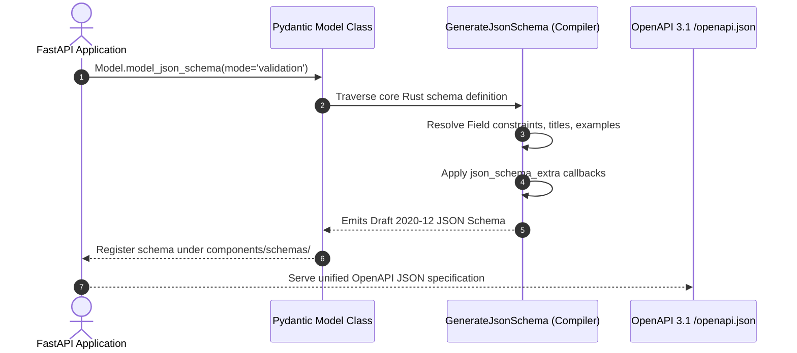

# JSON Schema & Customization in Pydantic v2

In Pydantic v2, JSON Schema generation was redesigned to achieve 100% dialect alignment with **JSON Schema Draft 2020-12**, which serves as the core foundational dialect for the **OpenAPI 3.1.0 Specification**.

Every Pydantic model can be exported into a formal JSON Schema via **`Model.model_json_schema()`**. Developers can customize schemas at the field level, model level (using **`json_schema_extra`**), or globally by extending the **`GenerateJsonSchema`** compiler.

---

## 1. Conceptual Foundation & Mental Model

### The OpenAPI 3.1 & Draft 2020-12 Convergence

```mermaid
graph TD
    subgraph Legacy Era (Pydantic v1 & OpenAPI 3.0)
        V1Schema["Pydantic v1 (Draft 7 / Custom)"]
        OAS30["OpenAPI 3.0 (Nullable: true workaround)"]
        V1Schema -.->|Friction & Translation Loss| OAS30
    end

    subgraph Modern Era (Pydantic v2 & OpenAPI 3.1)
        V2Schema["Pydantic v2 Engine (Native Draft 2020-12)"]
        OAS31["OpenAPI 3.1 (Full JSON Schema Compliance)"]
        V2Schema ===|Direct 1:1 Dialect Identity| OAS31
    end
```

### The Nullable Shift
In OpenAPI 3.0, nullable types required a non-standard vendor attribute: `{"type": "string", "nullable": true}`. 

In OpenAPI 3.1 and Pydantic v2, nullable fields adhere to standard JSON Schema syntax using type arrays:
```json
{
  "type": ["string", "null"]
}
```

---

## 2. Architecture & Internal Mechanics



Pydantic v2 supports two distinct schema generation modes:
- `mode='validation'`: Reflects the schema expected during incoming request validation (e.g. accepts aliases, default values, permissive types).
- `mode='serialization'`: Reflects the schema emitted during outbound response serialization (e.g. reflects computed fields, serialized aliases).

---

## 3. Comprehensive Syntax & Core Parameters

### `json_schema_extra` Configuration Options

You can inject metadata and custom vendor extensions via `Field()` or via `model_config`:

```python
from pydantic import BaseModel, ConfigDict, Field

class CustomSchemaModel(BaseModel):
    # 1. Field-level customization
    item_code: str = Field(
        ...,
        json_schema_extra={"x-internal-id": 1042, "example": "CODE-99"},
    )

    # 2. Model-level static dictionary
    model_config = ConfigDict(
        json_schema_extra={
            "description": "Customized model schema",
            "x-vendor-tag": "enterprise-tier",
        }
    )
```

You can also pass a **callable** to `json_schema_extra` to dynamically mutate the generated schema dictionary.

---

## 4. Practical Implementation: 5 Verified Examples

### Example 1: Exporting and Inspecting JSON Schema

```python
# inspect_schema.py
import json
from pydantic import BaseModel, Field, EmailStr

class UserProfile(BaseModel):
    id: int = Field(..., gt=0, description="Database ID")
    username: str = Field(..., min_length=3, max_length=20)
    email: EmailStr
    bio: str | None = Field(default=None, description="Optional biography")

# Generate JSON Schema Draft 2020-12
schema = UserProfile.model_json_schema()
print(json.dumps(schema, indent=2))
```

Generated JSON Schema:
```json
{
  "title": "UserProfile",
  "type": "object",
  "properties": {
    "id": {
      "title": "Id",
      "type": "integer",
      "exclusiveMinimum": 0,
      "description": "Database ID"
    },
    "username": {
      "title": "Username",
      "type": "string",
      "minLength": 3,
      "maxLength": 20
    },
    "email": {
      "title": "Email",
      "type": "string",
      "format": "email"
    },
    "bio": {
      "title": "Bio",
      "type": [
        "string",
        "null"
      ],
      "default": null,
      "description": "Optional biography"
    }
  },
  "required": [
    "id",
    "username",
    "email"
  ]
}
```

### Example 2: Dynamic Schema Mutation via Callable `json_schema_extra`

Mutating the schema dynamically (e.g. injecting sample request bodies for Swagger UI):

```python
# dynamic_schema_extra.py
from typing import Any
from pydantic import BaseModel, ConfigDict, Field

def enrich_schema(schema: dict[str, Any]) -> None:
    # Inject OpenAPI multi-example documentation
    schema["example"] = {
        "sku": "KEY-RGB-100",
        "name": "Mechanical Keyboard",
        "price": 129.99,
    }
    # Inject enterprise classification extension
    schema["x-compliance"] = "PCI-DSS-L1"

class Product(BaseModel):
    sku: str
    name: str
    price: float = Field(..., gt=0.0)

    model_config = ConfigDict(json_schema_extra=enrich_schema)

print(Product.model_json_schema()["example"])
# Output: {'sku': 'KEY-RGB-100', 'name': 'Mechanical Keyboard', 'price': 129.99}
```

### Example 3: Validation vs Serialization Schemas

Demonstrating how schemas differ based on the `mode` parameter:

```python
# validation_vs_serialization.py
from pydantic import BaseModel, computed_field

class Account(BaseModel):
    username: str
    password_hash: str

    @computed_field
    @property
    def is_verified(self) -> bool:
        return True

# 1. Validation mode: Computed fields are NOT expected in inputs
val_schema = Account.model_json_schema(mode="validation")
print("Validation properties:", list(val_schema["properties"].keys()))
# Output: ['username', 'password_hash']

# 2. Serialization mode: Computed fields ARE present in outputs
ser_schema = Account.model_json_schema(mode="serialization")
print("Serialization properties:", list(ser_schema["properties"].keys()))
# Output: ['username', 'password_hash', 'is_verified']
```

### Example 4: Subclassing `GenerateJsonSchema` for Global Transformations

Implementing an enterprise rule that converts all snake_case property titles into Title Case:

```python
# global_schema_generator.py
from typing import Any
from pydantic import BaseModel
from pydantic.json_schema import GenerateJsonSchema
from pydantic_core import core_schema

class CleanTitleJsonSchemaGenerator(GenerateJsonSchema):
    def field_title_should_be_set(
        self,
        schema: core_schema.CoreSchemaOrField,
        field_name: str | None,
    ) -> bool:
        # Prevent auto-generating generic default titles
        return False

class Employee(BaseModel):
    first_name: str
    department_code: str

# Generate schema using custom compiler
custom_schema = Employee.model_json_schema(
    schema_generator=CleanTitleJsonSchemaGenerator
)

print(custom_schema["properties"])
# Notice: 'title' attributes are cleanly suppressed!
```

Output:
```python
{
  'first_name': {'type': 'string'},
  'department_code': {'type': 'string'}
}
```

### Example 5: Custom Vendor Extensions (`x-webhooks`, `x-roles`) for API Gateways

```python
# gateway_extensions.py
from pydantic import BaseModel, Field

class SecureTransaction(BaseModel):
    transaction_id: str
    amount: float = Field(
        ...,
        json_schema_extra={
            "x-auth-role": "FINANCE_ADMIN",
            "x-audit-log": True,
        },
    )

schema = SecureTransaction.model_json_schema()
print("Field extension:", schema["properties"]["amount"]["x-auth-role"])
# Output: Field extension: FINANCE_ADMIN
```

---

## 5. Anti-Patterns & Common Traps

| Anti-Pattern | Why It Fails | Production Fix |
| :--- | :--- | :--- |
| **Using `schema_extra` in `class Config:`** | Deprecated in Pydantic v2; ignored by the new generator. | Use `model_config = ConfigDict(json_schema_extra=...)`. |
| **Mutating schema without copying in callable** | In rare cases, mutating shared dictionaries in place can corrupt other models. | Mutate the passed dictionary directly only within the model's scoped function. |
| **Expecting `nullable: true` in Pydantic v2** | Pydantic v2 adheres to Draft 2020-12, which replaces `nullable: true` with `type: ["type", "null"]`. | Update third-party tools to support OpenAPI 3.1 standards. |
| **Hardcoding JSON schema strings manually** | Fragile; code changes drift away from documentation. | Let Pydantic derive the schema automatically from type hints. |
| **Using `mode='validation'` to document API responses** | Computed fields will be missing from the documentation. | Use `mode='serialization'` for response schemas. |

---

## 6. Performance & Resource Characteristics

- **Schema Caching**: Pydantic v2 caches the generated JSON Schema dictionary after the first call to `model_json_schema()`. Subsequent calls return the cached dictionary in under 1 microsecond.
- **Memory Footprint**: Schema dictionaries are stored in memory only when explicitly invoked (e.g. during FastAPI startup when `/openapi.json` is generated).

---

## 7. Edge Cases, Failure Modes & Gotchas

1. **Def-Path Prefixes**: In OpenAPI 3.1, component schemas are registered under `#/components/schemas/`. When exporting schemas standalone, references default to `#/$defs/`.
2. **Recursive References**: Self-referencing models use `$ref: "#"` or `$ref: "#/$defs/ModelName"` in JSON Schema to express infinite recursion without cycle errors.

---

## 8. Security Implications & OWASP Alignment

- **Information Leakage via Schema Comments**: Ensure internal implementation details, internal server IP addresses, or database table names are not written into `description` or `json_schema_extra` fields.
- **Accurate Input Validation Constraints**: Accurately expressing bounds (`maximum`, `minLength`, `pattern`) in JSON Schema allows upstream API Gateways (like Kong, Apigee, or AWS WAF) to block malformed requests before they reach Python workers.

---

## 9. Modern Tooling Integration

- **Swagger UI 5.x**: Swagger UI version 5+ natively understands OpenAPI 3.1 and JSON Schema Draft 2020-12, displaying type unions (`string | null`), tuples, and pattern regexes cleanly.

---

## 10. Real-World Case Study: Production Incident

### The Incident
An enterprise API provider migrated their backend from Pydantic v1 (OpenAPI 3.0) to Pydantic v2 (OpenAPI 3.1). Enterprise customers using legacy Java and C# SDK generators began reporting compilation errors: all nullable fields broke because the generators could not parse `type: ["string", "null"]`.

### The Root Cause
Legacy client code generators (based on OpenAPI 3.0) expected OpenAPI 3.0's proprietary `nullable: true` attribute rather than the modern JSON Schema standard `type: [..., "null"]`.

### The Resolution
Created a custom `schema_generator` subclassing `GenerateJsonSchema` that converted type arrays back into `nullable: true` during the transitional deprecation window:
```python
class LegacyOpenAPIGenerator(GenerateJsonSchema):
    def handle_nullable(self, schema):
        # Convert type: ["string", "null"] -> type: "string", nullable: True
        ...
```
This provided backward compatibility for legacy enterprise clients while allowing internal services to run on Pydantic v2.

---

## 11. Hands-On Exercises & Challenge Problems

### Warm-Up Exercises
1. **Schema Dumper**: Create a model with 4 fields of different types. Dump its JSON schema via `model_json_schema()` and verify the `required` array.
2. **Field-Level Extra**: Inject `json_schema_extra={"x-unit": "celsius"}` into a temperature field and verify it appears in the dumped schema.

### Intermediate Challenges
3. **Multi-Example Documenter**: Use `model_config = ConfigDict(json_schema_extra=...)` to inject an array of three distinct example payloads (`examples=[...]`) into a user registration schema.
4. **Validation vs Serialization Schema Probe**: Build a model with a `@computed_field`. Generate schemas in both `validation` and `serialization` modes and assert that the computed field only appears in serialization mode.

### Production-Grade Challenges
5. **Corporate Compliance Schema Filter**: Implement a custom `GenerateJsonSchema` compiler that scans all model fields. If any field description is missing, automatically generate a default description based on the field name.
6. **OpenAPI Gateway Integration Hook**: Create a script that exports all schemas from your FastAPI models and verifies that every schema contains an `x-rate-limit` attribute before allowing CI deployment.

---

## 12. Interview Mastery: Deep-Dive Questions & Answers

#### Q1: What JSON Schema draft does Pydantic v2 align with?
**Answer**: Pydantic v2 aligns strictly with **JSON Schema Draft 2020-12**. This is a major improvement because OpenAPI 3.1 adopted Draft 2020-12 as its official schema foundation, creating 100% dialect compatibility between Pydantic and OpenAPI.

#### Q2: How does Pydantic v2 represent nullable fields in JSON Schema compared to Pydantic v1?
**Answer**: In Pydantic v1 (OpenAPI 3.0), nullable fields were represented using an explicit vendor extension: `{"type": "string", "nullable": true}`. In Pydantic v2 (Draft 2020-12 / OpenAPI 3.1), nullable fields use a type array: `{"type": ["string", "null"]}`.

#### Q3: What is the difference between `model_json_schema(mode='validation')` and `model_json_schema(mode='serialization')`?
**Answer**:
- `mode='validation'`: Generates the schema expected for incoming request data. It reflects input aliases, required fields, and excludes read-only computed fields.
- `mode='serialization'`: Generates the schema for outbound response data. It includes `@computed_field` properties, reflects serialization aliases, and excludes fields marked with `exclude=True`.

#### Q4: How do you inject custom documentation examples into a model schema in Pydantic v2?
**Answer**: Use `json_schema_extra` either on individual fields via `Field(..., json_schema_extra={"example": ...})` or on the model using `model_config = ConfigDict(json_schema_extra={"example": {...}})`.

#### Q5: Can `json_schema_extra` accept a callable function?
**Answer**: Yes. You can pass a function `def custom_extra(schema: dict[str, Any]) -> None:` to `json_schema_extra`. Pydantic will invoke this function during schema compilation, allowing dynamic mutation of the generated dictionary.

#### Q6: How do you globally alter how JSON Schemas are generated across an entire application?
**Answer**: By subclassing `pydantic.json_schema.GenerateJsonSchema` and passing the custom generator class to `.model_json_schema(schema_generator=MyCustomGenerator)`.

#### Q7: Where are reusable sub-schemas stored in the generated JSON Schema?
**Answer**: Reusable nested models are stored under the `#/$defs` key in standalone Pydantic JSON schemas, and under `#/components/schemas` when served inside FastAPI's OpenAPI document.

#### Q8: How are `readOnly` attributes represented in Pydantic v2's JSON Schema?
**Answer**: Attributes marked with `@computed_field` or `Field(frozen=True)` are annotated with `"readOnly": true` in the generated schema, signaling to client SDK generators that the field is immutable or server-generated.
