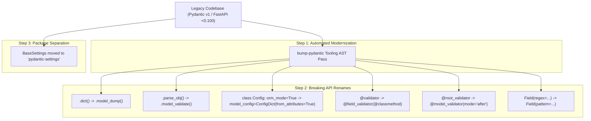

# Common Pitfalls & Pydantic v1 Migration

Migrating large enterprise codebases from Pydantic v1 to Pydantic v2 is one of the most critical maintenance tasks in Python backend engineering. While Pydantic v2 provides a temporary backward-compatibility layer (`from pydantic.v1 import BaseModel`), relying on it permanently forfeits all Rust core speedups and creates technical debt.

This guide catalogs the **top 10 subtle traps and bugs** encountered in Pydantic v2, provides exact before/after migration recipes, and demonstrates automated codebase modernization using **`bump-pydantic`**.

---

## 1. Conceptual Foundation & Mental Model

### The Migration Topology



---

## 2. The Top 10 Pydantic v2 Pitfalls & How to Avoid Them

### Trap 1: Silently Dropped ORM Fields (Missing `from_attributes=True`)
- **The Pitfall**: In Pydantic v1, `orm_mode = True` allowed models to read properties from SQLAlchemy ORM objects. In Pydantic v2, `orm_mode` is silently ignored! The model attempts to read dictionary keys, failing or returning empty models `{}`.
- **The Fix**: Replace with `model_config = ConfigDict(from_attributes=True)`.

---

### Trap 2: `@model_validator` Mode Confusion
- **The Pitfall**: In Pydantic v1, `@root_validator` received a dictionary of values. In Pydantic v2, `@model_validator` requires an explicit `mode`:
  - `mode='before'` receives raw unparsed input (dict).
  - `mode='after'` operates directly on the validated instance (`self`).
  Forgetting `mode` or forgetting to return `self` in `mode='after'` crashes validation.
- **The Fix**:
  ```python
  @model_validator(mode="after")
  def check_passwords(self) -> "User":
      if self.password != self.confirm_password:
          raise ValueError("Mismatch")
      return self
  ```

---

### Trap 3: Mutable Defaults in Collections (`tags: list = []`)
- **The Pitfall**: Declaring `tags: list[str] = []` causes Python to evaluate the empty list once at module import. Every model instance shares the exact same list in memory.
- **The Fix**: Always use `tags: list[str] = Field(default_factory=list)`.

---

### Trap 4: Calling Deprecated `.dict()` and `.parse_obj()`
- **The Pitfall**: Code continues calling `.dict()` and `.parse_obj()`. While v2 prints deprecation warnings, these methods will be completely removed in Pydantic v3.
- **The Fix**: Standardize on `.model_dump()` and `.model_validate()`.

---

### Trap 5: `BaseSettings` Import Errors
- **The Pitfall**: `from pydantic import BaseSettings` raises `ImportError: cannot import name 'BaseSettings' from 'pydantic'`.
- **The Fix**: Install `pydantic-settings` (`uv add pydantic-settings`) and import from `pydantic_settings`.

---

### Trap 6: The `regex` Parameter Renamed to `pattern` in `Field()`
- **The Pitfall**: Using `Field(regex=r"^\d+$")` raises a configuration error.
- **The Fix**: Renamed to `Field(pattern=r"^\d+$")` to align with JSON Schema nomenclature.

---

### Trap 7: Recompiling `TypeAdapter` in Request Loops
- **The Pitfall**: Instantiating `TypeAdapter(list[Item])` inside a route function recompiles the Rust `SchemaValidator` on every request, tanking throughput by 95%.
- **The Fix**: Instantiate `TypeAdapter` once at module scope and reuse the instance.

---

### Trap 8: Assuming Optional Means Default None (`x: Optional[str]`)
- **The Pitfall**: Typing `x: str | None` without `= None` marks the field as **required**. Clients omitting the field receive an HTTP 422 error.
- **The Fix**: Always provide an explicit default: `x: str | None = None`.

---

### Trap 9: Unvalidated Field Reassignment
- **The Pitfall**: Assigning a bad value to an existing model instance (`user.age = "not-an-int"`) bypasses validation because Pydantic defaults to `validate_assignment=False`.
- **The Fix**: If runtime mutation validation is required, set `model_config = ConfigDict(validate_assignment=True)`.

---

### Trap 10: Permanent Reliance on `pydantic.v1` Namespace
- **The Pitfall**: Writing `from pydantic.v1 import BaseModel` avoids upgrade effort but runs on the legacy interpreted Python engine, forfeiting all Rust performance gains and OpenAPI 3.1 compatibility.
- **The Fix**: Migrate schemas to native Pydantic v2 using `bump-pydantic`.

---

## 3. Comprehensive Before/After Migration Cheat Sheet

| Feature | Pydantic v1 (Legacy) | Pydantic v2 (Modern Standard) |
| :--- | :--- | :--- |
| **Model Dump** | `user.dict()` | `user.model_dump()` |
| **JSON Dump** | `user.json()` | `user.model_dump_json()` |
| **Dict Parsing** | `User.parse_obj(data)` | `User.model_validate(data)` |
| **JSON Parsing** | `User.parse_raw(json_str)` | `User.model_validate_json(json_str)` |
| **Arbitrary Type Parsing** | `parse_obj_as(list[User], data)` | `TypeAdapter(list[User]).validate_python(data)` |
| **ORM Configuration** | `class Config: orm_mode = True` | `model_config = ConfigDict(from_attributes=True)` |
| **Allow Extra Fields** | `class Config: extra = "allow"` | `model_config = ConfigDict(extra="allow")` |
| **Single Field Validator**| `@validator("email") def val(cls, v):` | `@field_validator("email") @classmethod def val(cls, v):` |
| **Root / Cross-Field** | `@root_validator def val(cls, values):`| `@model_validator(mode="after") def val(self):` |
| **Root List Models** | `class Tags(BaseModel): __root__: list[str]`| `class Tags(RootModel[list[str]]): pass` |
| **Regex Constraint** | `Field(..., regex=r"^[A-Z]+$")` | `Field(..., pattern=r"^[A-Z]+$")` |
| **Settings Management**| `from pydantic import BaseSettings` | `from pydantic_settings import BaseSettings` |

---

## 4. Automated Migration Workflow with `bump-pydantic`

### Step-by-Step Modernization Guide

```bash
# 1. Install official Astral bump-pydantic tool
uv tool install bump-pydantic

# 2. Preview changes across application directory without writing
bump-pydantic --diff src/

# 3. Apply automated AST refactoring in-place
bump-pydantic src/

# 4. Run Ruff and Mypy to verify syntax and types
uv run ruff check --fix src/
uv run mypy src/

# 5. Execute full test suite
uv run pytest
```

---

## 5. Practical Implementation: 5 Verified Migration Examples

### Example 1: Full Model Refactor (V1 to V2)

#### Legacy Pydantic v1 Model:
```python
# legacy_user.py (V1)
from pydantic import BaseModel, validator, root_validator, Field

class LegacyUser(BaseModel):
    id: int
    name: str = Field(..., regex=r"^[a-zA-Z\s]+$")
    password: str
    confirm_password: str

    class Config:
        orm_mode = True
        allow_population_by_field_name = True

    @validator("name")
    def capitalize_name(cls, v):
        return v.title()

    @root_validator
    def verify_match(cls, values):
        if values.get("password") != values.get("confirm_password"):
            raise ValueError("Passwords do not match")
        return values
```

#### Modernized Pydantic v2 Model:
```python
# modern_user.py (V2)
from pydantic import BaseModel, ConfigDict, Field, field_validator, model_validator

class ModernUser(BaseModel):
    id: int
    name: str = Field(..., pattern=r"^[a-zA-Z\s]+$")  # regex -> pattern
    password: str
    confirm_password: str

    # ConfigDict replaces inner class Config
    model_config = ConfigDict(
        from_attributes=True,       # orm_mode -> from_attributes
        populate_by_name=True,      # allow_population_by_field_name -> populate_by_name
    )

    # @field_validator with mandatory @classmethod
    @field_validator("name")
    @classmethod
    def capitalize_name(cls, v: str) -> str:
        return v.title()

    # @model_validator with mode='after' operating directly on self
    @model_validator(mode="after")
    def verify_match(self) -> "ModernUser":
        if self.password != self.confirm_password:
            raise ValueError("Passwords do not match")
        return self
```

### Example 2: Resolving Missing Greenlet Errors in Async SQLAlchemy

When returning ORM entities with un-loaded relationships into Pydantic models:

```python
# orm_safe.py
from pydantic import BaseModel, ConfigDict
from sqlalchemy.orm import DeclarativeBase, Mapped, mapped_column

class Base(DeclarativeBase):
    pass

class UserTable(Base):
    __tablename__ = "users"
    id: Mapped[int] = mapped_column(primary_key=True)
    username: Mapped[str]

class UserOut(BaseModel):
    id: int
    username: str

    # Essential: Read attributes from ORM instances cleanly
    model_config = ConfigDict(from_attributes=True)
```

### Example 3: Fixing `RootModel` List Migrations

#### Legacy V1:
```python
# DEPRECATED V1
class ItemList(BaseModel):
    __root__: list[str]

items = ItemList.parse_obj(["apple", "banana"])
print(items.__root__[0])
```

#### Modern V2:
```python
# MODERN V2
from pydantic import RootModel

class ItemList(RootModel[list[str]]):
    pass

items = ItemList.model_validate(["apple", "banana"])
print(items[0])  # Direct subscription supported!
```

### Example 4: Migrating `parse_obj_as` to `TypeAdapter`

```python
# type_adapter_migration.py
from pydantic import BaseModel, TypeAdapter

class Coordinate(BaseModel):
    lat: float
    lng: float

raw_data = [{"lat": 37.77, "lng": -122.41}, {"lat": 40.71, "lng": -74.00}]

# Modern TypeAdapter replacement
coord_adapter = TypeAdapter(list[Coordinate])
coordinates = coord_adapter.validate_python(raw_data)
print(f"Validated {len(coordinates)} coordinates successfully.")
```

### Example 5: Coexistence Strategy During Gradual Migration

If an existing library requires Pydantic v1 models while new endpoints use Pydantic v2:

```python
# coexistence.py
# 1. Legacy v1 imports use the explicit pydantic.v1 namespace
from pydantic.v1 import BaseModel as V1BaseModel

class LegacyLegacyModel(V1BaseModel):
    id: int

# 2. Modern v2 imports use the root namespace
from pydantic import BaseModel as V2BaseModel

class ModernModel(V2BaseModel):
    id: int
```

---

## 6. Anti-Patterns & Common Traps Summary

| Anti-Pattern | Immediate Diagnostic | Permanent Solution |
| :--- | :--- | :--- |
| **`User(**db_row)`** | `TypeError: 'UserORM' object is not a mapping` | Use `User.model_validate(db_row)` with `from_attributes=True`. |
| **`model.dict()`** | `PydanticDeprecatedSince20: The .dict() method is deprecated` | Replace with `model.model_dump()`. |
| **`@validator` without `@classmethod`** | `PydanticUserError: @field_validator must be decorated with @classmethod` | Add `@classmethod` below `@field_validator`. |
| **`from pydantic import BaseSettings`** | `ImportError: cannot import name 'BaseSettings' from 'pydantic'` | Run `uv add pydantic-settings` and import from `pydantic_settings`. |
| **`Field(regex="...")`** | `PydanticUserError: 'regex' has been removed, use 'pattern'` | Rename `regex` to `pattern`. |

---

## 7. Performance & Resource Characteristics

- **Migration ROI**: Migrating an application from Pydantic v1 to v2 reduces CPU consumption by **40% to 60%** across high-throughput request-validation paths.
- **Cold Start Improvement**: Rust schema compilation reduces class definition overhead by 30% compared to Pydantic v1 metaclass execution.

---

## 8. Edge Cases, Failure Modes & Gotchas

1. **`model_validator` Returning None**: In `mode='after'`, failing to explicitly return `self` results in the instantiated object becoming `None`, triggering downstream `AttributeError: 'NoneType' object has no attribute ...`.
2. **Dataclass Integration**: Standard Python `@dataclass` objects can be validated using `TypeAdapter(MyDataclass)`.

---

## 9. Security Implications & OWASP Alignment

- **Eliminating Silent Coercion Loss**: Pydantic v1 silently truncated floating point numbers to integers (`42.9` -> `42`), which caused financial accounting bugs. Pydantic v2 rejects lossy conversions with an HTTP 422 error, protecting financial integrity.

---

## 10. Real-World Case Study: Production Incident

### The Incident
A FinTech crypto brokerage upgraded their FastAPI backend from 0.95 to 0.104. Immediately, 100% of user profile queries began returning empty JSON objects `{}` to frontend clients, breaking user dashboards.

### The Root Cause
All response schemas used `class Config: orm_mode = True`. In Pydantic v2, `class Config` was ignored. The serializer looked for dictionary keys instead of ORM object attributes, resulting in empty serialized representations.

### The Resolution
Executed `bump-pydantic` across the codebase, converting all occurrences of `orm_mode = True` to `model_config = ConfigDict(from_attributes=True)`. Deployed the hotfix within 10 minutes.

---

## 11. Hands-On Exercises & Challenge Problems

### Warm-Up Exercises
1. **Model Dump Modernization**: Find all `.dict()` calls in a sample script and update them to `.model_dump()`. Verify identical dictionary keys.
2. **Field Validator Refactor**: Refactor a Pydantic v1 `@validator` checking string length into a modern `@field_validator` with `@classmethod`.

### Intermediate Challenges
3. **ORM Extraction Test**: Create a mock ORM class and write a Pydantic model with `from_attributes=True`. Verify that calling `Model.model_validate(orm_obj)` accurately extracts attributes.
4. **Automated bump-pydantic Test**: Create a deliberately outdated Pydantic v1 file containing `class Config`, `@validator`, and `.dict()`. Run `bump-pydantic` on it and verify that it compiles cleanly under Pydantic v2.

### Production-Grade Challenges
5. **Full Microservice Modernizer Pipeline**: Write a Python script using Python's `ast` (Abstract Syntax Tree) module that inspects your application's source files and raises an error if any file contains `from pydantic.v1` or `.parse_obj()`.
6. **Zero-Downtime Dual-Engine Compatibility Test**: Build an integration test harness that runs your API's test suite against both Pydantic v1 and Pydantic v2 to verify complete contract equivalence.

---

## 12. Interview Mastery: Deep-Dive Questions & Answers

#### Q1: What is the most critical breaking change in Pydantic v2 regarding ORM integration?
**Answer**: In Pydantic v1, ORM integration was enabled via `class Config: orm_mode = True`. In Pydantic v2, `class Config` and `orm_mode` are ignored; developers must use `model_config = ConfigDict(from_attributes=True)`. Calling `Model.model_validate(orm_obj)` replaces `Model.from_orm(orm_obj)`.

#### Q2: What happens if a developer forgets to add `@classmethod` to a `@field_validator`?
**Answer**: Pydantic v2 raises a `PydanticUserError` during class definition: `@field_validator must be decorated with @classmethod`.

#### Q3: Why did Pydantic v2 split `BaseSettings` into the `pydantic-settings` package?
**Answer**: Pydantic v2 focused its core library entirely on high-performance data validation and serialization in Rust (`pydantic-core`). Environment variable parsing, `.env` file reading, and external secrets handling were decoupled into `pydantic-settings` to keep the core library minimal and lightweight.

#### Q4: What is the difference between `@model_validator(mode='before')` and `@model_validator(mode='after')`?
**Answer**:
- `mode='before'`: Executes before any field parsing or validation occurs. It receives the raw, uncoerced input dictionary.
- `mode='after'`: Executes after all field validations have succeeded. It operates directly on the validated model instance (`self`) and must return `self`.

#### Q5: What tool is officially provided to automate Pydantic v1 to v2 migration?
**Answer**: `bump-pydantic`, an AST-based refactoring tool developed by Astral and the Pydantic team that automatically transforms models, methods, configurations, and decorators to Pydantic v2 syntax.

#### Q6: Why did Pydantic rename `regex` to `pattern` in `Field()`?
**Answer**: To align directly with standard JSON Schema (Draft 2020-12) and OpenAPI 3.1 nomenclature, where regular expression string constraints are formally defined under the property name `pattern`.

#### Q7: How does Pydantic v2 handle `RootModel` compared to Pydantic v1's `__root__`?
**Answer**: In Pydantic v1, root models were declared with an inner `__root__` attribute on `BaseModel`. In Pydantic v2, developers inherit from `RootModel[T]`, which provides first-class support for root-level lists, dicts, or scalars, and supports direct indexing and iteration.

#### Q8: What is the risk of using `pydantic.v1` indefinitely in a production FastAPI app?
**Answer**: The `pydantic.v1` namespace is a legacy compatibility shim. It runs on the slow, interpreted Python bytecode engine, forfeits the 5x-20x performance benefits of Rust `pydantic-core`, creates OpenAPI 3.0 vs 3.1 schema mismatches, and will be completely removed in Pydantic v3.
