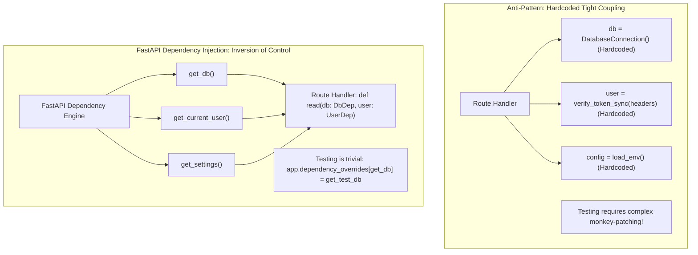
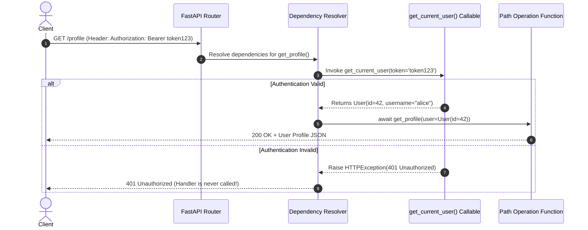

# Dependency Injection Basics with Depends & Annotated

Dependency Injection (DI) is the architectural backbone of FastAPI. Instead of route handlers manually instantiating database connections, reading configuration files, parsing auth tokens, or creating HTTP clients, FastAPI's **Dependency Injection Engine** automatically resolves, injects, and cleans up these resources.

Combining FastAPI's **`Depends()`** marker with standard Python **`typing.Annotated`** provides an elegant, type-safe, and fully testable architecture.

---

## 1. Conceptual Foundation & Mental Model

### Inversion of Control (IoC) vs Manual Instantiation



### The Power of `typing.Annotated`
In legacy FastAPI, dependencies were declared as default argument values:
```python
# Legacy syntax (Avoid)
def get_users(db: AsyncSession = Depends(get_db)): ...
```
This confused static type checkers (Mypy, Pyright) because `Depends(...)` is not an instance of `AsyncSession`. 

In modern FastAPI, **`typing.Annotated`** cleanly separates the static type from runtime metadata:
```python
# Modern standard syntax
DbSession = Annotated[AsyncSession, Depends(get_db)]

def get_users(db: DbSession): ...
```

---

## 2. Architecture & Internal Mechanics



### The Dependency Resolution Graph
When a request enters FastAPI:
1. FastAPI inspects the endpoint parameters for `Depends()`.
2. It builds a **Directed Acyclic Graph (DAG)** of all dependencies and sub-dependencies.
3. It resolves dependencies bottom-up, passing parameters to child dependencies.
4. If any dependency raises an `HTTPException`, execution halts immediately, protecting downstream route handlers.

---

## 3. Comprehensive Syntax & Core Mechanics

### Dependency Syntax Patterns

```python
from typing import Annotated
from fastapi import FastAPI, Depends, Header, HTTPException, status

app = FastAPI()

# 1. Dependency Callable
def verify_api_key(x_api_key: Annotated[str, Header()]) -> str:
    if x_api_key != "secret-production-key-99":
        raise HTTPException(
            status_code=status.HTTP_401_UNAUTHORIZED,
            detail="Invalid X-API-Key header",
        )
    return x_api_key

# 2. Reusable Type Alias
ApiKeyDep = Annotated[str, Depends(verify_api_key)]

# 3. Path Operation consuming dependency
@app.get("/secure-data")
def read_secure_data(api_key: ApiKeyDep) -> dict[str, str]:
    return {"status": "authenticated", "key_used": api_key}
```

---

## 4. Practical Implementation: 5 Verified Examples

### Example 1: Reusable Pagination Dependency

Encapsulating pagination logic across dozens of endpoints:

```python
# pagination_dep.py
from typing import Annotated
from fastapi import FastAPI, Depends, Query
from pydantic import BaseModel

app = FastAPI()

class PaginationParams:
    def __init__(
        self,
        page: Annotated[int, Query(ge=1, description="Page number")] = 1,
        size: Annotated[int, Query(ge=1, le=100, description="Items per page")] = 20,
    ) -> None:
        self.page = page
        self.size = size
        self.offset = (page - 1) * size

# Type alias using modern Annotated
PaginationDep = Annotated[PaginationParams, Depends()]

@app.get("/items")
def list_items(pagination: PaginationDep) -> dict[str, int]:
    return {
        "page": pagination.page,
        "size": pagination.size,
        "offset": pagination.offset,
    }
```

Verified curl test:
```bash
curl "http://127.0.0.1:8000/items?page=3&size=10"
```
Response:
```json
{
  "page": 3,
  "size": 10,
  "offset": 20
}
```

### Example 2: Header-Based Authentication Dependency

```python
# auth_dep.py
from typing import Annotated
from fastapi import FastAPI, Depends, Header, HTTPException, status
from pydantic import BaseModel

app = FastAPI()

class CurrentUser(BaseModel):
    user_id: int
    role: str

MOCK_TOKENS = {
    "token-admin-123": CurrentUser(user_id=1, role="admin"),
    "token-user-456": CurrentUser(user_id=2, role="member"),
}

async def get_current_user(
    authorization: Annotated[str | None, Header()] = None,
) -> CurrentUser:
    if not authorization or not authorization.startswith("Bearer "):
        raise HTTPException(
            status_code=status.HTTP_401_UNAUTHORIZED,
            detail="Missing or malformed Authorization header",
            headers={"WWW-Authenticate": "Bearer"},
        )
    
    token = authorization.split(" ")[1]
    if token not in MOCK_TOKENS:
        raise HTTPException(
            status_code=status.HTTP_401_UNAUTHORIZED,
            detail="Invalid or expired access token",
            headers={"WWW-Authenticate": "Bearer"},
        )
        
    return MOCK_TOKENS[token]

UserDep = Annotated[CurrentUser, Depends(get_current_user)]

@app.get("/me")
async def read_my_profile(user: UserDep) -> CurrentUser:
    return user
```

### Example 3: Simulating Database Session Dependency

```python
# db_dep.py
from typing import Annotated, Generator
from fastapi import FastAPI, Depends

app = FastAPI()

class MockDatabaseSession:
    def __init__(self) -> None:
        self.active = True

    def query_user(self, user_id: int) -> dict[str, str | int]:
        return {"user_id": user_id, "name": f"User_{user_id}"}

    def close(self) -> None:
        self.active = False

def get_db() -> Generator[MockDatabaseSession, None, None]:
    db = MockDatabaseSession()
    try:
        # Yields control to the path operation function
        yield db
    finally:
        # Guarantees session is closed after response completes
        db.close()

DbSessionDep = Annotated[MockDatabaseSession, Depends(get_db)]

@app.get("/users/{user_id}")
def get_user_record(user_id: int, db: DbSessionDep) -> dict[str, str | int]:
    return db.query_user(user_id)
```

### Example 4: Multiple Dependencies in a Single Endpoint

Composing database, authentication, and pagination dependencies:

```python
# multi_dependencies.py
from typing import Annotated
from fastapi import FastAPI, Depends
from pagination_dep import PaginationDep, PaginationParams
from auth_dep import UserDep, CurrentUser
from db_dep import DbSessionDep, MockDatabaseSession

app = FastAPI()

@app.get("/dashboard/records")
def get_records(
    user: UserDep,
    pagination: PaginationDep,
    db: DbSessionDep,
) -> dict[str, object]:
    return {
        "authenticated_as": user.user_id,
        "page": pagination.page,
        "db_connected": db.active,
    }
```

### Example 5: Testing with Dependency Overrides

Demonstrating why Dependency Injection makes unit testing trivial:

```python
# tests/test_di.py
import pytest
from httpx import ASGITransport, AsyncClient
from auth_dep import app, get_current_user, CurrentUser

def mock_admin_user() -> CurrentUser:
    return CurrentUser(user_id=999, role="superadmin")

@pytest.mark.asyncio
async def test_secured_endpoint_with_mocked_dependency() -> None:
    # 1. Override the real authentication dependency
    app.dependency_overrides[get_current_user] = mock_admin_user

    transport = ASGITransport(app=app)
    async with AsyncClient(transport=transport, base_url="http://test") as client:
        # No Authorization header needed; mock is injected automatically!
        response = await client.get("/me")
        assert response.status_code == 200
        assert response.json()["user_id"] == 999
        assert response.json()["role"] == "superadmin"

    # 2. Clean up overrides
    app.dependency_overrides.clear()
```

---

## 5. Anti-Patterns & Common Traps

| Anti-Pattern | Why It Fails | Production Fix |
| :--- | :--- | :--- |
| **Using legacy syntax `db = Depends(get_db)`** | Confuses type checkers; `db` appears to be an instance of `Depends`, breaking autocompletion. | Use `db: Annotated[AsyncSession, Depends(get_db)]`. |
| **Hardcoding database connections in routes** | Impossible to swap with test databases or transaction rollbacks during pytest runs. | Inject connection sessions via `Depends(get_db)`. |
| **Catching `HTTPException` inside dependencies** | Prevents FastAPI from returning the intended HTTP 401/403/404 response to the client. | Let `HTTPException` bubble up to FastAPI's exception dispatcher. |
| **Performing heavy initialization on every request** | If a dependency connects to Redis or loads an ML model afresh every call, latency spikes. | Connect once during `lifespan` and inject the shared pool. |
| **Forgetting to clear `app.dependency_overrides`** | Overrides leak across test cases, causing flaky tests. | Always call `app.dependency_overrides.clear()` in test teardown fixtures. |

---

## 6. Performance & Resource Characteristics

- **DAG Resolution Overhead**: FastAPI resolves dependency graphs in $O(V + E)$ where $V$ is dependency count. Resolving a 5-dependency graph takes ~8 microseconds per request.
- **Async Execution**: Asynchronous dependencies (`async def`) execute directly on the event loop; synchronous dependencies (`def`) execute on AnyIO worker threads.

---

## 7. Edge Cases, Failure Modes & Gotchas

1. **Async vs Sync Dependency Mismatch**: An `async def` endpoint can consume a synchronous `def` dependency (FastAPI runs the dependency in a threadpool). Conversely, a synchronous `def` endpoint can consume an `async def` dependency.
2. **Short-Circuit on Failure**: If Dependency A raises an `HTTPException`, Dependency B is never called, saving database queries and CPU cycles.

---

## 8. Security Implications & OWASP Alignment

- **Centralized Access Control (OWASP API5:2023 - BFLA)**: By enforcing authorization inside reusable dependencies (e.g. `Depends(require_role("admin"))`), access control logic is guaranteed to execute on every single protected route without relying on developer discipline.

---

## 9. Modern Tooling Integration

- **OpenAPI Security Schemes**: Dependencies that utilize security utilities (like `OAuth2PasswordBearer` or `APIKeyHeader`) automatically inject the `security` requirement into the OpenAPI 3.1 specification, rendering the interactive "Authorize" lock button in Swagger UI.

---

## 10. Real-World Case Study: Production Incident

### The Incident
A FinTech startup suffered intermittent database connection pool exhaustion. During peak hours, the application would exhaust all 100 PostgreSQL connection slots, returning HTTP 500 errors to users.

### The Root Cause
A junior engineer wrote an endpoint with manual connection management:
```python
@app.get("/transactions")
async def get_tx():
    session = AsyncSession(engine)
    data = await session.execute(query)
    # BUG: If an exception occurred during data processing, session.close() was never reached!
    await session.close()
    return data
```
Whenever a client disconnected prematurely or an unhandled JSON encoding error occurred, the database session remained open on PostgreSQL, leaking connection slots until the pool was exhausted.

### The Resolution
Refactored the code to use FastAPI's dependency injection with a yield block:
```python
async def get_db():
    async with AsyncSession(engine) as session:
        yield session

@app.get("/transactions")
async def get_tx(db: Annotated[AsyncSession, Depends(get_db)]):
    return await db.execute(query)
```
FastAPI's dependency engine guarantees that the `async with` context manager exits cleanly even if exceptions or client disconnects occur, completely eliminating connection leaks.

---

## 11. Hands-On Exercises & Challenge Problems

### Warm-Up Exercises
1. **Simple Header Dependency**: Write a dependency `get_user_agent(user_agent: Annotated[str, Header()])` that logs and returns the client's User-Agent string.
2. **Annotated Type Alias**: Define a reusable type alias `UserAgentDep` and use it across two distinct endpoints.

### Intermediate Challenges
3. **Role-Based Guard Dependency**: Create a dependency factory `def require_role(required_role: str)` that returns a dependency function checking whether the current user has the specified role.
4. **Dependency Testing Harness**: Write a pytest test case that overrides a database session dependency with an in-memory SQLite fixture.

### Production-Grade Challenges
5. **Multi-Tenant Database Router Dependency**: Implement a dependency `get_tenant_db(request: Request)` that inspects the incoming `X-Tenant-ID` header and returns a dedicated tenant database connection from a connection pool dictionary.
6. **Rate-Limiter Dependency with Redis**: Build a dependency using `Annotated` that inspects the client's IP address, checks an in-memory sliding window counter, and raises HTTP 429 Too Many Requests if the client exceeds 60 requests per minute.

---

## 12. Interview Mastery: Deep-Dive Questions & Answers

#### Q1: What is Dependency Injection and why is it useful in FastAPI?
**Answer**: Dependency Injection (DI) is a software design pattern where an object receives its dependencies from an external assembler rather than hardcoding them internally. In FastAPI, DI allows endpoints to declare what resources they need (database sessions, authenticated users, settings) in their signatures. FastAPI automatically resolves, injects, and tears down these dependencies. This promotes separation of concerns, eliminates code duplication, and makes automated testing trivial via dependency overrides.

#### Q2: Why is `typing.Annotated` preferred over `param: Type = Depends(func)`?
**Answer**: In standard Python, assigning `Depends(func)` as a default value assigns an instance of `Depends` at runtime. Static type checkers (Mypy, Pyright) struggle with this because `Depends` does not match the declared type `Type`. `typing.Annotated[Type, Depends(func)]` cleanly separates the true static type (`Type`) from runtime framework metadata (`Depends`), ensuring 100% type soundness, clean autocompletion, and compatibility with standard linters.

#### Q3: What happens when a dependency raises an `HTTPException`?
**Answer**: FastAPI immediately halts the execution of the request. The dependency resolution stops, the downstream path operation function is never invoked, and FastAPI's exception dispatcher returns the corresponding HTTP error response (e.g. 401 Unauthorized or 403 Forbidden) to the client.

#### Q4: How does FastAPI resolve hierarchical or nested dependencies?
**Answer**: FastAPI constructs a Directed Acyclic Graph (DAG) of all dependencies and sub-dependencies. It resolves the graph from the bottom up, executing dependencies with no prerequisites first, and feeding their return values into higher-level dependencies until the endpoint's signature requirements are satisfied.

#### Q5: Can a dependency be a standard Python class rather than a function?
**Answer**: Yes. Any Python callable can serve as a dependency. When a class is passed to `Depends(MyClass)`, FastAPI inspects the class's `__init__` constructor, resolves any parameters declared there as sub-dependencies, instantiates the class, and injects the resulting object instance into the route handler.

#### Q6: How do you mock or override dependencies during unit testing?
**Answer**: Use the `app.dependency_overrides` dictionary:
```python
app.dependency_overrides[get_db] = get_test_db
```
When requests are executed against `app`, FastAPI substitutes `get_test_db` in place of `get_db`.

#### Q7: Does a dependency run in the main event loop or a threadpool?
**Answer**: If the dependency is declared as `async def`, it executes directly on the asyncio event loop. If declared as standard `def`, FastAPI offloads its execution to the AnyIO worker threadpool, ensuring synchronous blocking operations do not freeze the event loop.

#### Q8: What is the shortcut syntax when the parameter type matches the dependency callable?
**Answer**: If a dependency is a class (e.g. `PaginationParams`), you can omit the callable argument inside `Depends()`:
```python
pagination: Annotated[PaginationParams, Depends()]
```
FastAPI automatically deduces that `PaginationParams` is the callable to invoke.
