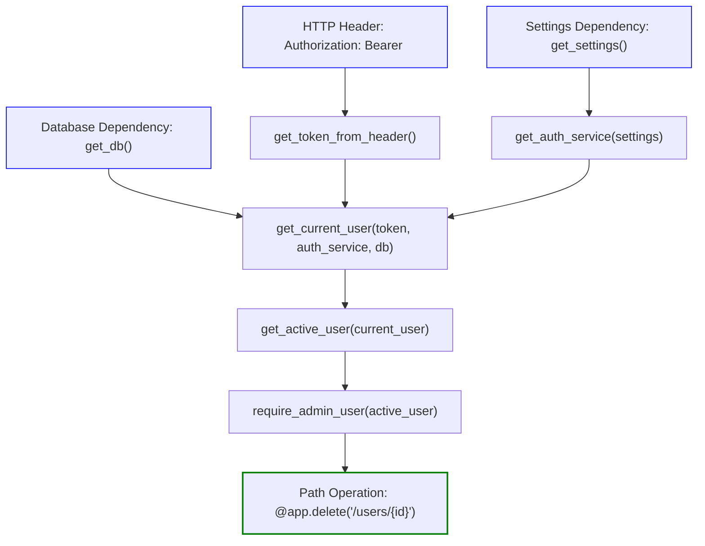
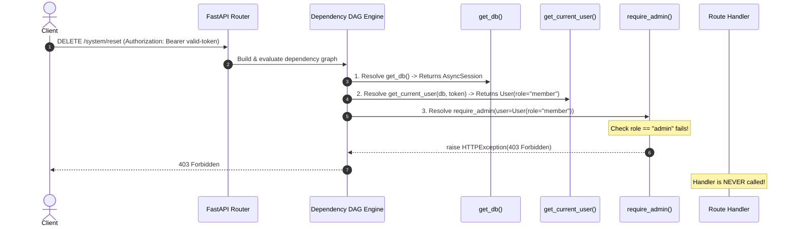
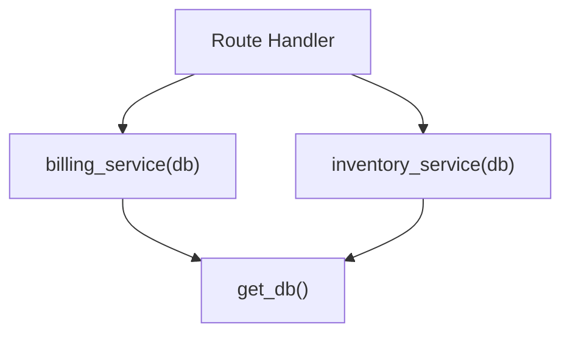

# Sub-Dependencies & Hierarchical Graphs in FastAPI

In production architectures, dependencies rarely exist in isolation. Authentication requires a database session, authorization requires an authenticated user, and tenant routing requires an organization lookup.

FastAPI handles this through **Sub-Dependencies**, automatically building a **Directed Acyclic Graph (DAG)** of all dependencies, resolving parameters from HTTP inputs at leaf nodes, executing bottom-up, and passing resolved values up the tree to your path operation handlers.

---

## 1. Conceptual Foundation & Mental Model

### The Hierarchical Authorization Chain



### Why Sub-Dependencies Excel
1. **Composability**: Small, single-responsibility functions are composed into complex security and business pipelines.
2. **Short-Circuit Protection**: If `get_current_user` raises an HTTP 401 error, `get_active_user` and `require_admin_user` are **never executed**, saving database round-trips and CPU cycles.
3. **Parameter Invariance**: Leaf dependencies can request path, query, header, or cookie parameters directly; higher-level dependencies simply declare the dependency types.

---

## 2. Architecture & Internal Mechanics



---

## 3. Comprehensive Syntax & Core Mechanics

### Chaining Dependencies with `Annotated`

```python
from typing import Annotated
from fastapi import Depends, HTTPException, status
from pydantic import BaseModel

class User(BaseModel):
    id: int
    is_active: bool
    role: str

# 1. Level 1: Raw user extraction
async def get_current_user() -> User:
    return User(id=1, is_active=True, role="member")

CurrentUserDep = Annotated[User, Depends(get_current_user)]

# 2. Level 2: Sub-dependency consuming Level 1
async def get_active_user(current_user: CurrentUserDep) -> User:
    if not current_user.is_active:
        raise HTTPException(
            status_code=status.HTTP_400_BAD_REQUEST,
            detail="Inactive user account",
        )
    return current_user

ActiveUserDep = Annotated[User, Depends(get_active_user)]

# 3. Level 3: Sub-dependency consuming Level 2
async def require_admin(active_user: ActiveUserDep) -> User:
    if active_user.role != "admin":
        raise HTTPException(
            status_code=status.HTTP_403_FORBIDDEN,
            detail="Administrative privileges required",
        )
    return active_user

AdminDep = Annotated[User, Depends(require_admin)]
```

---

## 4. Practical Implementation: 5 Verified Examples

### Example 1: Multi-Tiered Security Guard Architecture

```python
# multi_tier_auth.py
from typing import Annotated
from fastapi import FastAPI, Depends, Header, HTTPException, status
from pydantic import BaseModel

app = FastAPI()

class UserAccount(BaseModel):
    user_id: int
    username: str
    is_verified: bool
    role: str

MOCK_DB = {
    "token_alice": UserAccount(user_id=1, username="alice", is_verified=True, role="admin"),
    "token_bob": UserAccount(user_id=2, username="bob", is_verified=False, role="member"),
}

# Tier 1: Token extractor
def extract_token(authorization: Annotated[str | None, Header()] = None) -> str:
    if not authorization or not authorization.startswith("Bearer "):
        raise HTTPException(
            status_code=status.HTTP_401_UNAUTHORIZED,
            detail="Missing or malformed Authorization header",
        )
    return authorization.split(" ")[1]

TokenDep = Annotated[str, Depends(extract_token)]

# Tier 2: User loader (Sub-depends on Token)
def get_user_from_token(token: TokenDep) -> UserAccount:
    if token not in MOCK_DB:
        raise HTTPException(
            status_code=status.HTTP_401_UNAUTHORIZED,
            detail="Invalid or expired session token",
        )
    return MOCK_DB[token]

UserDep = Annotated[UserAccount, Depends(get_user_from_token)]

# Tier 3: Verification gate (Sub-depends on User)
def require_verified_account(user: UserDep) -> UserAccount:
    if not user.is_verified:
        raise HTTPException(
            status_code=status.HTTP_403_FORBIDDEN,
            detail="Email verification required before accessing this resource.",
        )
    return user

VerifiedUserDep = Annotated[UserAccount, Depends(require_verified_account)]

# Tier 4: Role gate (Sub-depends on Verified User)
def require_admin_role(verified_user: VerifiedUserDep) -> UserAccount:
    if verified_user.role != "admin":
        raise HTTPException(
            status_code=status.HTTP_403_FORBIDDEN,
            detail="Operation restricted to system administrators.",
        )
    return verified_user

AdminUserDep = Annotated[UserAccount, Depends(require_admin_role)]

# Route consuming top of the pyramid
@app.delete("/system/purge-cache")
def purge_cache(admin: AdminUserDep) -> dict[str, str]:
    return {"status": "purged", "authorized_by": admin.username}
```

Verified curl runs:
1. Missing token -> `401 Unauthorized`
2. Bob's token (unverified) -> `403 Forbidden` (`Email verification required`)
3. Alice's token (verified admin) -> `200 OK` (`{"status": "purged", "authorized_by": "alice"}`)

### Example 2: Parameter Propagation from Leaf Nodes

Demonstrating how leaf dependencies extract query/path parameters without the route handler needing to mention them:

```python
# leaf_parameters.py
from typing import Annotated
from fastapi import FastAPI, Depends, Query, Path

app = FastAPI()

# Leaf 1: Extracts tenant ID from path template
def get_tenant_id(
    tenant_id: Annotated[int, Path(ge=1, description="Tenant organization ID")],
) -> int:
    return tenant_id

# Leaf 2: Extracts audit note from query
def get_audit_note(
    note: Annotated[str, Query(description="Audit reason for action")] = "General maintenance",
) -> str:
    return note

# Composite Sub-Dependency
class TenantContext:
    def __init__(
        self,
        tenant_id: Annotated[int, Depends(get_tenant_id)],
        audit_note: Annotated[str, Depends(get_audit_note)],
    ) -> None:
        self.tenant_id = tenant_id
        self.audit_note = audit_note

TenantDep = Annotated[TenantContext, Depends()]

@app.post("/tenants/{tenant_id}/lock")
def lock_tenant(context: TenantDep) -> dict[str, str | int]:
    # Route signature ONLY requests 'context', but FastAPI exposes
    # both {tenant_id} and ?note in Swagger UI automatically!
    return {
        "locked_tenant": context.tenant_id,
        "reason": context.audit_note,
        "status": "locked",
    }
```

### Example 3: Multi-Layer Service Architecture (Repository -> Service -> Controller)

```python
# service_layers.py
from typing import Annotated
from fastapi import FastAPI, Depends

app = FastAPI()

class DatabaseConnection:
    def execute(self, query: str) -> list[str]:
        return ["record_1", "record_2"]

def get_db_connection() -> DatabaseConnection:
    return DatabaseConnection()

DbDep = Annotated[DatabaseConnection, Depends(get_db_connection)]

class UserRepository:
    def __init__(self, db: DbDep) -> None:
        self.db = db

    def find_all_users(self) -> list[str]:
        return self.db.execute("SELECT * FROM users")

UserRepoDep = Annotated[UserRepository, Depends()]

class UserService:
    def __init__(self, repo: UserRepoDep) -> None:
        self.repo = repo

    def get_formatted_users(self) -> dict[str, object]:
        raw = self.repo.find_all_users()
        return {"count": len(raw), "users": [u.upper() for u in raw]}

UserServiceDep = Annotated[UserService, Depends()]

@app.get("/users")
def list_users(service: UserServiceDep) -> dict[str, object]:
    return service.get_formatted_users()
```

### Example 4: Diamond Dependency Resolution with Shared Session

Resolving the diamond problem: two dependencies sharing a single parent:



```python
# diamond_resolution.py
from typing import Annotated, Generator
from fastapi import FastAPI, Depends

app = FastAPI()

class SessionPool:
    def __init__(self) -> None:
        self.session_id = id(self)

def get_db() -> Generator[SessionPool, None, None]:
    s = SessionPool()
    yield s

DbDep = Annotated[SessionPool, Depends(get_db)]

def billing_subservice(db: DbDep) -> int:
    return db.session_id

def inventory_subservice(db: DbDep) -> int:
    return db.session_id

@app.post("/order/complete")
def complete_order(
    billing_id: Annotated[int, Depends(billing_subservice)],
    inventory_id: Annotated[int, Depends(inventory_subservice)],
    direct_db: DbDep,
) -> dict[str, object]:
    # All three access points share the exact same session ID!
    return {
        "billing_session": billing_id,
        "inventory_session": inventory_id,
        "direct_session": direct_db.session_id,
        "is_unified": billing_id == inventory_id == direct_db.session_id,
    }
```

Response:
```json
{
  "billing_session": 1404593821900,
  "inventory_session": 1404593821900,
  "direct_session": 1404593821900,
  "is_unified": true
}
```

### Example 5: Testing Deep Trees by Overriding Leaf Nodes

To test a complex multi-tiered endpoint, you only need to override the lowest leaf node:

```python
# tests/test_deep_tree.py
import pytest
from httpx import ASGITransport, AsyncClient
from multi_tier_auth import app, extract_token

@pytest.mark.asyncio
async def test_admin_route_by_overriding_leaf_token() -> None:
    # Override only the leaf token extractor!
    app.dependency_overrides[extract_token] = lambda: "token_alice"

    transport = ASGITransport(app=app)
    async with AsyncClient(transport=transport, base_url="http://test") as client:
        # Request succeeds without supplying any HTTP Authorization header!
        response = await client.delete("/system/purge-cache")
        assert response.status_code == 200
        assert response.json()["authorized_by"] == "alice"

    app.dependency_overrides.clear()
```

---

## 5. Anti-Patterns & Common Traps

| Anti-Pattern | Why It Fails | Production Fix |
| :--- | :--- | :--- |
| **Circular dependency loops (A -> B -> A)** | Raises `RecursionError` or cyclic dependency exceptions at startup. | Refactor shared logic into a lower-level leaf dependency C. |
| **Passing database session manually down services** | Defeats Dependency Injection and tightens coupling. | Let each service declare `db: DbDep` in its `__init__`. |
| **Deep hierarchy exceeding 6 levels** | Increases mental complexity and makes debugging resolution graphs difficult. | Flatten hierarchies into cohesive composite context objects. |
| **Extracting request parameters in middle nodes** | Middle nodes should express domain requirements, not HTTP extraction details. | Keep path/query extraction in leaf nodes or controllers. |
| **Catching exceptions from sub-dependencies** | If a parent catches an HTTP 401 raised by a child and returns a fallback, security gates fail silently. | Let authentication/authorization exceptions bubble up unhindered. |

---

## 6. Performance & Resource Characteristics

- **DAG Resolution Complexity**: FastAPI computes the topological sort of dependencies once at startup. Per-request execution operates in $O(N)$ where $N$ is unique dependency count.
- **Short-Circuit Speed**: If an authentication check at depth 2 fails, execution aborts in under 5 microseconds, avoiding downstream database I/O.

---

## 7. Edge Cases, Failure Modes & Gotchas

1. **Diamond Dependency with `use_cache=False`**: If a leaf node sets `use_cache=False`, each parent branch instantiates its own copy, breaking transaction unity. Keep `use_cache=True` for shared resources.
2. **OpenAPI Parameter Collation**: FastAPI collates all parameters from all leaf nodes in the DAG and exposes them on the route in Swagger UI.

---

## 8. Security Implications & OWASP Alignment

- **Defense in Depth**: Chained authorization dependencies (`Token -> User -> Verified -> Admin`) implement Defense in Depth (OWASP Security Principle). Each layer validates a distinct security invariant before execution reaches business logic.

---

## 9. Modern Tooling Integration

- **Swagger UI Interactive Locks**: Security dependencies placed at leaf nodes automatically configure the `security` property on the path operation in `/openapi.json`.

---

## 10. Real-World Case Study: Production Incident

### The Incident
A multi-tenant healthcare SaaS platform experienced a privacy breach where an authenticated physician from Hospital A was able to access medical records belonging to Hospital B by tampering with the URL: `GET /tenants/hospital_b/patients/102`.

### The Root Cause
The route handler had separate, decoupled parameters:
```python
@app.get("/tenants/{tenant_id}/patients/{patient_id}")
async def get_patient(
    tenant_id: str,
    patient_id: int,
    user = Depends(get_current_user),  # Validates user is a doctor
):
    # BUG: The developer forgot to write code verifying that
    # user.hospital_id == tenant_id!
    return await db.query_patient(tenant_id, patient_id)
```

### The Resolution
Created a hierarchical sub-dependency `TenantAccessGuard` that sub-depends on both `get_current_user` and the path parameter `tenant_id`:
```python
def verify_tenant_access(
    tenant_id: Annotated[str, Path()],
    user: Annotated[User, Depends(get_current_user)],
) -> TenantContext:
    if user.tenant_id != tenant_id and not user.is_superadmin:
        raise HTTPException(status_code=403, detail="Cross-tenant access forbidden")
    return TenantContext(tenant_id=tenant_id, user=user)

TenantGuard = Annotated[TenantContext, Depends(verify_tenant_access)]

@app.get("/tenants/{tenant_id}/patients/{patient_id}")
async def get_patient(patient_id: int, guard: TenantGuard): ...
```
Authorization was strictly enforced by the dependency graph before the route handler could execute, eliminating cross-tenant leakage.

---

## 11. Hands-On Exercises & Challenge Problems

### Warm-Up Exercises
1. **Two-Level Chain**: Write a dependency `get_token` (from header) and a sub-dependency `get_user` (from token). Verify in a route.
2. **Short-Circuit Verification**: Send an invalid token and assert that `get_user` is never called.

### Intermediate Challenges
3. **Diamond Session Dependency**: Recreate Example 4. Prove that two sub-services receive the exact same database session instance.
4. **Tenant Path Guard**: Build a sub-dependency that reads `{tenant_id}` from the path and verifies it matches the authenticated user's organization.

### Production-Grade Challenges
5. **Hierarchical RBAC Matrix**: Build a complete 4-tier dependency tree:
   - `get_token` -> `get_user` -> `verify_permissions(required_scope)`
   Create three routes requiring different scopes (`read:users`, `write:users`, `admin`).
6. **Leaf Dependency Mocking Suite**: Write a comprehensive pytest test file that executes 10 tests against a 4-tier dependency pipeline, mocking only the leaf database connection.

---

## 12. Interview Mastery: Deep-Dive Questions & Answers

#### Q1: What is a sub-dependency in FastAPI?
**Answer**: A sub-dependency is a dependency that itself declares one or more dependencies in its function signature. FastAPI resolves these recursively, constructing a Directed Acyclic Graph (DAG) and executing dependencies bottom-up until the top-level route handler parameters are satisfied.

#### Q2: How does FastAPI resolve the "diamond dependency" problem?
**Answer**: When two sub-dependencies depend on the same underlying leaf dependency (e.g. both Service A and Service B depend on `get_db`), FastAPI's default `use_cache=True` ensures the leaf dependency executes only once. Both services receive the exact same instance, preserving database transaction boundaries.

#### Q3: What happens if a sub-dependency at depth 3 raises an `HTTPException`?
**Answer**: FastAPI immediately halts the entire dependency resolution pipeline. All upstream parent dependencies and the path operation function are aborted, and the HTTP exception response is returned to the client immediately.

#### Q4: How do sub-dependencies access request parameters like headers or path parameters?
**Answer**: Leaf dependencies can declare path, query, header, or cookie parameters directly in their signatures (e.g. `x_token: Annotated[str, Header()]`). FastAPI's parameter resolution engine inspects the entire dependency tree and extracts the required values from the incoming request.

#### Q5: Can sub-dependencies be asynchronous if the parent is synchronous?
**Answer**: Yes. FastAPI supports mixing asynchronous (`async def`) and synchronous (`def`) dependencies anywhere in the tree. Synchronous dependencies are offloaded to AnyIO worker threads, while asynchronous dependencies run on the main event loop.

#### Q6: How does dependency overriding work with sub-dependencies in tests?
**Answer**: You can override any node in the dependency graph using `app.dependency_overrides`. Overriding a leaf node (e.g. `get_db`) automatically propagates the mocked value to all upstream parent sub-dependencies that consume it.

#### Q7: What is the maximum recommended depth for dependency trees in production?
**Answer**: While FastAPI can technically resolve arbitrary depths, keeping trees between 2 to 4 levels deep (e.g. `Header -> Token -> User -> Role`) maintains high readability and keeps stack traces manageable.

#### Q8: Does FastAPI detect circular dependencies?
**Answer**: Yes. If Dependency A depends on Dependency B and Dependency B depends on Dependency A, FastAPI will detect the cyclic graph during application initialization and raise an error, preventing infinite recursion loops.
