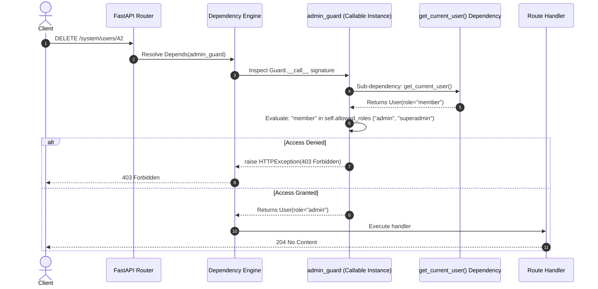

# Class-Based Dependencies & Callable Instances

While simple dependencies are often implemented as standalone functions, complex enterprise systems benefit immensely from **Class-Based Dependencies**. In Python, any callable can serve as a dependency—and classes are callables.

FastAPI supports two primary class-based dependency patterns:
1. **The Class Itself as a Dependency (`Depends(MyClass)`)**: FastAPI inspects `__init__`, resolves constructor arguments, and injects a newly instantiated object.
2. **Callable Class Instances (`Depends(my_instance)`)**: A class implements `__call__`, allowing parameterized, reusable dependency factories (such as role checkers and rate limiters) initialized with configuration parameters.

---

## 1. Conceptual Foundation & Mental Model

### Two Paradigms of Class Dependencies

```mermaid
flowchart TD
    subgraph Pattern A: The Class Itself (Type Deduced)
        ClassDef["class CommonQueryParams:\n  def __init__(self, q: str, skip: int, limit: int)"]
        RouteA["def read_items(params: Annotated[CommonQueryParams, Depends()])"]
        ClassDef -->|Instantiated per request| RouteA
    end

    subgraph Pattern B: Parameterized Callable Instance (Factory Pattern)
        ClassFactory["class RoleChecker:\n  def __init__(self, allowed_roles: list[str])\n  def __call__(self, user: UserDep)"]
        Instance["admin_guard = RoleChecker(['admin', 'superadmin'])"]
        RouteB["def delete_user(guard: Annotated[User, Depends(admin_guard)])"]
        ClassFactory --> Instance --> RouteB
    end
```

- **Pattern A (Classes directly)**: Replaces long parameter lists with clean, encapsulated objects (e.g. pagination, search filters, sorting options).
- **Pattern B (Callable instances)**: Creates configurable, parameterized security guards and reusable validation policies configured once at startup and invoked on demand per request.

---

## 2. Architecture & Internal Mechanics



---

## 3. Comprehensive Syntax & Core Parameters

### The Shortcut Syntax: `Depends()` without Arguments

When using standard classes as dependencies, you do not need to repeat the class name if the parameter is typed:

```python
from typing import Annotated
from fastapi import FastAPI, Depends, Query

class Pagination:
    def __init__(
        self,
        page: Annotated[int, Query(ge=1)] = 1,
        limit: Annotated[int, Query(ge=1, le=100)] = 20,
    ) -> None:
        self.page = page
        self.limit = limit
        self.offset = (page - 1) * limit

app = FastAPI()

# Shortcut syntax: Depends() with empty parentheses
PaginationDep = Annotated[Pagination, Depends()]

@app.get("/items")
def list_items(pagination: PaginationDep) -> dict[str, int]:
    return {"offset": pagination.offset, "limit": pagination.limit}
```

---

## 4. Practical Implementation: 5 Verified Examples

### Example 1: Standard Encapsulated Query Parameter Class

Grouping disparate search, filter, and pagination arguments into a cohesive object:

```python
# search_filter.py
from typing import Annotated
from fastapi import FastAPI, Depends, Query

app = FastAPI()

class SearchFilter:
    def __init__(
        self,
        q: Annotated[str | None, Query(min_length=2, description="Search query")] = None,
        category: Annotated[str, Query(description="Product category")] = "all",
        sort: Annotated[str, Query(pattern=r"^(asc|desc)$")] = "asc",
        page: Annotated[int, Query(ge=1)] = 1,
        limit: Annotated[int, Query(ge=1, le=50)] = 20,
    ) -> None:
        self.q = q
        self.category = category
        self.sort = sort
        self.page = page
        self.limit = limit

    def to_sql_filters(self) -> dict[str, object]:
        return {
            "search_term": f"%{self.q}%" if self.q else None,
            "category": self.category if self.category != "all" else None,
            "order_by": self.sort,
            "offset": (self.page - 1) * self.limit,
            "limit": self.limit,
        }

@app.get("/catalog")
def search_catalog(filters: Annotated[SearchFilter, Depends()]) -> dict[str, object]:
    return {"applied_filters": filters.to_sql_filters()}
```

Verified curl request:
```bash
curl "http://127.0.0.1:8000/catalog?q=laptop&category=tech&sort=desc&page=2"
```
Response:
```json
{
  "applied_filters": {
    "search_term": "%laptop%",
    "category": "tech",
    "order_by": "desc",
    "offset": 20,
    "limit": 20
  }
}
```

### Example 2: Parameterized Role-Based Access Control (RBAC) via `__call__`

```python
# rbac_callable.py
from typing import Annotated
from fastapi import FastAPI, Depends, Header, HTTPException, status
from pydantic import BaseModel

app = FastAPI()

class User(BaseModel):
    username: str
    roles: list[str]

# Base authentication dependency
def get_current_user(authorization: Annotated[str | None, Header()] = None) -> User:
    if authorization == "Bearer token_admin":
        return User(username="alice", roles=["admin", "billing"])
    elif authorization == "Bearer token_member":
        return User(username="bob", roles=["member"])
    raise HTTPException(status_code=401, detail="Unauthorized")

UserDep = Annotated[User, Depends(get_current_user)]

# Callable Class Factory
class RoleChecker:
    def __init__(self, allowed_roles: list[str]) -> None:
        self.allowed_roles = set(allowed_roles)

    def __call__(self, user: UserDep) -> User:
        user_roles = set(user.roles)
        if not user_roles.intersection(self.allowed_roles):
            raise HTTPException(
                status_code=status.HTTP_403_FORBIDDEN,
                detail=f"Operation requires one of roles: {list(self.allowed_roles)}",
            )
        return user

# Pre-configured reusable guard instances
require_admin = RoleChecker(["admin"])
require_billing = RoleChecker(["billing", "finance"])

@app.delete("/system/hard-reset")
def hard_reset(user: Annotated[User, Depends(require_admin)]) -> dict[str, str]:
    return {"status": "reset_complete", "operator": user.username}

@app.post("/billing/invoices")
def create_invoice(user: Annotated[User, Depends(require_billing)]) -> dict[str, str]:
    return {"status": "invoice_created", "operator": user.username}
```

Verified output:
- Bob accessing `/system/hard-reset` -> `403 Forbidden` (`Operation requires one of roles: ['admin']`)
- Alice accessing `/system/hard-reset` -> `200 OK`

### Example 3: Reusable Rate Limiter with Stateful Callable Instance

```python
# rate_limiter.py
import time
from typing import Annotated
from fastapi import FastAPI, Depends, Request, HTTPException, status

app = FastAPI()

class SlidingWindowRateLimiter:
    def __init__(self, max_requests: int, window_seconds: float) -> None:
        self.max_requests = max_requests
        self.window_seconds = window_seconds
        # In-memory IP tracking registry: IP -> list of timestamps
        self.history: dict[str, list[float]] = {}

    def __call__(self, request: Request) -> None:
        client_ip = request.client.host if request.client else "unknown"
        now = time.time()
        
        # Clean timestamps older than window
        timestamps = self.history.get(client_ip, [])
        valid_timestamps = [t for t in timestamps if now - t < self.window_seconds]
        
        if len(valid_timestamps) >= self.max_requests:
            retry_after = round(self.window_seconds - (now - valid_timestamps[0]), 1)
            raise HTTPException(
                status_code=status.HTTP_429_TOO_MANY_REQUESTS,
                detail="Rate limit exceeded",
                headers={"Retry-After": str(int(retry_after))},
            )
            
        valid_timestamps.append(now)
        self.history[client_ip] = valid_timestamps

# Configure distinct limiters for different tiers
strict_login_limiter = SlidingWindowRateLimiter(max_requests=5, window_seconds=60.0)
standard_api_limiter = SlidingWindowRateLimiter(max_requests=100, window_seconds=60.0)

@app.post("/auth/login", dependencies=[Depends(strict_login_limiter)])
def login() -> dict[str, str]:
    return {"status": "login_screen"}
```

### Example 4: Asynchronous Callable Classes (`async def __call__`)

When the callable dependency must perform non-blocking asynchronous operations:

```python
# async_callable.py
import asyncio
from typing import Annotated
from fastapi import FastAPI, Depends

app = FastAPI()

class RemoteTokenIntrospector:
    def __init__(self, introspection_url: str) -> None:
        self.url = introspection_url

    async def __call__(self, token: str = "mock-token") -> dict[str, bool]:
        # Simulating non-blocking network verification
        await asyncio.sleep(0.02)
        return {"active": True, "server": self.url}

verify_oauth = RemoteTokenIntrospector("https://auth.company.internal/introspect")

@app.get("/verify")
async def verify_token(result: Annotated[dict[str, bool], Depends(verify_oauth)]) -> dict[str, bool]:
    return result
```

### Example 5: Testing Callable Instance Guards with Dependency Overrides

```python
# tests/test_rbac.py
import pytest
from httpx import ASGITransport, AsyncClient
from rbac_callable import app, require_admin, User

@pytest.mark.asyncio
async def test_override_callable_instance_guard() -> None:
    # Override the callable instance directly
    app.dependency_overrides[require_admin] = lambda: User(username="mock_admin", roles=["admin"])

    transport = ASGITransport(app=app)
    async with AsyncClient(transport=transport, base_url="http://test") as client:
        # Request succeeds without any headers because the guard itself is overridden!
        response = await client.delete("/system/hard-reset")
        assert response.status_code == 200
        assert response.json()["operator"] == "mock_admin"

    app.dependency_overrides.clear()
```

---

## 5. Anti-Patterns & Common Traps

| Anti-Pattern | Why It Fails | Production Fix |
| :--- | :--- | :--- |
| **Writing `Depends(MyClass())` instead of `Depends(MyClass)`** | Instantiating a class without `__call__` inside `Depends()` raises a `TypeError: 'MyClass' object is not callable`. | Use `Depends(MyClass)` for constructors; use `Depends(instance)` only if `__call__` is implemented. |
| **Using global mutable state across requests in `__init__`** | Constructor runs on every request; instance attributes are not shared unless stored on the class. | Use `__call__` on a persistent instance if state must persist across requests. |
| **Redundant class names in `Annotated[Class, Depends(Class)]`** | Unnecessary boilerplate. | Use the shortcut syntax: `Annotated[Class, Depends()]`. |
| **Omitting return type hints on `__call__`** | Reduces type inference quality in editor autocompletions and Swagger generation. | Add explicit return type annotations to `def __call__(...)`. |
| **Blocking calls inside `__call__`** | If `__call__` is declared `async def` and contains synchronous blocking I/O, the event loop freezes. | Use `def __call__` for synchronous blocking work or `async def` with `await`. |

---

## 6. Performance & Resource Characteristics

- **Constructor Overhead**: Instantiating a lightweight class in Python takes ~150 nanoseconds, negligible in the context of an HTTP request-response cycle.
- **Callable Instance Pre-Computation**: Pre-configuring callable instances (e.g. `RoleChecker(["admin"])`) during module import computes set intersections and compiles configuration once, saving execution cycles per request.

---

## 7. Edge Cases, Failure Modes & Gotchas

1. **Sub-Dependencies on Callable Instances**: The `__call__` method can declare its own dependencies (e.g. `def __call__(self, user: UserDep, db: DbDep):`). FastAPI builds the full sub-dependency DAG cleanly.
2. **Inheritance with Constructors**: If a child class inherits from a base dependency class without defining its own `__init__`, FastAPI inspects the parent class's `__init__` signature automatically.

---

## 8. Security Implications & OWASP Alignment

- **Centralized Authorization Policy Enforcement**: Parameterized guards like `RoleChecker(["billing"])` enforce access control declarations in a single line at the endpoint declaration, making security audits straightforward to inspect visually.

---

## 9. Modern Tooling Integration

- **OpenAPI Parameter Collation**: Parameters declared in the `__init__` method of a class dependency are merged into the OpenAPI documentation with full type annotations, descriptions, and constraints.

---

## 10. Real-World Case Study: Production Incident

### The Incident
An international logistics API suffered an outage where database connection limits were breached. Handlers were written using:
```python
class DatabaseManager:
    def __init__(self):
        self.engine = create_engine(DATABASE_URL)  # DISASTROUS: New pool per request!

@app.get("/shipments")
def get_shipments(mgr: Annotated[DatabaseManager, Depends()]): ...
```

### The Root Cause
Because `DatabaseManager` was passed to `Depends()`, FastAPI invoked `__init__` on every incoming HTTP request. Each request initialized a brand-new SQLAlchemy engine and connection pool (5 connections each). Under 100 requests, 500 connections were opened, instantly overwhelming PostgreSQL.

### The Resolution
Separated connection pool lifecycle from request dependencies:
1. Created the single engine during application `lifespan`.
2. Passed the shared engine to a lightweight session dependency that allocates sessions, not engines.
Connection count stabilized at 20 pooled connections.

---

## 11. Hands-On Exercises & Challenge Problems

### Warm-Up Exercises
1. **Pagination Class Dependency**: Create a class `SortingParams` with `order_by: str` and `direction: str`. Inject it into an endpoint using the shortcut syntax `Depends()`.
2. **Callable Instance Checker**: Implement a `MinimumAgeGuard(18)` callable class that checks `age` and raises HTTP 403 if underage.

### Intermediate Challenges
3. **Multi-Scope OAuth Guard**: Implement a callable class `ScopeValidator(required_scopes: list[str])` that verifies whether a user's token possesses all required permissions.
4. **IP Whitelist Guard**: Build a callable dependency `IPWhitelistGuard(["127.0.0.1", "10.0.0.1"])` that reads `request.client.host` and blocks unauthorized IPs with HTTP 403.

### Production-Grade Challenges
5. **Configurable Token Bucket Rate Limiter**: Build a production-grade callable class `TokenBucketLimiter(rate, capacity)` that maintains client token buckets in memory and computes exact `Retry-After` HTTP headers when limits are exceeded.
6. **Polymorphic Database Router**: Implement a class dependency `TenantDatabaseSelector` whose constructor inspects `X-Tenant-Tier` and returns either a read-only replica connection or a primary read-write connection pool.

---

## 12. Interview Mastery: Deep-Dive Questions & Answers

#### Q1: What are the two distinct ways classes can be used as dependencies in FastAPI?
**Answer**:
1. **As a Class Type (`Depends(MyClass)`)**: FastAPI inspects the class's `__init__` constructor, resolves constructor arguments as sub-dependencies from the request, instantiates a new instance, and injects it.
2. **As a Callable Instance (`Depends(my_instance)`)**: An instance of a class that implements `__call__` is passed. FastAPI invokes the `__call__` method per request, passing any dependencies declared in `__call__`. This pattern is used for parameterized dependency factories (such as role checkers and rate limiters).

#### Q2: What is the shortcut syntax when using a class as a dependency?
**Answer**: When the parameter type annotation matches the class, you can omit the class argument inside `Depends()`:
```python
params: Annotated[CommonQueryParams, Depends()]
```
FastAPI automatically infers that `CommonQueryParams` is the callable to invoke.

#### Q3: How do parameters declared in a class's `__init__` method appear in Swagger UI?
**Answer**: FastAPI inspects the `__init__` parameters and treats them as standard route parameters. If a parameter is typed with `Query()` or standard scalar types, it appears in the Swagger UI documentation and OpenAPI specification as query parameters for that endpoint.

#### Q4: When should you use a callable instance instead of a simple dependency function?
**Answer**: Use a callable instance when you need a **parameterized, reusable dependency** that requires configuration at startup. For example, instead of writing separate functions for `require_admin`, `require_manager`, and `require_editor`, you write one `RoleChecker` class and instantiate `RoleChecker(["admin"])`, `RoleChecker(["manager"])`, etc.

#### Q5: Can the `__call__` method of a class dependency be declared as `async def`?
**Answer**: Yes. If `__call__` is declared as `async def`, FastAPI awaits it directly on the main event loop. If declared as standard `def`, FastAPI offloads it to the AnyIO worker threadpool.

#### Q6: Can a class dependency declare sub-dependencies in its `__init__` method?
**Answer**: Yes. Any argument in `__init__` can use `Depends()`:
```python
class OrderService:
    def __init__(self, db: Annotated[AsyncSession, Depends(get_db)]):
        self.db = db
```
FastAPI will resolve the sub-dependencies before invoking `__init__`.

#### Q7: Does a class dependency run with `use_cache=True` by default?
**Answer**: Yes. If a class dependency is referenced multiple times within the same request, it is instantiated only once, and the same object instance is shared across all consumers for that request.

#### Q8: How do you mock a callable class instance in automated tests?
**Answer**: Assign the mock function to the instance key in `app.dependency_overrides`:
```python
app.dependency_overrides[admin_guard_instance] = mock_auth_function
```
FastAPI will substitute the mock whenever that specific callable instance is encountered.
