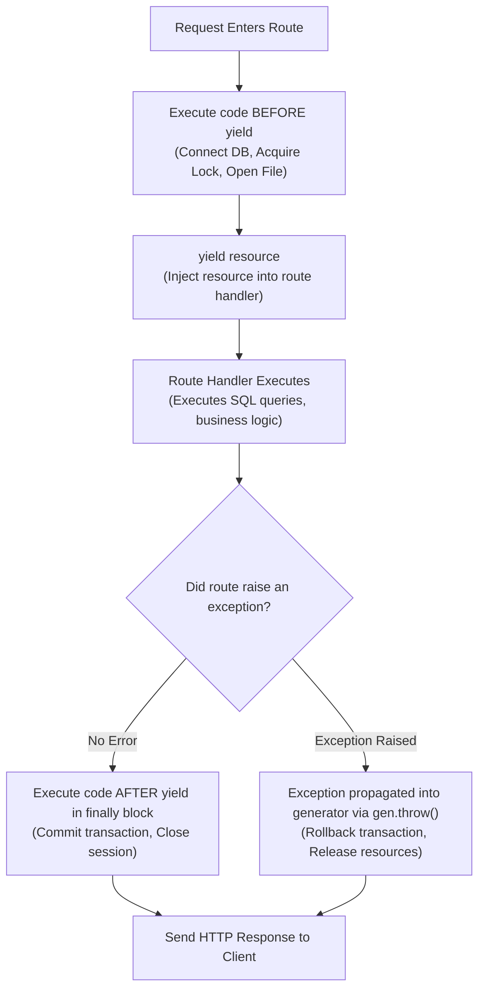

# Dependencies with Yield & Teardown Lifecycle

In backend engineering, many resources require a strict two-phase lifecycle: **setup** before request processing begins, followed by guaranteed **teardown** after the response has been delivered to the client. Examples include opening and closing database sessions, acquiring and releasing distributed locks, and handling temporary files.

FastAPI provides the **`yield` dependency** pattern (using Python generators and asynchronous generators). Code before `yield` executes during setup, the yielded object is injected into the route handler, and code after `yield` executes during teardown—guaranteed by a robust `try...finally` execution context.

---

## 1. Conceptual Foundation & Mental Model

### The Sandwich Execution Lifecycle

```mermaid
sequenceDiagram
    autonumber
    actor Client
    participant DI as FastAPI Dependency Engine
    participant YieldDep as get_db() (Yield Dependency)
    participant Route as Path Operation Handler

    Client->>DI: Incoming HTTP Request
    DI->>YieldDep: 1. Setup: session = Session(); session.begin()
    YieldDep-->>DI: 2. yield session
    DI->>Route: 3. Invoke handler: await handle(db=session)
    alt Handler Executes Successfully
        Route-->>DI: Returns 200 OK Response Data
    else Handler Raises Exception
        Route-->>DI: Raises HTTPException or unhandled error
    end
    DI->>YieldDep: 4. Teardown: Resume execution after yield
    Note over YieldDep: try...finally executes!<br/>session.close() or session.rollback()
    YieldDep-->>DI: Teardown complete
    DI-->>Client: Send HTTP Response / Error to Client
```

---

## 2. Architecture & Internal Mechanics



### Exception Propagation Mechanics
If an exception occurs inside the path operation function or downstream dependencies, FastAPI raises that exact exception inside the generator at the point of the `yield` statement (using `generator.throw()` or `agenerator.athrow()`). 

If your dependency wraps the `yield` in a `try...finally` block, the teardown code in `finally` is **guaranteed to execute**, even during unhandled application crashes or client disconnections.

---

## 3. Comprehensive Syntax & Core Mechanics

### Standard vs Asynchronous Yield Dependencies

#### Synchronous Yield Dependency:
```python
from typing import Generator
from fastapi import Depends

def get_sync_resource() -> Generator[Resource, None, None]:
    res = acquire_resource()
    try:
        yield res
    finally:
        res.release()
```

#### Asynchronous Yield Dependency (Standard in Modern FastAPI):
```python
from typing import AsyncGenerator
from fastapi import Depends

async def get_async_resource() -> AsyncGenerator[Resource, None]:
    res = await acquire_async_resource()
    try:
        yield res
    finally:
        await res.release()
```

---

## 4. Practical Implementation: 5 Verified Examples

### Example 1: Production Database Session with Automatic Rollback on Error

```python
# db_session_lifecycle.py
from typing import Annotated, AsyncGenerator
from fastapi import FastAPI, Depends, HTTPException, status
from pydantic import BaseModel

app = FastAPI()

class MockAsyncSession:
    def __init__(self) -> None:
        self.is_open = True
        self.committed = False
        self.rolled_back = False

    async def commit(self) -> None:
        self.committed = True
        print("Database transaction COMMITTED.")

    async def rollback(self) -> None:
        self.rolled_back = True
        print("Database transaction ROLLED BACK.")

    async def close(self) -> None:
        self.is_open = False
        print("Database connection CLOSED.")

async def get_db_session() -> AsyncGenerator[MockAsyncSession, None]:
    session = MockAsyncSession()
    print("Database session OPENED.")
    try:
        yield session
        # If no unhandled exception occurred, commit transaction
        await session.commit()
    except Exception as exc:
        # If any exception occurred during route handling, rollback transaction!
        await session.rollback()
        raise exc  # Crucial: re-raise to allow FastAPI exception handlers to format response
    finally:
        # Guaranteed cleanup
        await session.close()

DbSession = Annotated[MockAsyncSession, Depends(get_db_session)]

@app.post("/items/success")
async def create_item_success(db: DbSession) -> dict[str, str]:
    return {"status": "saved"}

@app.post("/items/failure")
async def create_item_failure(db: DbSession) -> None:
    raise HTTPException(status_code=status.HTTP_400_BAD_REQUEST, detail="Business logic error")
```

Execution verification:
- Hitting `/items/success` logs:
  `Database session OPENED.` -> `Database transaction COMMITTED.` -> `Database connection CLOSED.`
- Hitting `/items/failure` logs:
  `Database session OPENED.` -> `Database transaction ROLLED BACK.` -> `Database connection CLOSED.`

### Example 2: Temporary File Lifecycle Manager

Automatically provisioning and cleaning up spooled files on disk:

```python
# temp_file_lifecycle.py
import os
import tempfile
from typing import Annotated, Generator
from fastapi import FastAPI, Depends

app = FastAPI()

def get_temp_file() -> Generator[str, None, None]:
    # Setup: Create isolated temporary file
    temp_fd, temp_path = tempfile.mkstemp(prefix="fastapi_job_")
    os.close(temp_fd)
    print(f"Created temporary file: {temp_path}")
    try:
        yield temp_path
    finally:
        # Teardown: Delete temporary file from disk
        if os.path.exists(temp_path):
            os.remove(temp_path)
            print(f"Deleted temporary file: {temp_path}")

TempFileDep = Annotated[str, Depends(get_temp_file)]

@app.post("/process-large-data")
def process_data(file_path: TempFileDep) -> dict[str, str]:
    with open(file_path, "w") as f:
        f.write("Batch payload data...")
    return {"status": "processed", "temp_path": file_path}
```

### Example 3: Context Managers Inside Yield Dependencies

Using Python's native `async with` context managers inside yield dependencies:

```python
# context_manager_dep.py
import asyncio
from typing import Annotated, AsyncGenerator
from fastapi import FastAPI, Depends

app = FastAPI()

# Shared distributed lock mock
DISTRIBUTED_LOCK = asyncio.Lock()

async def get_distributed_lock() -> AsyncGenerator[None, None]:
    # Acquire lock using context manager
    async with DISTRIBUTED_LOCK:
        print("Distributed lock ACQUIRED.")
        yield
        print("Distributed lock RELEASING.")
    print("Distributed lock RELEASED.")

LockDep = Annotated[None, Depends(get_distributed_lock)]

@app.post("/critical-transaction", dependencies=[Depends(get_distributed_lock)])
async def critical_transaction() -> dict[str, str]:
    await asyncio.sleep(0.05)
    return {"status": "isolated_execution_complete"}
```

### Example 4: Execution Timing & Profiling Dependency

Measuring the complete end-to-end processing duration of an endpoint:

```python
# timing_dep.py
import time
from typing import Annotated, Generator
from fastapi import FastAPI, Depends

app = FastAPI()

def profile_execution() -> Generator[None, None, None]:
    start_time = time.perf_counter()
    try:
        yield
    finally:
        elapsed_ms = (time.perf_counter() - start_time) * 1000
        print(f"Endpoint execution time: {elapsed_ms:.2f} ms")

@app.get("/compute", dependencies=[Depends(profile_execution)])
def heavy_compute() -> dict[str, int]:
    time.sleep(0.02)
    return {"result": 42}
```

Console output after request:
`Endpoint execution time: 20.45 ms`

### Example 5: Testing Yield Teardown with Pytest

Verifying that cleanup code executes reliably even when tests trigger exceptions:

```python
# tests/test_yield.py
import pytest
from httpx import ASGITransport, AsyncClient
from db_session_lifecycle import app, MockAsyncSession, get_db_session

SESSION_TRACKER = []

async def test_get_db_session() -> AsyncGenerator[MockAsyncSession, None]:
    s = MockAsyncSession()
    SESSION_TRACKER.append(s)
    try:
        yield s
        await s.commit()
    except Exception as exc:
        await s.rollback()
        raise exc
    finally:
        await s.close()

@pytest.mark.asyncio
async def test_yield_teardown_on_route_exception() -> None:
    app.dependency_overrides[get_db_session] = test_get_db_session

    transport = ASGITransport(app=app)
    async with AsyncClient(transport=transport, base_url="http://test") as client:
        response = await client.post("/items/failure")
        assert response.status_code == 400

    # Verify that the session was properly rolled back and closed despite the error!
    session = SESSION_TRACKER[0]
    assert session.rolled_back is True
    assert session.is_open is False
    assert session.committed is False

    app.dependency_overrides.clear()
```

---

## 5. Anti-Patterns & Common Traps

| Anti-Pattern | Why It Fails | Production Fix |
| :--- | :--- | :--- |
| **Omitting `finally:` in yield dependencies** | If an unhandled exception or client disconnect occurs, cleanup code after `yield` is never reached, leaking resources. | Always wrap `yield` in `try...finally:`. |
| **Suppressing exceptions inside dependencies without re-raising** | Catching `except Exception:` without `raise` swallows the error; FastAPI returns an empty 200 OK instead of the error. | Always re-raise exceptions: `except Exception: ... raise`. |
| **Attempting to modify the HTTP response after `yield`** | By the time code after `yield` runs, HTTP response headers and body bytes have **already been sent** over the wire. | Set response headers inside the route handler or middleware. |
| **Raising `HTTPException` after `yield`** | The connection is already closed; raising an exception here crashes the ASGI worker instead of returning an error page. | Never raise `HTTPException` in the teardown phase. |
| **Yielding multiple times** | A dependency generator must yield **exactly once**. Multiple yields raise `RuntimeError: generator didn't stop`. | Use a single `yield` statement per dependency invocation. |

---

## 6. Performance & Resource Characteristics

- **Generator Context Overhead**: Python generator instantiation costs ~180 nanoseconds. Resolving 5 yield dependencies per request adds less than 1 microsecond of overhead.
- **Immediate Socket Resource Release**: Because teardown runs immediately after the response is sent, database connections are returned to the pool milliseconds faster than waiting for Python's garbage collector.

---

## 7. Edge Cases, Failure Modes & Gotchas

1. **Client Disconnection During Stream**: If a client abruptly closes their connection, FastAPI cancels the active request task. The generator receives an `asyncio.CancelledError` at `yield`. Ensure `finally` blocks handle task cancellations cleanly.
2. **Multiple Yield Invocations**: Writing `yield a; yield b` inside a dependency causes FastAPI to raise a `RuntimeError` during execution.

---

## 8. Security Implications & OWASP Alignment

- **Orphaned Lock Vulnerabilities**: In distributed locking architectures, failing to release a Redis lock during a route crash deadlocks the resource for other users. Wrapping locks in yield `finally:` blocks guarantees lock release.
- **Transaction Isolation Leakage**: Always execute `session.rollback()` in the `except` block to ensure uncommitted dirty reads do not persist in the database connection.

---

## 9. Modern Tooling Integration

- **SQLAlchemy 2.0 Async Session Pattern**: The canonical production pattern for SQLAlchemy in FastAPI is built around yield dependencies:
```python
async def get_db() -> AsyncGenerator[AsyncSession, None]:
    async with async_session_factory() as session:
        yield session
```

---

## 10. Real-World Case Study: Production Incident

### The Incident
A document generation SaaS platform suffered a production outage where worker server disk drives filled to 100% capacity within 4 hours, causing the entire API to crash.

### The Root Cause
A developer wrote a temporary file helper:
```python
def get_pdf_workspace():
    temp_dir = tempfile.mkdtemp()
    yield temp_dir
    # UNPROTECTED CLEANUP:
    shutil.rmtree(temp_dir)
```
When user-supplied documents had parsing errors, the route handler raised `HTTPException(422)`. The exception bubbled out of `yield`. Because there was no `try...finally` block, `shutil.rmtree(temp_dir)` was never reached, abandoning 50MB PDF files in `/tmp` on every failed request until the 200GB disk was completely exhausted.

### The Resolution
Wrapped the teardown in a `finally` block:
```python
def get_pdf_workspace():
    temp_dir = tempfile.mkdtemp()
    try:
        yield temp_dir
    finally:
        shutil.rmtree(temp_dir, ignore_errors=True)
```
Temporary directories were cleaned up with 100% reliability regardless of request success or failure.

---

## 11. Hands-On Exercises & Challenge Problems

### Warm-Up Exercises
1. **Basic Yield Logger**: Create a dependency that logs `"Start"` before `yield` and `"End"` in a `finally` block. Verify with curl.
2. **Error Teardown Probe**: Create an endpoint that raises an HTTP 500 error and verify that your dependency's `finally` block still executes.

### Intermediate Challenges
3. **Database Transaction Manager**: Implement a mock database session dependency that calls `.commit()` if the route succeeds, but `.rollback()` if an error occurs.
4. **Temporary Directory Cleaner**: Build a yield dependency that creates a temporary directory and ensures it is deleted after the request completes.

### Production-Grade Challenges
5. **Distributed Lock Context Yield Dependency**: Build an async yield dependency that acquires an `asyncio.Lock` with a 2-second timeout, yields control, and guarantees lock release in `finally`.
6. **Asyncpg Connection Lifecycle Manager**: Implement an async yield dependency that acquires a connection from an `asyncpg.Pool`, initializes a transaction, and handles commit/rollback/release cleanly.

---

## 12. Interview Mastery: Deep-Dive Questions & Answers

#### Q1: What is a "yield dependency" in FastAPI and what problem does it solve?
**Answer**: A yield dependency is a dependency that uses Python's `yield` statement (acting as a generator or async generator) to establish a two-phase lifecycle: setup code before `yield`, followed by guaranteed teardown code after `yield`. It solves the problem of resource management (e.g. database connections, file handles, locks), ensuring that cleanup code runs reliably after the HTTP response has been sent.

#### Q2: What happens if an unhandled exception is raised inside the path operation function when using a yield dependency?
**Answer**: FastAPI catches the exception and propagates it into the generator at the point of the `yield` statement using `generator.throw()` (or `athrow()` for async generators). If the generator has wrapped `yield` in a `try...finally` block, the code in `finally` will execute before FastAPI's exception handler returns the HTTP error response to the client.

#### Q3: Why is it critical to re-raise exceptions caught in a yield dependency?
**Answer**: If you catch an exception in a yield dependency (e.g. `except Exception: ...`) and do not re-raise it with `raise`, you swallow the exception. FastAPI will assume the request finished without error and attempt to return an empty 200 OK response instead of the intended HTTP error status code.

#### Q4: Can a yield dependency modify the HTTP response status code or headers after the `yield` statement?
**Answer**: No. By the time code after `yield` executes, the HTTP response has **already been transmitted** over the network to the client. Attempting to set response headers or mutate status codes after `yield` has zero effect and raising an `HTTPException` will crash the ASGI worker.

#### Q5: What is the recommended way to use Python context managers inside yield dependencies?
**Answer**: Wrap the context manager directly around the `yield` statement:
```python
async def get_db():
    async with SessionLocal() as session:
        yield session
```
The context manager's `__aenter__` executes before `yield`, and `__aexit__` executes during teardown.

#### Q6: How does `use_cache=True` interact with yield dependencies?
**Answer**: When `use_cache=True` (the default), the setup code before `yield` runs once when the dependency is first requested, the yielded object is cached and shared across all consumers for that request, and the teardown code after `yield` executes **only once** when the request finishes.

#### Q7: Can you yield multiple times in a single dependency?
**Answer**: No. A FastAPI dependency generator must yield **exactly once**. If a dependency yields a second time, FastAPI raises a `RuntimeError: generator didn't stop`.

#### Q8: What happens to yield dependencies if a client disconnects while the route is still processing?
**Answer**: FastAPI cancels the active request task, causing an `asyncio.CancelledError` to be thrown into the async generator at the `yield` point. If wrapped in a `try...finally` block, the teardown code executes immediately, freeing database sessions or file handles.
