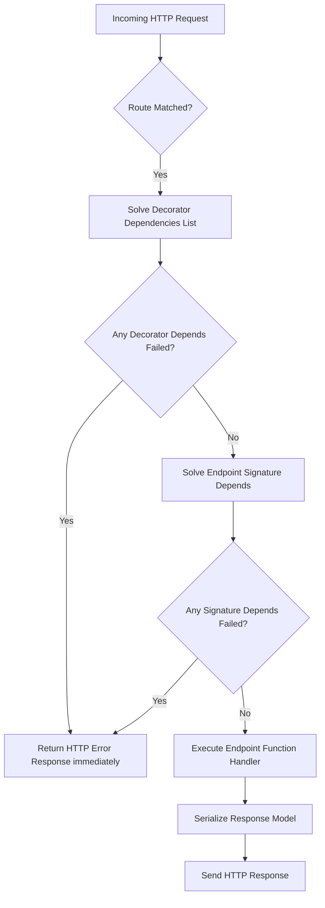

# FastAPI Dependencies in Path Decorators

Dependencies in FastAPI are not restricted to function signature parameters. When an operation requires verification, authorization, header validation, or rate limiting—but does not actually consume the return value of that verification inside the endpoint body—declaring the dependency in the path operation decorator's `dependencies=[Depends(...)]` list provides clean separation of concerns and guarantees execution order.

---

## Conceptual Foundation & Mental Model

In standard dependency injection, `user: User = Depends(get_current_user)` serves two purposes:
1. It executes `get_current_user` before invoking the endpoint logic.
2. It assigns the returned `User` instance to the local `user` parameter.

However, in many real-world scenarios, an endpoint requires side effects, security assertions, or prerequisite validations without needing the computed artifact:
- Validating that an API key or HMAC signature matches.
- Checking that a specific custom header (e.g., `X-Workspace-ID`, `X-Release-Stage`) is present and valid.
- Verifying client IP blacklists/whitelists.
- Enforcing rate-limiting budgets before touching business logic.

Placing unused parameters like `_check: None = Depends(verify_token)` in endpoint signatures clutters the handler signature, triggers static analysis warnings (e.g., unused arguments in Ruff/Flake8), and pollutes OpenAPI documentation if not carefully annotated. The decorator parameter `dependencies=[Depends(callable), ...]` evaluates dependencies sequentially or resolves shared sub-trees without polluting function arguments.

```
Incoming HTTP Request
       │
       ▼
┌────────────────────────────────────────────────────────┐
│ Path Decorator: @app.get("/items",                     │
│                  dependencies=[Depends(verify_auth)])  │
└────────────────────────────────────────────────────────┘
       │
       ├─► 1. Execute Depends(verify_auth)
       │      (Raises HTTPException on failure)
       │
       ├─► 2. Execute any sub-dependencies recursively
       │
       ▼ (All decorator dependencies pass successfully)
┌────────────────────────────────────────────────────────┐
│ Endpoint Handler: async def read_items():              │
│ (Executes cleanly with zero clutter or unused params)   │
└────────────────────────────────────────────────────────┘
```

---

## Architecture & Internal Mechanics

When FastAPI constructs a `Route` inside an `APIRouter` or `FastAPI` instance, it builds a `SolveDependencies` DAG:
1. **Decorator Dependencies First**: Dependencies passed via `dependencies=[Depends(...)]` in `@app.get(...)` or `@router.post(...)` are appended to the route's dependency solve list.
2. **Signature Dependencies**: Endpoint function arguments annotated with `Depends()` are resolved.
3. **Cache Evaluation**: If a dependency in the decorator list matches a dependency required by an argument (and `use_cache=True`), the solved value is cached and reused across the entire request scope.
4. **Exception Handling**: If any decorator dependency raises an exception (such as `HTTPException`), the request lifecycle short-circuits immediately; the endpoint handler is never invoked.



---

## Comprehensive Syntax & Core Mechanics

The `dependencies` argument accepts a Python sequence (typically a `list`) of `Depends()` instances:

```python
from typing import Annotated
from fastapi import FastAPI, Depends, Header, HTTPException, status

app = FastAPI()

async def verify_internal_token(x_internal_token: Annotated[str, Header()]):
    if x_internal_token != "super-secret-service-mesh-token":
        raise HTTPException(
            status_code=status.HTTP_403_FORBIDDEN,
            detail="Invalid or missing X-Internal-Token header"
        )

@app.get(
    "/internal/metrics",
    dependencies=[Depends(verify_internal_token)],
    tags=["Internal"]
)
async def get_system_metrics() -> dict[str, str]:
    # verify_internal_token ran, but handler doesn't need its return value!
    return {"cpu_utilization": "42%", "memory": "1.2GB free"}
```

Key nuances:
- You **cannot** access the return value of a dependency declared inside `dependencies=[Depends(...)]` in the handler body. If the handler needs the object (e.g., current user account), inject it via function parameters instead.
- Yield dependencies work identically in `dependencies=[...]`. Teardown blocks run after the endpoint finishes.
- Decorator dependencies participate in OpenAPI schema generation: query params, headers, and security schemes declared within them appear in Swagger/ReDoc.

---

## Practical Implementation (5 Complete Examples)

### Example 1: Enforcing Required Platform Headers
```python
from typing import Annotated
from fastapi import FastAPI, Depends, Header, HTTPException, status

app = FastAPI(title="Platform Header Guard")

def verify_client_version(
    x_client_version: Annotated[str, Header(description="Semver client identifier")]
) -> None:
    parts = x_client_version.split(".")
    if len(parts) < 3 or int(parts[0]) < 2:
        raise HTTPException(
            status_code=status.HTTP_426_UPGRADE_REQUIRED,
            detail="Client version must be >= 2.0.0"
        )

@app.get(
    "/v2/features",
    dependencies=[Depends(verify_client_version)]
)
async def list_features() -> dict[str, list[str]]:
    return {"features": ["ai_autocomplete", "batch_export", "zero_downtime_sync"]}
```

### Example 2: Maintenance Window / Feature Flag Guard
```python
import os
from fastapi import FastAPI, Depends, HTTPException, status

app = FastAPI()

class FeatureFlagGuard:
    def __init__(self, flag_name: str):
        self.flag_name = flag_name

    def __call__(self) -> None:
        is_enabled = os.getenv(self.flag_name, "false").lower() in ("true", "1", "yes")
        if not is_enabled:
            raise HTTPException(
                status_code=status.HTTP_503_SERVICE_UNAVAILABLE,
                detail=f"Feature '{self.flag_name}' is currently disabled or in maintenance mode."
            )

@app.post(
    "/beta/deep-search",
    dependencies=[Depends(FeatureFlagGuard(flag_name="ENABLE_DEEP_SEARCH"))]
)
async def execute_deep_search(query: str) -> dict[str, str]:
    return {"query": query, "status": "executed"}
```

### Example 3: Multiple Chained Decorator Dependencies
```python
from typing import Annotated
from fastapi import FastAPI, Depends, Header, HTTPException, status

app = FastAPI()

async def require_hmac_signature(x_signature: Annotated[str, Header()]) -> None:
    if not x_signature.startswith("sha256="):
        raise HTTPException(status_code=400, detail="Invalid HMAC format")

async def require_timestamp_freshness(x_timestamp: Annotated[int, Header()]) -> None:
    import time
    if abs(time.time() - x_timestamp) > 300:
        raise HTTPException(status_code=400, detail="Request timestamp expired (> 5m)")

@app.post(
    "/webhooks/stripe-ingress",
    dependencies=[
        Depends(require_hmac_signature),
        Depends(require_timestamp_freshness)
    ]
)
async def stripe_webhook_ingress(payload: dict) -> dict[str, str]:
    return {"received": True, "event": payload.get("type", "unknown")}
```

### Example 4: Context Manager / Yield Dependency via Decorator
```python
import time
from typing import AsyncGenerator
from fastapi import FastAPI, Depends, Request

app = FastAPI()

async def audit_telemetry_tracker(request: Request) -> AsyncGenerator[None, None]:
    start = time.perf_counter()
    try:
        yield
    finally:
        duration_ms = (time.perf_counter() - start) * 1000
        # In production: write to Structured Logger or statsd
        print(f"[AUDIT] {request.method} {request.url.path} finished in {duration_ms:.2f}ms")

@app.get(
    "/audit-guarded-report",
    dependencies=[Depends(audit_telemetry_tracker)]
)
async def get_report() -> dict[str, str]:
    return {"report": "quarterly_earnings.pdf", "status": "ready"}
```

### Example 5: Combining Decorator Guard with Parameterized Dependency
```python
from typing import Annotated
from fastapi import FastAPI, Depends, Header, HTTPException, status
from pydantic import BaseModel

app = FastAPI()

class CurrentUser(BaseModel):
    id: str
    role: str

async def verify_rate_limit(x_client_ip: Annotated[str, Header()] = "127.0.0.1") -> None:
    # Simulated rate limiter
    if x_client_ip == "10.0.0.99":
        raise HTTPException(status_code=429, detail="Too many requests from this IP")

async def get_authenticated_user(authorization: Annotated[str, Header()]) -> CurrentUser:
    if not authorization.startswith("Bearer "):
        raise HTTPException(status_code=401, detail="Invalid authorization scheme")
    return CurrentUser(id="usr_9988", role="admin")

@app.delete(
    "/resources/{res_id}",
    dependencies=[Depends(verify_rate_limit)]  # Enforces rate limit without binding
)
async def delete_resource(
    res_id: str,
    user: Annotated[CurrentUser, Depends(get_authenticated_user)]  # Binds user object
) -> dict[str, str]:
    return {"action": "deleted", "resource_id": res_id, "deleted_by": user.id}
```

---

## Anti-Patterns & Common Traps

| Anti-Pattern | Why It Breaks / Fails | Production Solution |
| :--- | :--- | :--- |
| **Injecting dummy arguments** (`_: None = Depends(guard)`) | Clutters signature, triggers linter warnings (`ARG001`), leaks confusing parameter definitions into docs. | Move purely side-effecting guards into `dependencies=[Depends(guard)]` in the decorator. |
| **Expecting return values from decorator dependencies** | Python decorators cannot expose return values to the inner function namespace. | If the handler logic requires the returned object, declare `arg: Type = Depends(...)` in function arguments. |
| **Relying on decorator dependencies for output filtering** | Decorators do not intercept or mutate the returned endpoint object. | Use custom `response_model`, response serializers, or middleware/yield hooks. |
| **Mixing raw functions instead of `Depends()`** | Writing `dependencies=[my_guard]` without wrapping in `Depends(my_guard)`. | FastAPI expects `Depends` or `Security` callables inside the list; raw callables trigger initialization errors. |
| **Duplicating guards across 20 identical route decorators** | DRY violation; forgetting to add the decorator to a new endpoint leaves it exposed. | Promote the dependency to router-level (`APIRouter(dependencies=[...])`) or global level. |

---

## Performance & Resource Characteristics

- **Zero Parameter Overhead**: Bypasses Python keyword-argument unpacking for the endpoint handler, saving microsecond-level stack allocation overhead.
- **Dependency Graph Optimization**: Shared sub-dependencies between decorator dependencies and parameter dependencies resolve once if `use_cache=True`.
- **Early Rejection Short-Circuiting**: Decorator dependencies are resolved sequentially. If the first dependency (e.g., token format verification) fails, remaining heavy dependencies (database lookups, cryptographic hashing) never execute.

---

## Edge Cases, Failure Modes & Gotchas

1. **Ordering of Execution**: Dependencies in the `dependencies=[...]` list execute in the exact order declared from left to right.
2. **Sub-dependency Resolution**: If dependency A depends on B, and B is also listed separately, B will be executed first, and its cached result will be passed into A.
3. **OpenAPI Visibility**: Even though no parameter is bound to the route handler, query parameters, path parameters, headers, or security scopes defined in the decorator's dependency **are** introspected and documented in the OpenAPI schema.
4. **Yield Exception Visibility**: Exceptions raised inside the endpoint handler will bubble into the `yield` block of decorator dependencies, allowing context cleanup or error logging.

---

## Security Implications & OWASP Alignment

- **Defense in Depth**: Prevents accidental bypass where an endpoint author forgets to add `_user: User = Depends(...)` in the parameter list. Decorator dependencies enforce policy at the structural boundary.
- **OWASP API1:2023 - Broken Object Level Authorization (BOLA)**: Use decorator dependencies to validate tenancy boundaries (e.g., checking that the active session has access to the requested organization) before executing the handler.
- **OWASP API4:2023 - Unrestricted Resource Consumption**: Enforce IP rate limits, payload size caps, and header integrity checks via decorator dependencies to reject malicious traffic early.

---

## Modern Tooling Integration

- **Ruff / Flake8**: Eliminates `ARG001` ("Unused function argument") errors that occur when developers add dummy `_verify: bool = Depends(...)` parameters.
- **Pyright / Mypy**: Keeps endpoint signatures type-pure, accepting only business-relevant inputs.
- **OpenAPI / Swagger UI**: Generates interactive documentation for all required headers, query filters, or auth mechanisms declared within decorator dependencies.

---

## Real-World Case Study / Production Incident

An enterprise multi-tenant banking API suffered a regression where an internal admin utility endpoint `/tenants/{id}/audit-dump` accidentally omitted the tenant isolation check in its function signature. While `get_current_user` was present, the tenant ownership validator was missing.

**Remediation**: The engineering team established an architecture standard:
1. Core security checks, IP whitelists, and mTLS verification were moved to decorator-level dependencies:
   ```python
   @router.get(
       "/{tenant_id}/audit-dump",
       dependencies=[
           Depends(verify_mtls_client_cert),
           Depends(enforce_tenant_access_boundary)
       ]
   )
   async def export_audit_dump(tenant_id: str): ...
   ```
2. Lint rules ensured no route under `/tenants/{id}` could be declared without the tenancy boundary dependency in its decorator.

---

## Hands-On Exercises & Challenge Problems

### Warmup (2 Exercises)
1. Write an endpoint `@app.get("/ping", dependencies=[...])` that requires a custom header `X-Debug-Mode: enabled`. If absent, return HTTP 400.
2. Create a decorator dependency that inspects query parameter `version: int` and raises HTTP 410 (Gone) if `version < 3`.

### Intermediate (2 Exercises)
3. Implement a decorator dependency that validates an HMAC-SHA256 signature passed in the `X-Signature` header against the raw request body bytes.
4. Implement a yield-based decorator dependency that measures database connection checkout time and logs a warning if checkout took longer than 50ms.

### Production-Grade (2 Exercises)
5. Build an IP whitelist decorator dependency `RequireIPRange(["192.168.1.0/24", "10.0.0.0/8"])` that supports CIDR block validation using Python's standard `ipaddress` module and handles `X-Forwarded-For` header parsing safely behind trusted proxies.
6. Build a dynamic feature flag dependency using a class callable that reads flags from Redis with a 5-second local TTL cache; apply it to three separate routes via `dependencies=[Depends(flag_guard)]`.

---

## Interview Mastery (8 Q&As)

### Junior Level
**Q1: What is the difference between `user: User = Depends(get_user)` and `dependencies=[Depends(get_user)]`?**
*Answer:* Function parameter injection binds the return value of `get_user` to the variable `user` inside the function body. `dependencies=[Depends(get_user)]` executes the dependency (running validations, checking auth, or raising errors), but discards the return value and does not bind it to any function argument.

**Q2: When should I put a dependency in the decorator instead of the function arguments?**
*Answer:* When you need the dependency's validation or side effects (such as verifying a header, checking an API token, or logging audit trails), but your handler function does not actually consume or reference the returned object.

**Q3: Can a dependency in `dependencies=[...]` raise an `HTTPException`?**
*Answer:* Yes. If any dependency in the decorator list raises an exception, FastAPI aborts the request immediately and returns the corresponding error response; the endpoint function is never called.

### Senior Level
**Q4: Do yield-based dependencies work when declared in `dependencies=[...]`?**
*Answer:* Yes. The pre-yield portion runs before the endpoint starts, and the post-yield cleanup block runs after the endpoint completes or raises an exception, exactly like parameter-injected yield dependencies.

**Q5: If a dependency is listed in both `dependencies=[Depends(auth)]` and `current_user: User = Depends(auth)`, will `auth()` run twice?**
*Answer:* By default, no. FastAPI's dependency solver uses `use_cache=True` by default. It executes `auth()` once, caches the result within the request scope, and supplies that cached value to `current_user`.

**Q6: How do decorator dependencies affect the generated OpenAPI / Swagger documentation?**
*Answer:* FastAPI fully inspects decorator dependencies. Any headers, query parameters, cookies, or OAuth2 security requirements declared within those dependencies are included in the OpenAPI schema and displayed in Swagger UI.

### Staff / Architect Level
**Q7: How does FastAPI resolve execution order when an endpoint has router-level dependencies, decorator dependencies, and parameter dependencies?**
*Answer:* FastAPI resolves dependencies in a topological order based on the dependency tree:
1. Router-level dependencies (and sub-router dependencies) execute first.
2. Path decorator dependencies execute next in list declaration order.
3. Function parameter dependencies execute.
If any dependency depends on a shared sub-dependency that was already resolved and cached, the cached value is reused immediately.

**Q8: How would you design an architectural policy to prevent developers from forgetting security decorators on individual endpoints?**
*Answer:* Rather than relying on individual developers to remember `dependencies=[Depends(...)]` on every route decorator:
1. Promote shared security dependencies to `APIRouter(dependencies=[...])` or the root `FastAPI(dependencies=[...])`.
2. Implement automated AST linting or integration tests that inspect `app.routes` and assert that every registered endpoint contains the mandatory security dependencies.
