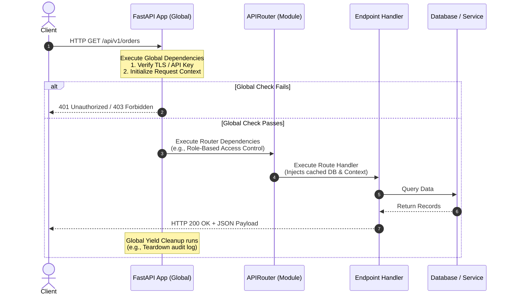

# FastAPI Global Dependencies

Global dependencies allow backend architects to enforce cross-cutting concerns—such as global authentication schemes, rate limiting, request context propagation, tenancy validation, and platform telemetry—across **every single endpoint** in an entire FastAPI application. By registering dependencies directly on the `FastAPI(...)` application constructor, teams eliminate boilerplate and guarantee zero-omission security policies.

---

## Conceptual Foundation & Mental Model

In a distributed microservice or web platform, certain policies must be non-negotiable and ubiquitous:
- **Mandatory Service-to-Service Authentication**: Every incoming request must provide a valid mTLS cert or internal API token.
- **Tenant Context Extraction**: Every request must specify an authorized tenant identifier.
- **Audit Logging**: Every incoming request must generate a structured trace event before and after execution.
- **Maintenance Guards**: The application must be able to reject non-admin traffic during migration windows.

Rather than relying on individual developers to attach `dependencies=[Depends(...)]` to every router or path operation, you declare dependencies at the root application level:

```python
app = FastAPI(dependencies=[Depends(global_security_check), Depends(global_audit_logger)])
```

```
                   Incoming HTTP Request
                             │
                             ▼
     ┌───────────────────────────────────────────────────┐
     │           FastAPI Root Application                │
     │   dependencies=[Depends(D1), Depends(D2)]         │
     └───────────────────────┬───────────────────────────┘
                             │
            ┌────────────────┴────────────────┐
            ▼                                 ▼
   Global Dependency 1               Global Dependency 2
(e.g., API Key Validation)         (e.g., Request Audit Log)
            │                                 │
            └────────────────┬────────────────┘
                             ▼ (Both Passed)
     ┌───────────────────────────────────────────────────┐
     │              APIRouter Dependencies               │
     │            dependencies=[Depends(D3)]             │
     └───────────────────────┬───────────────────────────┘
                             │
                             ▼
     ┌───────────────────────────────────────────────────┐
     │          Path Operation Decorator Depends         │
     │            dependencies=[Depends(D4)]             │
     └───────────────────────┬───────────────────────────┘
                             │
                             ▼
     ┌───────────────────────────────────────────────────┐
     │             Endpoint Handler Function             │
     │           def handler(param = Depends(D5))        │
     └───────────────────────────────────────────────────┘
```

---

## Architecture & Internal Mechanics

When FastAPI boots, it builds an internal routing tree composed of `APIRoute` instances:
1. **Inheritance Pipeline**: Any dependency registered in `FastAPI(dependencies=[...])` is automatically inherited by every route added directly to the app or included via `app.include_router(...)`.
2. **Topological Execution Order**:
   - Level 0: App-level global dependencies (left to right).
   - Level 1: Outer `include_router` dependencies.
   - Level 2: Nested `APIRouter` dependencies.
   - Level 3: Route decorator dependencies (`@router.get(..., dependencies=[...])`).
   - Level 4: Endpoint parameter dependencies (`arg: T = Depends(...)`).
3. **Short-Circuit Guarantees**: If a global dependency raises an `HTTPException`, Starlette/FastAPI immediately short-circuits execution. Router-level, route-level, and handler functions are never executed.
4. **Scope-Wide Caching**: If a global dependency computes a resource (e.g., `get_current_tenant`) with `use_cache=True`, downstream routers and endpoint handlers injecting `tenant: Tenant = Depends(get_current_tenant)` receive the exact cached instance without recalculation.



---

## Comprehensive Syntax & Core Mechanics

Global dependencies are configured using the `dependencies` parameter of the `FastAPI` application class:

```python
from typing import Annotated
from fastapi import FastAPI, Depends, Header, HTTPException, status

async def verify_api_key(
    x_api_key: Annotated[str | None, Header()] = None
) -> str:
    if not x_api_key or x_api_key != "production-secret-api-key":
        raise HTTPException(
            status_code=status.HTTP_401_UNAUTHORIZED,
            detail="Invalid or missing X-API-Key header"
        )
    return x_api_key

# Registered globally across all routes
app = FastAPI(
    title="Core Enterprise Service",
    dependencies=[Depends(verify_api_key)]
)

@app.get("/health")
async def health_check():
    # Even this health check requires X-API-Key!
    return {"status": "ok"}
```

### Excluding Certain Routes from Global Dependencies
A common architectural challenge is that global dependencies apply to **all** routes, including `/docs`, `/openapi.json`, and public health checks `/health`. To exclude public endpoints:
1. Don't put the dependency on `FastAPI(dependencies=[...])`; instead, put it on an authenticated `APIRouter(dependencies=[...])` and mount all protected sub-routers under it.
2. OR, implement conditional bypass logic inside the global dependency inspecting `request.url.path`.

---

## Practical Implementation (5 Complete Examples)

### Example 1: Multi-Tenant Schema Isolation Guard
```python
from typing import Annotated
from fastapi import FastAPI, Depends, Header, HTTPException, Request, status

class TenantContext:
    def __init__(self, tenant_id: str, plan: str):
        self.tenant_id = tenant_id
        self.plan = plan

VALID_TENANTS = {
    "acme": "enterprise",
    "stark": "pro",
    "wayne": "enterprise"
}

async def global_tenant_guard(
    request: Request,
    x_tenant_id: Annotated[str | None, Header()] = None
) -> TenantContext:
    # Bypass for system docs and health
    if request.url.path in ("/docs", "/redoc", "/openapi.json", "/healthz"):
        return TenantContext(tenant_id="system", plan="internal")

    if not x_tenant_id or x_tenant_id not in VALID_TENANTS:
        raise HTTPException(
            status_code=status.HTTP_400_BAD_REQUEST,
            detail=f"Invalid or missing X-Tenant-ID header: {x_tenant_id}"
        )
    
    tenant = TenantContext(tenant_id=x_tenant_id, plan=VALID_TENANTS[x_tenant_id])
    request.state.tenant = tenant
    return tenant

app = FastAPI(dependencies=[Depends(global_tenant_guard)])

@app.get("/healthz")
async def public_health():
    return {"status": "healthy"}

@app.get("/v1/dashboard")
async def get_dashboard(request: Request):
    return {
        "tenant": request.state.tenant.tenant_id,
        "plan": request.state.tenant.plan,
        "metrics": [100, 200, 300]
    }
```

### Example 2: Global Audit Telemetry and Request Tracing
```python
import time
import uuid
from typing import AsyncGenerator
from fastapi import FastAPI, Depends, Request, Response

async def global_request_audit(request: Request) -> AsyncGenerator[None, None]:
    request_id = request.headers.get("X-Request-ID", str(uuid.uuid4()))
    request.state.request_id = request_id
    start_time = time.perf_counter()

    try:
        yield
    finally:
        duration_ms = (time.perf_counter() - start_time) * 1000
        # In production: emit structured log or statsd metrics
        print(f"[AUDIT] {request.method} {request.url.path} (ID: {request_id}) took {duration_ms:.2f}ms")

app = FastAPI(dependencies=[Depends(global_request_audit)])

@app.get("/items")
async def list_items(request: Request):
    return {"request_id": request.state.request_id, "data": ["item1", "item2"]}
```

### Example 3: Global IP Geolocation & Blacklisting Guard
```python
from fastapi import FastAPI, Depends, Request, HTTPException, status

BLOCKED_SUBNETS = {"198.51.100.1", "203.0.113.50"}

async def global_ip_firewall(request: Request) -> None:
    client_ip = request.client.host if request.client else "unknown"
    # Check X-Forwarded-For if behind trusted reverse proxy
    forwarded = request.headers.get("X-Forwarded-For")
    if forwarded:
        client_ip = forwarded.split(",")[0].strip()

    if client_ip in BLOCKED_SUBNETS:
        raise HTTPException(
            status_code=status.HTTP_403_FORBIDDEN,
            detail="Client IP blocked by perimeter security policy."
        )

app = FastAPI(
    title="Hardened API",
    dependencies=[Depends(global_ip_firewall)]
)

@app.get("/secure-data")
async def get_secure_data():
    return {"message": "Access granted"}
```

### Example 4: Architectural Two-Tier Setup (Public vs Protected Routers)
```python
from typing import Annotated
from fastapi import FastAPI, APIRouter, Depends, Header, HTTPException

# Prefer this pattern when public routes shouldn't execute security dependencies!
app = FastAPI(title="Two-Tier Clean Architecture")

async def require_auth_token(authorization: Annotated[str, Header()]):
    if not authorization.startswith("Bearer "):
        raise HTTPException(status_code=401, detail="Unauthorized")
    return authorization.removeprefix("Bearer ")

# Tier 1: Public router (no dependencies)
public_router = APIRouter(prefix="/public", tags=["Public"])

@public_router.get("/status")
async def get_status():
    return {"status": "all systems operational"}

# Tier 2: Protected router (with router-level dependency)
protected_router = APIRouter(
    prefix="/api/v1",
    dependencies=[Depends(require_auth_token)],
    tags=["Protected API"]
)

@protected_router.get("/users/me")
async def get_current_user():
    return {"id": "usr_123", "email": "user@example.com"}

app.include_router(public_router)
app.include_router(protected_router)
```

### Example 5: Global Maintenance Window Interceptor with Admin Exemption
```python
import os
from typing import Annotated
from fastapi import FastAPI, Depends, Header, HTTPException, status

MAINTENANCE_MODE = os.getenv("MAINTENANCE_MODE", "false").lower() == "true"

async def global_maintenance_guard(
    x_admin_override_token: Annotated[str | None, Header()] = None
) -> None:
    if MAINTENANCE_MODE:
        if x_admin_override_token == "super-admin-override-secret":
            return  # Allow admin staff through during maintenance
        raise HTTPException(
            status_code=status.HTTP_503_SERVICE_UNAVAILABLE,
            detail="System undergoing planned database maintenance. Please retry in 15 minutes."
        )

app = FastAPI(dependencies=[Depends(global_maintenance_guard)])

@app.get("/orders")
async def list_orders():
    return [{"id": 1, "status": "shipped"}]
```

---

## Anti-Patterns & Common Traps

| Anti-Pattern | Why It Breaks / Fails | Production Solution |
| :--- | :--- | :--- |
| **Enforcing auth globally on `FastAPI(dependencies=[...])`** | Locks out `/docs`, `/redoc`, and container health checks (`/healthz`), causing Kubernetes liveness probes to fail. | Use path-check bypasses or group authenticated routes into a protected `APIRouter(dependencies=[...])`. |
| **Using Global Dependencies instead of ASGI Middleware for raw byte streaming** | Dependencies cannot alter the raw incoming byte stream or mutate outgoing headers after the response is committed. | Use ASGI Middleware for raw response streaming, gzip compression, or CORS. |
| **Slow, blocking I/O in global dependencies** | Every single incoming HTTP request blocks waiting on synchronous I/O, destroying throughput. | Always use `async def` with non-blocking async clients (`httpx`, `asyncpg`, `redis.asyncio`). |
| **Setting `use_cache=False` on heavy global dependencies** | Causes database or identity checks to re-execute multiple times if sub-dependencies also call them. | Leave `use_cache=True` (default) so resolved objects are shared across the entire request DAG. |
| **Modifying mutable global state inside a dependency** | Introduces race conditions in concurrent async requests. | Store request-specific state in `request.state` or `contextvars.ContextVar`. |

---

## Performance & Resource Characteristics

- **Overhead**: Minimal (~0.05ms per request) when implemented with non-blocking async functions.
- **Cache Reuse**: Because global dependencies run at the root of the dependency tree, any value cached during global evaluation is immediately available to downstream route-level dependencies.
- **Fail-Fast Advantage**: Requests with invalid headers, expired tokens, or malformed credentials are rejected before any route-level database queries or business computations occur.

---

## Edge Cases, Failure Modes & Gotchas

1. **Internal Docs Gating**: By default, `FastAPI(dependencies=[Depends(verify_auth)])` applies to user-defined routes, but **does not** gate Starlette's built-in OpenAPI endpoints (`/docs`, `/redoc`, `/openapi.json`) unless custom routes or docs URLs are configured.
2. **Exception Handlers**: If a custom exception handler itself invokes dependencies, ensure global dependencies do not create infinite recursion.
3. **Mount / Sub-Applications**: Global dependencies on the parent `FastAPI` instance **do not** automatically apply to mounted sub-apps created with `app.mount("/sub", sub_app)`. You must configure dependencies on each sub-app independently.

---

## Security Implications & OWASP Alignment

- **OWASP API2:2023 - Broken Authentication**: Guarantees that no developer can accidentally deploy a new endpoint without authentication by enforcing security at the application root.
- **Zero-Trust Architecture**: Assumes no request is trusted by default. Every incoming socket connection is validated against global perimeter policies.
- **Centralized Security Audit**: Security teams can inspect a single line in `main.py` (`FastAPI(dependencies=[...])`) to verify that all endpoints enforce standard corporate headers, mTLS, or tenant isolation.

---

## Modern Tooling Integration

- **Uvicorn / Gunicorn**: Works seamlessly with multiple async worker processes.
- **OpenTelemetry / Prometheus**: Combine global dependencies with OpenTelemetry spans to trace every request from entry to exit.
- **Pydantic Settings**: Dynamically toggle global dependencies (e.g., maintenance mode, rate limits) based on environment configurations.

---

## Real-World Case Study / Production Incident

A fintech startup exposed an internal administrative reporting route `/internal/v1/user-balances` in a new feature branch. Because the developer forgot to add `@router.get(..., dependencies=[Depends(require_admin)])`, the endpoint was accidentally public.

**Post-Mortem & Fix**:
The team migrated from per-route security decorators to a global router architecture:
```python
# main.py
app = FastAPI()

# All business routes mount under protected router
api_v1 = APIRouter(prefix="/v1", dependencies=[Depends(enforce_zero_trust_auth)])
api_v1.include_router(users_router)
api_v1.include_router(balances_router)

app.include_router(api_v1)
```
This ensured that any new route added to any sub-router was automatically secured by default, eliminating human omission risk.

---

## Hands-On Exercises & Challenge Problems

### Warmup (2 Exercises)
1. Configure a `FastAPI` application with a global dependency that checks for an `X-Environment` header and rejects requests if it is not one of `"dev"`, `"staging"`, or `"prod"`.
2. Implement a global yield dependency that increments an in-memory counter of active concurrent requests and decrements it when the request finishes.

### Intermediate (2 Exercises)
3. Build a global dependency that checks if the request path starts with `/api/` and enforces an API key, while allowing root paths like `/` and `/health` without headers.
4. Implement a global dependency that extracts the `User-Agent` header, parses the client type (mobile, desktop, bot), and attaches a `ClientDevice` dataclass to `request.state.device`.

### Production-Grade (2 Exercises)
5. Create a dynamic tenant-routing architecture where a global dependency inspects the request host header (e.g., `tenant1.api.domain.com`), queries a local Redis cache for the tenant's database connection string, and binds it to a `contextvars.ContextVar` for downstream SQLAlchemy sessions.
6. Build a complete rate-limiting global dependency using a sliding-window algorithm backed by Redis, returning standard headers `X-RateLimit-Limit`, `X-RateLimit-Remaining`, and `X-RateLimit-Reset`, with automatic short-circuiting on HTTP 429.

---

## Interview Mastery (8 Q&As)

### Junior Level
**Q1: How do you register a global dependency in FastAPI?**
*Answer:* By passing a list of `Depends()` calls to the `dependencies` parameter of the `FastAPI` application constructor: `app = FastAPI(dependencies=[Depends(my_dependency)])`.

**Q2: Does a global dependency execute for every endpoint?**
*Answer:* Yes, it executes for every path operation registered on the app or included via `app.include_router()`.

**Q3: Can a global dependency return a value that my endpoint function receives?**
*Answer:* Not directly through the global list. However, if the endpoint declares `data = Depends(my_dependency)`, FastAPI's dependency cache (`use_cache=True`) will supply the value already computed by the global dependency without running it again. Alternatively, the global dependency can store values on `request.state`.

### Senior Level
**Q4: How do global dependencies differ from Starlette HTTP middleware?**
*Answer:*
- **FastAPI Dependencies**: Participate in the FastAPI dependency injection graph, leverage Pydantic type validation, inspect headers/query/body parameters natively, support `use_cache`, and automatically document security schemes in OpenAPI.
- **Middleware**: Operates at the lower ASGI protocol level, intercepts all raw HTTP requests before routing occurs, can modify raw response byte streams (e.g., compression), but does not have access to FastAPI route parameters or OpenAPI introspection.

**Q5: How can you exclude public endpoints (like `/health` or `/docs`) when using global dependencies?**
*Answer:* Two standard approaches:
1. Prefer architectural segregation: attach dependencies to a top-level `APIRouter(dependencies=[...])` and mount all protected endpoints under it, leaving `/health` on the unrestricted root app.
2. Inside the dependency, inspect `request.url.path` against an allowlist and return early if matched.

**Q6: What happens if a global yield dependency raises an unhandled exception in its cleanup block?**
*Answer:* The ASGI server catches the unhandled exception, logs a traceback, and Starlette's server error middleware returns an HTTP 500 Internal Server Error to the client if headers have not yet been sent.

### Staff / Architect Level
**Q7: In a large enterprise microservice with 50+ routers, should you use `FastAPI(dependencies=[...])` or hierarchical `APIRouter(dependencies=[...])`?**
*Answer:* Hierarchical router composition is strongly preferred. Global application-level dependencies are inflexible because they force every single endpoint—including webhooks with distinct HMAC signatures, public landing pages, OAuth callbacks, and Kubernetes probes—into the same pipeline. Grouping endpoints into semantic router trees (e.g., `public_router`, `internal_router`, `partner_api_router`) with modular router-level dependencies provides superior isolation and maintainability.

**Q8: How does Python 3.13/3.14 free-threading affect global dependencies that store state?**
*Answer:* In free-threaded Python (no GIL), concurrent requests execute in true parallel OS threads. Global dependencies must never mutate shared module-level state, dictionaries, or lists without synchronization primitives (`threading.Lock`). Request-scoped state must be stored in `request.state` or `contextvars.ContextVar`, which are thread-safe and isolated per async task.
