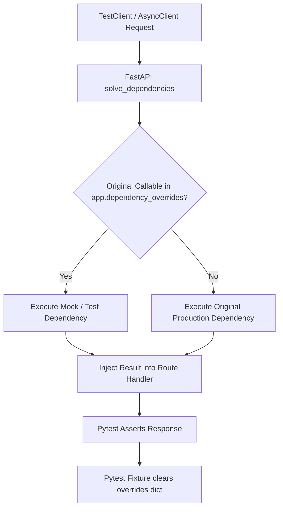

# FastAPI Dependency Overrides in Testing

One of FastAPI's most powerful architectural features is `app.dependency_overrides`. By treating dependencies as swappable keys in a simple dictionary, FastAPI allows developers to replace production database engines, third-party payment gateways, authentication schemes, and slow external microservices with lightweight test doubles, in-memory databases, or mock implementations during testing—with zero changes to production application code.

---

## Conceptual Foundation & Mental Model

In traditional web frameworks, swapping dependencies during tests often requires invasive monkey-patching (`unittest.mock.patch`), complex mock frameworks, or environment variable toggles. These approaches are brittle, susceptible to import-order bugs, and make concurrent test execution dangerous.

FastAPI solves this at the architectural core:
- The `FastAPI` instance exposes a mutable dictionary: `app.dependency_overrides`.
- When resolving dependencies for any incoming request, the dependency solver checks if the requested callable exists as a key in `app.dependency_overrides`.
- If a match is found, FastAPI executes the override callable instead of the original dependency.
- Once testing completes, clearing the dictionary (`app.dependency_overrides.clear()`) instantly restores standard production behavior.

```
       Production Request                          Test Request
               │                                         │
               ▼                                         ▼
┌─────────────────────────────┐           ┌─────────────────────────────┐
│ Depends(get_db_session)     │           │ Depends(get_db_session)     │
└──────────────┬──────────────┘           └──────────────┬──────────────┘
               │                                         │
               ▼                                         ▼
      Checks Overrides                          Checks Overrides
       (None Found)                           (Found: get_test_db)
               │                                         │
               ▼                                         ▼
┌─────────────────────────────┐           ┌─────────────────────────────┐
│ Production Postgres Cluster │           │ In-Memory SQLite / Mock DB  │
└─────────────────────────────┘           └─────────────────────────────┘
```

---

## Architecture & Internal Mechanics

During request dispatch in `fastapi.dependencies.utils.solve_dependencies`:
1. **Key Lookup**: FastAPI takes the original dependency callable `dependant.call`.
2. **Override Check**: It checks `app.dependency_overrides.get(dependant.call)`.
3. **Execution**: If an override function is returned, FastAPI constructs a sub-dependant for the override function, parses its arguments, executes it, and passes its return value into downstream functions.
4. **Hierarchical Sub-dependency Overrides**: Overriding a leaf dependency in a deep dependency tree replaces that leaf for **all** upstream consumers across the entire application without needing to mock the intermediate dependencies.



---

## Comprehensive Syntax & Core Mechanics

The core mechanism is a standard Python dictionary:

```python
from fastapi import FastAPI, Depends

app = FastAPI()

def get_database_engine():
    # Production database connection
    return "production_postgres_cluster"

@app.get("/status")
def status_endpoint(db = Depends(get_database_engine)):
    return {"connected_to": db}

# In your test suite:
def override_database_engine():
    return "in_memory_sqlite_test_db"

# Register the override
app.dependency_overrides[get_database_engine] = override_database_engine

# Remove the override when done
app.dependency_overrides.clear()
```

### Key Rules:
- The key in `dependency_overrides` must be the **exact original function reference** passed to `Depends()`.
- The override value must be a **callable** (function, lambda, or class instance with `__call__`), not the evaluated value.
- If the original was a generator (`yield`), the override can be a generator or a standard function.

---

## Practical Implementation (5 Complete Examples)

### Example 1: Bypassing OAuth2 Authentication in Unit Tests
```python
from fastapi import FastAPI, Depends, HTTPException, status
from fastapi.testclient import TestClient
import pytest

app = FastAPI()

class User:
    def __init__(self, username: str, is_admin: bool):
        self.username = username
        self.is_admin = is_admin

async def get_current_user() -> User:
    # Production: decodes JWT, queries database
    raise HTTPException(status_code=status.HTTP_401_UNAUTHORIZED, detail="Token required")

@app.get("/admin/metrics")
async def read_metrics(user: User = Depends(get_current_user)):
    if not user.is_admin:
        raise HTTPException(status_code=status.HTTP_403_FORBIDDEN, detail="Admin required")
    return {"active_users": 4200, "system_health": "100%"}

# --- Test Suite ---
def test_admin_metrics_with_mocked_user():
    # Arrange mock user
    async def mock_admin_user() -> User:
        return User(username="test_admin", is_admin=True)

    app.dependency_overrides[get_current_user] = mock_admin_user
    
    try:
        client = TestClient(app)
        response = client.get("/admin/metrics")
        assert response.status_code == 200
        assert response.json()["active_users"] == 4200
    finally:
        app.dependency_overrides.clear()
```

### Example 2: Pytest Fixture Pattern with Automatic Teardown
```python
import pytest
from typing import AsyncGenerator
from fastapi import FastAPI, Depends
from httpx import AsyncClient, ASGITransport

app = FastAPI()

class ThirdPartyPaymentGateway:
    async def charge(self, amount: int) -> str:
        # Production: makes slow, billable network call to Stripe
        return "ch_live_real_stripe_charge_id"

def get_payment_gateway() -> ThirdPartyPaymentGateway:
    return ThirdPartyPaymentGateway()

@app.post("/checkout")
async def checkout(gateway: ThirdPartyPaymentGateway = Depends(get_payment_gateway)):
    charge_id = await gateway.charge(5000)
    return {"success": True, "charge_id": charge_id}

# --- Pytest Fixture ---
class MockPaymentGateway:
    async def charge(self, amount: int) -> str:
        return "ch_mock_test_charge_id"

@pytest.fixture
def mock_payment():
    app.dependency_overrides[get_payment_gateway] = lambda: MockPaymentGateway()
    yield
    app.dependency_overrides.clear()

@pytest.mark.anyio
async def test_checkout_endpoint(mock_payment):
    transport = ASGITransport(app=app)
    async with AsyncClient(transport=transport, base_url="http://test") as client:
        response = await client.post("/checkout")
        assert response.status_code == 200
        assert response.json() == {"success": True, "charge_id": "ch_mock_test_charge_id"}
```

### Example 3: Overriding SQLAlchemy Async Database Sessions
```python
import pytest
from typing import AsyncGenerator
from fastapi import FastAPI, Depends
from sqlalchemy.ext.asyncio import create_async_engine, AsyncSession, async_sessionmaker
from sqlalchemy.orm import declarative_base
from sqlalchemy import Column, Integer, String, select
from httpx import AsyncClient, ASGITransport

Base = declarative_base()

class ItemModel(Base):
    __tablename__ = "items"
    id = Column(Integer, primary_key=True, index=True)
    name = Column(String)

# Production DB engine (e.g. Postgres)
prod_engine = create_async_engine("sqlite+aiosqlite:///:memory:")
prod_sessionmaker = async_sessionmaker(prod_engine, expire_on_commit=False)

async def get_db() -> AsyncGenerator[AsyncSession, None]:
    async with prod_sessionmaker() as session:
        yield session

app = FastAPI()

@app.get("/items")
async def list_items(db: AsyncSession = Depends(get_db)):
    result = await db.execute(select(ItemModel))
    items = result.scalars().all()
    return [{"id": i.id, "name": i.name} for i in items]

# --- Test with Isolated In-Memory SQLite ---
@pytest.fixture
async def test_db_session():
    test_engine = create_async_engine("sqlite+aiosqlite:///:memory:")
    async with test_engine.begin() as conn:
        await conn.run_sync(Base.metadata.create_all)

    test_sessionmaker = async_sessionmaker(test_engine, expire_on_commit=False)

    async def override_get_db() -> AsyncGenerator[AsyncSession, None]:
        async with test_sessionmaker() as session:
            # Seed test item
            session.add(ItemModel(id=1, name="Test Widget"))
            await session.commit()
            yield session

    app.dependency_overrides[get_db] = override_get_db
    yield
    app.dependency_overrides.clear()
    await test_engine.dispose()
```

### Example 4: Testing Failure Modes and Exceptions via Overrides
```python
from fastapi import FastAPI, Depends, HTTPException, status
from fastapi.testclient import TestClient

app = FastAPI()

def check_inventory_service(item_id: str) -> bool:
    # Production gRPC call
    return True

@app.post("/orders/{item_id}")
def create_order(item_id: str, available: bool = Depends(check_inventory_service)):
    if not available:
        raise HTTPException(status_code=400, detail="Item out of stock")
    return {"order_status": "confirmed"}

def test_inventory_down_raises_503():
    def mock_broken_inventory():
        raise HTTPException(
            status_code=status.HTTP_503_SERVICE_UNAVAILABLE,
            detail="Inventory cluster unreachable"
        )

    app.dependency_overrides[check_inventory_service] = mock_broken_inventory
    try:
        client = TestClient(app)
        response = client.post("/orders/sku_123")
        assert response.status_code == 503
        assert response.json()["detail"] == "Inventory cluster unreachable"
    finally:
        app.dependency_overrides.clear()
```

### Example 5: Overriding a Sub-Dependency in a Deep Tree
```python
from fastapi import FastAPI, Depends
from fastapi.testclient import TestClient

app = FastAPI()

# Level 1: Configuration leaf
def get_vat_rate() -> float:
    return 0.20  # Production UK VAT 20%

# Level 2: Calculator depending on Level 1
def calculate_tax(vat: float = Depends(get_vat_rate)) -> float:
    return 100.0 * vat

# Level 3: Route handler
@app.get("/checkout/summary")
def get_summary(tax: float = Depends(calculate_tax)):
    return {"subtotal": 100.0, "tax": tax, "total": 100.0 + tax}

def test_override_leaf_sub_dependency():
    # We only override get_vat_rate; calculate_tax runs real logic!
    app.dependency_overrides[get_vat_rate] = lambda: 0.05
    try:
        client = TestClient(app)
        res = client.get("/checkout/summary")
        assert res.status_code == 200
        # Tax should be 100 * 0.05 = 5.0
        assert res.json()["tax"] == 5.0
        assert res.json()["total"] == 105.0
    finally:
        app.dependency_overrides.clear()
```

---

## Anti-Patterns & Common Traps

| Anti-Pattern | Why It Breaks / Fails | Production Solution |
| :--- | :--- | :--- |
| **Assigning value instead of callable** (`app.dependency_overrides[fn] = mock_val`) | FastAPI attempts to inspect arguments on `mock_val`; crashes with `TypeError: ... is not callable`. | Wrap values in a lambda or function: `lambda: mock_val`. |
| **Forgetting to clear overrides after test** | Leaks mock implementations into subsequent tests, causing baffling cascading test failures. | Use `try ... finally: app.dependency_overrides.clear()` or pytest fixtures with yield teardowns. |
| **Using `unittest.mock.patch` on dependencies** | Brittle; fails when modules are imported with `from x import y`; breaks async generators. | Always use `app.dependency_overrides`. |
| **Overriding parameterized class dependencies incorrectly** | Overriding the class rather than the specific instance created in `Depends(Filter(param=1))`. | Override the exact instance or use custom factory callables. |
| **Running parallel tests with global app mutations without isolated apps** | In `pytest-xdist`, tests running in multiple processes work fine, but threading within a single process can cause race conditions on `app.dependency_overrides`. | Scope test apps with app-factory fixtures. |

---

## Performance & Resource Characteristics

- **Zero Test Startup Overhead**: Instant dictionary lookups (`O(1)`), avoiding the heavy introspection overhead of reflection-based mock frameworks.
- **Blazing Fast Test Runs**: Replaces physical network calls (Stripe, Twilio, AWS S3) with microsecond in-memory returns.
- **Memory Footprint**: `app.dependency_overrides` holds minimal reference counts; clearing it allows Python's garbage collector to immediately release test objects.

---

## Edge Cases, Failure Modes & Gotchas

1. **Exact Key Matching**: FastAPI matches dependencies by object identity (`key is dependant.call`). If you import a function under two different module aliases or reload modules, the key will not match and the production dependency will execute.
2. **Decorator Dependencies**: Dependencies registered in `dependencies=[Depends(guard)]` in `@app.get(...)` **can** also be overridden via `app.dependency_overrides[guard]`.
3. **Mounted Sub-Applications**: Overriding a dependency on `app` does **not** automatically override it on a sub-app mounted via `app.mount("/sub", sub_app)`. Overrides must be applied to `sub_app.dependency_overrides`.

---

## Security Implications & OWASP Alignment

- **Testing Security Controls without Compromising Keys**: Allows testing RBAC boundaries, scope checks, and malicious token handling without hardcoding real credentials or secret keys in test files.
- **OWASP API10:2023 - Unsafe Consumption of APIs**: Thoroughly simulate edge cases—such as external API timeouts, HTTP 500 errors, and malformed JSON payloads—by overriding upstream service clients.

---

## Modern Tooling Integration

- **Pytest**: Standard pytest fixtures seamlessly handle fixture setup and teardown of `app.dependency_overrides`.
- **HTTPX**: Combine with `httpx.AsyncClient` for high-performance, non-blocking asynchronous end-to-end integration tests.
- **Testcontainers**: Spin up real PostgreSQL or Redis Docker containers in integration tests, and inject the ephemeral container connection strings via `app.dependency_overrides`.

---

## Real-World Case Study / Production Incident

A financial services firm ran a test suite of 800 integration tests that took 18 minutes to complete because tests made real database queries to an external staging database. Furthermore, sporadic network timeouts caused intermittent CI build failures.

**Remediation**:
1. The team refactored the database dependency into `get_db`.
2. In the `conftest.py`, a global fixture swapped `get_db` with an ephemeral in-memory SQLite / aiosqlite database:
   ```python
   @pytest.fixture(autouse=True)
   def override_db(test_session):
       app.dependency_overrides[get_db] = lambda: test_session
       yield
       app.dependency_overrides.clear()
   ```
3. Test suite run time dropped from 18 minutes to **14 seconds**, and intermittent CI flakiness dropped to zero.

---

## Hands-On Exercises & Challenge Problems

### Warmup (2 Exercises)
1. Write a test that overrides a simple `get_timestamp()` dependency to return a fixed datetime string `"2026-01-01T00:00:00Z"`.
2. Write a test that asserts an endpoint returns HTTP 403 when `get_current_user` is overridden with an unauthorized user.

### Intermediate (2 Exercises)
3. Write a pytest fixture that overrides a Redis client dependency with an in-memory dictionary mock (`fakeredis`), verifying that an endpoint correctly caches a computed payload.
4. Implement a test using `app.dependency_overrides` that forces a payment dependency to simulate a network timeout error (`httpx.TimeoutException`) and asserts that the API returns HTTP 504 Gateway Timeout.

### Production-Grade (2 Exercises)
5. Build an integration test suite for a multi-tenant application that overrides `get_tenant_context` across 10 parameterized test cases, verifying tenant data isolation.
6. Design an application factory pattern `def create_app() -> FastAPI` and demonstrate how testing with isolated application instances eliminates concurrency hazards when executing tests with `pytest-xdist`.

---

## Interview Mastery (8 Q&As)

### Junior Level
**Q1: What is `app.dependency_overrides` in FastAPI?**
*Answer:* It is a dictionary on the `FastAPI` application instance used primarily in testing to substitute any dependency callable with a custom test double or mock implementation.

**Q2: What should the key and value be in `app.dependency_overrides`?**
*Answer:* The key must be the exact original dependency function or callable object. The value must be the replacement callable (function, generator, or lambda).

**Q3: Why is it important to call `app.dependency_overrides.clear()` after each test?**
*Answer:* If not cleared, overrides remain active across subsequent test cases, causing unintended state leakage, false positives, or test contamination.

### Senior Level
**Q4: How does `app.dependency_overrides` compare to Python's `unittest.mock.patch`?**
*Answer:*
- `dependency_overrides` operates at the framework architecture level: it is type-safe, supports async generators/yield dependencies cleanly, is unaffected by module import aliasing, and doesn't pollute Python's `sys.modules`.
- `unittest.mock.patch` monkey-patches Python namespaces, which can lead to subtle bugs if functions are imported directly via `from module import func`.

**Q5: If dependency A depends on dependency B, can you override only B without modifying A?**
*Answer:* Yes. FastAPI evaluates dependencies as a DAG. If you place an override for B in `app.dependency_overrides[B]`, FastAPI will automatically inject the override of B into A during resolution.

**Q6: Can you override dependencies that were declared in `dependencies=[Depends(...)]` on a route decorator?**
*Answer:* Yes. `app.dependency_overrides` applies to all dependencies regardless of whether they are declared in route decorators, router decorators, or endpoint function parameters.

### Staff / Architect Level
**Q7: How do you handle `app.dependency_overrides` safely in parallel test environments (e.g. multi-threaded test runners)?**
*Answer:* Because `app.dependency_overrides` mutates a single shared `app` instance, parallel threads in the same process can race. Best practices include:
1. Using process-based parallelism (`pytest -n auto` with `pytest-xdist`), where each worker process has its own memory space and `app` instance.
2. Adopting the Application Factory pattern (`def create_app() -> FastAPI`) so every test gets an isolated app instance.

**Q8: What happens if an override dependency declares different parameters or sub-dependencies than the original?**
*Answer:* FastAPI fully analyzes the signature of the override callable at runtime. The override can declare its own sub-dependencies, query parameters, or request objects, and FastAPI's solver will resolve them dynamically.
