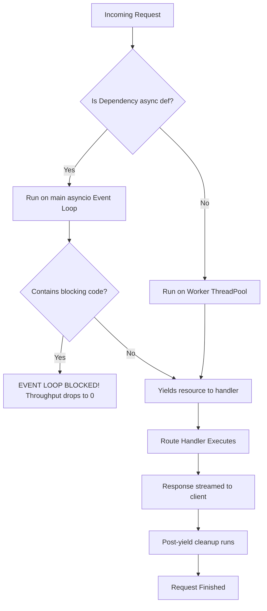

# Common FastAPI Dependency Mistakes & Debugging

FastAPI's dependency injection system is intuitive, but subtle misunderstandings of its execution lifecycle, concurrency model, caching behavior, and exception propagation can cause catastrophic production failures—including thread pool starvation, database connection pool exhaustion, silent transaction rollbacks, and security vulnerabilities.

---

## Conceptual Foundation & Mental Model

A FastAPI dependency is not just a helper function; it is an active node in an asynchronous Directed Acyclic Graph (DAG) executed per HTTP request. The most common catastrophic mistakes stem from failing to respect the boundaries of this DAG:
1. **Concurrency Mismatches**: Running blocking, synchronous I/O operations inside an `async def` dependency blocks the central asyncio event loop for all concurrent users.
2. **Yield Lifecycle Blindspots**: Assuming yield cleanup code can modify outgoing HTTP responses or headers after the response stream has already been committed to the client socket.
3. **Background Tasks with Closed Resources**: Passing a database session or open file handle resolved in a yield dependency into `BackgroundTasks`, where it is accessed **after** the yield block has closed it.
4. **Cache Mutation Corruptions**: Inadvertently mutating a shared, cached object (`use_cache=True`), corrupting state across multiple parts of the same request.
5. **Circular Dependency Deadlocks**: Constructing recursive or mutually dependent dependency chains that prevent graph resolution.

```
Request Timeline:
0ms   ──► Request arrives
10ms  ──► Pre-yield Dependency runs (DB session opened)
20ms  ──► Route handler runs (Schedules BackgroundTask with DB session)
30ms  ──► Response sent to client (Socket closed)
35ms  ──► Post-yield cleanup runs (DB session CLOSED!)
40ms  ──► BackgroundTask executes ──► CRASH: InterfaceError (Session closed!)
```

---

## Architecture & Internal Mechanics

### How FastAPI Resolves Concurrency Modes in Dependencies
When FastAPI analyzes a dependency callable:
- If defined as `async def`: FastAPI runs it directly on the main event loop. If it contains blocking code (`time.sleep()`, synchronous `requests.get()`, blocking ORM queries), the entire process stops processing other requests!
- If defined as `def`: FastAPI offloads execution to an external threadpool (`starlette.concurrency.run_in_threadpool`). This prevents event loop blocking, but consumes threadpool capacity (default 40 threads in `anyio`).



---

## Comprehensive Syntax & Core Mechanics

The table below catalogs the most dangerous dependency mistakes and their operational signatures:

| Mistake | Root Cause | Symptom in Production |
| :--- | :--- | :--- |
| **Sync DB in `async def`** | Calling `psycopg2` or sync SQLAlchemy in `async def get_db()` | Latency spikes from 5ms to 10s under moderate load; CPU drops to 0%. |
| **Background Task Resource Reuse** | Passing yield-scoped session into `background_tasks.add_task` | `sqlalchemy.exc.InvalidRequestError: Session is closed`. |
| **Swallowing Exceptions in Yield** | Catching `Exception` in yield block and not re-raising | Client receives truncated or corrupt responses; errors logged as successes. |
| **Mutating Cached Objects** | Modifying an object returned by `use_cache=True` dependency | Sub-dependency A sees modifications made by Sub-dependency B unexpectedly. |
| **Forgetting `Depends()` wrapper** | Writing `user: User = get_current_user` instead of `= Depends(...)` | Pydantic attempts to validate callable as query string; returns 422 Unprocessable Entity. |

---

## Practical Implementation (5 Complete Examples of Bugs & Fixes)

### Example 1: The Event Loop Blocker (Bug & Production Fix)
```python
# ❌ BUG: Blocking synchronous I/O inside an async def dependency!
import time
import requests  # Blocking HTTP client
from fastapi import FastAPI, Depends

app = FastAPI()

async def bad_auth_token_verifier(token: str = "test"):
    # This freezes the entire event loop for 1 second!
    time.sleep(1.0)
    # response = requests.get("https://auth.internal/verify")
    return {"user": "alice"}

# ✅ FIX: Use asynchronous non-blocking libraries (httpx, aiofiles)
import httpx

async def good_auth_token_verifier(token: str = "test"):
    async with httpx.AsyncClient() as client:
        # Non-blocking async I/O
        # resp = await client.get("https://auth.internal/verify")
        pass
    return {"user": "alice"}

# OR: If synchronous library cannot be replaced, declare as def (not async def)
def sync_auth_token_verifier(token: str = "test"):
    # FastAPI will safely offload this to worker threadpool
    time.sleep(1.0)
    return {"user": "alice"}
```

### Example 2: The Background Task with Closed Session Trap
```python
from typing import AsyncGenerator
from fastapi import FastAPI, Depends, BackgroundTasks

app = FastAPI()

class DatabaseSession:
    def __init__(self):
        self.is_open = True
    def log_activity(self, user: str):
        if not self.is_open:
            raise RuntimeError("Database connection is CLOSED!")
        print(f"Logged activity for {user}")
    def close(self):
        self.is_open = False

async def get_db() -> AsyncGenerator[DatabaseSession, None]:
    db = DatabaseSession()
    try:
        yield db
    finally:
        db.close()

# ❌ BUG: Passing db session into background task
@app.post("/bad-checkout")
async def bad_checkout(
    bg: BackgroundTasks,
    db: DatabaseSession = Depends(get_db)
):
    # This crashes when background task runs, because db.close() has already executed!
    bg.add_task(db.log_activity, user="alice")
    return {"status": "ok"}

# ✅ FIX: Background tasks must create their own independent sessions or pass primitive data!
def standalone_background_logger(user: str):
    # Instantiate new session independently
    session = DatabaseSession()
    try:
        session.log_activity(user=user)
    finally:
        session.close()

@app.post("/good-checkout")
async def good_checkout(
    bg: BackgroundTasks,
    db: DatabaseSession = Depends(get_db)
):
    # Pass only primitive strings/data to background task
    bg.add_task(standalone_background_logger, user="alice")
    return {"status": "ok"}
```

### Example 3: Silently Swallowing Exceptions in Yield Teardown
```python
from typing import AsyncGenerator
from fastapi import FastAPI, Depends, HTTPException

app = FastAPI()

# ❌ BUG: Bare except catches route exception and hides it
async def bad_yield_dependency() -> AsyncGenerator[str, None]:
    print("Pre-yield setup")
    try:
        yield "resource"
    except Exception as e:
        print(f"Swallowed exception: {e}")
        # Not re-raising! FastAPI cannot handle the error properly!

# ✅ FIX: Always re-raise exceptions unless you are intentionally handling it
async def good_yield_dependency() -> AsyncGenerator[str, None]:
    print("Pre-yield setup")
    try:
        yield "resource"
    except Exception as e:
        print(f"Logging exception in teardown: {e}")
        raise  # Re-raise so FastAPI's exception handlers process it
    finally:
        print("Guaranteed cleanup")

@app.get("/trigger-error")
async def trigger_error(res: str = Depends(good_yield_dependency)):
    raise HTTPException(status_code=400, detail="Custom bad request")
```

### Example 4: The Mutable Cache Pollution Trap
```python
from fastapi import FastAPI, Depends

app = FastAPI()

# A shared dependency returning a mutable dictionary
def get_user_permissions() -> dict[str, list[str]]:
    return {"roles": ["viewer"]}

# Sub-dependency A modifies the mutable object
def enrich_permissions(perms: dict = Depends(get_user_permissions)) -> dict:
    perms["roles"].append("temporary_editor")
    return perms

# Sub-dependency B expects original uncorrupted permissions
def audit_permissions(perms: dict = Depends(get_user_permissions)) -> dict:
    return perms

@app.get("/test-cache-trap")
def test_cache_trap(
    a: dict = Depends(enrich_permissions),
    b: dict = Depends(audit_permissions)
):
    # ❌ BUG: Because use_cache=True by default, 'b' sees the mutation made in 'a'!
    return {"a": a, "b": b}

# ✅ FIX: Return immutable types (tuples, frozensets) or Pydantic models (frozen=True)
from pydantic import BaseModel, ConfigDict

class UserPermissions(BaseModel):
    model_config = ConfigDict(frozen=True)  # Cannot be mutated!
    roles: tuple[str, ...]

def get_safe_permissions() -> UserPermissions:
    return UserPermissions(roles=("viewer",))
```

### Example 5: Forgetting `Depends()` and Triggering 422 Errors
```python
from fastapi import FastAPI, Depends
from pydantic import BaseModel

app = FastAPI()

class DatabaseConnection:
    pass

def get_connection() -> DatabaseConnection:
    return DatabaseConnection()

# ❌ BUG: Forgot = Depends(get_connection)
# FastAPI treats 'db' as a required Query Parameter, attempting to parse it from the URL!
@app.get("/bad-endpoint")
def bad_endpoint(db: DatabaseConnection = get_connection):
    return {"status": "ok"}

# ✅ FIX: Explicitly use Depends() or Annotated
from typing import Annotated

@app.get("/good-endpoint")
def good_endpoint(db: Annotated[DatabaseConnection, Depends(get_connection)]):
    return {"status": "ok"}
```

---

## Anti-Patterns & Common Traps

| Anti-Pattern | Root Cause | Production Remediation |
| :--- | :--- | :--- |
| **Attempting to modify response headers in yield teardown** | The response status code and headers are sent to the client socket *before* post-yield code executes. | Use ASGI Middleware or inject `Response` object into handler arguments. |
| **Circular dependency graph (A depends on B, B depends on A)** | Architectural tight coupling in sub-dependency DAG. | Refactor shared sub-logic into a standalone third dependency C. |
| **Calling dependencies directly inside handlers** (`get_db()`) | Directly calling the function bypasses dependency injection, caching, and cleanup hooks. | Always inject via `Depends(get_db)`. |
| **Using `request.state` to pass data between dependencies instead of return values** | Destroys type safety and makes unit testing difficult. | Return strongly typed domain objects and pass them via sub-dependencies. |

---

## Performance & Resource Characteristics

- **Event Loop Starvation Impact**: A single synchronous `time.sleep(1)` inside an `async def` dependency reduces a server's concurrent request throughput from 10,000 req/s to exactly 1 req/s!
- **Thread Pool Saturation**: Overusing synchronous `def` dependencies for high-volume endpoints can exhaust the default 40 worker threads, resulting in queued requests and high p99 latency.
- **Connection Leaks**: Failing to use `try ... finally` in yield dependencies ensures that whenever an unhandled exception occurs, database connections remain unclosed, exhausting PostgreSQL pool limits.

---

## Edge Cases, Failure Modes & Gotchas

1. **Client Disconnects**: If a client disconnects mid-request (e.g. cancels browser tab), FastAPI still attempts to run the teardown of yield dependencies to guarantee resource cleanup.
2. **Unhandled Exceptions in Dependencies vs Exception Handlers**: If a dependency raises `HTTPException`, Starlette's exception handler runs *before* the post-yield code of outer dependencies.
3. **Pydantic Model Dependencies**: When passing a Pydantic model to `Depends(MyModel)`, FastAPI parses body parameters or form data; if the request method is `GET`, FastAPI treats the model fields as query parameters.

---

## Security Implications & OWASP Alignment

- **State Leakage Across Requests**: Sharing mutable instances via dependencies can lead to session hijacking where User A's profile data is served to User B.
- **OWASP API4:2023 - Unrestricted Resource Consumption**: Unbounded connection allocation in broken yield dependencies will crash backend database clusters via connection pool exhaustion.

---

## Modern Tooling Integration

- **Pyright / Mypy**: Catches missing `Depends()` annotations by warning when a parameter default does not match the parameter type hint.
- **Ruff**: Configured with flake8-bugbear (`B`) flags blocking synchronous calls inside coroutines.
- **FastAPI TestClient**: Tests dependency lifecycles with mock error injections to verify that cleanup blocks always run.

---

## Real-World Case Study / Production Incident

An enterprise retail API crashed during a Black Friday event with thousands of `500 Internal Server Error` responses. The database logs showed: `FATAL: remaining connection slots are reserved for non-replication superuser connections`.

**Investigation**:
The development team had written their database yield dependency as:
```python
async def get_db():
    conn = await pool.acquire()
    yield conn
    await pool.release(conn)  # No try...finally!
```
When endpoints raised `HTTPException(404, "Item not found")`, execution jumped directly to FastAPI's error handler, skipping `await pool.release(conn)`. Within 4 minutes, all 200 database connections leaked and remained permanently locked.

**Resolution**:
Wrapped all resource acquisitions in standard `try ... finally` blocks:
```python
async def get_db():
    conn = await pool.acquire()
    try:
        yield conn
    finally:
        await pool.release(conn)
```
Connection leakage was eliminated immediately.

---

## Hands-On Exercises & Challenge Problems

### Warmup (2 Exercises)
1. Identify the bug in: `async def verify_signature(sig: str): time.sleep(0.05); return sig` and fix it.
2. Fix this endpoint signature that fails with 422: `def read_root(cfg: AppConfig = get_config): pass`.

### Intermediate (2 Exercises)
3. Write a test case demonstrating that an unhandled exception inside a route handler successfully triggers the `finally` block of a yield dependency.
4. Refactor a pair of mutually recursive dependencies `get_user_profile` and `get_user_account` into a clean, acyclic dependency DAG.

### Production-Grade (2 Exercises)
5. Build an asynchronous integration test verifying that a background task scheduled via `BackgroundTasks` executes cleanly with its own database session without encountering `InterfaceError: Session closed`.
6. Implement a dynamic dependency inspector using Python's `ast` module that scans all FastAPI routes in a repository and raises a CI error if any `async def` dependency calls known blocking libraries (`time.sleep`, `urllib.request`, `requests`).

---

## Interview Mastery (8 Q&As)

### Junior Level
**Q1: What happens if you define a dependency as `async def` but call `time.sleep(5)` inside it?**
*Answer:* Because the dependency is declared as `async def`, FastAPI runs it directly on the main asyncio event loop. The blocking `time.sleep(5)` halts the entire event loop, freezing all concurrent requests for all users across the entire server process.

**Q2: What is the correct way to handle cleanup in a dependency that opens a database connection?**
*Answer:* Use a generator function with `yield` wrapped in a `try ... finally` block:
```python
async def get_db():
    db = open_db()
    try:
        yield db
    finally:
        db.close()
```

**Q3: Can a dependency post-yield block add a custom header to the outgoing HTTP response?**
*Answer:* No. By the time the post-yield code executes, the HTTP response headers and body have already been committed and transmitted across the network socket. Use middleware or inject the `Response` object into the endpoint handler to modify headers.

### Senior Level
**Q4: Why does passing a database session from a yield dependency into `BackgroundTasks` fail?**
*Answer:* FastAPI executes the post-yield teardown of dependencies as soon as the HTTP response is sent, closing the database session. `BackgroundTasks` execute *after* response completion, meaning any attempt by the background task to access that session encounters an already-closed or invalid connection.

**Q5: What is the difference between `def` and `async def` dependencies in terms of thread execution?**
*Answer:* `async def` dependencies run cooperatively on the main asyncio thread event loop. Synchronous `def` dependencies are offloaded by FastAPI/Starlette to an AnyIO worker threadpool, ensuring they do not block the event loop while performing synchronous operations.

**Q6: What causes a circular dependency error in FastAPI and how do you resolve it?**
*Answer:* It occurs when Dependency A depends on Dependency B, and Dependency B directly or indirectly depends on Dependency A. Because FastAPI resolves dependencies as a directed acyclic graph (DAG), a cycle cannot be resolved. The resolution is to extract the shared logic into an independent Dependency C that both A and B can depend on.

### Staff / Architect Level
**Q7: How do you design an architectural standard across a large engineering org to prevent developers from writing blocking code in `async def` dependencies?**
*Answer:*
1. Implement static analysis and linting: Use Ruff and custom AST rules (or flake8-async) to flag blocking synchronous libraries (`requests`, `time.sleep`, `urllib`) inside `async def` functions.
2. Architecture isolation: Provide pre-built, hardened dependency modules (e.g. `get_db`, `get_http_client`) in an internal shared library and forbid developers from writing raw connection logic.
3. Concurrency testing: Enforce automated load tests in CI using tools like Locust or k6 to catch event loop stalls and latency spikes under concurrency before deployment.

**Q8: If an exception is raised in the `yield` cleanup block of a dependency, what happens to the client and server?**
*Answer:* Because the client has already received the response headers and payload, the client connection is unaffected (or terminates if streaming). On the server, the unhandled exception propagates up to the ASGI server (Uvicorn), which catches it, logs a critical stack trace, and increments error metrics. If the error occurs in a database cleanup block, it may leak database connections or locks unless handled with robust `try ... finally` protections.
