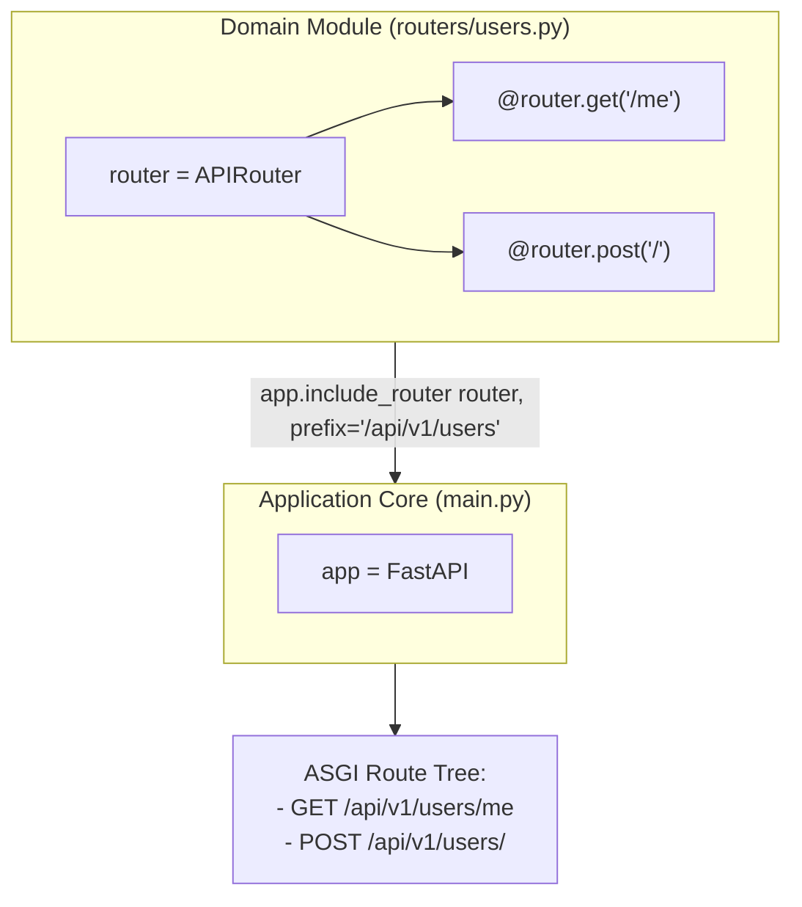

# FastAPI APIRouter Basics & Modular Routing

In production systems, declaring all API endpoints on a single root `app = FastAPI()` instance produces unwieldy monolithic files, creates merge conflicts across engineering teams, and obscures domain boundaries. FastAPI's `APIRouter` provides a modular, composable routing abstraction that allows developers to organize routes into isolated, reusable domain controllers.

---

## Conceptual Foundation & Mental Model

Think of `APIRouter` as a "miniature FastAPI instance" dedicated to a specific business subdomain (e.g., users, billing, inventory, analytics):
- An `APIRouter` supports all HTTP path operation decorators (`@router.get`, `@router.post`, `@router.put`, `@router.delete`, `@router.patch`).
- It can define its own URL prefix, tags, default dependencies, and default error responses.
- It does **not** run standalone on Uvicorn; instead, it is mounted or included into the root application using `app.include_router(router)`.

```
                    Root FastAPI Instance
                     app = FastAPI(...)
                             │
            ┌────────────────┼────────────────┐
            ▼                ▼                ▼
   Users APIRouter    Billing APIRouter  Catalog APIRouter
    prefix="/users"   prefix="/billing"   prefix="/items"
    tags=["Users"]    tags=["Billing"]    tags=["Items"]
            │                │                │
     ┌──────┴──────┐         ├───────┐        └───────┐
     ▼             ▼         ▼       ▼                ▼
GET /users/  POST /users/  GET /... POST /...     GET /items/
```

---

## Architecture & Internal Mechanics

When `app.include_router(router)` is called:
1. **Route Cloning**: FastAPI iterates over all `Route` objects registered on the `APIRouter`.
2. **Prefix Composition**: It prefixes each route's path with the router's `prefix` (and any outer prefix supplied in `include_router`).
3. **Metadata Merging**: Tags, dependencies, response descriptions, and callbacks defined on the router are merged with those on individual path operations.
4. **Registration on App**: The resulting resolved `APIRoute` instances are appended to the root `app.router.routes` list for high-speed ASGI pattern matching.



---

## Comprehensive Syntax & Core Mechanics

An `APIRouter` accepts several configuration parameters that apply to all path operations registered under it:

```python
from fastapi import APIRouter

router = APIRouter(
    prefix="/api/v1/orders",
    tags=["Orders"],
    responses={
        404: {"description": "Resource not found in orders database"},
        500: {"description": "Internal order processing error"}
    }
)

@router.get("/")
async def list_orders():
    return [{"order_id": "ord_101", "status": "shipped"}]
```

Registering the router on the main application:
```python
from fastapi import FastAPI
# from app.routers.orders import router as orders_router

app = FastAPI(title="Enterprise Storefront")
app.include_router(router)
```

---

## Practical Implementation (5 Complete Examples)

### Example 1: Standard Domain-Separated Routers
```python
# users_router.py
from fastapi import APIRouter, HTTPException
from pydantic import BaseModel

router = APIRouter(prefix="/users", tags=["User Management"])

class User(BaseModel):
    id: int
    name: str

USERS = {1: User(id=1, name="Alice"), 2: User(id=2, name="Bob")}

@router.get("/", response_model=list[User])
async def get_all_users():
    return list(USERS.values())

@router.get("/{user_id}", response_model=User)
async def get_user_by_id(user_id: int):
    if user_id not in USERS:
        raise HTTPException(status_code=404, detail="User not found")
    return USERS[user_id]
```

### Example 2: Wiring Multiple Domain Routers in `main.py`
```python
from fastapi import FastAPI
# Simulated imports:
# from routers.users import router as users_router
# from routers.billing import router as billing_router

app = FastAPI(title="Modular API Architecture", version="1.0.0")

# Mount with explicit version prefixes
app.include_router(router, prefix="/api/v1")

@app.get("/health", tags=["System"])
async def root_health():
    return {"status": "healthy"}
```

### Example 3: Router-Level Common Response Models and Schemas
```python
from fastapi import APIRouter
from pydantic import BaseModel

class ErrorResponse(BaseModel):
    error_code: str
    message: str

router = APIRouter(
    prefix="/payments",
    tags=["Payments"],
    responses={
        400: {"model": ErrorResponse, "description": "Payment validation failed"},
        402: {"model": ErrorResponse, "description": "Payment required / card declined"},
    }
)

@router.post("/charge")
async def process_charge(amount: float):
    return {"status": "charge_initiated", "amount": amount}
```

### Example 4: Dynamically Overriding Router Prefixes on Mount
```python
from fastapi import FastAPI, APIRouter

# Router defined without hardcoded prefix
items_router = APIRouter(tags=["Items"])

@items_router.get("/")
async def list_items():
    return ["item_a", "item_b"]

app = FastAPI()

# Prefix is bound dynamically during application composition!
# Allows mounting the same router at /internal/items AND /public/items
app.include_router(items_router, prefix="/v1/items")
app.include_router(items_router, prefix="/v2/items")
```

### Example 5: Route Operation Naming and Deduplication
```python
from fastapi import APIRouter

router = APIRouter(prefix="/reports", tags=["Reports"])

# Using operation_id guarantees unique OpenAPI client SDK method names
@router.get("/daily", operation_id="get_daily_executive_report")
async def get_daily():
    return {"report": "daily", "metrics": 100}

@router.get("/monthly", operation_id="get_monthly_executive_report")
async def get_monthly():
    return {"report": "monthly", "metrics": 3000}
```

---

## Anti-Patterns & Common Traps

| Anti-Pattern | Why It Breaks / Fails | Production Solution |
| :--- | :--- | :--- |
| **Trailing slash inconsistency** (`prefix="/users/"` with `@router.get("/")`) | Creates double slashes `/users//` or unexpected 307 Temporary Redirects. | Never put trailing slashes in `prefix` (use `prefix="/users"`). |
| **Instantiating a new `FastAPI()` instead of `APIRouter` for modules** | Creates isolated ASGI applications that do not share OpenAPI docs, middlewares, or dependencies. | Use `APIRouter()` for modules, not `FastAPI()`. |
| **Hardcoding identical operation names across routers** | OpenAPI requires unique operation IDs; duplicate function names across routers generate ambiguous SDK clients. | Use unique function names or assign explicit `operation_id="..."`. |
| **Importing `app` inside router modules** | Triggers circular import deadlocks (`main.py` imports `router`, which imports `main.py`). | Routers must never import `app`; `main.py` imports routers. |

---

## Performance & Resource Characteristics

- **Zero Runtime Dispatch Overhead**: `APIRouter` routes are cloned into `app.router.routes` at startup; incoming requests are routed via compiled regex patterns with zero indirection.
- **Memory Footprint**: Routing tables consume less than a few kilobytes of RAM for hundreds of endpoints.
- **Fast Startup**: Router registration executes in single-digit milliseconds during application boot.

---

## Edge Cases, Failure Modes & Gotchas

1. **Root Path Matching**: If an endpoint is declared as `@router.get("")` vs `@router.get("/")`:
   - `@router.get("")` matches `/prefix` exactly without a trailing slash.
   - `@router.get("/")` matches `/prefix/` with a trailing slash. If a client requests `/prefix`, Starlette issues an automatic 307 redirect to `/prefix/`.
2. **Order of `include_router` Calls**: Routes are matched in the order they are registered. Put more specific routes (e.g. `/users/me`) before parameterized wildcard routes (e.g. `/users/{id}`).

---

## Security Implications & OWASP Alignment

- **OWASP API1:2023 - Broken Object Level Authorization**: Organizing endpoints into dedicated domain routers makes it easier to enforce domain-specific authorization boundaries and audit route lists.
- **Attack Surface Minimization**: Internal administration routes can be segregated onto a private router (`/admin/...`) that is easily gated by network policies or reverse proxies.

---

## Modern Tooling Integration

- **OpenAPI 3.1 & Swagger UI**: Routers automatically group endpoints under collapsible tags in Swagger UI.
- **OpenAPI Generator**: Distinct routers generate clean SDK service classes (`UsersApi`, `OrdersApi`).

---

## Real-World Case Study / Production Incident

A financial dashboard team had 95 endpoints declared in a 4,500-line `main.py`. During a rapid release, two engineers modified the same file, resulting in git merge conflicts that accidentally dropped an authorization check on `/accounts/transfer`.

**Refactoring Strategy**:
The team broke `main.py` down into 8 domain routers inside `app/routers/`:
- `routers/auth.py`
- `routers/accounts.py`
- `routers/transfers.py`
- `routers/analytics.py`

`main.py` was reduced to 35 lines containing only router registration and lifecycle hooks. Merge conflicts dropped by 90% and code review safety increased significantly.

---

## Hands-On Exercises & Challenge Problems

### Warmup (2 Exercises)
1. Create an `APIRouter` with `prefix="/health"` and a single GET endpoint returning `{"status": "ok"}`.
2. Include the router into a root `FastAPI` app and verify it responds at `/health`.

### Intermediate (2 Exercises)
3. Create two routers (`customers_router` and `products_router`) with custom tags and attach both to an app under `/api/v1`.
4. Configure an `APIRouter` with custom response schemas for 404 and 500 error codes and verify they appear in the `/openapi.json` documentation.

### Production-Grade (2 Exercises)
5. Build a dynamic router loader that uses `pkgutil` or `importlib` to automatically discover and mount all routers present in an `app/routers/` package directory without manual imports.
6. Design a route registry that enforces an organization-wide naming convention: all path operations must define an explicit `operation_id` matching `{router_tag}_{method}_{path}`.

---

## Interview Mastery (8 Q&As)

### Junior Level
**Q1: What is `APIRouter` in FastAPI?**
*Answer:* `APIRouter` is a class used to group related path operations into modular components, allowing developers to structure large applications into multiple files instead of declaring everything on the root `FastAPI` instance.

**Q2: How do you attach an `APIRouter` to a `FastAPI` instance?**
*Answer:* Using the `app.include_router(router)` method, optionally specifying a `prefix` and `tags`.

**Q3: Can an `APIRouter` be run directly with Uvicorn?**
*Answer:* No. An `APIRouter` is not an ASGI application; it must be included into a `FastAPI` or Starlette application instance.

### Senior Level
**Q4: What happens if both `APIRouter(prefix="/api")` and `app.include_router(router, prefix="/v1")` specify a prefix?**
*Answer:* FastAPI concatenates them in order: the resulting path will be `/v1/api/...`.

**Q5: How does route matching order work when including multiple routers?**
*Answer:* Routes are evaluated in the order they are registered in the ASGI route table. If a route `/users/{user_id}` is registered before `/users/me`, a request to `/users/me` will match the parameterized route first unless `/users/me` is registered earlier.

**Q6: What is the semantic difference between `@router.get("")` and `@router.get("/")` on a router with `prefix="/items"`?**
*Answer:* `@router.get("")` matches `http://host/items` without a trailing slash. `@router.get("/")` matches `http://host/items/` with a trailing slash (and redirects `/items` to `/items/` via a 307 Temporary Redirect).

### Staff / Architect Level
**Q7: How do you architect an enterprise FastAPI application with 50+ domain routers to prevent merge conflicts and circular dependencies?**
*Answer:*
1. Establish a strict three-tier module structure: `schemas/`, `services/`, and `routers/`.
2. Router files only import schemas, services, and FastAPI classes; they never import `app` or other router files.
3. Use a central `api/v1/router.py` aggregator that imports individual domain routers and includes them into an umbrella `v1_router`, which `main.py` includes into `app`.
4. Ensure domain business logic is completely isolated inside service classes.

**Q8: What are the performance implications of having hundreds of routes mounted via multiple `APIRouter` instances?**
*Answer:* Starlette compiles path patterns into regular expressions during startup. At runtime, path resolution is efficient (`O(N)` regex checks against the compiled table, where N is the number of routes). For thousands of routes, route matching latency remains under 0.1ms; however, developer ergonomics and Swagger UI rendering speed benefit from segregating massive APIs across versioned or subdomain routers.
