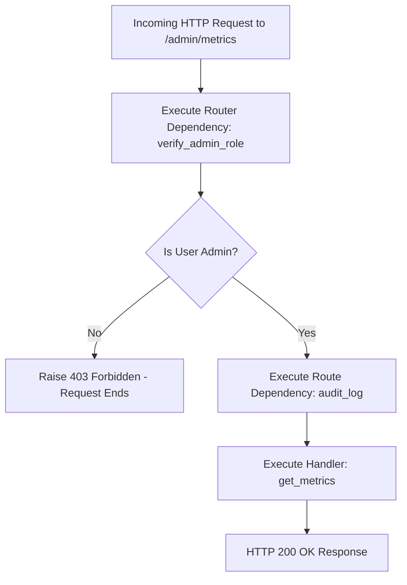

# FastAPI Router-Level Dependencies & Authorization

Securing an API route-by-route is error-prone. In enterprise systems, access control, tenant validation, and audit requirements align with business domains. FastAPI allows architects to apply dependencies directly to an `APIRouter`—or dynamically when mounting a router via `include_router(..., dependencies=[...])`—ensuring that every route within that domain inherits identical security guards with zero code duplication.

---

## Conceptual Foundation & Mental Model

Consider an API with an administration domain (`/admin/*`) and a public billing domain (`/billing/*`). Applying `admin_guard` individually across 25 admin endpoints means a single developer omission exposes an administrative route to unauthorized users.

By configuring dependencies on the router:
1. **Declaration at Router Definition**: `APIRouter(dependencies=[Depends(admin_guard)])` secures all routes defined on that router instance.
2. **Declaration at Inclusion**: `app.include_router(router, dependencies=[Depends(extra_guard)])` applies additional guards dynamically without modifying the router's source file.

```
                    Incoming HTTP Request
                             │
                             ▼
     ┌───────────────────────────────────────────────────┐
     │                FastAPI Application                │
     └───────────────────────┬───────────────────────────┘
                             │
            ┌────────────────┴────────────────┐
            ▼                                 ▼
   Public Router (No Auth)            Admin Router (Secured)
                                dependencies=[Depends(verify_admin)]
            │                                 │
     GET /public/status               GET /admin/users
     (Executes immediately)           (Guaranteed: verify_admin runs first!)
```

---

## Architecture & Internal Mechanics

When routes are registered on an `APIRouter` and subsequently included into an application:
1. **Dependency Aggregation**:
   - Router definition dependencies (`APIRouter(dependencies=[...])`) are recorded on the router.
   - Inclusion dependencies (`include_router(..., dependencies=[...])`) are prepended or combined.
   - Route decorator dependencies (`@router.get(..., dependencies=[...])`) are appended.
   - Endpoint signature dependencies (`arg = Depends(...)`) are resolved.
2. **Topological Order**:
   Execution strictly respects the hierarchy: Outer/Parent Router Dependencies $\rightarrow$ Router Dependencies $\rightarrow$ Route Decorator Dependencies $\rightarrow$ Signature Dependencies.
3. **Short-Circuit Semantics**: If any router-level dependency raises `HTTPException`, route evaluation terminates immediately.



---

## Comprehensive Syntax & Core Mechanics

### 1. Declaring on Router Creation
```python
from fastapi import APIRouter, Depends

# All endpoints registered on this router automatically inherit this dependency
admin_router = APIRouter(
    prefix="/admin",
    tags=["Administration"],
    dependencies=[Depends(verify_admin_jwt), Depends(enforce_ip_whitelist)]
)
```

### 2. Declaring Dynamically During `include_router`
```python
# Reusable inventory router with NO security baked in
inventory_router = APIRouter(prefix="/inventory", tags=["Inventory"])

# Mount under internal portal with mandatory internal VPN guard
app.include_router(
    inventory_router,
    prefix="/internal",
    dependencies=[Depends(require_internal_vpn)]
)

# Mount same router under partner portal with OAuth2 partner token guard
app.include_router(
    inventory_router,
    prefix="/partners",
    dependencies=[Depends(require_partner_oauth)]
)
```

---

## Practical Implementation (5 Complete Examples)

### Example 1: Enforcing Role-Based Access Control (RBAC) on Admin Router
```python
from typing import Annotated
from fastapi import FastAPI, APIRouter, Depends, Header, HTTPException, status

app = FastAPI()

async def require_admin_role(x_user_role: Annotated[str, Header()]):
    if x_user_role != "admin":
        raise HTTPException(
            status_code=status.HTTP_403_FORBIDDEN,
            detail="Forbidden: Requires administrative privileges."
        )

admin_router = APIRouter(
    prefix="/admin",
    tags=["Admin"],
    dependencies=[Depends(require_admin_role)]
)

@admin_router.get("/users")
async def list_all_users():
    return [{"id": 1, "username": "alice"}, {"id": 2, "username": "bob"}]

@admin_router.delete("/users/{user_id}")
async def delete_user(user_id: int):
    return {"status": "deleted", "user_id": user_id}

app.include_router(admin_router)
```

### Example 2: Multi-Tenant Tenant Isolation Router Guard
```python
from typing import Annotated
from fastapi import FastAPI, APIRouter, Depends, Header, HTTPException, Request

class Tenant:
    def __init__(self, tenant_id: str, plan: str):
        self.tenant_id = tenant_id
        self.plan = plan

async def extract_and_verify_tenant(
    request: Request,
    x_tenant_id: Annotated[str, Header()]
) -> Tenant:
    if x_tenant_id not in ("tenant_alpha", "tenant_beta"):
        raise HTTPException(status_code=400, detail="Unknown or suspended tenant.")
    tenant = Tenant(tenant_id=x_tenant_id, plan="enterprise")
    request.state.tenant = tenant
    return tenant

tenant_router = APIRouter(
    prefix="/org",
    dependencies=[Depends(extract_and_verify_tenant)]
)

@tenant_router.get("/settings")
async def get_settings(request: Request):
    return {"tenant": request.state.tenant.tenant_id, "plan": request.state.tenant.plan}

app = FastAPI()
app.include_router(tenant_router)
```

### Example 3: Context-Manager Yield Dependencies on Routers
```python
import time
from typing import AsyncGenerator
from fastapi import FastAPI, APIRouter, Depends, Request

async def router_performance_profiler(request: Request) -> AsyncGenerator[None, None]:
    start_time = time.perf_counter()
    try:
        yield
    finally:
        duration_ms = (time.perf_counter() - start_time) * 1000
        print(f"[METRIC] Domain '{request.url.path}' executed in {duration_ms:.2f}ms")

analytics_router = APIRouter(
    prefix="/analytics",
    tags=["Analytics"],
    dependencies=[Depends(router_performance_profiler)]
)

@analytics_router.get("/summary")
async def analytics_summary():
    return {"views": 10540, "conversions": 340}

app = FastAPI()
app.include_router(analytics_router)
```

### Example 4: Hierarchical Dependency Inheritance Across Nested Routers
```python
from fastapi import FastAPI, APIRouter, Depends

def guard_level_1():
    print("Executing Level 1 Guard")

def guard_level_2():
    print("Executing Level 2 Guard")

def guard_level_3():
    print("Executing Level 3 Guard")

child_router = APIRouter(
    prefix="/sub",
    dependencies=[Depends(guard_level_3)]
)

@child_router.get("/endpoint")
async def leaf_endpoint():
    return {"message": "All 3 guards ran in order 1 -> 2 -> 3!"}

parent_router = APIRouter(
    prefix="/parent",
    dependencies=[Depends(guard_level_2)]
)
parent_router.include_router(child_router)

app = FastAPI()
app.include_router(parent_router, dependencies=[Depends(guard_level_1)])
```

### Example 5: Combining Router Dependencies with Parameter Dependencies
```python
from typing import Annotated
from fastapi import FastAPI, APIRouter, Depends, Header, HTTPException
from pydantic import BaseModel

class CurrentUser(BaseModel):
    id: str
    role: str

async def verify_domain_token(x_domain_key: Annotated[str, Header()]) -> None:
    if x_domain_key != "corp-domain-key":
        raise HTTPException(status_code=401, detail="Invalid domain key")

async def get_current_user(authorization: Annotated[str, Header()]) -> CurrentUser:
    return CurrentUser(id="usr_55", role="billing_operator")

# Router enforces domain key globally across all billing routes
billing_router = APIRouter(
    prefix="/billing",
    tags=["Billing"],
    dependencies=[Depends(verify_domain_token)]
)

@billing_router.get("/invoices")
async def list_invoices(user: Annotated[CurrentUser, Depends(get_current_user)]):
    # Both verify_domain_token and get_current_user have executed
    return {"user": user.id, "invoices": ["inv_01", "inv_02"]}

app = FastAPI()
app.include_router(billing_router)
```

---

## Anti-Patterns & Common Traps

| Anti-Pattern | Why It Breaks / Fails | Production Solution |
| :--- | :--- | :--- |
| **Duplicating guards across 20 routes in the same file** | Violates DRY; inevitable omission during feature development creates security vulnerabilities. | Move shared guards to `APIRouter(dependencies=[Depends(...)])`. |
| **Expecting return values from router-level dependencies** | Router-level dependencies discard their return values; handlers cannot access them as parameters directly. | If handler needs the returned object, declare `Depends()` in the handler or store in `request.state`. |
| **Applying destructive yield dependencies at router level without exception handling** | An unhandled exception in one route skips cleanup or leaves open connections if not wrapped in `try...finally`. | Always protect yield blocks with `try ... finally`. |
| **Putting public health checks inside secured routers** | Kubernetes liveness/readiness probes get rejected with 401/403, causing pod restarts. | Keep health checks on unrestricted public routers or the root app. |

---

## Performance & Resource Characteristics

- **Pre-Compiled Graph**: Router dependencies are merged into the path operation's dependency solve list at startup; there is zero runtime penalty for router nesting.
- **Dependency Caching (`use_cache=True`)**: If a router dependency and a route handler parameter depend on the same underlying sub-dependency (e.g., `get_db`), it executes once per request.

---

## Edge Cases, Failure Modes & Gotchas

1. **Ordering of Multiple Dependencies**: In `APIRouter(dependencies=[Depends(A), Depends(B)])`, `A` always executes before `B`.
2. **OpenAPI Schema Documentation**: Parameters (headers, queries) defined in router dependencies automatically appear in the OpenAPI documentation for every endpoint on that router.
3. **Yield Teardown Order**: Post-yield cleanup executes in reverse order of pre-yield initialization (LIFO / Stack order).

---

## Security Implications & OWASP Alignment

- **OWASP API5:2023 - Broken Function Level Authorization**: Router-level dependencies provide declarative perimeter security across entire functional modules.
- **Fail-Secure Architecture**: Defaulting to secure routers ensures that newly added endpoints are protected by default.

---

## Modern Tooling Integration

- **Swagger UI**: Displays all security headers and tokens declared by router dependencies in interactive documentation.
- **Pytest**: Easily bypass or test router dependencies using `app.dependency_overrides`.

---

## Real-World Case Study / Production Incident

An online gaming backend exposed a new administrative endpoint `/admin/reset-leaderboard`. The developer assumed that because the route was placed inside `admin.py`, it was secure. However, security checks were previously attached to endpoints individually using `@router.get(..., dependencies=[...])`, and the developer omitted the decorator argument. The unauthenticated endpoint was scraped and triggered, wiping production leaderboards.

**Remediation**:
The architecture was refactored:
```python
admin_router = APIRouter(
    prefix="/admin",
    dependencies=[Depends(verify_superadmin_mfa)]
)
```
Every route declared under `admin_router` became permanently guarded, preventing developer omission.

---

## Hands-On Exercises & Challenge Problems

### Warmup (2 Exercises)
1. Create an `APIRouter` with a router-level dependency that checks for header `X-Service-Name`.
2. Verify that two endpoints on that router both reject requests lacking `X-Service-Name`.

### Intermediate (2 Exercises)
3. Implement a rate-limiting dependency on an `APIRouter` restricting all routes within that router to 20 requests per minute per IP.
4. Mount a public router and a private router under the same app; assert that public routes succeed without credentials while private routes return 401.

### Production-Grade (2 Exercises)
5. Build a multi-tenant router architecture where a router dependency parses `X-Tenant-ID`, validates tenant status against a cache, and attaches tenant metadata to `request.state`.
6. Implement an audit dependency on an `APIRouter` that records endpoint execution time and status code to an async logger, ensuring post-yield code executes even when handlers raise exceptions.

---

## Interview Mastery (8 Q&As)

### Junior Level
**Q1: How do you add a dependency to an entire `APIRouter`?**
*Answer:* By passing a list of `Depends()` calls to the `dependencies` parameter of the `APIRouter`: `router = APIRouter(dependencies=[Depends(my_guard)])`.

**Q2: Can an endpoint function inside a secured router access the return value of a router dependency?**
*Answer:* Not directly through function parameters. However, the endpoint can inject the same dependency with `data = Depends(my_guard)` (and FastAPI will use the cached result), or the router dependency can attach data to `request.state`.

**Q3: Does a router dependency run before or after the endpoint's parameter dependencies?**
*Answer:* Router-level dependencies execute before the endpoint's parameter dependencies.

### Senior Level
**Q4: What happens if both `APIRouter(dependencies=[A])` and `include_router(..., dependencies=[B])` are used?**
*Answer:* Both dependencies execute. Inclusion dependencies (`B`) run first, followed by the router's own dependencies (`A`), before route-level dependencies execute.

**Q5: Can router-level dependencies be overridden in tests using `app.dependency_overrides`?**
*Answer:* Yes. `app.dependency_overrides` works identically for router-level dependencies as it does for route-level or global dependencies.

**Q6: What is the best practice for handling public health check endpoints in an application that requires authentication across most routers?**
*Answer:* Keep health check routes on the root `FastAPI` instance or on a dedicated `public_router` with no dependencies, rather than mounting them inside secured routers.

### Staff / Architect Level
**Q7: How do router dependencies interact with OpenAPI security schemes?**
*Answer:* If a router-level dependency utilizes security classes (such as `OAuth2PasswordBearer`, `HTTPBearer`, or `Security()`), FastAPI adds the security scheme requirement to the OpenAPI definition of every route on that router. Swagger UI will automatically display padlock icons and include the required authorization headers.

**Q8: In an enterprise application with 100+ microservices, why is router-level authorization superior to middleware-based authorization?**
*Answer:* Router dependencies participate in FastAPI's type system, support dependency caching, allow fine-grained OpenAPI schema generation, support test overrides via `dependency_overrides`, and can easily access resolved path parameters—capabilities that low-level ASGI middlewares lack.
