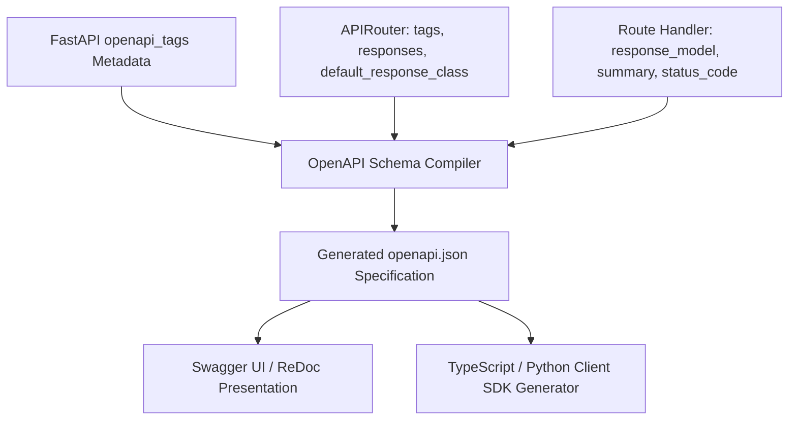

# FastAPI Router Tags, Metadata & Responses

In addition to grouping paths and dependencies, `APIRouter` serves as a primary configuration node for the generated OpenAPI specification. By setting router-level tags, common response schemas, custom response classes, and unique operation ID generators, backend teams create professional, beautifully structured API documentation and reliable automated client SDKs.

---

## Conceptual Foundation & Mental Model

When an API grows beyond a handful of endpoints, unstructured Swagger UI documentation becomes an unnavigable wall of endpoints. Furthermore, client SDK generators (like `openapi-typescript` or `openapi-generator-cli`) produce collision-prone method names if operations lack clean IDs.

Configuring metadata at the `APIRouter` level provides:
1. **Visual Tag Grouping**: Collapsible, categorized sections in Swagger UI and ReDoc.
2. **Default Error Responses**: Declaring common 400, 401, 404, or 500 JSON schemas once per router.
3. **Response Class Inheritance**: Setting high-performance serializers (e.g. `ORJSONResponse`) across all router endpoints.
4. **Operation ID Standardization**: Generating clean, predictable function names for client SDK generation.

```
┌────────────────────────────────────────────────────────┐
│ APIRouter(                                             │
│   tags=["User Accounts"],                              │
│   responses={404: {"model": NotFoundError}},          │
│   default_response_class=ORJSONResponse                │
│ )                                                      │
└───────────────────────────┬────────────────────────────┘
                            │ Propagates To All Routes
           ┌────────────────┼────────────────┐
           ▼                ▼                ▼
     GET /users/me    POST /users/     DELETE /users/{id}
    - Tag: User Accts - Tag: User Accts- Tag: User Accts
    - Has 404 Schema - Has 404 Schema - Has 404 Schema
    - ORJSON Output  - ORJSON Output  - ORJSON Output
```

---

## Architecture & Internal Mechanics

When FastAPI generates the OpenAPI 3.1 JSON schema:
1. **Tag Merging**: Tags from the router are merged with tags declared on individual endpoints.
2. **Response Merging**: The router's `responses` dictionary is deep-merged with the endpoint's `responses`. If an endpoint defines a response code already present on the router, the endpoint's definition takes precedence.
3. **OpenAPI Tags Metadata**: Detailed descriptions and external documentation URLs declared in `FastAPI(openapi_tags=[...])` are bound to router tags during final documentation compilation.



---

## Comprehensive Syntax & Core Mechanics

```python
from fastapi import APIRouter
from fastapi.responses import ORJSONResponse
from pydantic import BaseModel

class StandardError(BaseModel):
    error_code: str
    message: str

router = APIRouter(
    prefix="/billing",
    tags=["Billing & Payments"],
    default_response_class=ORJSONResponse,
    responses={
        400: {"model": StandardError, "description": "Invalid payment parameters"},
        402: {"model": StandardError, "description": "Payment Required / Card Declined"},
        404: {"model": StandardError, "description": "Billing entity not found"}
    }
)
```

### Standardizing Operation IDs
By default, FastAPI generates operation IDs using the Python function name. If two routers have a function named `get_items`, collisions occur. Use `generate_unique_id_function`:

```python
from fastapi import FastAPI
from fastapi.routing import APIRoute

def custom_generate_unique_id(route: APIRoute) -> str:
    # Generates e.g. "billing-get_invoices" or "users-get_profile"
    tag = route.tags[0] if route.tags else "default"
    return f"{tag}-{route.name}"

app = FastAPI(generate_unique_id_function=custom_generate_unique_id)
```

---

## Practical Implementation (5 Complete Examples)

### Example 1: Enriching Tags with Detailed OpenAPI Metadata
```python
from fastapi import FastAPI, APIRouter

tags_metadata = [
    {
        "name": "Authentication",
        "description": "Operations for logging in, refreshing JWT tokens, and MFA verification.",
    },
    {
        "name": "Inventory Management",
        "description": "Manage warehouse products, stock levels, and supplier orders.",
        "externalDocs": {
            "description": "Warehouse Logistics Protocol Docs",
            "url": "https://docs.enterprise.com/logistics",
        },
    },
]

app = FastAPI(
    title="Warehouse Operations Platform",
    openapi_tags=tags_metadata
)

inventory_router = APIRouter(prefix="/inventory", tags=["Inventory Management"])

@inventory_router.get("/stock")
async def get_stock():
    return {"sku_1": 450, "sku_2": 12}

app.include_router(inventory_router)
```

### Example 2: Common Domain Error Schemas on `APIRouter`
```python
from fastapi import FastAPI, APIRouter, HTTPException, status
from pydantic import BaseModel

class ErrorPayload(BaseModel):
    code: str
    detail: str
    trace_id: str

catalog_router = APIRouter(
    prefix="/catalog",
    tags=["Product Catalog"],
    responses={
        404: {"model": ErrorPayload, "description": "Product was not found"},
        503: {"model": ErrorPayload, "description": "Catalog search index offline"},
    }
)

@catalog_router.get("/products/{product_id}")
async def get_product(product_id: int):
    if product_id == 999:
        raise HTTPException(
            status_code=status.HTTP_404_NOT_FOUND,
            detail="Product 999 is discontinued"
        )
    return {"id": product_id, "name": "Mechanical Keyboard"}

app = FastAPI()
app.include_router(catalog_router)
```

### Example 3: Router-Level High-Performance `ORJSONResponse`
```python
from fastapi import FastAPI, APIRouter
from fastapi.responses import ORJSONResponse
import math

# All endpoints on this router serialize responses using ultra-fast Rust-based ORJSON
metrics_router = APIRouter(
    prefix="/telemetry",
    tags=["Telemetry"],
    default_response_class=ORJSONResponse
)

@metrics_router.get("/high-density-datapoints")
async def get_datapoints():
    # Returns massive array serialized at high speed
    return {
        "datapoints": [{"timestamp": i, "val": math.sin(i)} for i in range(1000)]
    }

app = FastAPI()
app.include_router(metrics_router)
```

### Example 4: Custom Operation ID Generation for TypeScript Client SDKs
```python
from fastapi import FastAPI, APIRouter
from fastapi.routing import APIRoute

def client_sdk_operation_id(route: APIRoute) -> str:
    # Produces SDK method names like "orders_cancelOrder"
    tag = route.tags[0].lower().replace(" ", "_") if route.tags else "default"
    clean_name = route.name.replace("_", " ").title().replace(" ", "")
    # camelCase
    method_name = clean_name[0].lower() + clean_name[1:]
    return f"{tag}_{method_name}"

app = FastAPI(generate_unique_id_function=client_sdk_operation_id)

orders_router = APIRouter(prefix="/orders", tags=["Orders"])

@orders_router.post("/cancel")
async def cancel_order(order_id: str):
    return {"cancelled": order_id}

app.include_router(orders_router)
# Resulting operationId in OpenAPI: "orders_cancelOrder"
```

### Example 5: Deprecating Entire Router Endpoints in OpenAPI
```python
from fastapi import FastAPI, APIRouter

# Mark an entire legacy router as deprecated
legacy_router = APIRouter(
    prefix="/api/v1/legacy",
    tags=["Legacy API (Deprecated)"],
    deprecated=True  # Strips or marks with strikethrough in Swagger UI!
)

@legacy_router.get("/user-list")
async def legacy_list():
    return [{"user": "legacy"}]

app = FastAPI()
app.include_router(legacy_router)
```

---

## Anti-Patterns & Common Traps

| Anti-Pattern | Why It Breaks / Fails | Production Solution |
| :--- | :--- | :--- |
| **Omitting tags on routers** | Endpoints are grouped under a messy default category in Swagger UI. | Always declare `tags=["Domain Name"]` on `APIRouter`. |
| **Inconsistent tag names across routers** (`"Users"` vs `"users"` vs `"User"`) | Creates duplicate, fragmented sections in OpenAPI documentation. | Use a shared Python `Enum` or constants for tag names. |
| **Duplicate Python function names across routers without unique ID generator** | Client SDK generators produce duplicate class methods or invalid code. | Use `FastAPI(generate_unique_id_function=...)` to namespace IDs. |
| **Redefining the same error schema on 50 individual route decorators** | DRY violation; updating the error schema requires modifying 50 files. | Declare common error schemas in `APIRouter(responses={...})`. |

---

## Performance & Resource Characteristics

- **Zero Runtime Overhead**: Tag and metadata compilation happens once during application startup or upon the first request to `/openapi.json`.
- **ORJSONResponse Serialization**: Setting `default_response_class=ORJSONResponse` on routers handling large payloads increases serialization throughput by 3x–10x over standard `JSONResponse`.

---

## Edge Cases, Failure Modes & Gotchas

1. **Tag Order in Swagger UI**: Swagger UI displays tags in the order they are defined in `FastAPI(openapi_tags=[...])`. Tags not present in `openapi_tags` appear at the bottom.
2. **Response Model Precedence**: If an endpoint declares `responses={404: ...}`, it completely replaces any 404 schema declared on the router for that specific endpoint.
3. **Hidden / Undocumented Endpoints**: To hide an endpoint from OpenAPI docs while keeping it functional, declare `include_in_schema=False` on the path operation decorator.

---

## Security Implications & OWASP Alignment

- **API Inventory & Documentation (OWASP API9:2023 - Improper Inventory Management)**: Clean tag structures and descriptions ensure security teams can comprehensively audit exposed endpoints, parameters, and authentication methods.
- **Accidental Internal Route Exposure**: Deprecating legacy routes or marking sensitive internal debug routes with `include_in_schema=False` prevents attackers from discovering internal interfaces via automated OpenAPI scrapers.

---

## Modern Tooling Integration

- **Orval / OpenAPI-TypeScript**: Generates clean, type-safe React / Vue / Angular API client hooks from unique operation IDs.
- **Redocly / ReDoc**: Renders three-panel interactive documentation based on router tag hierarchies and Markdown descriptions.

---

## Real-World Case Study / Production Incident

A mobile app team used automated OpenAPI generators to produce Swift and Kotlin SDKs. Whenever the backend team added a new router with a standard function name like `get_details`, the generator crashed or produced invalid duplicated methods in client code: `client.getDetails()` vs `client.getDetails_1()`.

**Solution**:
The platform architect implemented a standardized `generate_unique_id_function` on the root `FastAPI` instance:
```python
def custom_id(route: APIRoute):
    return f"{route.tags[0]}_{route.name}"
```
This produced deterministic, namespaced SDK methods: `client.users.getDetails()` and `client.products.getDetails()`, completely resolving client build failures.

---

## Hands-On Exercises & Challenge Problems

### Warmup (2 Exercises)
1. Create an `APIRouter` with `tags=["Catalog"]` and a single route; inspect the Swagger UI at `/docs` to verify tag grouping.
2. Configure `default_response_class=ORJSONResponse` on a router and verify the response header `content-type: application/json` is returned.

### Intermediate (2 Exercises)
3. Define a Pydantic `APIError` schema and attach it as a default 400 and 500 response on an `APIRouter`. Verify it appears under Responses in OpenAPI docs.
4. Define a custom `openapi_tags` list with markdown descriptions and external documentation links, and link it to two separate routers.

### Production-Grade (2 Exercises)
5. Build a custom `generate_unique_id_function` that generates kebab-case operation IDs in the format `{http_method}-{tag}-{path_slug}` and write a test asserting uniqueness across 20 mock routes.
6. Create an automated test that inspects `app.openapi()` and asserts that every registered route has at least one tag, a non-empty summary, and an explicit 404 response schema.

---

## Interview Mastery (8 Q&As)

### Junior Level
**Q1: How do you group endpoints under a specific section in Swagger UI?**
*Answer:* By assigning tags to the `APIRouter` or path operation decorator: `router = APIRouter(tags=["Users"])`.

**Q2: What is the purpose of `responses` in `APIRouter`?**
*Answer:* It defines default HTTP status codes, descriptions, and Pydantic error models that apply to all path operations registered on that router, documenting them in OpenAPI.

**Q3: How do you set `ORJSONResponse` as the default serializer for a router?**
*Answer:* By setting `default_response_class=ORJSONResponse` in the `APIRouter` constructor.

### Senior Level
**Q4: How do you prevent operation ID collisions when generating client SDKs from FastAPI?**
*Answer:* By providing a custom `generate_unique_id_function` to `FastAPI(generate_unique_id_function=...)` that combines the route's tag, method, or path into a unique string.

**Q5: What happens if an endpoint defines a 404 response, and the router also defines a 404 response?**
*Answer:* FastAPI merges response dictionaries. The endpoint's specific 404 definition takes precedence and overrides the router's default 404 definition.

**Q6: How can you hide an endpoint from OpenAPI documentation without deleting it?**
*Answer:* Set `include_in_schema=False` on the path operation decorator: `@router.get("/secret", include_in_schema=False)`.

### Staff / Architect Level
**Q7: How do you enforce API documentation standards across a large organization with dozens of independent engineering teams?**
*Answer:*
1. Implement a shared base router factory or custom `APIRouter` subclass that enforces non-empty tags, response models, and descriptions.
2. In CI pipelines, write an automated validation test that parses `app.openapi()` and fails builds if any endpoint lacks tags, operation IDs, or standard RFC 7807 error responses.
3. Configure `openapi_tags` centrally to maintain an enterprise dictionary of allowed domain tags.

**Q8: Why is `generate_unique_id_function` critical when using tools like Orval or openapi-generator?**
*Answer:* Code generators use `operationId` as the function or method name in the generated client code (e.g. `api.usersGetProfile()`). Without a custom generator, FastAPI defaults to the Python function name (`get_profile`), which leads to naming collisions whenever two routes share the same function name across different files, breaking client generation.
