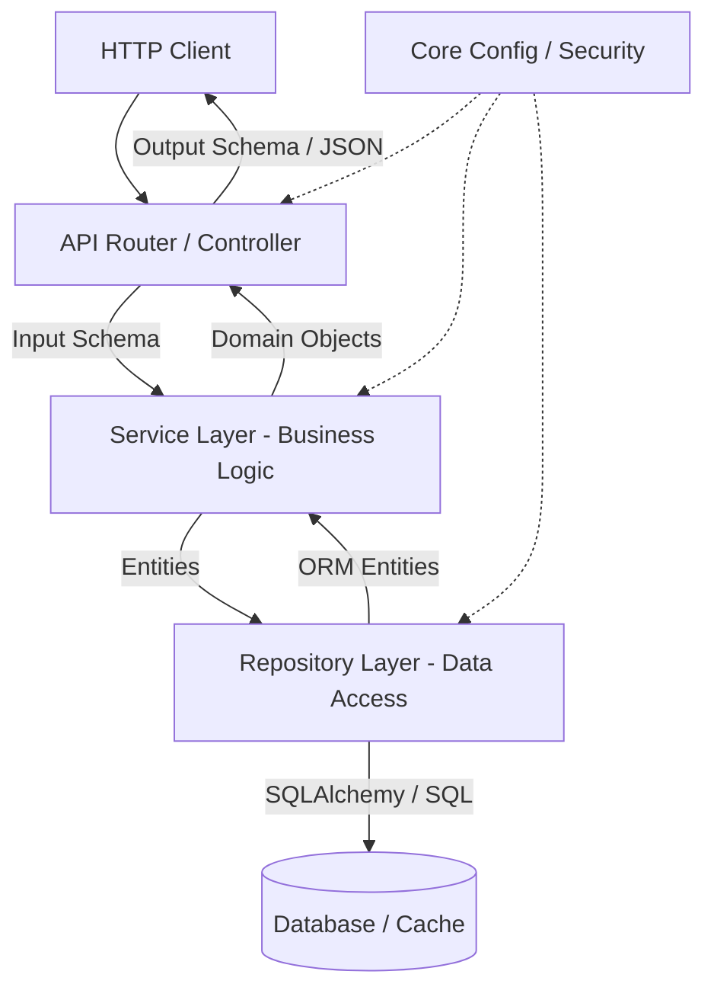

# FastAPI Project Structure Patterns & Layouts

A well-structured codebase prevents merge conflicts, eliminates circular dependencies, enforces separation of concerns, and accelerates onboarding. While FastAPI is deliberately unopinionated about project layout, enterprise applications converge on two battle-tested structural paradigms: **Layered Architecture (Package-by-Layer)** and **Feature-Driven Architecture (Package-by-Feature)**.

---

## Conceptual Foundation & Mental Model

In a toy application, placing routes, database models, schemas, and queries in a single `main.py` is common. In production, this causes:
- Tight coupling between HTTP request handling and database access.
- Inability to reuse business logic in asynchronous background workers (Celery, ARQ) or CLI tools.
- Circular import deadlocks as models import schemas and routers import models.

### Paradigm A: Layered Architecture (Package-by-Layer)
Organizes files by technical responsibility (Routers, Services, Repositories, Schemas, Models). Ideal for small-to-medium APIs with cohesive domain data.

### Paradigm B: Feature-Driven Architecture (Package-by-Feature)
Organizes files by business capability (Auth, Billing, Users, Catalog). Each feature contains its own router, schemas, services, and models. Ideal for large enterprise teams and microservices.

```
Layered (Package-by-Layer)              Feature-Driven (Package-by-Feature)
app/                                    app/
├── api/          (Routers)             ├── features/
│   └── v1/                             │   ├── billing/
├── core/         (Config, Security)    │   │   ├── router.py, service.py
├── models/       (SQLAlchemy Models)   │   │   └── schemas.py, models.py
├── schemas/      (Pydantic Models)     │   ├── users/
├── services/     (Business Logic)      │   │   ├── router.py, service.py
└── repositories/ (Database Queries)    │   │   └── schemas.py, models.py
                                        └── core/ (Shared Config, DB, Security)
```

---

## Architecture & Internal Mechanics

### The Golden Rule: The Dependency Rule
Dependencies must point **inward** toward domain logic, never outward toward presentation or framework mechanics:
1. **Routers (`api/`)**: Accept HTTP requests, validate input via Pydantic schemas, call Services, return response schemas. **Zero raw SQL or business algorithms allowed here.**
2. **Services (`services/`)**: Coordinate domain workflows, apply business rules, orchestrate third-party APIs. **Zero FastAPI imports allowed here.**
3. **Repositories (`repositories/`)**: Execute database operations (SQLAlchemy, Redis).
4. **Core (`core/`)**: Application configuration (`pydantic-settings`), logging, database session factories.



---

## Comprehensive Syntax & Core Mechanics

### Enterprise Production Directory Blueprint
Below is the canonical production layout adopted across high-throughput enterprise systems:

```
src/app/
├── __init__.py
├── main.py                     # App factory, lifespan, global middleware, router mounts
├── core/                       # Shared platform primitives
│   ├── __init__.py
│   ├── config.py               # Pydantic Settings (ENV loading)
│   ├── database.py             # SQLAlchemy async engine & sessionmaker
│   ├── security.py             # Password hashing (argon2/bcrypt), JWT encoding/decoding
│   └── exceptions.py           # Custom domain exception classes & global handlers
├── api/                        # HTTP transport layer
│   ├── __init__.py
│   ├── dependencies.py         # Shared dependencies (get_db, get_current_user)
│   └── v1/
│       ├── __init__.py
│       ├── router.py           # V1 umbrella router aggregating domain routers
│       ├── auth.py             # Auth endpoints
│       ├── users.py            # User endpoints
│       └── billing.py          # Billing endpoints
├── schemas/                    # Pydantic request/response validation schemas
│   ├── __init__.py
│   ├── common.py               # Pagination, standard error envelopes
│   ├── user.py                 # UserCreate, UserRead, UserUpdate
│   └── billing.py              # InvoiceRead, ChargeCreate
├── models/                     # SQLAlchemy declarative ORM models
│   ├── __init__.py
│   ├── base.py                 # Base class with id, created_at, updated_at
│   ├── user.py                 # UserModel
│   └── billing.py              # InvoiceModel
├── repositories/               # Data access layer (abstracts queries)
│   ├── __init__.py
│   ├── base.py                 # Generic CRUD repository
│   └── user_repo.py            # UserRepository (select, insert, update)
└── services/                   # Pure business logic (framework-agnostic)
    ├── __init__.py
    ├── user_service.py         # Registration, password reset logic
    └── billing_service.py      # Stripe integration, invoicing
```

---

## Practical Implementation (5 Complete Architecture Modules)

### 1. `core/config.py` (Pydantic Settings)
```python
from pydantic_settings import BaseSettings, SettingsConfigDict
from pydantic import PostgresDsn, computed_field

class Settings(BaseSettings):
    model_config = SettingsConfigDict(env_file=".env", env_ignore_empty=True, extra="ignore")

    PROJECT_NAME: str = "Enterprise Core API"
    ENVIRONMENT: str = "production"
    API_V1_PREFIX: str = "/api/v1"
    
    POSTGRES_SERVER: str = "localhost"
    POSTGRES_PORT: int = 5432
    POSTGRES_USER: str = "postgres"
    POSTGRES_PASSWORD: str = "secret"
    POSTGRES_DB: str = "production_db"

    @computed_field
    @property
    def SQLALCHEMY_DATABASE_URI(self) -> str:
        return f"postgresql+asyncpg://{self.POSTGRES_USER}:{self.POSTGRES_PASSWORD}@{self.POSTGRES_SERVER}:{self.POSTGRES_PORT}/{self.POSTGRES_DB}"

settings = Settings()
```

### 2. `core/database.py` (Async SQLAlchemy Engine & Session)
```python
from typing import AsyncGenerator
from sqlalchemy.ext.asyncio import create_async_engine, async_sessionmaker, AsyncSession
from app.core.config import settings

engine = create_async_engine(
    settings.SQLALCHEMY_DATABASE_URI,
    pool_size=20,
    max_overflow=10,
    pool_pre_ping=True
)

async_session_factory = async_sessionmaker(
    bind=engine,
    autoflush=False,
    expire_on_commit=False
)

async def get_db_session() -> AsyncGenerator[AsyncSession, None]:
    async with async_session_factory() as session:
        try:
            yield session
        finally:
            await session.close()
```

### 3. `repositories/user_repo.py` (Data Access Layer)
```python
from typing import Sequence
from sqlalchemy.ext.asyncio import AsyncSession
from sqlalchemy import select
from app.models.user import UserModel

class UserRepository:
    def __init__(self, session: AsyncSession):
        self.session = session

    async def get_by_id(self, user_id: int) -> UserModel | None:
        result = await self.session.execute(select(UserModel).where(UserModel.id == user_id))
        return result.scalar_one_or_none()

    async def get_by_email(self, email: str) -> UserModel | None:
        result = await self.session.execute(select(UserModel).where(UserModel.email == email))
        return result.scalar_one_or_none()

    async def create(self, user: UserModel) -> UserModel:
        self.session.add(user)
        await self.session.flush()
        return user
```

### 4. `services/user_service.py` (Pure Business Logic)
```python
from app.repositories.user_repo import UserRepository
from app.schemas.user import UserCreate
from app.models.user import UserModel
from app.core.security import hash_password

class UserService:
    def __init__(self, user_repo: UserRepository):
        self.user_repo = user_repo

    async def register_new_user(self, payload: UserCreate) -> UserModel:
        existing = await self.user_repo.get_by_email(payload.email)
        if existing:
            raise ValueError("Email already registered")

        hashed_pwd = hash_password(payload.password)
        user_entity = UserModel(email=payload.email, hashed_password=hashed_pwd)
        created_user = await self.user_repo.create(user_entity)
        return created_user
```

### 5. `api/v1/users.py` (HTTP Transport Adapter)
```python
from typing import Annotated
from fastapi import APIRouter, Depends, HTTPException, status
from sqlalchemy.ext.asyncio import AsyncSession
from app.core.database import get_db_session
from app.repositories.user_repo import UserRepository
from app.services.user_service import UserService
from app.schemas.user import UserCreate, UserRead

router = APIRouter(prefix="/users", tags=["Users"])

def get_user_service(
    session: Annotated[AsyncSession, Depends(get_db_session)]
) -> UserService:
    repo = UserRepository(session)
    return UserService(repo)

@router.post("/", response_model=UserRead, status_code=status.HTTP_201_CREATED)
async def create_user(
    payload: UserCreate,
    service: Annotated[UserService, Depends(get_user_service)],
    session: Annotated[AsyncSession, Depends(get_db_session)]
):
    try:
        user = await service.register_new_user(payload)
        await session.commit()
        return user
    except ValueError as e:
        await session.rollback()
        raise HTTPException(status_code=status.HTTP_400_BAD_REQUEST, detail=str(e))
```

---

## Anti-Patterns & Common Traps

| Anti-Pattern | Why It Breaks / Fails | Production Solution |
| :--- | :--- | :--- |
| **Writing database queries directly in routers** | Tightly couples endpoints to SQL schema; impossible to reuse queries in background workers or CLI scripts. | Encapsulate queries in `repositories/` or `services/`. |
| **Importing routers into models or services** | Causes immediate circular import crashes on application boot. | Strictly maintain one-way dependency flow: `Routers -> Services -> Repositories -> Models`. |
| **Passing raw SQLAlchemy models directly to API responses** | Leaks database internals (passwords, foreign keys) and triggers lazy-loading crashes outside session scope. | Always serialize through explicit Pydantic `response_model` schemas. |
| **Scattering `os.getenv()` across 30 files** | Missing environment variables are discovered only at runtime when an endpoint is hit. | Validate all environment variables at startup in `core/config.py` using `pydantic-settings`. |

---

## Performance & Resource Characteristics

- **Separation of Concerns Overhead**: Adding repository and service layers introduces negligible overhead (~10 function call frames, less than 2 microseconds per request) while saving hundreds of engineering hours in debugging and refactoring.
- **Async Session Management**: Centralizing session lifecycle in `core/database.py` guarantees proper connection pooling and deterministic cleanup.

---

## Edge Cases, Failure Modes & Gotchas

1. **Alembic Migrations and Model Discovery**: Alembic requires importing all models inside `env.py` (`from app.models.base import Base; from app.models import *`). Ensure all model files are imported so `Base.metadata` discovers tables.
2. **Transaction Commit Boundary**: Decide where `await session.commit()` lives. A common best practice is to commit at the router/dependency boundary or inside a Unit of Work context manager, keeping repositories focused purely on querying and flushing.

---

## Security Implications & OWASP Alignment

- **Information Leakage Prevention**: Decoupling internal SQLAlchemy database models from external Pydantic schemas prevents accidental exposure of sensitive columns (`password_hash`, `stripe_customer_token`).
- **OWASP API3:2023 - Broken Object Property Level Authorization**: Explicit Pydantic input schemas (`UserCreate`, `UserUpdate`) prevent Mass Assignment vulnerabilities where malicious users inject unexpected fields (`is_admin=True`).

---

## Modern Tooling Integration

- **Alembic**: Database migrations configured against `src/app/models/`.
- **Docker Multi-Stage Builds**: Copy `src/app` into a minimal Python 3.12/3.13 distroless or alpine container.
- **Uv / Hatch**: Manage modern Python packaging with `src`-layout (`src/app`).

---

## Real-World Case Study / Production Incident

A fast-growing SaaS company built their initial MVP with all SQL queries inside route functions: `@app.post("/subscribe") async def subscribe(...)`. Six months later, they introduced an asynchronous Celery worker to handle recurring subscription renewals.

**The Problem**:
The renewal logic was trapped inside FastAPI endpoint functions, depending on `Request` and `Depends()`. The developers had to copy-paste 400 lines of subscription billing code into Celery tasks, leading to diverging business logic and over-billing bugs.

**Remediation**:
1. Extracted billing logic into `app/services/billing_service.py`.
2. Both FastAPI routes and Celery workers now import and invoke the identical `BillingService`.
3. Duplication was completely eliminated and billing errors dropped to zero.

---

## Hands-On Exercises & Challenge Problems

### Warmup (2 Exercises)
1. Scaffold an `app/` folder containing `core/`, `api/v1/`, `schemas/`, and `services/` with appropriate `__init__.py` files.
2. Implement a `core/config.py` using `pydantic-settings` that loads `PORT: int = 8000` and `DEBUG: bool = False`.

### Intermediate (2 Exercises)
3. Implement a decoupled `ProductService` and `ProductRepository` that manage an in-memory product list, wired to a FastAPI router via dependency injection.
4. Add a custom domain exception `ItemOutOfStockError` in `core/exceptions.py` and register a global FastAPI exception handler translating it to HTTP 409 Conflict.

### Production-Grade (2 Exercises)
5. Scaffold a complete production-grade application layout adhering to the `src/` layout with `uv`, Alembic migrations configured, async SQLAlchemy sessions, and automated health checks.
6. Design and implement a Feature-Driven package structure (`app/features/orders/`) and demonstrate how a feature can be packaged and extracted into an independent microservice with minimal changes.

---

## Interview Mastery (8 Q&As)

### Junior Level
**Q1: Why shouldn't you write SQL queries directly inside FastAPI route handlers?**
*Answer:* Writing queries in routes violates separation of concerns. It makes business logic non-reusable across background tasks or CLI scripts, tightly couples HTTP transport to database implementations, and makes unit testing difficult.

**Q2: What is the purpose of `core/config.py`?**
*Answer:* To centralize and validate all application configuration and environment variables at startup using Pydantic Settings, failing fast if required secrets are missing.

**Q3: What is the difference between `models/` and `schemas/` in a FastAPI project?**
*Answer:* `models/` defines database tables and entity relationships (typically using SQLAlchemy ORM). `schemas/` defines Pydantic models for HTTP request validation, response serialization, and OpenAPI schema generation.

### Senior Level
**Q4: Compare Layered Architecture (Package-by-Layer) vs Feature Architecture (Package-by-Feature). When should you choose each?**
*Answer:*
- **Package-by-Layer**: Groups files by technical type (`routers/`, `services/`, `models/`). Excellent for small-to-medium codebases with high entity cohesion.
- **Package-by-Feature**: Groups files by domain capability (`billing/`, `users/`). Superior for large systems and multi-team environments because each domain is self-contained, simplifying microservice refactoring and ownership.

**Q5: How do you prevent circular imports between models and schemas?**
*Answer:* Enforce strict one-way dependency rules: Schemas may import models (or vice versa depending on mapping), but services only import schemas and models, and routers only import services and schemas. Never import routers into services or models.

**Q6: Where should database transaction commits (`await session.commit()`) take place?**
*Answer:* Ideally at the transaction boundary (the route handler, the dependency yield block, or a Unit of Work context manager). Repositories should only query and flush (`await session.flush()`), allowing the outer layer to coordinate multi-repository atomic commits.

### Staff / Architect Level
**Q7: How do you design a FastAPI architecture that allows domain services to be executed seamlessly by both HTTP requests and Celery/Kafka message consumers?**
*Answer:* Keep domain services completely agnostic of web frameworks:
1. Domain service methods must never accept `fastapi.Request`, `Response`, or `Depends` parameters; accept only primitive types, Pydantic schemas, or domain entities.
2. Domain services raise standard domain exceptions (`EntityNotFoundError`), not `HTTPException`.
3. In the FastAPI layer, routers inject services and catch domain exceptions to translate them into HTTP status codes.
4. In Celery/Kafka workers, consumers instantiate the same services and handle domain exceptions with retry queues or dead-letter queues.

**Q8: Why is the `src/` layout preferred over placing `app/` at the repository root?**
*Answer:* The `src/` layout prevents accidental import of the local development directory over installed packages, guarantees tests run against the installed/packaged module, and aligns with modern Python packaging standards (PEP 517/518, hatch, flit, uv).
