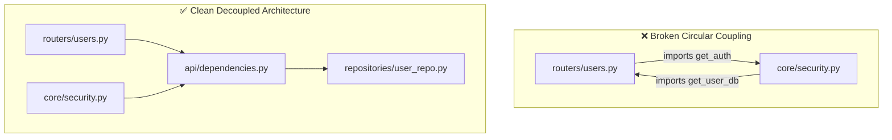

# FastAPI Circular Imports & Architectural Resolution

Circular imports (`ImportError: cannot import name ... from partially initialized module`) represent one of the most frequent friction points in growing FastAPI applications. They typically emerge when developers mix transport layers with data models, create mutual dependencies between routers and application instances, or couple relational database schemas across module boundaries.

---

## Conceptual Foundation & Mental Model

In Python, when module `A` imports module `B`, Python executes `B`. If `B` then attempts to import `A` before `A` finishes executing its top-level namespace, Python halts with:
`ImportError: cannot import name 'X' from partially initialized module 'A' (most likely due to a circular import)`.

In FastAPI codebases, this almost always occurs in three classic scenarios:
1. **The `app` <-> `router` Cycle**: `main.py` imports `users_router.py` to register it, while `users_router.py` imports `app` from `main.py` to access decorators or shared state.
2. **The Bidirectional Model Cycle**: `User` model references `Order` model, while `Order` model references `User` model.
3. **The Shared Dependency Cycle**: `auth.py` imports `users.py` to fetch users, while `users.py` imports `auth.py` for password hashing or token verification.

```
Classic Circular Trap:
┌─────────────────────────┐                ┌─────────────────────────┐
│        main.py          │  import router │    routers/users.py     │
│ 1. app = FastAPI()      ├───────────────►│ 1. from main import app │
│ 2. app.include_router() │                │ 2. @app.get('/users')   │
└─────────────────────────┘◄───────────────┴─────────────────────────┘
                              import app
                    CRASH: Partially initialized module!
```

---

## Architecture & Internal Mechanics

Understanding how Python evaluates modules reveals why architectural decoupling is the only permanent cure:
1. **Module Execution is Synchronous**: When `import X` runs, Python creates an empty entry in `sys.modules["X"]` and executes lines 1 to N of `X.py`.
2. **Unfinished Namespaces**: Any name defined on line 50 of `X.py` does not exist while line 10 of `X.py` is executing an import from `Y.py`.
3. **Dependency Injection Eliminates Direct Imports**: By passing dependencies into functions (`user_service: UserService = Depends(get_user_service)`), neither module needs to import the other's concrete implementation at the top of the file.



---

## Comprehensive Syntax & Core Mechanics

### 1. `TYPE_CHECKING` Guard and `from __future__ import annotations`
When two Pydantic or SQLAlchemy classes only reference each other for static type hints (Mypy/Pyright) and not runtime instantiation, use the `typing.TYPE_CHECKING` guard:

```python
from __future__ import annotations
from typing import TYPE_CHECKING
from pydantic import BaseModel

if TYPE_CHECKING:
    from app.schemas.order import OrderRead  # Only imported during static analysis!

class UserRead(BaseModel):
    id: int
    name: str
    orders: list[OrderRead] = []
```

### 2. Forward References in Pydantic v2
In Pydantic v2, string forward references are evaluated automatically:
```python
from pydantic import BaseModel

class Team(BaseModel):
    id: int
    name: str
    members: list["User"] = []  # String forward reference

class User(BaseModel):
    id: int
    team: Team | None = None
```

---

## Practical Implementation (5 Complete Examples of Cycles & Fixes)

### Example 1: Resolving the `main.py` <-> `router.py` Trap
```python
# ❌ BROKEN main.py
# from fastapi import FastAPI
# from app.routers.users import router
# app = FastAPI()
# app.include_router(router)

# ❌ BROKEN app/routers/users.py
# from app.main import app  # <--- CRASH! Circular import!
# @app.get("/users")
# def get_users(): ...

# ✅ FIXED: Use APIRouter and unidirectional imports!
# app/routers/users.py:
from fastapi import APIRouter

router = APIRouter(prefix="/users", tags=["Users"])

@router.get("/")
async def list_users():
    return ["user1", "user2"]

# main.py:
from fastapi import FastAPI
# router imports nothing from main.py!
from app.routers.users import router as users_router

app = FastAPI()
app.include_router(users_router)
```

### Example 2: Resolving Mutual Schema References with Deferred Resolution
```python
# app/schemas/author.py
from __future__ import annotations
from pydantic import BaseModel
from typing import TYPE_CHECKING

if TYPE_CHECKING:
    from app.schemas.book import BookSchema

class AuthorSchema(BaseModel):
    id: int
    name: str
    books: list[BookSchema] = []

# app/schemas/book.py
from __future__ import annotations
from pydantic import BaseModel
from typing import TYPE_CHECKING

if TYPE_CHECKING:
    from app.schemas.author import AuthorSchema

class BookSchema(BaseModel):
    id: int
    title: str
    author: AuthorSchema | None = None

# Rebuilding models for Pydantic v2:
# In app/schemas/__init__.py
from app.schemas.author import AuthorSchema
from app.schemas.book import BookSchema

# Explicitly rebuild schemas to resolve string/type-checking annotations
AuthorSchema.model_rebuild()
BookSchema.model_rebuild()
```

### Example 3: Decoupling Security and User Dependencies via a Common Module
```python
# ❌ BROKEN: security.py imports get_user from users_api.py,
# while users_api.py imports verify_token from security.py!

# ✅ FIXED: Extract shared database and dependency resolvers into dependencies.py
# app/core/security.py (Contains only crypto/JWT logic - NO dependencies or DB imports!)
import jwt

SECRET_KEY = "prod-secret"
def decode_token(token: str) -> dict:
    return jwt.decode(token, SECRET_KEY, algorithms=["HS256"])

# app/api/dependencies.py (Wires DB & Security together)
from fastapi import Depends, HTTPException
from fastapi.security import OAuth2PasswordBearer
from app.core.security import decode_token

oauth2_scheme = OAuth2PasswordBearer(tokenUrl="token")

async def get_current_user_id(token: str = Depends(oauth2_scheme)) -> str:
    payload = decode_token(token)
    return payload["sub"]

# app/routers/users.py (Consumes dependencies.py - Never imports main or security!)
from fastapi import APIRouter, Depends
from app.api.dependencies import get_current_user_id

router = APIRouter()

@router.get("/me")
async def get_me(user_id: str = Depends(get_current_user_id)):
    return {"user_id": user_id}
```

### Example 4: In-Function Local Imports for Rare Edge Cases
```python
# When an architectural refactoring is temporarily impossible,
# defer the import inside the function body so it executes at runtime:
from fastapi import APIRouter

router = APIRouter()

@router.post("/trigger-heavy-report")
async def trigger_report():
    # Deferred local import: runs only when endpoint is called!
    from app.services.heavy_reporting import generate_pdf_report
    report_url = await generate_pdf_report()
    return {"url": report_url}
```

### Example 5: Resolving SQLAlchemy Relational Models with String Relationship Names
```python
from sqlalchemy.orm import declarative_base, relationship, Mapped, mapped_column
from sqlalchemy import ForeignKey

Base = declarative_base()

class Parent(Base):
    __tablename__ = "parents"
    id: Mapped[int] = mapped_column(primary_key=True)
    # Notice: Use string "Child" instead of importing Child class directly!
    children: Mapped[list["Child"]] = relationship("Child", back_populates="parent")

class Child(Base):
    __tablename__ = "children"
    id: Mapped[int] = mapped_column(primary_key=True)
    parent_id: Mapped[int] = mapped_column(ForeignKey("parents.id"))
    parent: Mapped["Parent"] = relationship("Parent", back_populates="children")
```

---

## Anti-Patterns & Common Traps

| Anti-Pattern | Why It Breaks / Fails | Production Solution |
| :--- | :--- | :--- |
| **Importing `app` inside router modules** | `main.py` imports the router; router imports `main.py` $\rightarrow$ instant circular import crash. | Use `APIRouter()` in router modules. Routers must never import `app`. |
| **Using `from module import X` when modules mutually depend** | Top-level execution fails because `X` is not yet bound in the incomplete module. | Use `import module` and access `module.X` inside functions, or refactor to common dependency. |
| **Circular dependency between Service and Repository** | Service calls Repository; Repository calls Service to validate business rules. | Repositories must remain dumb data access layers; business rules belong exclusively in Services. |
| **Relying solely on local in-function imports to fix bad design** | Masks architectural rot; makes code harder to read and breaks static type analysis. | Refactor shared logic into a standalone intermediary module. |

---

## Performance & Resource Characteristics

- **Zero Runtime Overhead with `TYPE_CHECKING`**: Code inside `if TYPE_CHECKING:` is never executed at runtime; Python skips the import entirely, reducing memory and startup time.
- **`model_rebuild()` Execution**: Executed once during startup in microsecond timeframes, compiling Pydantic core schemas without runtime penalty.

---

## Edge Cases, Failure Modes & Gotchas

1. **Pydantic v2 `model_rebuild()` Requirement**: If models use forward references defined under `if TYPE_CHECKING:`, calling `.model_validate()` before `model_rebuild()` raises `PydanticUndefinedAnnotation: name '...' is not defined`.
2. **Dynamic Sub-Router Mounting**: If Router A imports Router B, and Router B imports Router A, Python will crash on import before FastAPI even attempts to build the route table.

---

## Security Implications & OWASP Alignment

- **Architectural Determinism**: Circular imports often cause developers to introduce fragile global variables or haphazard module monkey-patching, which can inadvertently bypass authentication checks or leak request state across async tasks.
- **Fail-Fast Startup**: Circular imports crash on startup, preventing partially initialized or corrupted code from being deployed into production.

---

## Modern Tooling Integration

- **Ruff / Flake8**: The `TCH` rule family (flake8-type-checking) automatically flags imports that are only used for type annotations and moves them under `if TYPE_CHECKING:`.
- **Mypy / Pyright**: Seamlessly resolves forward references when `from __future__ import annotations` is present.

---

## Real-World Case Study / Production Incident

A healthcare technology company had their production deployment crash during a routine rolling update. The build had passed unit tests because the tests imported modules individually. However, when Uvicorn started `main.py`, a newly added circular dependency between `services/audit.py` and `services/patient.py` caused Python to throw `ImportError: cannot import name 'PatientService' from partially initialized module`.

**Root Cause**:
`PatientService` imported `AuditService` to log changes. An intern added an import in `AuditService` to look up patient consent status from `PatientService`.

**Remediation**:
1. Extracted patient consent checking into a separate domain service: `services/consent.py`.
2. Both `PatientService` and `AuditService` imported `ConsentService`, breaking the circular dependency.
3. Added a CI check that executes `python -c "import app.main"` to catch import cycle regressions before container image publication.

---

## Hands-On Exercises & Challenge Problems

### Warmup (2 Exercises)
1. Write two mock Python modules (`alpha.py` and `beta.py`) that trigger a circular import error.
2. Resolve the cycle using an intermediary `shared.py` file.

### Intermediate (2 Exercises)
3. Create two Pydantic models (`Company` and `Employee`) that mutually reference each other using `from __future__ import annotations` and verify they validate JSON successfully using `model_rebuild()`.
4. Refactor a legacy endpoint where a router function imports `app` from `main.py` into a proper decoupled `APIRouter` architecture.

### Production-Grade (2 Exercises)
5. Build a static analysis script using Python's `ast` module that scans an entire project directory, constructs an import dependency graph, and detects circular import cycles before running tests.
6. Design a complex multi-entity SQLAlchemy model hierarchy (User, Team, Membership, Workspace) utilizing string relationships to eliminate all cross-model circular import hazards.

---

## Interview Mastery (8 Q&As)

### Junior Level
**Q1: What is a circular import in Python?**
*Answer:* A circular import occurs when Module A attempts to import Module B, while Module B directly or indirectly imports Module A before Module A has completed initializing its namespace.

**Q2: Why does importing `app` inside a router module cause a circular import?**
*Answer:* `main.py` imports the router module to register it with `app.include_router(router)`. If the router also imports `app` from `main.py`, neither module can complete initialization, resulting in an `ImportError`.

**Q3: How does `from __future__ import annotations` help prevent circular imports?**
*Answer:* It treats type annotations as raw strings at runtime instead of evaluating them during module execution, allowing type hints to reference types defined later or under `if TYPE_CHECKING:` guards.

### Senior Level
**Q4: When should you use `typing.TYPE_CHECKING`?**
*Answer:* Use `if TYPE_CHECKING:` to wrap imports that are exclusively needed for static type linters (Mypy, Pyright) and are not used for runtime logic, Pydantic field instantiation, or inheritance.

**Q5: How do you resolve bidirectional relationships in SQLAlchemy models located in different files?**
*Answer:* Pass the relationship target as a string instead of importing the model class directly: `relationship("ChildModel", back_populates="parent")`. SQLAlchemy resolves string model names against `Base.metadata` after all models are loaded.

**Q6: What is `Pydantic.model_rebuild()` and when is it required?**
*Answer:* In Pydantic v2, `model_rebuild()` forces the schema engine to re-evaluate deferred string annotations and forward references. It is required when models reference types that were defined in other modules or guarded by `if TYPE_CHECKING:`.

### Staff / Architect Level
**Q7: How does Inversion of Control (IoC) / Dependency Injection fundamentally solve circular dependencies in large codebases?**
*Answer:* In tight coupling, Module A directly imports and instantiates Module B, and vice-versa. With Dependency Injection, neither module imports the other; instead, they define abstract interfaces or dependencies that are resolved and injected at runtime by FastAPI's dependency solver. The modules only know about the interface, breaking the concrete import cycle.

**Q8: How can an engineering organization enforce zero-circular-import policies in CI/CD pipelines?**
*Answer:*
1. Run import verification checks in CI: `python -m app.main`.
2. Enforce architectural boundary linters like `import-linter` or custom AST DAG validators that verify that `routers` never import other `routers`, and `models` never import `services`.
3. Configure Ruff with `TCH` rules to automatically enforce `TYPE_CHECKING` guards.
