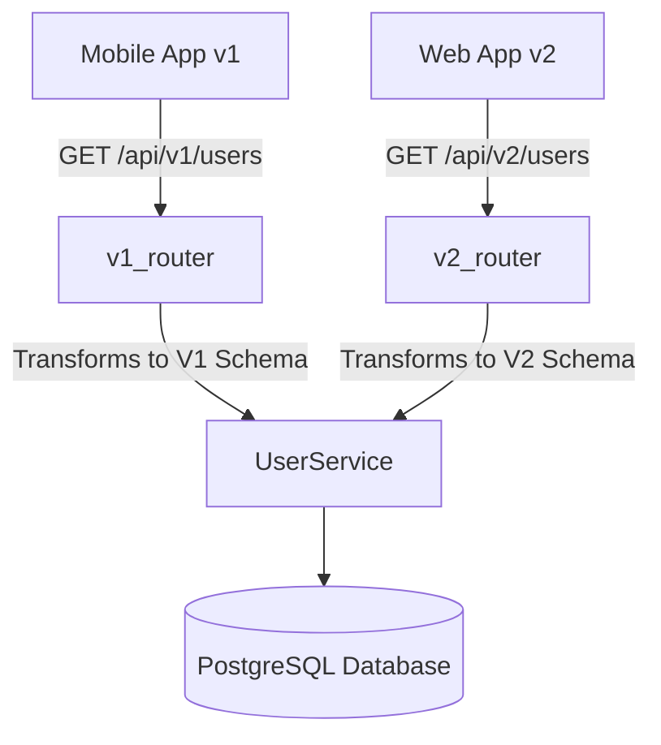

# FastAPI API Versioning Strategies

Public APIs must evolve without breaking mobile apps, external integration partners, or frontend clients. FastAPI supports diverse versioning architectures: **URL Path Versioning** (industry standard), **Header-Based Versioning** (content negotiation or custom headers), and **Query Parameter Versioning**. Choosing and implementing the right strategy ensures zero-downtime evolution and graceful deprecation.

---

## Conceptual Foundation & Mental Model

API versioning is not merely about changing route strings; it is about managing the lifecycle of contracts:
1. **URL Path Versioning (`/v1/...`, `/v2/...`)**: Most visible, highly cacheable, simple for API gateways and CDNs, unambiguous for Swagger UI documentation.
2. **Header-Based Versioning (`X-API-Version: 2` or `Accept: application/vnd.company.v2+json`)**: Keeps URLs clean and resource-oriented (pure REST), but harder to test in browsers and complex to route at reverse proxies.
3. **Query Parameter Versioning (`/items?version=2`)**: Easy to toggle in exploratory testing, but prone to caching issues and parameter pollution.

```
       Incoming Request: GET /api/v1/users vs GET /api/v2/users
                                  │
                                  ▼
                   ┌─────────────────────────────┐
                   │     FastAPI Router Tree     │
                   └──────────────┬──────────────┘
                                  │
            ┌─────────────────────┴─────────────────────┐
            ▼                                           ▼
┌───────────────────────────────┐           ┌───────────────────────────────┐
│     V1 Router (/api/v1)       │           │     V2 Router (/api/v2)       │
│ - UserReadV1 (id, fullName)   │           │ - UserReadV2 (id, first, last)│
│ - Shared UserService          │           │ - Shared UserService          │
│ - Sunset / Deprecation Headers│           │ - Active Standard             │
└───────────────────────────────┘           └───────────────────────────────┘
```

---

## Architecture & Internal Mechanics

### Structural Organization of Side-by-Side Versions
Rather than cloning the entire backend, side-by-side versioning in FastAPI isolates the transport layer (routers and Pydantic schemas) while reusing the core domain services and database repositories:

```
src/app/
├── api/
│   ├── v1/
│   │   ├── router.py         # Aggregates V1 endpoints
│   │   ├── users.py          # Serializes via UserSchemaV1
│   │   └── orders.py
│   └── v2/
│       ├── router.py         # Aggregates V2 endpoints
│       ├── users.py          # Serializes via UserSchemaV2 (breaking changes)
│       └── orders.py
├── schemas/
│   ├── v1/user.py
│   └── v2/user.py
└── services/                 # Reusable business logic shared across both versions!
    └── user_service.py
```



---

## Comprehensive Syntax & Core Mechanics

### URL Path Versioning via Umbrella Routers
```python
from fastapi import FastAPI, APIRouter

app = FastAPI(title="Multi-Version API")

# Version 1 Router
v1_router = APIRouter(prefix="/api/v1", tags=["API Version 1"])
# Version 2 Router
v2_router = APIRouter(prefix="/api/v2", tags=["API Version 2"])

app.include_router(v1_router)
app.include_router(v2_router)
```

### Standard HTTP Deprecation & Sunset Headers (RFC 8594)
When retiring an older API version, return standard HTTP headers:
- `Deprecation: true` (or a date)
- `Sunset: Wed, 11 Nov 2026 00:00:00 GMT`
- `Link: <https://docs.api.com/migration>; rel="deprecation"`

---

## Practical Implementation (5 Complete Examples)

### Example 1: Full Side-by-Side URL Path Versioning
```python
from fastapi import FastAPI, APIRouter
from pydantic import BaseModel

app = FastAPI(title="E-Commerce API")

# --- V1 Domain Contract ---
class UserV1(BaseModel):
    id: int
    name: str  # Single full name string

v1_router = APIRouter(prefix="/v1/users", tags=["v1 - Users"])

@v1_router.get("/{user_id}", response_model=UserV1)
async def get_user_v1(user_id: int):
    # Backward compatibility adapter
    return {"id": user_id, "name": "Alice Montgomery"}

# --- V2 Domain Contract (Breaking Change: split name) ---
class UserV2(BaseModel):
    id: int
    first_name: str
    last_name: str
    preferred_locale: str

v2_router = APIRouter(prefix="/v2/users", tags=["v2 - Users"])

@v2_router.get("/{user_id}", response_model=UserV2)
async def get_user_v2(user_id: int):
    return {
        "id": user_id,
        "first_name": "Alice",
        "last_name": "Montgomery",
        "preferred_locale": "en_US"
    }

# Mount under API root
app.include_router(v1_router, prefix="/api")
app.include_router(v2_router, prefix="/api")
```

### Example 2: Header-Based Versioning via Dependency
```python
from typing import Annotated
from fastapi import FastAPI, Header, HTTPException, status
from pydantic import BaseModel

app = FastAPI(title="Header-Versioned API")

class AccountV1(BaseModel):
    account_id: str
    balance: float

class AccountV2(BaseModel):
    account_id: str
    balance: float
    currency: str
    active_holds: float

def resolve_api_version(
    x_api_version: Annotated[str | None, Header()] = "1.0"
) -> str:
    if x_api_version not in ("1.0", "2.0"):
        raise HTTPException(
            status_code=status.HTTP_400_BAD_REQUEST,
            detail=f"Unsupported API version '{x_api_version}'. Supported: 1.0, 2.0"
        )
    return x_api_version

@app.get("/accounts/{account_id}")
async def get_account(
    account_id: str,
    version: Annotated[str, Header(alias="X-API-Version")] = "1.0"
):
    if version == "1.0":
        return AccountV1(account_id=account_id, balance=1250.50)
    return AccountV2(account_id=account_id, balance=1250.50, currency="USD", active_holds=0.0)
```

### Example 3: Automated Sunset and Deprecation Response Headers
```python
from fastapi import FastAPI, APIRouter, Response

app = FastAPI()

def apply_deprecation_headers(response: Response):
    # RFC 8594 standard deprecation headers
    response.headers["Deprecation"] = "true"
    response.headers["Sunset"] = "Fri, 01 Jan 2027 00:00:00 GMT"
    response.headers["Link"] = '<https://api.domain.com/docs/v1-sunset>; rel="sunset"'

legacy_v1_router = APIRouter(prefix="/v1", tags=["V1 (Deprecated)"])

@legacy_v1_router.get("/metrics")
async def get_legacy_metrics(response: Response):
    apply_deprecation_headers(response)
    return {"status": "ok", "notice": "This version will sunset Jan 1, 2027"}

app.include_router(legacy_v1_router)
```

### Example 4: Content Negotiation Versioning (`Accept` Header)
```python
from typing import Annotated
from fastapi import FastAPI, Header, HTTPException
from fastapi.responses import JSONResponse

app = FastAPI()

@app.get("/reports/quarterly")
async def get_report(accept: Annotated[str, Header()]):
    if "application/vnd.company.v2+json" in accept:
        return JSONResponse(
            content={"version": 2, "revenue": 1000000, "ebitda": 250000},
            media_type="application/vnd.company.v2+json"
        )
    elif "application/vnd.company.v1+json" in accept or "*/*" in accept:
        return JSONResponse(
            content={"version": 1, "revenue": 1000000},
            media_type="application/vnd.company.v1+json"
        )
    raise HTTPException(status_code=406, detail="Not Acceptable media type version")
```

### Example 5: Multiple Independent Swagger UI Docs per API Version
```python
from fastapi import FastAPI, APIRouter

# Primary root app
app = FastAPI(title="Master Gateway", docs_url=None, redoc_url=None)

# Standalone V1 sub-app with its own docs at /v1/docs
app_v1 = FastAPI(
    title="Customer Platform API v1",
    version="1.0.0",
    docs_url="/docs",
    description="Legacy production API"
)

# Standalone V2 sub-app with its own docs at /v2/docs
app_v2 = FastAPI(
    title="Customer Platform API v2",
    version="2.0.0",
    docs_url="/docs",
    description="Modern production API"
)

@app_v1.get("/users")
def get_users_v1():
    return ["user_v1"]

@app_v2.get("/users")
def get_users_v2():
    return ["user_v2"]

# Mount applications
app.mount("/api/v1", app_v1)
app.mount("/api/v2", app_v2)
```

---

## Anti-Patterns & Common Traps

| Anti-Pattern | Why It Breaks / Fails | Production Solution |
| :--- | :--- | :--- |
| **Duplicating database models for every API version** | Results in separate database tables (`users_v1`, `users_v2`) and database desynchronization. | Evolve single database models; handle version transformations purely in Pydantic schemas. |
| **Silently breaking backwards compatibility on `/v1`** | Causes mobile apps or external customer integrations to crash unexpectedly. | Additive non-breaking changes are allowed in v1; breaking changes demand `/v2`. |
| **Failing to signal deprecation timelines** | Clients never migrate; engineering is burdened with supporting legacy versions indefinitely. | Emit RFC 8594 `Sunset` and `Deprecation` headers and log client user agents. |
| **Baking version logic into SQL queries** (`SELECT version_1_col FROM ...`) | Pollutes database layer with HTTP transport details. | Map database columns in the Service layer to the respective version's schema. |

---

## Performance & Resource Characteristics

- **URL Path Routing Speed**: Fast and deterministic. FastAPI's route table matches `/api/v1/...` vs `/api/v2/...` in constant time without header parsing overhead.
- **Header Parsing Overhead**: Inspecting `Accept` or `X-API-Version` adds minor string-matching overhead to every request (~5 microseconds).
- **CDN Caching**: URL path versioning caches perfectly at edge CDNs (Cloudflare, Fastly); header-based versioning requires `Vary: Accept` or `Vary: X-API-Version` headers to prevent CDN cache poisoning.

---

## Edge Cases, Failure Modes & Gotchas

1. **Vary Header in Header-Based Versioning**: If versioning via headers, your responses **must** include the `Vary: X-API-Version` header; otherwise, intermediate HTTP proxies may serve a cached V1 response to a client requesting V2.
2. **OpenAPI Schema Generation in Header Versioning**: FastAPI's automatic Swagger UI documentation does not natively support documenting multiple distinct schemas for the same URL path under different headers. URL path versioning generates separate, fully documented endpoints cleanly.

---

## Security Implications & OWASP Alignment

- **OWASP API9:2023 - Improper Inventory Management**: Unmonitored, deprecated API versions often contain unfixed vulnerabilities. Actively monitor traffic to `/v1` and enforce hard sunset dates to retire old endpoints.
- **Contract Enforcement**: Separate Pydantic schemas per version ensure that security validations or new constraints introduced in V2 cannot be bypassed by sending unexpected fields to V1.

---

## Modern Tooling Integration

- **Reverse Proxies (Nginx, Traefik, Envoy)**: Easily route `/api/v1` to legacy pods and `/api/v2` to modern pods during progressive migrations.
- **Spectral / OpenAPI Linters**: Enforce versioning rules and RFC 8594 headers across all registered routes.

---

## Real-World Case Study / Production Incident

A popular logistics API released V2 of their shipping endpoint, changing `package_weight: float` (in pounds) to `weight: WeightObject(value: float, unit: str)`. Because the team updated the endpoint in place on `/shipping` without versioning, older mobile scanners uploaded numbers without the unit object, causing unhandled 422 errors and halting deliveries for 3 hours.

**Remediation**:
1. Reverted `/shipping` to accept legacy V1 payload structures.
2. Created a dedicated `/v2/shipping` router accepting the new rich object.
3. Added the `Sunset` header to `/v1/shipping` with an 18-month migration window.
4. Logistics mobile devices migrated smoothly without operational disruption.

---

## Hands-On Exercises & Challenge Problems

### Warmup (2 Exercises)
1. Create a FastAPI app with two routes: `/api/v1/ping` and `/api/v2/ping`, returning their respective version strings.
2. Add a `Deprecation: true` header to the `/api/v1/ping` response.

### Intermediate (2 Exercises)
3. Implement a header-based version resolver that inspects `X-API-Version: 2` and serves an extended user schema.
4. Build a FastAPI middleware that automatically attaches RFC 8594 `Sunset` headers to any request matching paths that start with `/api/v1/`.

### Production-Grade (2 Exercises)
5. Design and implement a multi-app versioning architecture using `app.mount()` where `/v1` and `/v2` each host independent Swagger UI documentation with custom version-specific schemas.
6. Build a compatibility adapter layer in a service class that accepts a database record and dynamically translates it to either a `LegacyV1Schema` or `ModernV2Schema` without duplicating query logic.

---

## Interview Mastery (8 Q&As)

### Junior Level
**Q1: What are the three primary ways to version an API?**
*Answer:*
1. URL path versioning (`/api/v1/resource`)
2. Header-based versioning (`X-API-Version: 1` or `Accept` header)
3. Query parameter versioning (`/api/resource?version=1`)

**Q2: Why is URL path versioning the most popular strategy in FastAPI?**
*Answer:* It is explicit, easy to test in any browser, integrates seamlessly with OpenAPI and Swagger UI documentation, and caches cleanly on CDNs without requiring complex `Vary` headers.

**Q3: What HTTP status code should you return if a client requests an unsupported API version?**
*Answer:* Return `400 Bad Request` (for invalid version parameters) or `406 Not Acceptable` (if negotiating via `Accept` headers).

### Senior Level
**Q4: What RFC headers should be returned when an API endpoint is deprecated?**
*Answer:* RFC 8594 specifies:
- `Deprecation: true` (or a date)
- `Sunset: <HTTP-date>` (the date the endpoint will be permanently decommissioned)
- `Link: <url>; rel="sunset"` (link to documentation or migration guides)

**Q5: Why is header-based versioning difficult to document in FastAPI's Swagger UI?**
*Answer:* OpenAPI 3.1 organizes endpoints primarily by HTTP Method + Path. When the same URL path returns completely different request/response schemas based on an arbitrary header, Swagger UI cannot render multiple interactive forms for the same path cleanly.

**Q6: How should database schemas be managed when maintaining two API versions?**
*Answer:* Maintain a single, unified database schema. Never create duplicate database tables for API versions. Handle differences and transformations exclusively in the Pydantic schema and service layer adapters.

### Staff / Architect Level
**Q7: How do you design an enterprise migration path to safely sunset an API version used by millions of clients?**
*Answer:*
1. **Telemetry**: Instrument logging to track client user-agents, IP addresses, and traffic volume hitting the deprecated version.
2. **Standards-Based Communication**: Emit RFC 8594 `Sunset` and `Deprecation` headers on all responses, with links to migration documentation.
3. **Outreach & Communication**: Proactively contact registered API key holders still calling the legacy version.
4. **Brownouts (Chaos Testing)**: Schedule periodic 15-minute scheduled outages of the legacy version in staging/production to alert remaining inactive developers before the permanent cutoff.
5. **Hard Cutoff**: Switch the legacy route to return `410 Gone` with a link to the new API documentation.

**Q8: What is the risk of CDN cache poisoning when using header-based versioning, and how do you mitigate it?**
*Answer:* If a CDN (e.g. Cloudflare) caches responses purely by URL path, a response generated for `X-API-Version: 1` might be served to a subsequent client sending `X-API-Version: 2`. To mitigate this, the server **must** return `Vary: X-API-Version` (or `Vary: Accept`), instructing the CDN and browser caches to include that header in the cache lookup key.
