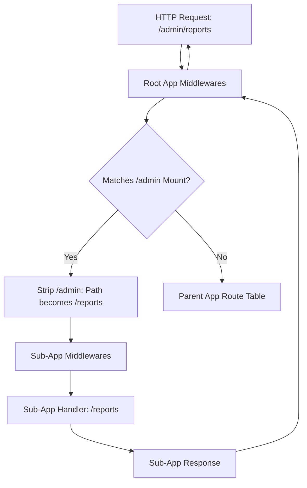

# FastAPI Sub-Applications & Mounting

While `app.include_router()` integrates modular routes into a single unified routing table and OpenAPI specification, `app.mount()` operates at the lower ASGI protocol boundary. Mounting allows backend architects to embed completely independent FastAPI applications, host legacy WSGI frameworks (like Flask or Django), serve directories of static assets, and run isolated middleware and documentation pipelines under designated URL prefixes.

---

## Conceptual Foundation & Mental Model

Understanding the architectural distinction between **inclusion** and **mounting** is critical:
- **`include_router(router)`**: Merges routes into the parent application. All endpoints share the same OpenAPI documentation (`/docs`), exception handlers, middlewares, and dependency overrides.
- **`mount("/sub", sub_app)`**: Treats `sub_app` as a black-box ASGI callable. Requests matching `/sub` have their URL root shifted and are handed directly to the mounted application. The sub-application maintains its **own independent OpenAPI docs**, middlewares, lifespan events, and exception handlers.

```
                    Root Application: app = FastAPI()
                     (OpenAPI Docs at /docs)
                               │
            ┌──────────────────┴──────────────────┐
            ▼                                     ▼
include_router(users_router)             mount("/admin", admin_app)
- Appended to parent route table         - Completely independent FastAPI app
- Appears in /docs                       - Has own /admin/docs!
- Shares parent middlewares              - Has own isolated middlewares
```

---

## Architecture & Internal Mechanics

When an incoming ASGI HTTP scope matches a mounted path (e.g. `/admin/...`):
1. **Scope Path Shifting**: Starlette modifies `scope["root_path"]` by appending the mount path (e.g. `/admin`) and strips `/admin` from `scope["path"]`.
2. **ASGI Delegation**: The root app directly calls `await sub_app(scope, receive, send)`.
3. **Boundary Isolation**:
   - Exception handlers registered on the root app do **not** catch exceptions raised in the sub-app unless specifically forwarded.
   - Middlewares registered on the sub-app run **only** for requests destined for the sub-app.
   - Middlewares registered on the root app wrap the entire request, executing before the sub-app is entered.



---

## Comprehensive Syntax & Core Mechanics

### 1. Mounting a FastAPI Sub-Application
```python
from fastapi import FastAPI

parent_app = FastAPI(title="Parent Gateway", docs_url="/docs")
sub_app = FastAPI(title="Internal Admin Sub-App", docs_url="/docs")

@sub_app.get("/status")
def admin_status():
    return {"admin": "online"}

# Mounted at /admin
parent_app.mount("/admin", sub_app)
# Parent docs: http://host/docs
# Sub-app docs: http://host/admin/docs
# Sub-app endpoint: http://host/admin/status
```

### 2. Mounting Static Files
```python
from fastapi import FastAPI
from fastapi.staticfiles import StaticFiles

app = FastAPI()
# Serves files from the local directory "static"
app.mount("/static", StaticFiles(directory="static"), name="static")
```

### 3. Mounting Legacy WSGI Applications (Flask / Django)
```python
from fastapi import FastAPI
from fastapi.middleware.wsgi import WSGIMiddleware
from flask import Flask

flask_app = Flask(__name__)

@flask_app.route("/legacy")
def legacy_flask():
    return "Hello from legacy Flask inside FastAPI!"

app = FastAPI()
app.mount("/flask", WSGIMiddleware(flask_app))
```

---

## Practical Implementation (5 Complete Examples)

### Example 1: Segregated Admin Portal with Dedicated Authentication
```python
from fastapi import FastAPI, Depends, HTTPException, status
from fastapi.security import HTTPBasic, HTTPBasicCredentials
import secrets

# Sub-application for Admin portal
admin_app = FastAPI(title="Secure Backoffice", docs_url="/docs")
security = HTTPBasic()

def require_admin_credentials(credentials: HTTPBasicCredentials = Depends(security)):
    is_user_ok = secrets.compare_digest(credentials.username, "superadmin")
    is_pass_ok = secrets.compare_digest(credentials.password, "correct-horse-battery")
    if not (is_user_ok and is_pass_ok):
        raise HTTPException(
            status_code=status.HTTP_401_UNAUTHORIZED,
            detail="Incorrect admin credentials",
            headers={"WWW-Authenticate": "Basic"},
        )
    return credentials.username

@admin_app.get("/dashboard")
async def admin_dashboard(user: str = Depends(require_admin_credentials)):
    return {"message": f"Welcome, {user}. System healthy."}

# Parent public application
root_app = FastAPI(title="Public Customer API")

@root_app.get("/items")
async def list_public_items():
    return ["item_1", "item_2"]

# Mount sub-app: accessible at /backoffice/dashboard and /backoffice/docs
root_app.mount("/backoffice", admin_app)
```

### Example 2: Mounting Static Assets with Directory Browsing Control
```python
from fastapi import FastAPI
from fastapi.staticfiles import StaticFiles
import os

app = FastAPI()

# Ensure public asset directory exists
os.makedirs("public_assets", exist_ok=True)
with open("public_assets/robots.txt", "w") as f:
    f.write("User-agent: *\nDisallow: /admin\n")

# html=True enables serving index.html automatically on directory requests
app.mount(
    "/assets",
    StaticFiles(directory="public_assets", html=True),
    name="assets"
)
```

### Example 3: Multi-Team Independent Lifespans in Sub-Apps
```python
from contextlib import asynccontextmanager
from fastapi import FastAPI

@asynccontextmanager
async def billing_lifespan(app: FastAPI):
    print("[BILLING] Connecting to Stripe Webhook worker...")
    yield
    print("[BILLING] Closing Stripe connection.")

billing_sub_app = FastAPI(title="Billing Domain", lifespan=billing_lifespan)

@billing_sub_app.get("/invoices")
def list_invoices():
    return ["inv_01", "inv_02"]

root_app = FastAPI(title="Enterprise API Gateway")
root_app.mount("/billing", billing_sub_app)
```

### Example 4: Strangler Fig Pattern (Migrating Legacy Flask to FastAPI)
```python
from fastapi import FastAPI
from fastapi.middleware.wsgi import WSGIMiddleware
from flask import Flask as LegacyFlask

# Step 1: Legacy Flask app handling 50 legacy routes
flask_service = LegacyFlask("legacy_service")

@flask_service.route("/user-reports")
def old_report():
    return {"framework": "Flask", "report": "legacy_csv"}

# Step 2: Modern FastAPI app handling high-performance new routes
fastapi_app = FastAPI(title="Modern Cloud Gateway")

@fastapi_app.get("/v2/fast-analytics")
async def fast_analytics():
    return {"framework": "FastAPI", "latency": "1.2ms"}

# Step 3: Mount Flask inside FastAPI. Old endpoints remain functional at /legacy/...
fastapi_app.mount("/legacy", WSGIMiddleware(flask_service))
```

### Example 5: Testing Mounted Sub-Applications with `TestClient`
```python
from fastapi import FastAPI
from fastapi.testclient import TestClient

sub_app = FastAPI()
@sub_app.get("/ping")
def ping_sub():
    return {"message": "sub_pong"}

main_app = FastAPI()
main_app.mount("/service", sub_app)

def test_mounted_app():
    client = TestClient(main_app)
    # Full mounted path
    response = client.get("/service/ping")
    assert response.status_code == 200
    assert response.json() == {"message": "sub_pong"}

    # Sub-app can also be tested in complete isolation!
    isolated_client = TestClient(sub_app)
    isolated_response = isolated_client.get("/ping")
    assert isolated_response.status_code == 200
```

---

## Anti-Patterns & Common Traps

| Anti-Pattern | Why It Breaks / Fails | Production Solution |
| :--- | :--- | :--- |
| **Using `mount()` instead of `include_router()` for simple route grouping** | Fractures OpenAPI documentation into multiple disconnected `/docs` portals and breaks global exception handling. | Use `include_router()` for modular routes; use `mount()` only when total ASGI isolation is required. |
| **Attempting to override sub-app dependencies using `parent_app.dependency_overrides`** | Sub-apps have their own dependency solve state; parent overrides do not cascade into mounted apps. | Set overrides directly on `sub_app.dependency_overrides`. |
| **Mounting StaticFiles without directory existence check** | Crashes on application startup with `RuntimeError: Directory '...' does not exist`. | Verify and create directory using `os.makedirs(..., exist_ok=True)` before mounting. |
| **Expecting parent exception handlers to catch sub-app errors** | Mounted sub-apps handle their own ASGI exceptions internally; parent handlers are bypassed. | Register custom exception handlers on the `sub_app` directly. |

---

## Performance & Resource Characteristics

- **ASGI Dispatch Overhead**: Sub-apps add a negligible single ASGI function call frame overhead (< 1 microsecond).
- **WSGIMiddleware Execution**: WSGI is synchronous; `WSGIMiddleware` offloads every Flask/Django request to an AnyIO worker thread, consuming thread pool resources.
- **Static File Streaming**: `StaticFiles` supports HTTP `Range` requests and `ETag` conditional headers natively, enabling efficient media and file streaming.

---

## Edge Cases, Failure Modes & Gotchas

1. **Root Path Redirection**: Requesting `/admin` (without trailing slash) when mounted at `/admin` triggers a 307 redirect to `/admin/` depending on sub-app route definitions.
2. **Reverse Proxy URL Generation**: When running behind Nginx or Kubernetes Ingress, ensure the proxy forwards `X-Forwarded-Prefix: /admin` so the sub-app generates valid Swagger UI asset links.
3. **CORS Isolation**: CORS middleware applied to `sub_app` does not protect parent endpoints, and parent CORS middleware might not catch preflight `OPTIONS` if the mount pattern intercepts the path early.

---

## Security Implications & OWASP Alignment

- **Perimeter Defense-in-Depth**: Sensitive administrative sub-apps (`/admin`, `/internal`) can be mounted with strict HTTP Basic auth or mTLS middlewares without complicating the customer-facing public API.
- **OWASP API9:2023 - Improper Inventory Management**: Keep mounted documentation endpoints (`/admin/docs`) protected or disabled in production (`docs_url=None`) to avoid exposing internal infrastructure.

---

## Modern Tooling Integration

- **Uvicorn**: Dispatches incoming sockets seamlessly across mounted ASGI and WSGI trees.
- **WhiteNoise / StaticFiles**: Efficient static asset caching headers (`Cache-Control: public, max-age=31536000`).

---

## Real-World Case Study / Production Incident

An enterprise retail system had an unauthenticated admin dashboard because developers applied global JWT authentication to the parent `FastAPI` instance:
`app = FastAPI(dependencies=[Depends(verify_jwt)])`
They then mounted an internal metrics sub-application:
`app.mount("/metrics-ui", metrics_sub_app)`

**Incident**:
An external penetration test discovered that `/metrics-ui` was accessible anonymously. The developers did not realize that parent `FastAPI(dependencies=[...])` **do not apply to mounted sub-apps**.

**Remediation**:
Applied the security dependency directly to the sub-app:
```python
metrics_sub_app = FastAPI(dependencies=[Depends(verify_jwt)])
```
Audit tests were implemented to verify authentication across all mounted roots.

---

## Hands-On Exercises & Challenge Problems

### Warmup (2 Exercises)
1. Mount a `StaticFiles` app serving a temporary folder with an `index.html` file and access it via `TestClient`.
2. Mount a sub-app at `/v2` and verify that the sub-app's Swagger UI is accessible at `/v2/docs`.

### Intermediate (2 Exercises)
3. Build a parent application and a mounted sub-application; demonstrate that an exception handler registered on the parent does not catch exceptions in the sub-app, and resolve it.
4. Mount a simple Flask application inside FastAPI using `WSGIMiddleware` and verify both FastAPI and Flask endpoints return valid responses.

### Production-Grade (2 Exercises)
5. Implement the Strangler Fig architectural pattern: wrap a legacy monolithic WSGI application with FastAPI, migrating 3 endpoints to native async FastAPI while proxying all remaining traffic to the legacy WSGI app.
6. Design an enterprise multi-portal system with three mounted sub-apps (`/customer`, `/partner`, `/admin`), each having its own isolated authentication dependency, rate limiter, and OpenAPI specification.

---

## Interview Mastery (8 Q&As)

### Junior Level
**Q1: What is the difference between `app.include_router()` and `app.mount()` in FastAPI?**
*Answer:* `include_router()` adds routes into the parent application's routing table (sharing the same OpenAPI docs, middlewares, and exception handlers). `mount()` embeds an independent ASGI/WSGI application under a path prefix (with its own isolated docs, middlewares, and routing logic).

**Q2: How do you serve static CSS and JavaScript files in FastAPI?**
*Answer:* Using Starlette's `StaticFiles`:
```python
app.mount("/static", StaticFiles(directory="static"), name="static")
```

**Q3: Can a mounted sub-app have its own `/docs` page?**
*Answer:* Yes. If mounted at `/admin`, the sub-app's documentation is served at `/admin/docs`, completely independent of the parent app's `/docs`.

### Senior Level
**Q4: Do dependencies declared on `FastAPI(dependencies=[...])` apply to mounted sub-apps?**
*Answer:* No. Mounted sub-applications are completely isolated ASGI applications. Parent global dependencies and router dependencies do not cascade into mounted sub-apps.

**Q5: How does `WSGIMiddleware` allow Flask or Django to run inside FastAPI?**
*Answer:* `WSGIMiddleware` adapts the synchronous WSGI interface to the asynchronous ASGI interface by executing the WSGI application inside an AnyIO worker thread for each incoming request.

**Q6: How do you test a mounted sub-application using `TestClient`?**
*Answer:* You can pass the parent application to `TestClient(parent_app)` and request the full mounted path (`/sub/endpoint`), or pass the sub-app directly `TestClient(sub_app)` to test it in total isolation.

### Staff / Architect Level
**Q7: When should an architect choose mounted sub-applications over modular `APIRouter`s?**
*Answer:* Choose `mount()` when:
1. Embedding legacy WSGI apps (Flask, Django) during incremental migrations (Strangler Fig pattern).
2. Serving static assets or single-page apps (SPAs).
3. Teams require completely distinct OpenAPI specifications (e.g., Public API docs vs Internal Admin docs).
4. Sub-domains require isolated, conflicting middleware stacks (e.g. distinct CORS policies or custom session handlers).

**Q8: What happens to ASGI `scope["root_path"]` and `scope["path"]` during request dispatch into a mounted sub-application?**
*Answer:* Starlette adjusts the ASGI scope: the mount prefix (e.g. `/admin`) is appended to `scope["root_path"]` and stripped from the beginning of `scope["path"]`. This ensures the sub-app evaluates routes relative to its own root (e.g. `/dashboard` instead of `/admin/dashboard`), allowing sub-apps to be mounted anywhere without modifying internal route definitions.
